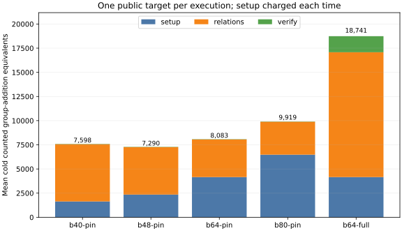

# Target-pinned relation collection: frozen sweep

Session: `ECBS1hdabf729ffad4`, spec `ECS1h34e0f3b9fd0f`, current-source
ecbench binary SHA-256 `c5d2539d4d50976741982f32bc444d4b4e625a3a239bd9910f30606c3ccddb57`.
The exact [spec](../../specs/prime20-pinned-sweep.json),
[session](../../sessions/prime20-pinned-sweep-20261013/) and
[full replay receipt](../../replay-all-sweep.json) are retained. Audit receipt
SHA-256: `1a24f267ecec04dd337c2c64f603273f8a48e4058ab4c2a67d84d991c2e04dd1`.

The curve is registered `icv1-fp20-t727-cd198a38`, order 562427. The panel
contains eight fresh public targets, three measured rounds and one warmup.
All 256 executions verified the recovered scalar by exact point replay;
all 192 measured executions replayed identically in the audit. Every arm
earned L0 on a shared macOS host. The graph uses measured cold counted
group-addition equivalents (GAE), with table setup charged per target.

| arm | mean cold GAE | mean trials | mean relations | mean setup GAE | mean relation GAE |
|:--|--:|--:|--:|--:|--:|
| B64 checked full rank | 18,740.917 | 11,042.958 | 159.292 | 4,160 | 12,918.917 |
| B40 target pin | 7,597.708 | 4,381.750 | 24.792 | 1,640 | 5,930.708 |
| B48 target pin | 7,290.083 | 3,501.167 | 28.583 | 2,352 | 4,911.083 |
| B64 target pin | 8,082.625 | 2,677.375 | 37.375 | 4,160 | 3,895.625 |
| B80 target pin | 9,919.125 | 2,250.000 | 49.792 | 6,480 | 3,412.125 |
| B64 subtraction target pin | 342,765.167 | 2,677.375 | 37.375 | 0 | 342,738.167 |
| negation rho | 1,013.042 | — | — | — | — |

The paired B64 target-pin / checked-full-rank counted ratio is 0.4313
(95% target-cluster interval 0.3987–0.4701). B48 / B64 target pin is
0.9019 (0.8591–0.9488), and B48 / B40 is 0.9595 (0.8853–1.0343).
B48 had the lowest mean in this sweep, so it was frozen for an independent
holdout alongside B40, B64 and matched rho. The current-binary B64
subtraction arm verified in all 24 measured executions; its paired ratio
to the B64 table arm is 42.4077 (39.2612–45.1413) in counted GAE.

These ratios are diagnostics: square roots, Legendre symbols, lookups, row
operations and native prime work are not fully priced in `ecbench.gae`.
All wall readings are L0 descriptions. The best measured IC arm is 7.1962
times matched rho in this lower-bound count; this one field size establishes
no scaling result.

The figure source is [plot_counts.py](../../plot_counts.py); its exact input
is the session's `records.jsonl`. [summary.json](summary.json) contains the
plotted means. The SVG, 150-dpi PNG and PDF are retained together.
