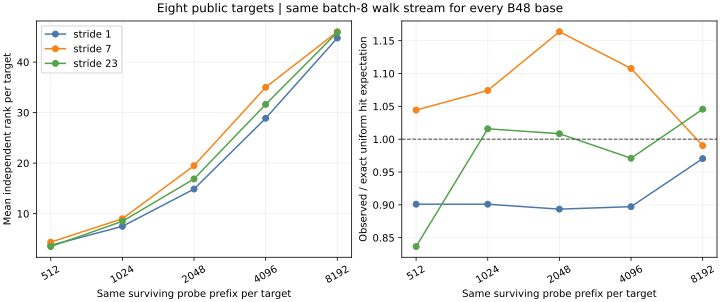

# Equal-prefix coverage control: fresh public targets

The [protocol](FRESH_PREFIX_PROTOCOL.md) and [workload](specs/fixed-prefix-fresh.json) froze the target seed and primary comparison before target generation. The [input checker](fixed-prefix-fresh-input-check.json) binds eight new public targets and algorithm seeds, with no overlap against the earlier coverage holdout. The [raw log](fixed-prefix-fresh.log.gz), [machine receipt](fixed-prefix-fresh-result.json), [derived summary](fixed-prefix-fresh.json), and [chart](fixed-prefix-fresh.svg) retain the exact source commit and test-binary hash. The test passed: each target supplied at least 8,192 surviving batch-8 walk points within the 20,000-attempt cap, and every B48 base consumed the same point prefix.

After merging the existing PR branch and current main, the [post-merge replay receipt](fixed-prefix-postmerge-replay.json) and [raw log](fixed-prefix-postmerge-replay.log.gz) reproduced the complete fresh-panel JSON result exactly with a new test binary. The original run record remains unchanged.

| x stride | Unique pair keys | Hits at 4,096 probes × 8 | Mean independent rank at 4,096 | Rank per 1,000 lower-bound cold GAE at 4,096 | Mean rank at 8,192 |
| ---: | ---: | ---: | ---: | ---: | ---: |
| 1 | 2,286 | 239 | 28.875 | 3.434 | 44.750 |
| 7 | 2,301 | 297 | 35.000 | 4.159 | 46.000 |
| 23 | 2,298 | 260 | 31.625 | 3.760 | 45.875 |

At the *predeclared* 4,096-probe milestone, stride 23 minus stride 1 yielded 2.750 additional independent rows per target. The paired eight-target bootstrap interval is 1.000–4.625 rows. The corresponding rank-per-lower-bound-cold-GAE ratio is 1.095 (interval 1.032–1.176). Both intervals favor stride 23 under the frozen inference rule, so this confirms a bounded early-prefix collection effect on this registered 20-bit curve and these eight fresh targets. Its magnitude is smaller than the [exploratory panel's](FIXED_PREFIX_INITIAL.md) 7.125-row difference and 1.236 ratio. Stride 7, a prespecified control, had 6.125 additional rows (3.000–10.250) at 4,096; no base was selected on this fresh panel.

At 8,192 probes, stride 23 minus stride 1 was 1.125 rows per target (0.000–2.250), and its rank-per-GAE ratio was 1.025 (1.000–1.051 after rounding; the exact lower endpoint is 0.999687). That secondary comparison does not resolve a persistent efficiency gain. Table-hit observed/uniform ratios at 4,096 probes were 0.897, 1.108 and 0.971 for strides 1, 7 and 23. Exact independent-uniform probabilities are reconstructed from each table's unique pair keys; walk probes themselves are correlated.

These are component counts with a cold counted GAE *lower bound*. The receipt counts group-law field inversions only; native factor-base, coordinate, hash and matrix work are not fully priced. The equal prefix eliminates unequal probe budgets in the earlier target-pinned coverage panels, but it does not measure a complete target solve or isolated wall time. The next gate is to serialize and price native operations in ecbench, then run the frozen L2 matched-target panel and independent-host replay. The [calibration problem](../../problems/rootfinding-complete-cost-calibration.md) tracks those requirements.
