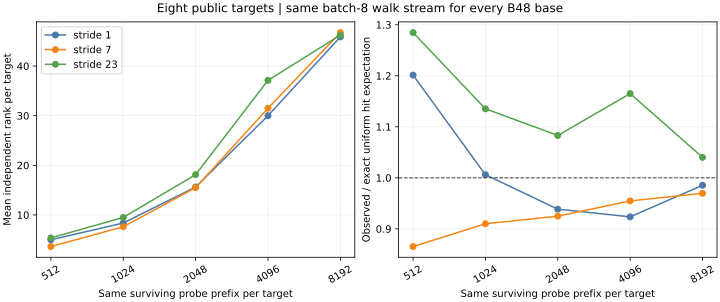

# Equal-prefix coverage control: initial public-target panel

The [frozen addendum](FIXED_PREFIX_PROTOCOL.md) and [constructor correction](FIXED_PREFIX_CORRECTION.md) precede this successful run. The [first failed log](fixed-prefix-initial-failure.log.gz) remains separate. The corrected [raw log](fixed-prefix-corrected.log.gz), [machine receipt](fixed-prefix-result.json), [derived summary](fixed-prefix-initial.json), and [chart](fixed-prefix-initial.svg) bind the exact test binary and source commit. The test passed with eight public targets, 20,000 attempted points per target, and an identical batch-8 stream of 8,192 surviving probes per B48 base and target.

| x stride | Unique pair keys | Hits at 4,096 probes × 8 | Mean rank at 4,096 | Hits at 8,192 probes × 8 | Mean rank at 8,192 | Rank per 1,000 lower-bound cold GAE at 4,096 |
| ---: | ---: | ---: | ---: | ---: | ---: | ---: |
| 1 | 2,286 | 246 | 30.000 | 525 | 45.875 | 3.543 |
| 7 | 2,301 | 256 | 31.500 | 520 | 46.750 | 3.719 |
| 23 | 2,298 | 312 | 37.125 | 557 | 46.250 | 4.380 |

At the declared 4,096-point milestone, stride 23 minus stride 1 is 7.125 independent rows per target (paired eight-target bootstrap interval 1.75–11.875); rank per cold counted GAE is 1.236 times the ordinary base (interval 1.054–1.447). At 8,192 probes, the rank difference is 0.375 (interval −1.125–1.625) and the rank-per-GAE ratio is 1.008 (0.976–1.036). The table occupancies differ by less than 0.7%; the early row difference is a signal about this fixed stream, not an established base-family advantage.

This panel reused targets from the earlier target-pinned coverage holdout, and the 4,096 milestone was inspected among five declared prefixes. Its intervals are descriptive without a multiple-look correction. The walk points are correlated. The field-inversion numbers in the machine receipt cover *group-law operations only*, and the cold counted GAE omits native factor-base and matrix costs. The next discriminating check is a new seed with eight fresh public targets, a predeclared primary comparison at 4,096 surviving probes, and the same stride-7 control. Neither panel establishes a qualified whole-solve wall result.
