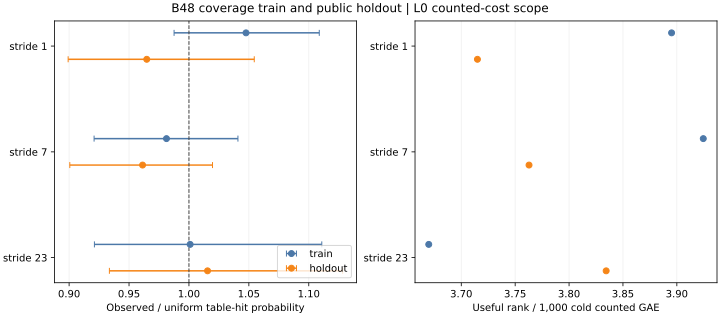

# Rootfinding relation-collection follow-up

This study executes the four frozen actions in [PROTOCOL.md](PROTOCOL.md) on the registered 20-bit prime subgroup (`r = 562427`): synchronized 4/8/16-lane collection, a component profile, a B train/holdout sweep, and a fixed-base coverage control. It is a small-curve engineering and relation-yield result. The release binary SHA-256 is `b24171038803d4873d63dbdf5b5c95d5958b0549a7c40266f559fb3331405105`. The five sessions bind their own source commit, host capsule, public targets, spec, raw records and binary hash. All were run on the shared macOS host with L0 isolation.

## Sealed executions

| Panel | Session | Records verified | Measured replays identical | Report |
| --- | --- | ---: | ---: | --- |
| Lane width | [ECBS1hdb2c745b39ed](sessions/lanes-local-20261013/) | 256/256 | 192/192 | [PDF](reports/run-20261014T0647Z-ECBS1hdb2c745b39ed/REPORT.pdf) |
| B train | [ECBS1hbdfb5bc7d8a8](sessions/retune-train-local-20261013/) | 256/256 | 192/192 | [PDF](reports/run-20261014T0654Z-ECBS1hbdfb5bc7d8a8/REPORT.pdf) |
| B holdout | [ECBS1hadb0689b12a0](sessions/retune-holdout-local-20261013/) | 256/256 | 192/192 | [PDF](reports/run-20261014T0657Z-ECBS1hadb0689b12a0/REPORT.pdf) |
| Coverage train | [ECBS1hb4afb33dbfd5](sessions/coverage-train-local-20261013/) | 160/160 | 120/120 | [PDF](reports/run-20261014T0700Z-ECBS1hb4afb33dbfd5/REPORT.pdf) |
| Coverage holdout | [ECBS1h1b585c89ebd1](sessions/coverage-holdout-local-20261013/) | 160/160 | 120/120 | [PDF](reports/run-20261014T0703Z-ECBS1h1b585c89ebd1/REPORT.pdf) |

The five audit receipts—[lanes](lanes-replay-all.json), [B train](retune-train-replay-all.json), [B holdout](retune-holdout-replay-all.json), [coverage train](coverage-train-replay-all.json), and [coverage holdout](coverage-holdout-replay-all.json)—have `ok: true`, no problems, and 816/816 identical measured replays in total. Every one of the 1,088 planned executions completed with a verified scalar. All target points are public and independently checked by ecbench. The earlier native-walk session was also re-audited by this binary in [prior-native-replay.json](prior-native-replay.json). Source provenance for the lane session is commit `84373b34c481c3dbd7b9bc067983f7241df247e0`; later study-only commits did not change the release binary.

## 1. Synchronized lane collector

The collector now supports serial and batch-inversion schedules at widths 4, 8 and 16. The [final focused test](final-lane-test.log.gz) checks each point and its two coefficients over 2,048 probes per width, including restarts; the [sealed pair check](lanes-pair-check.json) finds 24/24 exact serial/batch pairs at each width in targets tried, relations, rank, answer, counted GAE and lane counters. Each matched pair has a counted GAE ratio of exactly 1. The [rho comparison](sessions/lanes-local-20261013/comparisons/rho-neg__b48-batch-8.json) puts batch-8 at 7.463 times rho's cold counted GAE on these targets (95% target-cluster interval 5.817–9.626); this is a lower-bound comparison with unpriced native operations, not an end-to-end performance ratio.

The batched group law reduces field inversions in the focused source-level test. The sealed ecbench record currently omits `GroupOps.field_ops`, however, so it does not contain a measured inversion count for the lane arms. The [pair checker](check_lane_pairs.py) marks that field unavailable instead of inferring zero or silently declaring an inversion result. Prepared but unused tail lanes and lane-state memory floor are present in the relations phase's native counters.

## 2. Probe costs

The [local ignored profile](profile-local.json), with its [raw log](prime-lane-profile.log.gz), ran 200,000 microloop samples per component: inversion 79.51 ns, coordinate round trip 4.22 ns, jump selection 1.28 ns, table lookup 3.70 ns, guard insertion 3.80 ns, and 256 restart-pool draws at 5,143.88 ns each. These loops have different cache behavior from a full collector and ran without host isolation. They are only a diagnostic breakdown; they cannot explain the prior native/generic whole-solve wall ratio of 1.3898 or qualify a wall gain. The isolated L2 profile in [lanes-l2.json](specs/lanes-l2.json) remains unrun: the [access check](l2-access-check.json) found no configured isolab URL or CLI and both SSH aliases refused connections.

## 3. B retune

The [train selection](retune-selection.json) was committed before the holdout ran: B48 had the lowest mean cold counted GAE, 7,957.42, among B40/44/48/52/56/64. The independent holdout put B56 at 8,151.71 and the selected B48 at 8,328.29. Its [paired B56/B48 comparison](sessions/retune-holdout-local-20261013/comparisons/b48-batch-8__b56-batch-8.json) is 0.979 (95% target-cluster interval 0.919–1.038). Thus the train ordering was not stable enough to establish a B optimum. The costs include counted cold setup, relation work and verification, but remain lower bounds because factor-base field work, native field operations, lookups and row work are unpriced. Peak process RSS in these arms was about 31 MiB.

## 4. Relation coverage

The [factor-base dumps](controls/) fix three target-independent B48 bases at x strides 1, 7 and 23. [coverage_null.py](coverage_null.py) reconstructs the unique negation-folded pair-table x keys from those exported points and verifies their curve equation. Their exact independent uniform-subgroup hit probabilities are `2K/(r-1)`: 0.8129%, 0.8182% and 0.8172%, respectively. The train/holdout [occupancy records](coverage-train-null.json) [and](coverage-holdout-null.json) and [derived rank/cost table](coverage-efficiency.json) retain probes, relations, useful rank, counted cold cost and peak RSS.

| Base | Train observed/uniform (95% target-cluster interval) | Holdout observed/uniform (95% target-cluster interval) | Holdout mean cold GAE |
| --- | ---: | ---: | ---: |
| stride 1 | 1.048 (0.988–1.109) | 0.965 (0.899–1.055) | 8,097.83 |
| stride 7 | 0.981 (0.921–1.041) | 0.961 (0.901–1.020) | 8,238.42 |
| stride 23 | 1.001 (0.921–1.111) | 1.016 (0.934–1.128) | 7,802.13 |

The observed hit rates show no resolved departure from uniform occupancy in these target-pinned sessions. Stride 23 used fewer mean counted GAE than stride 1 in both panels, but its [holdout paired ratio](sessions/coverage-holdout-local-20261013/comparisons/b48-stride-1__b48-stride-23.json) is 0.963 with interval 0.841–1.114. Walk probes are correlated and the collector stops at the target pin, so the sessions do not give equal fixed probe budgets. The target-cluster intervals are descriptive, and no claim of universal unbiased coverage or an improved full solve follows.

### Equal-prefix follow-up

An [exploratory control](FIXED_PREFIX_INITIAL.md) reused the earlier holdout targets and found an early stride-23 rank surplus, which shrank by 8,192 probes. A [fresh-target protocol](FRESH_PREFIX_PROTOCOL.md) then froze a new target seed and the 4,096-probe comparison before generating targets. Its [eight-target control](FIXED_PREFIX_FRESH.md), [raw receipt](fixed-prefix-fresh-result.json), and [derived summary](fixed-prefix-fresh.json) use the identical first 8,192 surviving batch-8 walk points for all three B48 bases. At 4,096 probes, stride 23 minus stride 1 was 2.750 independent rows per target (paired bootstrap interval 1.000–4.625); rank per lower-bound cold counted GAE was 1.095 times (1.032–1.176). The predeclared bounded early-prefix criterion passed, at a smaller magnitude than in the exploratory panel. At 8,192, the rank-per-GAE interval touched parity. These equal-prefix component results do not fill the sealed native-cost, full-solve or isolated-wall gates.

## Remaining measurement gates

The next source change must serialize the native field-operation counters into sealed ecbench records and price remaining native costs in a common unit. An L2 isolated run of the frozen lane specification with A/A noise, followed by independent-host replay, is still required for a qualified wall comparison. [The open calibration problem](../../problems/rootfinding-complete-cost-calibration.md) tracks these exact gates. No P-192 through P-521 result is inferred from this registered 20-bit subgroup.
