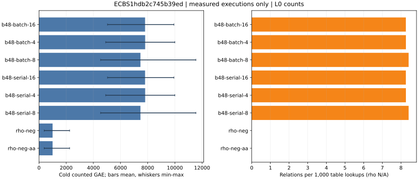

# Prime rootfinding synchronized lane batch inversion

Session `ECBS1hdb2c745b39ed`, binary `b24171038803d4873d63dbdf5b5c95d5958b0549a7c40266f559fb3331405105`; 256/256 records.

L0 counted operations and relation yield. Native field operation counts are absent from this record. All wall time is descriptive.

Raw records: [lanes-local-20261013](../../sessions/lanes-local-20261013/records.jsonl).
