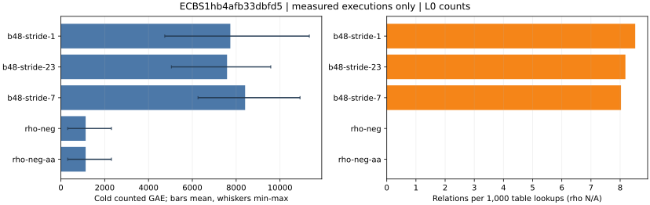

# Prime rootfinding fixed-stride coverage train

Session `ECBS1hb4afb33dbfd5`, binary `b24171038803d4873d63dbdf5b5c95d5958b0549a7c40266f559fb3331405105`; 160/160 records.

L0 counted operations and relation yield. Native field operation counts are absent from this record. All wall time is descriptive.

Raw records: [coverage-train-local-20261013](../../sessions/coverage-train-local-20261013/records.jsonl).
