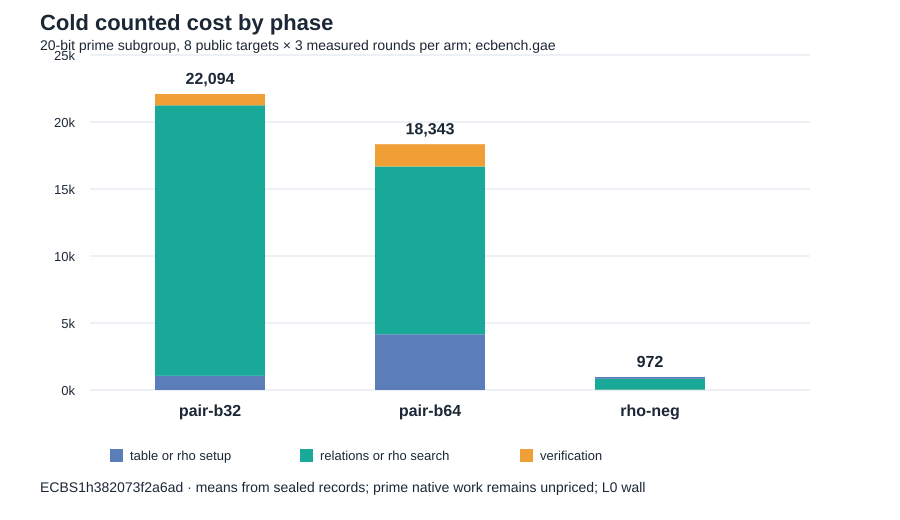

# Root-finding pair-table size: prime 20-bit cohort

Status: measured and locally replayed. This is a parameter optimization of the
two-summand pair-table strategy, measured in ecbench's counted group-addition
equivalents (GAE). It does not establish a complete-cost or wall-time speedup.

## Frozen question and evidence

The [protocol](PROTOCOL.md) and [spec](specs/prime20-b32-vs-b64.json) were
committed at `2273c71ee1d3adddf47d4e6a2d75f06669d43739` before running.
The spec SHA-256 is `736c294e086b04818c1eb2688d94c7256e91f86c48e855d0189134190bde2594`.
The existing release binary SHA-256 is
`be956553a5a2cd1227e8f1add8dd24e11dffba5068c799234b55e44ffc3a1b61`.
The only IC configuration difference is `prime-abscissa:size=32` versus
`size=64`; both use `mitm:m=2,negation_folded=1`, checked full-rank linear
algebra and the same eight new public targets and algorithm seeds. The curve
is `icv1-fp20-t727-cd198a38`, prime subgroup order `562427`.

The sealed [session](sessions/prime20-b32-vs-b64/) is
`ECBS1h382073f2a6ad`, macOS arm64, 14 logical CPUs, environment class
`ECBENV2hd82681268e96`. The runner used `--cpus none --allow-busy`, so all
timings are L0. It recorded 128/128 verified executions (including warmups),
with 24 measured executions per arm. The [full replay](replay-all.json)
reports 128 verified, 96 identical measured replays and zero problems.

| Arm | Base points / columns | Verified measured | Mean total GAE | Mean S = GAE / sqrt(r) | Mean relation trials | Table setup / relations / verification mean GAE |
| --- | ---: | ---: | ---: | ---: | ---: | ---: |
| rho.negation | — | 24/24 | 971.917 | 1.296 | — | 140 setup / 806 search / 25 verification |
| pair table, B=32 | 64 / 32 | 24/24 | 22,094.250 | 29.461 | 18,394.292 | 1,056 / 20,190 / 848.250 |
| pair table, B=64 | 128 / 64 | 24/24 | 18,343.208 | 24.459 | 10,641.250 | 4,160 / 12,522.958 / 1,660.250 |

The [paired comparison](sessions/prime20-b32-vs-b64/comparisons/pair-b32__pair-b64.json)
gives **B64/B32 = 0.830225** in counted GAE (95% workload-cluster interval
0.697026–0.961546; 24 pairs, eight target clusters), equivalently
**B32/B64 = 1.204492** on this counted metric. Six of the eight target
means favored B64; two favored B32. The changed base size changes both
relation yield and the rank problem, so this is a configuration comparison,
not a same-factor-base kernel timing. The [matched rho comparison](sessions/prime20-b32-vs-b64/comparisons/rho-neg__pair-b64.json)
places B64 at 18.873 times rho's counted GAE on these targets (cluster
interval 15.451–24.374). The [rho A/A](sessions/prime20-b32-vs-b64/comparisons/rho-neg__rho-neg-aa.json)
is exactly 1.000 in counted operations.



The graph is generated from the [phase summary](summary.json) by
[`render_chart.mjs`](render_chart.mjs). The [run report](reports/run-20261013T1630Z/report.pdf)
and [results PDF](report.pdf) contain the same labeled visual.

## Accounting and limits

The table charges pair-table construction for each cold target. At B64 it
adds 3,104 setup GAE and 812 verification GAE on average while saving
7,667 relation GAE relative to B32, yielding 3,751 net counted GAE less.
The largest whole-process RSS observed was 31,232 KiB for B32 and 30,800
KiB for B64; those maxima do not isolate pair-table memory and cannot be
used as a table-memory comparison.

Prime factor-base Legendre tests and square roots, target probes, lookups and
matrix row operations remain unpriced in ecbench.gae; the rho arm also omits
native canonicalization. Thus this is a **counted lower-bound comparison**.
All 24 paired wall observations were below the requested L2 level, so the
descriptive median wall quotient is not a runtime result. No new native
implementation, larger-field result, or single-target advantage over matched
rho is established. The earlier source and ecbench assessment remains at
[`../ecbench_rootfinding_assessment_20261012/REPORT.md`](../ecbench_rootfinding_assessment_20261012/REPORT.md).

## Reproduction

```sh
RAYON_NUM_THREADS=1 target/release/ecbench run --wait --allow-busy --cpus none --spec research/ecbench_rootfinding_tuning_20261013/specs/prime20-b32-vs-b64.json --out research/ecbench_rootfinding_tuning_20261013/sessions/prime20-b32-vs-b64
target/release/ecbench verify --dir research/ecbench_rootfinding_tuning_20261013/sessions/prime20-b32-vs-b64 --replay-all --out research/ecbench_rootfinding_tuning_20261013/replay-all.json --exit-code
target/release/ecbench compare --dir research/ecbench_rootfinding_tuning_20261013/sessions/prime20-b32-vs-b64 --a pair-b32 --b pair-b64 --save --json
jq -s -f research/ecbench_rootfinding_assessment_20261012/analysis.jq research/ecbench_rootfinding_tuning_20261013/sessions/prime20-b32-vs-b64/records.jsonl > research/ecbench_rootfinding_tuning_20261013/summary.json
node research/ecbench_rootfinding_tuning_20261013/render_chart.mjs
```

The frozen protocol said `ecbench audit`; the binary used for this run exposes
the same replay operation as `ecbench verify`. The command above is the actual
one. No canonical frontier graph was changed: this L0 local session has
unpriced native work and no independent-host replay. The [validation record](VALIDATION.md)
retains the full-suite failures and the passing focused reruns; it does not
represent the full suite as clean.
