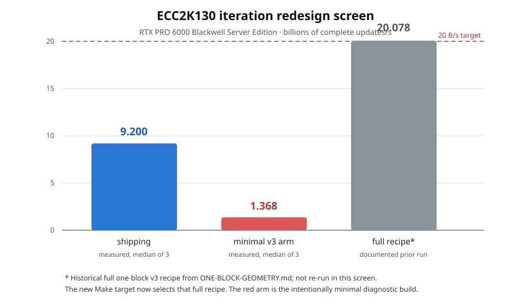

# ECC2K130 major iteration-function redesign: RunPod screen

Run date: 2026-10-12. This report records implementation and GPU-screen
evidence for the opt-in table-walk redesign. It does not promote the redesign
to the live DP32 campaign.

## Result in one sentence

The redesign entry point is now wired to the repository's full tuned v3 RTX
PRO 6000 recipe, but the matched RunPod screen used the deliberately minimal
table-walk arm and measured only **1.367780 B/s** median versus **9.200478 B/s**
for shipping on the same GPU. The candidate passed the arithmetic and 300/300
reference-replay gates, but its 128-register / 400-local-byte frame is a
compiler/resource regression. The existing full one-block recipe's historical
20.078 B/s result remains separate evidence and still needs a fresh run from
the committed redesign target.



## What changed

`ecc2k130/Makefile` now exposes `gpu-rtx-pro6000-iteration-redesign`. It
selects the existing `PRO6000_20B_KNOBS` recipe, rather than creating a second
partially tuned recipe. The target remains opt-in and explicitly uses a
separate v3 table-walk/corpus identity; it is not a DP32 worker default.

The selected recipe includes B16/T512/one-block geometry, byte pivoting, tag
rebuilt denominators, pipelined and split selection, batch and block hint
reconvergence, `CYCLE_FAST2`, inline polynomial products, `FROM_REDUCED`, L2
persistence, the shared square table, and the v3 inversion setting. The
recipe is documented in `ecc2k130/ONE-BLOCK-GEOMETRY.md` and
`ecc2k130/CYCLE-ESCAPE-V3.md`.

`ecc2k130/benchmarks/iteration-redesign/gpujob.sh` is the matched screen
harness. It derives the CUDA architecture from `nvidia-smi`, records the host
receipt and source hashes, runs the device table probe, verifies both arms
against 300 host-reference reports, and only then times three 32-launch
samples per arm. `VERIFY_DP_CAP=262144` was added after the first valid full
SKU run overflowed its 65536-record default.

## Run inputs and controls

- GPU: RunPod `NVIDIA RTX PRO 6000 Blackwell Server Edition`, 188 SMs, 96 GB,
  driver 595.91.07, CUDA toolkit 13.3.73, compute capability 12.0.
- Source revision: `779a4044e73148758302ff1c997654b25f53d4f3`, with the target
  and harness uncommitted at launch.
- Job: `benchmarks/iteration-redesign/gpujob.sh`.
- Verification: `--curve 131 --packed --dp-weight 50 --dp-cap 262144
  --steps 16 --launches 6 --verify 300 --run-id 35 --dp-file ...`.
- Timing: `--curve 131 --packed --bench --steps 1024 --launches 32`;
  automatic worker count; three repeats per arm; no DP reporting in the timed
  invocation.
- Arms: shipping `WITNESS=1 WALK_TABLE=0`; minimal redesign `WITNESS=0
  WALK_TABLE=1 TABLE_PIVOT_BYTES=1`, otherwise the same B16/T256/MINBLOCKS=2
  common arithmetic knobs.

The exact textual receipts and logs are under `raw/`. Large DP binaries and
transport archives are intentionally not committed; their SHA-256 values are
preserved in `raw/run5/artifact-files.sha256`.

## Measured observations

| arm | median | range | kernel resources | verification |
|---|---:|---:|---|---|
| shipping | 9.200478 B/s | 9.143414–9.225351 | 104 registers, 0 local bytes/thread, 1,792 shared bytes/block | 300/300, 0 dropped |
| minimal v3 redesign | 1.367780 B/s | 1.366416–1.370203 | 128 registers, 400 local bytes/thread, 48,732 dynamic table bytes/block | 300/300, 0 dropped |

The redesign/shipping ratio is **0.148664** (14.866%). This is an observed
matched-screen ratio, not an end-to-end campaign result. The local frame is the
clear diagnostic: the v3 cold resolver is present in the minimal kernel's live
call graph, so the old table-walk throughput cannot be transferred to this
build merely by enabling `WALK_TABLE=1`.

## Failures and recovery

The first launcher attempt failed before pod creation because the initial
GraphQL escaping shim was invalid. A second attempt allocated a MIG partition
(`run2-receipt.json`) and was aborted and terminated. A third attempt supplied
a RunPod display name instead of the full type ID and was rejected before
allocation. The fourth attempt used the correct full SKU, but both verification
arms overflowed the 65,536 DP buffer (126,368 redesign reports and 126,798
shipping reports); timing was correctly suppressed. The fifth attempt raised
the verification capacity to 262,144 and passed all correctness gates before
timing.

These failures are retained as evidence and are not interpreted as
algorithmic failures.

## Historical context, clearly separated

The repository's prior `ONE-BLOCK-GEOMETRY.md` receipt reports 20.078 B/s
median for the full B16/T512/one-block v3 recipe, with 300/300 replay and
472,776 DPs matching its reference. That is a committed historical
measurement, not a measurement from this screen. The current screen's minimal
arm omitted the full recipe's v3 scheduling and arithmetic knobs, so its
1.367780 B/s result must not be used to characterize the optimized target.
Conversely, the historical 20.078 B/s result must not be treated as fresh
RunPod validation of this new PR state.

The follow-up attempt to launch the same full-SKU job with
`REDESIGN_PIVOT=0` was blocked by the managed executor before any RunPod API
call: the security reviewer classified the source-archive upload and paid
external job as requiring explicit approval for that export destination. No
additional pod was created.

## Local validation

The implementation was checked with:

```text
make -C ecc2k130 test-table-walk-host test-table-v3-replay test-cycle-rule test-cycle-escape
bash -n ecc2k130/benchmarks/iteration-redesign/gpujob.sh
make -n -C ecc2k130 gpu-rtx-pro6000-iteration-redesign
git diff --check
```

The host/device table arithmetic and cycle-rule fixtures are the correctness
gates for the redesign; a CUDA build remains dependent on the GPU toolchain.
All four table layouts passed with zero phase/pivot/sign/tag/addend mismatches;
the v3 replay, cycle-rule, and cycle-escape targets also passed. The replay
build emitted only unused generated-constant warnings.

The repository-wide `cargo test --release --lib` check was attempted but could
not run because this executor has no `cargo` binary; it is not an ECC2K test
failure.

## Decision boundary

Implemented: opt-in target, architecture-aware screen harness, correction for
verification-buffer sizing, and immutable failure/success receipts.

Not complete: a fresh RunPod benchmark of the committed full
`gpu-rtx-pro6000-iteration-redesign` target. Until that run is authorized and
completed, the redesign stays isolated from DP32 and from any live corpus.
