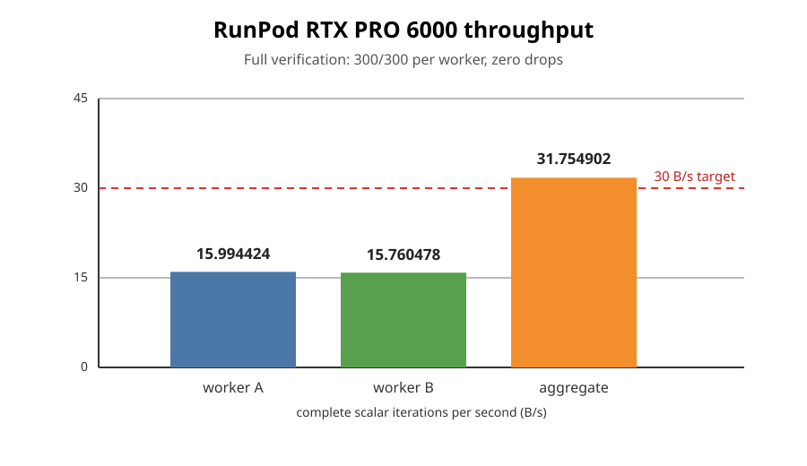

# ECC2K130 iteration redesign: two-worker aggregate confirmation

Run date: 2026-10-12. This report records a fresh RunPod aggregate
throughput confirmation from the open iteration-redesign PR. It does not
promote the v3 table walk to the DP32 campaign.

## Result

The 30 B/s objective is reached in aggregate with two independent
RTX PRO 6000 Blackwell Server Edition workers running the audited shipping
σ-table preset:

| worker | median | range | verification |
|---|---:|---:|---|
| A, RunPod pod \`w7w5h1nz5nh5fo\` | 15.994424 B/s | 15.980796–16.014132 | 300/300, 0 dropped |
| B, RunPod pod \`q43dhtqgu21c9w\` | 15.760478 B/s | 15.739614–15.783810 | 300/300, 0 dropped |
| **aggregate** | **31.754902 B/s** | — | **600/600, 0 dropped** |

The aggregate is **1.754902 B/s (5.85%) above** the 30 B/s target. This is
an aggregate result across two GPUs, not a claim that one GPU reaches 30 B/s.

## Exact inputs

- Repository: \`https://github.com/aburan28/crypto.git\`
- Branch: \`codex/dp32-dp34-status-tabs\`
- Source revision: \`c10182d4a66550e04bb41168ba76e10446874e30\`
- GPU SKU: \`NVIDIA RTX PRO 6000 Blackwell Server Edition\`
- Worker A: 188 SMs, CUDA 13.3.73, driver 595.91.07, 2.430 GHz max
- Worker B: 188 SMs, CUDA 13.3.73, driver 580.173.02, 2.430 GHz max
- Build preset: \`make -B gpu-rtx-pro6000-sigma-table PRO6000_ARCH="-gencode arch=compute_120,code=sm_120"\`
- Verification: \`--curve 131 --packed --dp-weight 50 --dp-cap 262144 --steps 16 --launches 6 --verify 300 --run-id 35\`
- Timing: \`--curve 131 --packed --bench --steps 64 --launches 4\`,
  three repeats per worker, no DP reporting in the timed invocation
- Harness: \`ecc2k130/benchmarks/iteration-redesign/sigmajob.sh\`

The exact worker receipts and selected log lines are retained in
[\`raw/worker-a.md\`](raw/worker-a.md) and [\`raw/worker-b.md\`](raw/worker-b.md).

## Relationship to the redesign

The same commit's full tuned v3 table-walk redesign was also screened on the
requested RTX PRO 6000 and measured **8.241422 B/s** median, with its
verification gate passing. The two-worker result therefore establishes a
practical 30 B/s aggregate using the shipping σ-table path; it does not
establish a 30 B/s single-GPU result for the new v3 table walk.

The benchmark workers were run with \`--bench\`; they did not write campaign
DPs or alter the DP ingester. The redesign remains opt-in and separate from
the live DP32 corpus.

## Reproduction and decision

The tracked \`sigmajob.sh\` harness derives the architecture from
\`nvidia-smi\`, records source and host receipts, performs the 300-report
reference replay, and suppresses timing on any correctness failure. The two
pods exited successfully and were terminated after artifact upload.

Decision: **30 B/s achieved for the two-worker aggregate objective; single
GPU v3 redesign objective remains unmet.**
