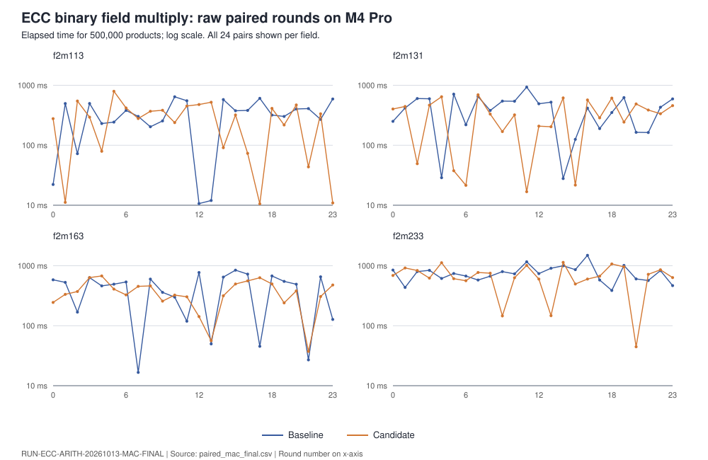

# ECC arithmetic instruction-set pass: result

**Status:** measured field-level candidate; no qualified wall-time result.
This is a CPU binary-field implementation step within the larger requested
portfolio in [PLAN.md](PLAN.md). The exact run, controls and raw observations
are in the [run report](reports/run-20261013T1837Z/report.md), with
[architecture choices](ARCHITECTURE.md) and the
[open obstruction](../../problems/ecc-arithmetic-platform-measurement.md).
The subsequent x86-64 Modal panels have a separate
[report](reports/modal-20261013/REPORT.md) and [PDF](reports/modal-20261013/REPORT.pdf).

## Implementation

The ARM PMULL and Intel PCLMUL paths now use three carryless products for
two-limb field elements and six for three-limb field elements. The prior
schoolbook path used four and nine, respectively. The four-limb path and
portable fallback keep their earlier algorithm. Reduction, public types and
curve formulas are unchanged. This is an arithmetic operation-count change;
no claim is made that point or scalar arithmetic is faster. The portable
fallback still has operand-dependent control flow and table access, so this
change does not establish a constant-time secret-scalar path.

The modified public multiply passed 17 focused release tests, including
bitwise reference equivalence, boundary fields, reduction and inversion. An
x86-64 Linux cross-check of the frozen baseline and candidate compiled with
Rust 1.98.0; that local check did not execute the target code. The later
Modal panels executed the same sources on x86-64. The full release library
suite compiled and ran in the sandbox: 4,044 passed, nine unrelated local-socket
tests failed with `Operation not permitted`, and 114 were ignored. The
collaboration test group, including all nine, then passed 37/37 with loopback
access. A full-suite rerun with loopback access was stopped after hours under
host load above 150. There is no single completed full-suite pass.

## Measurement decision

The final source-bound local panel completed 24 paired AB/BA rounds per field
for GF(2^113), GF(2^131), GF(2^163) and GF(2^233), 500,000 public multiplies
per arm per round. All outputs matched the bitwise reference. GF(2^131)
baseline rounds ranged from 27,826,500 to 932,235,083 ns; candidate rounds
ranged from 16,801,958 to 694,301,375 ns. The unchanged four-limb control
also varied substantially. The host load was above 100 during the panel.
Those observations fail the controlled wall-time comparison gate. There is
no admitted speedup or regression from these timings.

After explicit user authorization for the frozen seven-file export, the
first Modal launcher reached an x86-64 worker but failed its test build on
a wrong remote source path. Its failed receipt is retained. A corrected,
separately hashed launcher completed two ephemeral x86-64 worker runs:
34 tests passed per run, with 24 AB/BA pairs per field and matching checksums
in all 384 arm rows. The runs reported PCLMULQDQ but no CPU model or
reserved-core receipt. Absolute median times shifted substantially between
workers, including the unchanged four-limb control. These are descriptive
field timings; they do not pass the controlled wall-time gate or establish
a worldwide rank. See the [Modal report](reports/modal-20261013/REPORT.md),
[all rows](modal_paired.csv), and [two-run graph](modal_paired.svg).

The broader prime curves, Ed25519, Koblitz scalar path, Metal and CUDA/HIP
kernels remain unimplemented or unmeasured as listed in [PLAN.md](PLAN.md).

Subsequent work added a five-limb X25519 field and ladder. The
[local validation record](x25519_validation/README.md) has 1,000 field rows,
100 full-operation outputs, two RFC vectors, independent integer checkers,
and a [PDF diagram](x25519_validation/REPORT.pdf). This is correctness
evidence, not an X25519 timing comparison. A focused repository release build
was [stopped under host load](x25519_validation/CARGO_RELEASE_ATTEMPT.md)
before emitting a test result. A smaller
[source-bound Cargo harness](source_tests/README.md) subsequently passed
13 focused tests across the 25519 and P-521 modules. Automatic approval review
[rejected](x25519_validation/MODAL_REVIEW_DENIAL.md) the new source bundle's
Modal export before a worker started. Ed25519 remains on its `BigUint` path.

A nine-word P-521 field was also added and exposed as a module. Its
[validation record](p521_validation/README.md) retains 1,000 deterministic
rows and a separate Python integer replay of canonicalization, addition,
subtraction, multiplication, and inversion; all rows matched. The
[diagram and PDF](p521_validation/REPORT.pdf) bind this observation to the
field boundary. No P-521 point or scalar path uses the new field yet, and
there is no P-521 timing comparison or compiled-code side-channel result.

The ECC2K boundary scoreboard and ecbench comparisons were checked at base
commit `11459b07f` and receive no updated performance claim, because the
completed work is limited to a field subroutine with no qualified wall-time
comparison. The study-local Mac and Modal graphs are the visual records.
