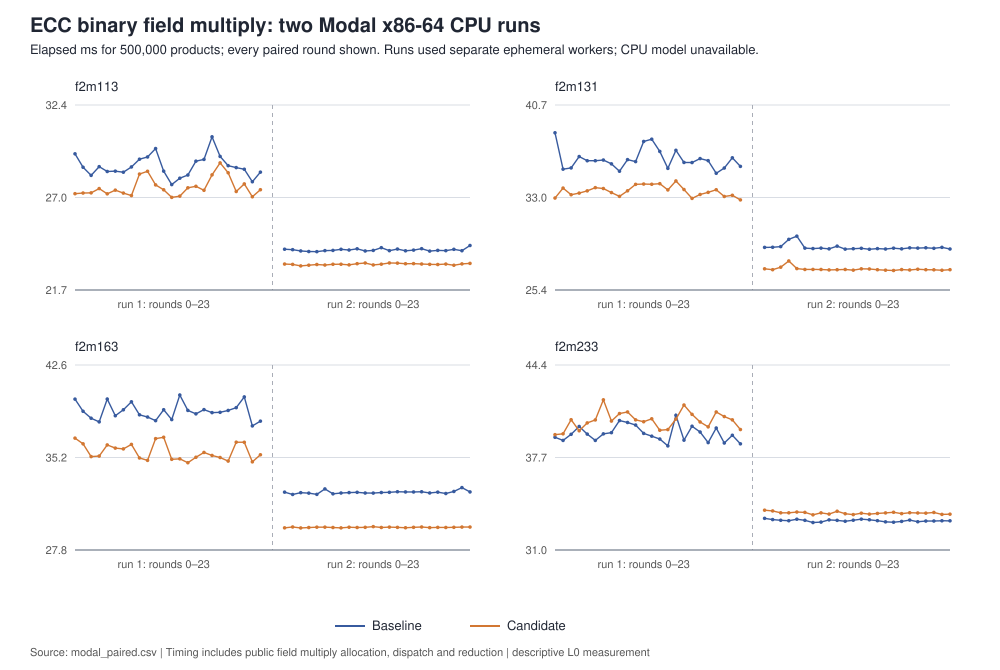

# Binary field multiply: two Modal x86-64 CPU panels

**Status:** two completed field-level panels; descriptive timing only

**Scope:** public `F2mElement::mul` in GF(2^113), GF(2^131), GF(2^163), and GF(2^233)

## Execution and source binding

The exact local command was `modal run research/ecc_arithmetic_20261013/modal_panel_attempt2.py`, executed twice. The [attempt-2 bundle](../../MODAL_BUNDLE_attempt2.sha256) verifies the six frozen Rust files and the corrected launcher. The baseline source SHA-256 is `2bc2a1f55887ef7db1fdb1ce5a6cd05c86b7c75e9eb8ade36497ff5686b37fd3`; the candidate SHA-256 is `8b32c5467ee8c87752b9cb86594fb742aa9053fd5918172686c4270c9e936364`. These match the final Mac panel's sources. The local branch was at `f3e0c619c` with new run files uncommitted when Modal was launched.

Each Modal function requested two vCPUs, 2,048 MiB, and a 1,200-second timeout. It reported Linux/gVisor x86-64, Rust and Cargo 1.93.1, `pclmulqdq`, `vpclmulqdq`, `avx2`, `bmi2`, and `adx`. It reported `cpu_model: unknown` and an 18-CPU affinity mask; neither is a reserved-core receipt. The [first completed run](https://modal.com/apps/a-buran28/main/ap-qP1AfLsBcqOOyXn7Tm5XDf) and [second completed run](https://modal.com/apps/a-buran28/main/ap-loC8PFRRW4x5qlwfaT7CBc) used separate ephemeral workers. Their immutable returned JSON is [run 1](../../modal_result_attempt2_run1.json) (SHA-256 `c985c7cceade7b6ae7ac8b16ce72a67e290912a181b506e5db5a4c08f500c77d) and [run 2](../../modal_result_attempt2_run2.json) (SHA-256 `000ec007eee6c6d8932b97004c34bdb819823affb18791830e2ac5ae7417dcaa`). The raw CLI logs are [run 1](../../modal_run_attempt2.stdout) and [run 2](../../modal_run_attempt2_repeat.stdout). All paths in this paragraph have `internal` provenance except the two Modal run pages, which are `retrieved` run pointers.

The launcher did not return remote start/end timestamps, per-phase resource
measurements, or hardware frequency data. The CLI logs and Modal run pages are
retained, but they do not fill those receipt fields.

The earlier [launcher attempt](../../modal_result.json) failed during compilation because it mounted `f2m.rs` at the wrong remote path. It produced zero timed rows. That failed receipt and its original [bundle](../../MODAL_BUNDLE.sha256) remain intact; the corrected launcher is a separate file.

## Correctness and observations

Both completed workers reported `test_exit: 0`, with 34 tests passed and zero failed, followed by `bench_exit: 0`. Each ran 24 alternating AB/BA pairs per field, 500,000 public multiplies per arm per pair, using the same fixed 256 operand pairs and seed `0x0123456789abcdef`. The driver checked each operand pair's full result against bitwise schoolbook multiplication before timing. [modal_analysis.py](../../modal_analysis.py) independently validates the returned source hashes, row count, order, parameters, pair completeness and arm checksums, then exports [all 384 timed arm rows](../../modal_paired.csv) and the [machine-readable summary](../../modal_summary.json).

Median milliseconds for 500,000 public field multiplies, shown as baseline / candidate:

| field | run 1 | run 2 | interpretation |
| --- | ---: | ---: | --- |
| GF(2^113), two limbs | 28.767 / 27.471 | 23.996 / 23.200 | three versus four carryless products |
| GF(2^131), three limbs | 36.079 / 33.580 | 28.825 / 27.043 | six versus nine products; ECC2K field degree |
| GF(2^163), three limbs | 38.869 / 35.389 | 32.390 / 29.583 | six versus nine products |
| GF(2^233), four limbs | 39.378 / 40.410 | 33.142 / 33.702 | unchanged schoolbook control |

Within each run, all 24 pairs per field completed and every baseline/candidate checksum matched. Across runs, absolute median times changed substantially, including the unchanged four-limb control. The control's candidate arm also did not center at equality. The worker provided no exact CPU model, core isolation, frequency/thermal record, A/A panel, or same-host production-library comparator. These observations do not pass the controlled wall-time comparison gate and establish no qualified speedup or worldwide rank.

The timer includes public field multiply allocation, dispatch, carryless product and reduction. It excludes point and scalar operations, Frobenius recoding, ECC2K walk overhead, data movement, and all requested prime-curve and GPU paths. The next discriminating gate is the same frozen operands on a named, pinned x86-64 CPU with A/A, a same-boundary external comparator, and a full point/scalar or walk panel after the field result is qualified.
