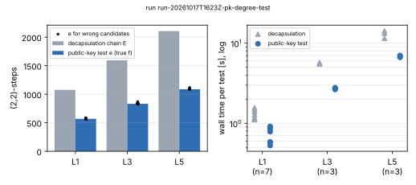
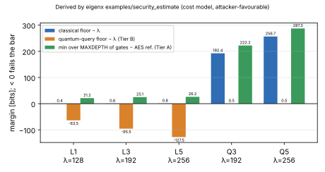
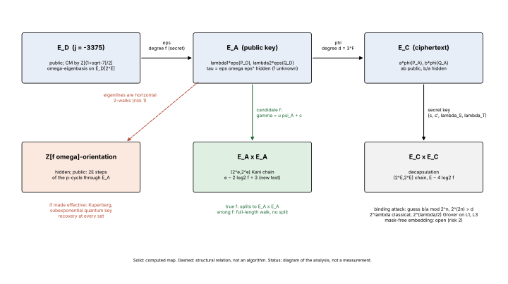

# Eigen-Séta v2 assessment, 2026-10-17

Report for the search round "assess the eigenx scheme and update the paper".
The paper revision is `crypto:papers/eigen-seta/` (revision 2). The code is
the sibling repository `eigenx` at commit `94fe2d9` (branch
`claude/eigenx-scheme-assessment-0z5d0u`). PDF: [`report.pdf`](report.pdf).

**Status.** This is the authors' own analysis, not an external review. No
attack below the stated costs was found. One new attack component was built
and measured: the public-key degree test. It lowers the cost of a non-binding
row. Every statement below is labelled *derived* (computed from parameters or
a stated model), *measured* (from a record here), *proved* (written proof,
with Lean status), or *literature*.

## Question and scope

Is Eigen-Séta v2, as implemented in `eigenx`, as secure as its security notes
and the paper's revision 1 say? What must change in the paper? The scope
covers the five parameter sets L1, L3, L5, Q3 and Q5, key recovery, message
recovery, the quantum claims, the implementation's test status, and
consistency between the paper, `eigenx:docs/SECURITY.md` and the cost model
`eigenx:src/security.rs`. Out of scope: side-channel measurement on the theta
build, and new parameter generation.

## Method

1. Recomputed every derived number in the paper's parameter and attack tables,
   and ran the cost model (`records/security_estimate_before.txt`, then
   `records/security_estimate.txt` after the oracle change). *Derived.*
2. Reread the correctness proofs, and read the key-generation filter
   (`eigenx:src/kem.rs::kani_scalars_for_degree`,
   `eigenx:src/ntheory.rs::two_squares`) that defines the degree search space.
3. Ran `cargo test --release` on unmodified `eigenx` main (`d4ee763`):
   `records/eigenx_tests_main_d4ee763.txt`. `tests/field.rs::f1` fails.
   *Measured.*
4. Built and ran the public-key degree test (below). *Measured.*
5. Read the literature listed in `eigenx:docs/SECURITY.md` §9 against the
   public key. *Literature.*

## Findings

| # | Finding | Kind | Effect |
|---|---|---|---|
| F1 | A candidate f is testable from the public key alone with a (2^e,2^e) Kani chain on E_A × E_A, where e ≈ 2·log₂ f + 3, against E ≈ 4·log₂ f for decapsulation. | proved (Lemma 1), measured | degree-search gate columns −1.9 bits; no floor, tier or category changes |
| F2 | Revision 1's "NIST categories 1/3/5 for L1/L3/L5" holds only in the gate-count metric. L1 and L3 have about 2^64.5 and 2^96.5 quantum queries. | derived | claim withdrawn in unqualified form; two tiers in the paper |
| F3 | The hidden Z[f·ω]-orientation is the largest structural risk. Making it effective gives Kuperberg-type subexponential quantum key recovery at **every** set, because the Q sets enlarge d, not f. | literature + derived | ranked risk 1; open problem |
| F4 | `Fp::mul2`/`mul3` used the friendly reduction for every modulus, giving wrong F_p² products for non-friendly moduli. `tests/field.rs::f1` failed on main. No parameter set was affected. | measured | fixed in eigenx |
| F5 | `eigenx:docs/SECURITY.md` put the public ω-eigenbasis on E_D[3^F]. That is impossible (3 is inert in Q(√−7)). | derived | corrected |
| F6 | The cost model's admissible fraction 1/ln 2^E is justified as "sum-of-two-squares density". The real predicate is that, after trial division to 2^14, the remaining cofactor is 1 or a prime ≡ 1 (mod 4), together with the divisibility and sign conditions. The measured ρ is 1.6–2.3 bits above the model's fraction. | derived | model is conservative; documented |
| F7 | eigenx CI on main fails at `cargo fmt --check` and then at clippy `-D warnings` (rustc 1.97). | measured (CI log) | fixed (fmt plus four clippy fixes) |
| F8 | α = x + yπ with N(y) ≤ 2^κ: the public curve is fixed by (f, y) and a few choices. No use found. | derived | recorded |

### Lemma 1 (the public-key test)

Let ψ_A = 2τ − t·f ∈ End(E_A). It has trace 0 and degree 7f², and it acts as
f·s_D on P_A and −f·s_D on Q_A. For odd u and e ≤ E with
2^e − 7u²f′² = c² + c′² (c even), set λ_S = u f′ s_D + c and
λ_T = c − u f′ s_D. Then ⟨(c′P′, −λ_S P′), (c′Q′, −λ_T Q′)⟩ ⊂ E_A²[2^e], with
P′ = [2^(E−e)]P_A, is isotropic for every candidate f′. For f′ = f it is the
kernel of the Kani isogeny of γ = uψ_A + c, which splits into E_A × E_A.

*Proof.* The Weil-pairing exponent is c′² + λ_Sλ_T = c′² + c² − u²f′²s_D²,
which is ≡ c² + c′² + 7u²f′² = 2^e (mod 2^e). For f′ = f, deg γ = 7u²f² + c²
= 2^e − c′², and the generators are (c′R, −γR); apply Kani's lemma.

**Proof map.**

| Statement | Lean declaration | Hypotheses | Status |
|---|---|---|---|
| isotropy congruence | `pkTest_kernel_isotropic` in `lean/EigenSetaPkTest.lean` | s² + 7 = M·k, c² + c′² + 7u²f² = M (integers) | proved; axioms propext, Quot.sound |
| norm identity N(c + u f√−7) + c′² = 2^e ⇔ c² + c′² + 7u²f² = 2^e | `pkTest_kani_degree` | none | proved; axioms propext, Classical.choice, Quot.sound |
| deg(uψ_A + c) = N(c + u f√−7), and Kani's lemma | not formalised | | **open**: Lean core has no elliptic curves or quaternion orders |

Toolchain `leanprover/lean4:v4.34.1` (core only). Check:
`tools/lean/proof-gate.sh research/eigen_seta_assessment_20261017/lean/EigenSetaPkTest.lean`
gives PASS, 2 theorems (`records/lean/`).

## Measurement: run `run-20261017T1623Z-pk-degree-test`

Run report: [`reports/run-20261017T1623Z-pk-degree-test/`](reports/run-20261017T1623Z-pk-degree-test/).
Host: Intel Xeon @ 2.10 GHz, 4 vCPU shared cloud VM, rustc 1.97.0, release
build, no pinning (`records/<run>/host.txt`). For each set: one fresh key with
its true f; the true f tested (both eigenvalue assignments); wrong candidates
(uniform odd values prime to 21, plus near misses f + j·2^k with
k ∈ {16, 64, ⌊f_bits/2⌋}) tested with the theta chain; interleaved timing of
one test against one decapsulation.

| set | E | e (true f) | e_min | mean excess (wrong) | wrong tested (accepted) | test s, median [range] | decaps s, median [range] | n |
|---|---|---|---|---|---|---|---|---|
| L1 | 1076 | 569 | 560 | 9.9 | 105 (0) | 0.79 [0.53–0.91] | 1.28 [1.11–1.57] | 7 |
| L3 | 1594 | 832 | 823 | 14.7 | 35 (0) | 2.72 [2.64–2.78] | 5.54 [5.49–5.75] | 3 |
| L5 | 2106 | 1087 | 1076 | 14.0 | 18 (0) | 6.84 [6.66–7.03] | 13.34 [11.54–14.26] | 3 |

All values are *measured*, except e_min = ⌊log₂ 7f²⌋ + 2 (*derived*). At L1 the
Mumford inspector walked the true f (glue, 563 Richelot steps, final split)
and one wrong f (glue, 566 Richelot steps, no early split, no final split).
Every decapsulation in the timing rows returned the encapsulated key. The
timings come from a noisy shared VM and support only the factor-of-two
reading.

## Unresolved

* Risk 1, the hidden orientation (`eigenx:docs/LITERATURE_DRILL.md` L6, L8);
  risk 2, a mask-free embedding (L2); risk 3, the decisional assumption (L7).
* External review of the Grover-oracle constant 2^8.
* Constant-time evidence on the theta build.

## Files

* `records/`: run TSVs and host, cost-model outputs before and after,
  test log of main, Lean gate receipts.
* `figures/`: graphs (SVG/PDF/PNG) and their sources (`diagram.py`;
  graphs by `crypto:papers/eigen-seta/figures/plot_assessment.py`).
* `lean/`: Lean file and toolchain pin.
* `report.typ` → `report.pdf`.
