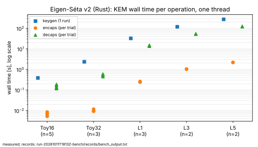
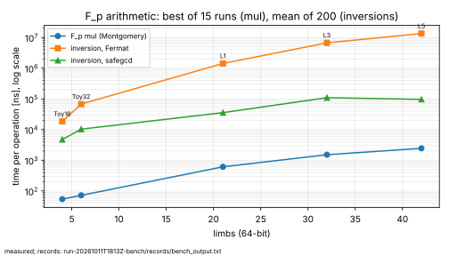
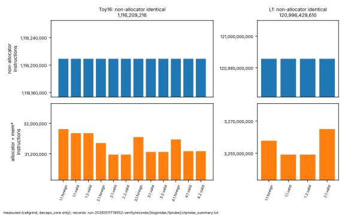
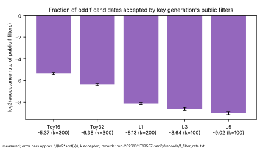

# Eigen-Séta v2 in Rust: constant-time decapsulation at NIST level 1, 3 and 5 sizes

Results report, 2026-10-11, covering two rounds of work. The PDF is
`report.pdf`. The related material is in three places:

* the crate `eigen_seta/`, whose `README.md` describes the scheme and whose
  `SIDE_CHANNELS.md` holds the side-channel audit;
* the paper `papers/eigen-seta/`, with the specification, correctness
  proofs, security analysis and attack-cost table;
* this directory, which gathers the measured evidence and states the limits
  of each claim.

## Claims and their status

| # | Claim | Status | Evidence |
|---|---|---|---|
| 1 | The Rust KEM decapsulates correctly at Toy16, Toy32, L1, L3 and L5. | measured: 3,635 decapsulations, no failure (Toy16 3,005, Toy32 603, L1 23, L3 2, L5 2) | `reports/run-20261011T1955Z-verify/`, `reports/run-20261011T1813Z-bench/` |
| 2 | Public key and ciphertext are 1344, 1992 and 2632 bytes at L1, L3 and L5. Decapsulation takes 13–15 s, 52–54 s and 120–124 s on one core of the recorded host. | measured, one host, n = 3, 2 and 2 | `reports/run-20261011T1813Z-bench/` |
| 3 | The secret phase of decapsulation executes the same instructions for every key and ciphertext, apart from glibc's allocator. | measured with callgrind at Toy16 (4 keys × 3 ciphertexts) and at **L1** (2 keys, 2 ciphertexts, 1 FO-rejected). This is evidence, not a proof. | `reports/run-20261011T1955Z-verify/`, and earlier `reports/run-20261011T1827Z-sidechannel/` |
| 4 | No timing difference is detected between a fixed ciphertext and fresh ones, including FO-rejected ones, for one key. | measured, Welch t-test with 1,000 samples per class: \|t\| ≤ 2.36 in the latest run and ≤ 0.84 in the earlier one, against a threshold of 4.5 | same |
| 5 | Decapsulation and encapsulation survive adversarial inputs. | tested: 48 adversarial ciphertexts and 14 adversarial public keys, no panic and no hang, and no crafted ciphertext yields the honest key | `eigen_seta/tests/robustness.rs` |
| 6 | The parameter sets meet NIST categories 1, 3 and 5. | **conjectured**. The binding attack is guessing the mask ratio modulo about √(3^F), about 2^λ classically and 2^(λ/2) Grover iterations, the same shape as AES key search. Key recovery is far costlier. No independent cryptanalysis exists. | `papers/eigen-seta/` §6 |
| 7 | The toy `walk` variant in the merged prototype is insecure. | derived from the merged code: its key is computed from the public walk degree alone (`eigen_seta_toy.py` lines 133–155). An exploratory run, not archived, decrypted 5/5. | correction notices; paper §6.2 |
| 8 | The kernel recovered in decryption is always cyclic, so the toy's "non-cyclic" corner case cannot occur in v2. | proved: paper Proposition 3 | `papers/eigen-seta/` §4 |

Defects found and fixed during the work:

* **An LLVM-introduced conditional in safegcd.** The masked add in
  `normalize` was compiled into a conditional skip, so the timing depended
  on the sign of a secret-dependent intermediate. The callgrind probe found
  it, and `black_box` on the masks fixed it.
* **A key-generation hang.** Tonelli–Shanks accepted z = 0 as a non-residue.
  A regression test covers it.
* **Degenerate secret scalars.** A scalar ≡ −1 modulo the point order breaks
  y-recovery. Key generation now rejects such keys.
* **An uncapped basis search.** The canonical-basis search on public curves
  had no iteration bound. It is now capped and returns a refusal.

Correction to the first version of this report: it said the quantum security
was about λ/2, "as for FESTA", without relating that to NIST's definitions.
Those definitions are themselves AES key search, which is a 2^(λ/2) Grover
search. See claim 6.

## Results

### Correctness, sizes and speed

The benchmark run is `run-20261011T1813Z-bench`, on commit 19c641d12, on an
Intel Xeon at 2.80 GHz in a shared VM, built with rustc 1.97.0.

| Set | p bits | pk = ct (B) | keygen (s), n = 1 | encaps (s) | decaps (s) | correct |
|---|---|---|---|---|---|---|
| Toy16 | 216 | 216 | 0.38 | 0.005–0.008 | 0.12–0.19 | 5/5 |
| Toy32 | 369 | 376 | 2.3 | 0.009–0.012 | 0.45–0.59 | 3/3 |
| L1 | 1341 | 1344 | 32.3 | 0.24–0.26 | 13.4–15.0 | 3/3 |
| L3 | 1991 | 1992 | 118.6 | 1.03 | 51.8–53.9 | 2/2 |
| L5 | 2630 | 2632 | 271.8 | 2.17–2.20 | 120.2–124.0 | 2/2 |

The verification run `run-20261011T1955Z-verify`, on commit d504af28e, added
correctness trials with fresh OsRng keys: 3,000 of 3,000 at Toy16, 600 of
600 at Toy32 and 20 of 20 at L1. Zero failures in 3,000 trials bounds the
failure rate only by about 10^-3. Negligibility rests on the heuristic
O(E/p) argument in the paper.

In the same binary and run as the timings, safegcd inversion is 3.9× to 140×
faster than Fermat inversion, from Toy16 to L5. No pre-change baseline
binary was kept for the KEM-level timings, so this report makes **no
KEM-level speedup claim**; AGENTS.md §10 requires a recorded baseline.

### Constant-time evidence

The callgrind instruction counts of `decaps_core` give one non-allocator
value per parameter set:

| Set | Keys | Runs | Non-allocator instructions |
|---|---|---|---|
| Toy16 | 4 | 12 | 1,116,209,216 in every run |
| L1 | 2 | 4 | 120,996,429,610 in every run |

Allocator work, which includes heap growth through `sbrk` and `brk`,
varies with the heap state left by the earlier variable-time phases. It is
equal for the two valid ciphertexts of each key. Full tables are in
`SIDE_CHANNELS.md` §5 and the run report.

Limits:

* Instruction counts do not cover memory-address leakage. The code has no
  secret-indexed tables, which is an argument, not a measurement.
* L3 and L5 were not probed. The code is generic over the limb count.
* The result covers this compiler and target only.
* Key generation is variable time by design (`SIDE_CHANNELS.md`, R1).

### Key-recovery search space

Key generation's public filters accept 2^-8.13, 2^-8.64 and 2^-9.02 of the
odd candidates for f at L1, L3 and L5. That leaves about 2^268, 2^399 and
2^525 admissible degrees for an exhaustive search.

## Graphs checked and left unchanged

These canonical graphs were checked:

* `docs/index-calculus-scoreboard.html`
* `docs/ic/progress-timeline.json`
* `docs/performance-gains/`
* `docs/curves/`
* `figures/`

None of them covers isogeny-based KEMs or this crate. `docs/curves/`
mentions isogenies only as curve-transfer links in the discrete-log curve
registry, and this work adds no registry curve. So none of them changed.
This report's graphs are new. They are drawn from the run records by
`figures/plot.py` and `figures/plot_verify.py`, which only plot recorded
values.

## Files

* `README.md`, `report.typ`, `report.pdf`: this report.
* `figures/`: the graphs and the two plotting scripts.
* `reports/run-20261011T1813Z-bench/`: timings and sizes.
* `reports/run-20261011T1827Z-sidechannel/`: the first constant-time probe,
  at Toy16, on commit 19c641d12, and the first timing test.
* `reports/run-20261011T1955Z-verify/`: correctness trials, constant-time
  probes at Toy16 and L1, the timing test and filter rates, on commit
  d504af28e.
