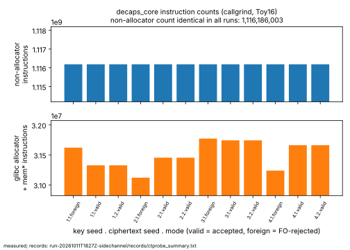

# Eigen-Séta v2 in Rust: constant-time decapsulation at NIST level 1, 3 and 5 sizes

Results report, 2026-10-11. The PDF is `report.pdf`. The code is in the
crate `eigen_seta/`, whose README describes the scheme and whose
`SIDE_CHANNELS.md` holds the full audit. This report gathers the evidence
for what the accompanying PR claims and states the limits of each claim.

## Claims and their status

| # | Claim | Status | Evidence |
|---|---|---|---|
| 1 | The Rust KEM decapsulates correctly at Toy16, Toy32, L1, L3 and L5. | measured: 15/15 trials in the benchmark run, plus earlier development runs | `reports/run-20261011T1813Z-bench/` |
| 2 | Public key and ciphertext are 1344, 1992 and 2632 bytes at L1, L3 and L5. Decapsulation takes 13–15 s, 52–54 s and 120–124 s on one core of the recorded host. | measured, one host, n = 3, 2 and 2 | same |
| 3 | The secret phase of decapsulation runs a key-independent and ciphertext-independent instruction stream, apart from glibc's allocator. | measured at Toy16 for 4 keys × 3 ciphertexts with callgrind. This is evidence, not a proof. | `reports/run-20261011T1827Z-sidechannel/` |
| 4 | No timing difference is detected between a fixed ciphertext and fresh ones, including FO-rejected ones, for one key. | measured with a Welch t-test, 1,000 samples per class: \|t\| ≤ 0.84, against a threshold of 4.5 | same |
| 5 | The parameter sets target λ = 128, 192 and 256 classical bits. | **conjectured**, with heuristic arguments in `eigen_seta/README.md` §3. No independent cryptanalysis exists. Quantum security is about λ/2, as for FESTA. | — |
| 6 | The toy `walk` variant in the merged prototype is insecure. | measured: an outsider decrypted 5/5 ciphertexts from public data | correction notices in `RESEARCH_ENDRING_PKE_STRATEGY.md` and the prototype README |

Two defects found during this work are fixed in the same PR:

* **An LLVM-introduced conditional in safegcd.** The masked add in
  `normalize` was compiled into a conditional skip, so the timing depended
  on the sign of a secret-dependent intermediate. The callgrind probe found
  it, and `black_box` on the masks fixed it. The counts above were taken
  after the fix.
* **A key-generation hang.** Tonelli–Shanks accepted z = 0 as a non-residue.
  A regression test covers it.

## Results

### Correctness, sizes and speed

The benchmark run is `run-20261011T1813Z-bench`, on an Intel Xeon at
2.80 GHz in a shared VM, built with rustc 1.97.0. Every trial's decapsulated
key matched the encapsulated one.

| Set | p bits | pk = ct (B) | keygen (s), n = 1 | encaps (s) | decaps (s) | correct |
|---|---|---|---|---|---|---|
| Toy16 | 216 | 216 | 0.38 | 0.005–0.008 | 0.12–0.19 | 5/5 |
| Toy32 | 369 | 376 | 2.3 | 0.009–0.012 | 0.45–0.59 | 3/3 |
| L1 | 1341 | 1344 | 32.3 | 0.24–0.26 | 13.4–15.0 | 3/3 |
| L3 | 1991 | 1992 | 118.6 | 1.03 | 51.8–53.9 | 2/2 |
| L5 | 2630 | 2632 | 271.8 | 2.17–2.20 | 120.2–124.0 | 2/2 |

Measured in the same binary and run, safegcd inversion is 3.9× to 140×
faster than Fermat inversion, from Toy16 to L5. Field multiplication scales
as expected. No pre-change baseline binary was kept for the KEM-level
timings, so this report makes **no KEM-level speedup claim**. AGENTS.md §10
requires a recorded baseline for one.

### Constant-time evidence

`run-20261011T1827Z-sidechannel` covers the callgrind instruction counts of
`decaps_core`, the secret phase, at Toy16. Each of 4 key seeds has 2 valid
ciphertexts and 1 foreign, FO-rejected one. The table of values is in
`SIDE_CHANNELS.md` §5 and in the run report. The non-allocator count was
identical in all 12 runs. The glibc allocator count varies with the heap
state left by the earlier variable-time phases.

Limits:

* Instruction counts do not cover memory-address leakage. The code has no
  secret-indexed tables, which is an argument, not a measurement.
* The check was run at Toy16 only. The code is generic over the limb count
  N, so the same control flow is expected at L1–L5, but that was not
  measured.
* The result covers this compiler and target only.
* Key generation is variable time by design. See `SIDE_CHANNELS.md`
  residual issue R1.

## Graphs checked and left unchanged

These canonical graphs were checked:

* `docs/index-calculus-scoreboard.html`
* `docs/ic/progress-timeline.json`
* `docs/performance-gains/`
* `docs/curves/`
* `figures/`

None of them covers isogeny-based KEMs or this crate. `docs/curves/`
mentions isogenies only as curve-transfer links in the discrete-log curve
registry, and this work adds no registry curve. So none of them changed. This
report's graphs are new and live in `figures/`. They are drawn from the run
records by `figures/plot.py`, which only plots recorded values.

## Files

* `README.md`, `report.typ`, `report.pdf`: this report.
* `figures/`: `kem_times.svg`, `field_ops.svg`, `ct_probe.svg` and the
  plotting script.
* `reports/run-20261011T1813Z-bench/`: the benchmark run report, its
  records and its PDF.
* `reports/run-20261011T1827Z-sidechannel/`: the side-channel run report,
  its records (callgrind outputs xz-compressed, probe outputs, dudect
  output) and its PDF.
