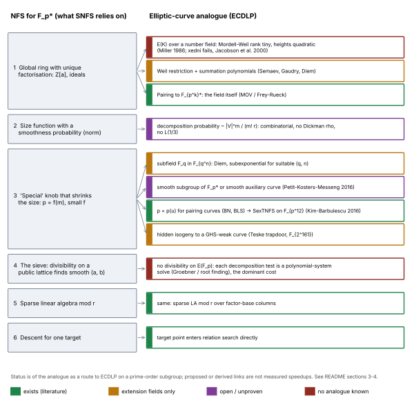
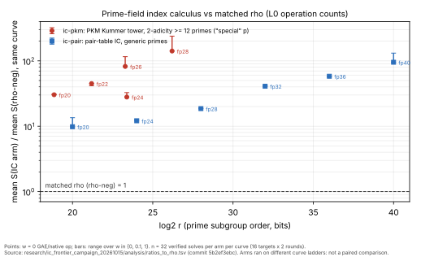

# What would a special number field sieve for elliptic curves look like?

**Date:** 2026-10-16. **Kind:** literature and theory search round (no new
run). **PDF:** [`REPORT.pdf`](REPORT.pdf). **Figures:**
[`figures/dictionary.svg`](figures/dictionary.svg) (diagram),
[`figures/ratio_to_rho.svg`](figures/ratio_to_rho.svg) (graph of recorded
values). **Conductor task:** T-1.

**Correction (2026-10-16, after merge of #1951).** The first version of this
report missed four repository studies on shape C:
- `research/pkm_tower_ecbench_20261013`
- `research/pkm_isogeny_tower_ecbench_20261015`
- `research/pkm_supersingular_aux_20261015`
- `research/pkm_dickson_torus_20261015`, together with
  `research/f4_generic_field_20261015`

It also proposed a test, T1, that those studies had already answered. §0
(row C), §4C, §6 and §7 are now corrected. T1 is withdrawn, and §7 names the
one open experiment instead. The figures, data and the other shapes are
unchanged.

Every statement carries one label: **[lit]** taken from a cited paper,
**[repo]** a value already recorded in this repository (path given),
**[derived]** reasoning made in this note and not independently checked,
**[proposed]** an untested idea. Nothing here claims a speedup, a break of a
deployed curve, or a key recovery.

## 0. Question and short answer

*Question (owner, 2026-10-16):* is there a plausible elliptic-curve analogue
of the special number field sieve (SNFS), and what would it look like?

*Short answer.* SNFS needs three things: (1) a global ring with unique
factorisation that maps onto the group, (2) a size function under which
"smooth" elements are common, and (3) a special algebraic identity, such as
`p = f(m)` with small `f`, that makes the sizes small. It finds smooth
elements cheaply by sieving on a public lattice. For ECDLP, each of these
pieces has a partial analogue, but no known construction supplies all of them
for a curve over a prime field:

| shape | what plays "special" | status |
|:--|:--|:--|
| A. Pairing transfer, then SNFS on `F_{p^k}` | small embedding degree `k`, and `p = p(u)` polynomial (BN, BLS) | **exists** [lit]. It is the only way SNFS proper reaches elliptic curves today. It needs small `k`. P-256 has `k = (n−1)/3` [repo] |
| B. Weil restriction / summation polynomials over `F_{q^n}` | a subfield `F_q` (factor base `x(P) ∈ F_q`) | **exists for extension fields** [lit]. Teske's hidden-isogeny curves are the analogue of the "hidden SNFS" (FGHT) trapdoor [lit] |
| C. Prime-field "special" factor base (Petit–Kosters–Messeng 2016) | a smooth subgroup of `F_p^*`. P-224's `p − 1 = 2^96·…` qualifies | **open only in its exponent** [lit, repo]. The repo has measured it end to end: 27.9–141× matched rho. A Kummer, isogeny or supersingular base costs the same as a plain base. The solving degree does not depend on how special `p` is, P-224 included. Open: whether that degree stays bounded |
| D. Lift to a global curve (number field, heights) | a curve over `Q` or `K` with many small-height points | **no working version**: heights grow quadratically, and xedni fails [lit] |

The closest thing to an "elliptic SNFS" over a **prime** field is shape C.
Two observations weaken the idea that a special prime matters there:

- **[derived]** PKM's own isogeny variant works for *every* prime. It uses an
  auxiliary curve of smooth order, so a special `p` changes which maps can be
  used, not whether the attack applies.
- **[lit]** PKM report "similar" solving degrees, times and memory for the
  subgroup (special `p`) and isogeny (any `p`) versions.
- **[repo]** The repository measured the same thing, and more (§4C):
  - A deeper 2-power in `p − 1` does not change the F4 solving degree,
    from `v₂ = 18` up to the P-224 prime (`v₂ = 96`).
  - In the table pipeline, every PKM base costs the same as a plain base of
    the same size.

In SNFS, by contrast, a random `p` simply has no small-coefficient `f`, and
that gap is the whole source of SNFS's advantage.

## 1. What SNFS actually exploits

**[lit]** In NFS for discrete logarithms in `F_p^*`:

1. Pick `f ∈ Z[x]` and `m` with `f(m) ≡ 0 (mod p)`. The two ring maps
   `Z[x] → Z[α]` and `Z[x] → Z` (`x ↦ m`) both reduce to `F_p`.
2. A *relation* is a coprime pair `(a, b)` such that both `a − bm` and the
   norm `N(a − bα) = b^d f(a/b)` are smooth. Each side then factors over
   small primes or prime ideals, and Schirokauer maps take care of units.
3. Relations are found by **sieving**. For each factor-base prime ideal
   `(ℓ, s)`, the pairs it divides form the public lattice
   `a ≡ bs (mod ℓ)`, so testing for smoothness costs about one memory touch
   per hit.
4. Sparse linear algebra mod `r`, then a descent for the individual target.

What makes the sieve **special** is the size of the norm:

- With a general `f`, the coefficients are about `p^{1/(d+1)}`. The norms
  are then large, and the cost is `L_p[1/3, (64/9)^{1/3} ≈ 1.923]`.
- When `p = f(m)` with tiny coefficients (Solinas or Mersenne-like primes, or
  the planted trapdoor of Fried–Gaudry–Heninger–Thomé 2017), the norms drop
  to about `B^d`. The cost falls to `L_p[1/3, (32/9)^{1/3} ≈ 1.526]`.

The repository's toy is `src/cryptanalysis/fght_snfs.rs`. Its
`ecc_implications` module already says why this does not carry over to
ECDLP directly.

## 2. Why the direct analogue fails over a prime field

- **No global factorisation [lit].** Miller (1986) and Silverman–Suzuki
  (ASIACRYPT 1998) considered lifting `E/F_p` and its points to a curve over
  `Q`. Mordell–Weil groups are finitely generated with small rank. Canonical
  height grows quadratically, so `ĥ([k]P) = k²ĥ(P)`, and the few points of
  small height cannot reach a random target. Silverman's xedni calculus
  (2000) tried to force the lift. Jacobson, Koblitz, Silverman, Stein and
  Teske (2000) showed that it fails: the lifted points are almost always
  independent. The repository repeats this at NIST sizes:
  `research/notes/cm-isogeny/RESEARCH_NIST_CYCLOTOMIC_POINT_HEIGHTS.md` §3
  finds no small points on the canonical lift and a lifted generator with
  `ĥ ≈ log p` [repo].
- **No sieve [derived].** "Ideal `𝔭` divides `a − bα`" is a congruence on
  `(a, b)`, and it defines a lattice anyone can enumerate. Points have no
  divisibility relation. To ask whether `R` decomposes over a factor base,
  you solve a summation-polynomial system, which is a Gröbner or
  root-finding problem, and that solve is the dominant cost of every
  ECDLP index calculus. In `research/lattice_index_calculus_20261015`, the
  autoresearcher repository makes the same point in lattice form [repo]:
  - NFS's ideal lattice is public;
  - the ECDLP relation lattice `{c : Σ cᵢFᵢ = O}` has determinant `r`, but
    its coordinates are the unknown logarithms.
- **No smoothness distribution [derived].** The NFS size function gives
  Dickman-ρ smoothness probabilities, and from those comes `L(1/3)`. The
  summation-polynomial analogue is combinatorial. The expected number of
  ordered `m`-decompositions of a target over a factor base `V` is
  `|V|^m / r`, before quotienting by orderings and signs. This identity is
  also used in `research/cyclotomic_falsifier_20261015/README.md` §2 [repo].
  Raising `|V|` does not shrink the "size" of anything. It only trades
  factor-base size against the cost of solving the system.

## 3. The dictionary (diagram)



*Figure 1.* Each SNFS ingredient (left) and its ECDLP analogues (right).
Colour shows status: green, exists in the literature; amber, extension fields
only; purple, open or unproven; red, no analogue known. Layout source:
[`figures/dictionary.py`](figures/dictionary.py). The diagram adds no
evidence. Every box cites §§1–4.

## 4. The four shapes, concretely

### A. Pairing transfer + SNFS on the target field (exists)

**[lit]**

- **Steps.** The Weil or Tate pairing maps the order-`r` subgroup of
  `E(F_p)` into `μ_r ⊂ F_{p^k}^*`, where `k` is the embedding degree
  (Menezes–Okamoto–Vanstone 1993; Frey–Rück 1994). The DLP in
  `F_{p^k}^*` is then solved with NFS.
- **Where "special" comes from.** Pairing-friendly families give `p` as a
  polynomial in a small parameter `u`. For BN,
  `p = 36u⁴ + 36u³ + 24u² + 6u + 1`. That polynomial supplies the
  small-coefficient `f` that SNFS needs.
- **The special variants.** Kim–Barbulescu's extended tower NFS (CRYPTO
  2016) and its special variant SexTNFS exploit this. The abstract gives
  exTNFS's medium-prime constant as `L_Q(1/3, (48/9)^{1/3})`, down from
  `(96/9)^{1/3}`. The special variant's lower constant for `p = p(u)` was
  not checked against the paper in this round.
- **Consequences.** Key sizes had to be updated for BN, BLS12, KSS16, KSS18
  and BLS24 (Barbulescu–Duquesne, J. Cryptology 2019). Secondary sources
  quote roughly 100–110 bits for BN over a 256-bit `p`, against the 128 bits
  previously assumed (survey arXiv:2212.01855), and about 126 bits for
  BLS12-381 (Aranha–Fotiadis–Guillevic 2023 talk table). *These figures were
  not checked against the papers' tables in this round. The eprint PDFs
  returned 403.*
- **This is a real elliptic-curve SNFS.** But it applies only when `k` is
  small. P-192, P-224 and P-256 have `k = (n−1)/10`, `(n−1)/3` and
  `(n−1)/3` (189–255 bits) [repo, `RESEARCH_NIST_CYCLOTOMIC_POINT_HEIGHTS.md`
  §2.1]. For those curves the route does not exist.

### B. Subfield structure over `F_{q^n}` (exists, extension fields only)

**[lit]**

- **Method.** Semaev (2004) introduced summation polynomials. Gaudry (2009)
  and Diem (2011, 2013) used them over `F_{q^n}` with factor base
  `{P : x(P) ∈ F_q}`. Weil restriction turns
  `S_{n+1}(x₁, …, x_n, x(R)) = 0` into `n` equations over `F_q` in `n`
  unknowns.
- **Cost.** For fixed `n` the cost is `Õ(q^{2−2/n})` (Gaudry). Diem (Algebra
  & Number Theory 7(6), 2013) proves subexponential time for suitable
  sequences of `(q, n)`, and `e^{Õ((log q^n)^{3/4})}` when
  `a(log q)^{1/3} ≤ n ≤ b·log q` (as stated in the abstract).
- **The subfield is the special structure.** A prime field has no proper
  subfield, and that is the whole difficulty.
- **Hidden version.** Teske's elliptic-curve trapdoor (ePrint 2003/058) is
  the true analogue of the FGHT hidden-SNFS prime. A public curve over
  `F_{2^161}` looks generic, but a secret isogeny takes it to a curve on
  which GHS Weil descent reaches a genus 7 or 8 Jacobian, where index
  calculus is feasible. The structure is hidden in the isogeny class, not
  in the field.
- **Repo.** The toy is `src/cryptanalysis/diem_descent.rs`. Binary-field GHS
  tooling is in `ghs_*.rs`.

### C. Prime-field "special" factor base: Petit–Kosters–Messeng (open)

**[lit]** PKM (PKC 2016, §3.3) define the factor base by the zeros `V` of a
rational map `L` that is a composition of low-degree maps:

- **Special-prime version.** Suppose `p − 1` has a `B`-smooth divisor
  `∏ pᵢ ≈ p^{1/m}`. Let `V` be the subgroup of that order in `F_p^*`, with
  `L_j(x) = x^{p_j}` and `L_{n'}(x) = 1 − x^{p_{n'}}`. The paper's example is
  NIST P-224, whose `p − 1 = 2^96 · 3 · 5 · 17 · 257 · 641 · 65537 ·
  274177 · 6700417 · 67280421310721` "satisfies the prerequisites … for
  m ≥ 3 and B = 2".
- **Arbitrary-prime version (§3.4).** Use an auxiliary curve `E'/F_p` of
  smooth order and its isogeny tower. This works for any `p`.
- **Break-even.** The attack beats rho if the system `T(E, m, L)` can be
  solved faster than `p^{1/2 − 1/m}`.
- **The authors' conclusion.** "The attacks are not practical at the moment
  and we do not know their asymptotic complexity." They also report that
  the two versions have similar solving degree, time and memory.

**What it looks like as a pipeline [derived from PKM]:**

```
precompute: V = {x : x^(2^t) = c}  (a coset of mu_{2^t}),  |FB| ~ 2^t
relation:   R = aP + bQ  (random a, b)
            unknowns x_1..x_m, tower y_{i,0} = x_i, y_{i,j+1} = y_{i,j}^2, y_{i,t} = c
            S_{m+1}(x_1, ..., x_m, x(R)) = 0      -> quadratic tower system, F4
            each solution -> one row  sum ±P_i = R
algebra:    ~|FB| rows, sparse LA mod r  ->  log_P(Q)
balance:    |V|^m ~ m! p ;  wins only if one system solve < p^(1/2 - 1/m)
```

**Where the repository stands [repo]:**

- **Solver degree.** The PKM tower oracle
  (`research/notes/index-calculus/RESEARCH_PKM_TOWER_ORACLE.md`, rounds
  1–7) finds that F4's solving degree is **not bounded at `m = 2`**: it
  rises to 6 at `N = 20`.
  - At `m = 3` it reaches 7 at `N = 15` and stays 7 at `N = 18` (round 7).
  - At `m = 4` it is 7 at `N = 12` and `N = 16`.
  - The Kummer (special-prime) family, the isogeny family and the
    shape-matched null behave the same way. That is the measured
    counterpart of PKM's "similar".
- **How special `p` is does not matter to the solver.**
  - `research/pkm_dickson_torus_20261015` finds the same `D` at `v₂ = 18`,
    27 and 30.
  - `research/f4_generic_field_20261015` finds the same `D` at `v₂ = 40`,
    48 and 56 and at the NIST P-224 prime (`v₂ = 96`). The cells are
    `m = 2, N ≤ 18`; `m = 3, N ≤ 12`; and `m = 4, N = 8`. The multiply-add
    count of a Kummer cell is identical at 45, 52, 61 and 224 bits.
  - The Dickson torus tower (the `p + 1` side, for P-192- and P-256-shaped
    primes) gives the same `D` as the split tower.
- **Kummer base against a plain base.** In
  `research/pkm_tower_ecbench_20261013`, the Kummer base run end to end in
  ecbench costs 29–141× rho with the negation map, on five curves of 20–28
  bits (896 runs, all verified). It costs the same as a plain base of the
  same size, within 1%. The tower structure can only help an algebraic
  solver, not a table lookup.
- **Isogeny base for any prime.** In
  `research/pkm_isogeny_tower_ecbench_20261015` (paired, with the
  auxiliary-curve search charged), the isogeny base costs 1.00–1.33× a plain
  base of equal size. The excess is the search, and every arm stays 18–136×
  rho.
  - In `research/pkm_supersingular_aux_20261015`, a supersingular auxiliary
    curve (`y² = x³ + x`, found in one draw) gives the same `D`. It shrinks
    the auxiliary share of `S` from 10–27% to 0.9–1.9%.
  - So a special prime is not even needed to build the base cheaply.
- **End-to-end cost.** In the 2026-10-15 frontier campaign
  (`research/ic_frontier_campaign_20261015`), the `ic-pkm` arm (Kummer
  tower on primes with 2-adicity ≥ 12) costs **27.9–141.3×** the matched
  `rho-neg` at w = 0, over `log₂ r` = 18.9–26.2. On all five curves
  `rho-neg < ic-pkm` holds across the whole w ∈ {0, 0.1, 1} GAE band
  (`analysis/band-pkm.md`). The generic-prime pair-table arm costs
  9.8–95.2× over 20–40 bits. See Figure 2.

### D. Lift to a global curve (no working version)

**[lit + derived]** A "true" prime-field elliptic SNFS would need a public
curve `Ẽ/K` that reduces to `E` and has two properties:

- (i) points of small height whose reductions cover a positive fraction of
  `E(F_p)`;
- (ii) a cheap test that a lifted target is a small combination of them.

In a Mordell–Weil lattice of rank `ρ`, the number of points with
`ĥ ≤ h` grows like `h^{ρ/2}`. Known ranks are small (the largest known
examples are below 30), so (i) fails.

Lifting the target `R` with control of its height is the problem xedni
tried to solve, and it failed. A designer-planted version (an FGHT-style
"special `(a, b)`") would need such a lift to exist in secret. No
mechanism for that is known: see `RESEARCH_P256_BACKDOOR_SPECULATION.md`
and `src/cryptanalysis/fght_snfs.rs::ecc_implications` [repo].

## 5. Measured context (graph)



*Figure 2.* Mean `S` of each prime-field index-calculus arm divided by mean
`S` of `rho-neg` on the same curve:

- **Markers:** w = 0 GAE per native operation. **Bars:** range over
  w ∈ {0, 0.1, 1}. **Sample:** n = 32 verified solves per arm per curve
  (16 targets × 2 rounds). **Unit:** ecbench L0 operation counts.
- **Source:** recorded values copied verbatim from
  `research/ic_frontier_campaign_20261015/analysis/ratios_to_rho.tsv`
  (commit `5b2ef3ebc`) into [`data/ratio_to_rho.tsv`](data/ratio_to_rho.tsv).
- **Not a paired comparison.** The two arms ran on different curve ladders,
  so the figure does not show that "special" primes are worse or better.
  It shows that neither arm reaches rho at these sizes.
- **Plotting source:** [`figures/plot_ratio.py`](figures/plot_ratio.py),
  layout only.

Distance to rho, read from the recorded rows:

| arm | curves | log₂ r | ratio to matched rho at w=0 | across band |
|:--|--:|:--|:--|:--|
| ic-pkm | 5 | 18.9–26.2 | 27.9 – 141.3 | rho below IC on all 5 |
| ic-pair | 6 | 20.0–40.0 | 9.8 – 95.2 | rho below IC on all 6 |

The campaign fits the cost exponent `α` (cost ∝ `r^α`). For the generic
pair table it is `0.620 [0.557, 0.663]`, against rho's
`0.435 [0.331, 0.501]` at w = 0 (campaign README) [repo].

## 6. What a "hidden SNFS" curve would look like: a checklist

**[derived]** For a curve designer who wanted a trapdoor in the spirit of
FGHT, these are the known places to hide structure. Each comes with whether
it can be seen from public parameters:

1. **Small embedding degree, plus a polynomial `p(u)`.** Shape A. *Visible:*
   compute `ord_r(p)`.
2. **An extension field `F_{q^n}` with composite `n`, or a char-2 field.**
   Shape B. The field itself is *visible*. A secret isogeny to a GHS-weak
   curve (Teske) is *not visible*, but needs an extension field.
3. **A smooth `p − 1` or `p + 1`.** Shape C. *Visible.* It is also not
   exclusive: PKM's isogeny version works for every prime. A supersingular
   auxiliary curve makes that base cheap (§4C). And the measured solving
   degree is the same at a special prime as at a less special one.
4. **A global lift with many small points.** Shape D. No mechanism is known.

For prime-field curves with huge `k` (P-256, secp256k1, P-384, P-521), only
item 3 applies, and only to P-192, P-224 and P-521, the families whose
`p ± 1` is algebraically smooth
(`research/notes/cm-isogeny/RESEARCH_NIST_SOLINAS_STRUCTURE.md`). For PKM,
P-224 is the relevant case. Its solving degree matches the small-prime
ladder in every measured cell (§4C), so whatever shape C's exponent turns
out to be, P-224's smooth `p − 1` has not been shown to change it. That is a
research question and not a demonstrated weakness.

## 7. Unresolved checks and next discriminating test

- **[unverified]** The BN and BLS bit-security figures in §4A come from
  secondary sources. Check them against the Barbulescu–Duquesne (2019) and
  Guillevic (PKC 2020) tables.
- **T1 (withdrawn; already answered).** The first version proposed a
  paired test: Kummer against isogeny against a plain base, end to end. The
  repository had already run it, base by base against a plain base of equal
  size:
  - Kummer: within 1%;
  - isogeny: 1.00–1.33×;
  - supersingular auxiliary: indistinguishable on two of three curves, and
    1–7% higher on the third.

  The solver degree was compared against a shape-matched null and across
  `v₂` up to P-224. See §4C.
- **The one open experiment in shape C** is
  `backlog/XP-20261015-pkm-m3-n21-m4-n20` (encyclopedia §8, lead 1). It
  asks whether the Kummer tower's F4 solving degree stays at 7 at
  `m = 3, N = 21` and at `m = 4, N = 20`. It is the only question in this
  line that decides an exponent.
  - It is blocked on hardware: about 256 GB for `m = 3` and about 512 GB for
    `m = 4`. A disk-backed reducer would also unblock it, but none is built.
  - The P-192 auxiliary-curve search card is gated behind it.
- **[lit, not covered in the first version]** Amadori–Pintore–Sala (FFA
  2018) and Pintore's variant, Momonari–Kudo, and Hu, ePrint 2024/1923.
  Hu concludes that no subexponential prime-field ECDLP method is known.
  They are covered in `research/literature_search_20261011` and
  `research/notes/ecdlp-general/RESEARCH_ECDLP_STATE_OF_THE_ART.md` §8.
- **Shape B, not studied here:** Teske's hidden-isogeny trapdoor has no
  dedicated repository study. The binary GHS tooling (`research/ghs_*`)
  covers the descent itself. The trapdoor is extension-field only.
- **[proposed] T2.** No in-repo work for shape A: ecbench has no
  `F_{p^k}` NFS. If someone wants it, it is a separate study (a pairing
  plus TNFS cost model), not an ECDLP index-calculus row.

## 8. Canonical graphs checked

This round, and its correction, adds no measured value and changes no
canonical conclusion, so these graphs were checked and left unchanged:

- `docs/index-calculus-scoreboard.html`
- `docs/ic/progress-timeline.json`
- `research/ic_frontier_campaign_20261015/analysis/frontier.svg`

## Reproduce the figures and the PDF

Layout only, from the committed data. Typst and matplotlib come from a scratch
virtualenv outside the repository (research-visuals skill, "Rendering"):

```sh
python3 figures/plot_ratio.py && python3 figures/dictionary.py
pandoc README.md -f gfm -t typst -s -o REPORT.typ   # then set font, margin, 10pt
python3 -c "import typst; typst.compile('REPORT.typ', output='REPORT.pdf')"
```

## References

- C. Diem, *On the discrete logarithm problem in elliptic curves*,
  Compositio Math. 147 (2011); *… II*, Algebra & Number Theory 7(6) (2013)
  1281–1323.
- J. Fried, P. Gaudry, N. Heninger, E. Thomé, *A kilobit hidden SNFS
  discrete logarithm computation*, EUROCRYPT 2017.
- P. Gaudry, *Index calculus for abelian varieties of small dimension and
  the elliptic curve discrete logarithm problem*, J. Symbolic Comput. 44
  (2009).
- M. Jacobson, N. Koblitz, J. Silverman, A. Stein, E. Teske, *Analysis of
  the xedni calculus attack*, Des. Codes Cryptogr. 20 (2000).
- T. Kim, R. Barbulescu, *Extended Tower Number Field Sieve: a new
  complexity for the medium prime case*, CRYPTO 2016 (ePrint 2015/1027).
- R. Barbulescu, S. Duquesne, *Updating key size estimations for pairings*,
  J. Cryptology (2019) (ePrint 2017/334).
- A. Guillevic, *A short-list of pairing-friendly curves resistant to
  Special TNFS at the 128-bit security level*, PKC 2020 (ePrint 2019/1371).
- V. Miller, *Use of elliptic curves in cryptography*, CRYPTO 1985 (LNCS
  218, 1986).
- C. Petit, M. Kosters, A. Messeng, *Algebraic approaches for the elliptic
  curve discrete logarithm problem over prime fields*, PKC 2016.
- I. Semaev, *Summation polynomials and the discrete logarithm problem on
  elliptic curves*, ePrint 2004/031.
- J. Silverman, J. Suzuki, *Elliptic curve discrete logarithms and the
  index calculus*, ASIACRYPT 1998.
- E. Teske, *An elliptic curve trapdoor system*, ePrint 2003/058
  (J. Cryptology).
