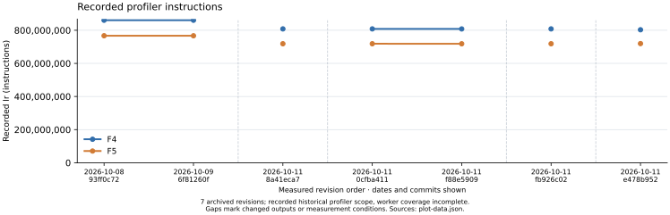
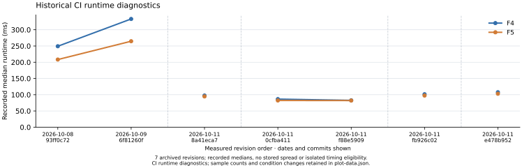
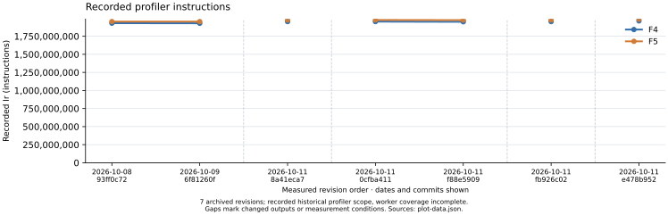
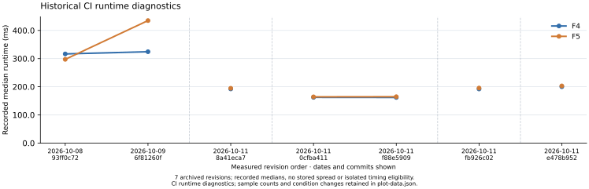
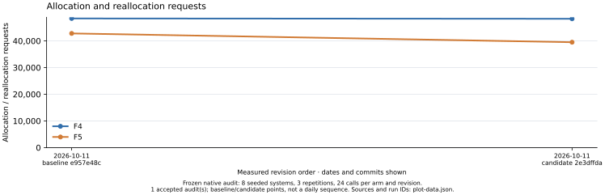
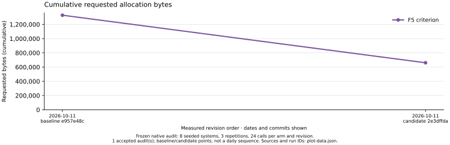

# Separate F4/F5 performance history

Frozen rendering of **7 recorded main revisions**, plus the native allocation baseline/candidate audit. No new performance run or speedup claim.

Plots retain each algorithm as its own series. CI runtime is diagnostic; incomplete historical profiler coverage is retained as recorded. Connecting lines stop when fingerprints or measurement conditions change. X spacing is revision order, not elapsed time.

[Combined PDF](report.pdf) · [Editable source](report.typ) · [Native plot data and provenance](plot-data.json)

## Boolean matrix step: F4 and F5

One shared K_1 / 2^23 m=2 system, 22 Boolean variables, maximum degree 4. Matrix construction, reduction and readback; F5 includes its criterion.

[Group PDF](boolean-matrix.pdf) · [Editable source](boolean-matrix.typ)

| UTC date / revision | F4 Ir | F5 Ir | F4 ms | F5 ms |
| --- | --- | --- | --- | --- |
| 2026-10-08 / 93ff0c72 | 860,633,889 | 766,940,469 | 249.241 | 208.250 |
| 2026-10-09 / 6f81260f | 860,555,567 | 766,776,087 | 333.279 | 264.687 |
| 2026-10-11 / 8a41eca7 | 808,263,705 | 718,576,235 | 97.380 | 94.658 |
| 2026-10-11 / 0cfba411 | 808,263,705 | 718,578,523 | 86.390 | 82.214 |
| 2026-10-11 / f88e5909 | 807,989,935 | 718,391,055 | 82.597 | 81.948 |
| 2026-10-11 / fb926c02 | 808,263,705 | 718,576,189 | 101.379 | 97.323 |
| 2026-10-11 / e478b952 | 803,017,657 | 719,516,063 | 107.585 | 102.927 |

- Historical Python-orchestrated perf.history/v1 snapshots; no new performance run or speedup claim.
- Runtime: one recorded median per kernel and revision; sample counts retained per point, no stored spread, no isolated timing eligibility. Runtime is diagnostic.
- Profiler Ir is the recorded historical scope. Worker-thread coverage is incomplete for these kernels; it is not a complete solver operation count.
- Lines stop at missing values, changed output fingerprints, or changed host/compiler/harness/profiler. Different algorithm fingerprints are expected and are not equated.
- X positions are measured revision order, labelled with UTC commit date and revision; spacing is not elapsed time.

## Boolean solver calls: F4 and F5

Shared K_1 / 2^17 m=2 workload, 16 Boolean variables, four planted and four random targets, maximum degree 3. The solve_boolean_system entry point, including root readback.

[Group PDF](boolean-solver.pdf) · [Editable source](boolean-solver.typ)

| UTC date / revision | F4 Ir | F5 Ir | F4 ms | F5 ms |
| --- | --- | --- | --- | --- |
| 2026-10-08 / 93ff0c72 | 1,930,989,200 | 1,953,108,992 | 316.570 | 297.297 |
| 2026-10-09 / 6f81260f | 1,929,374,570 | 1,952,598,745 | 324.403 | 435.004 |
| 2026-10-11 / 8a41eca7 | 1,953,021,023 | 1,974,789,730 | 192.203 | 194.561 |
| 2026-10-11 / 0cfba411 | 1,953,020,766 | 1,975,267,516 | 162.266 | 164.161 |
| 2026-10-11 / f88e5909 | 1,949,981,977 | 1,973,219,339 | 161.982 | 164.584 |
| 2026-10-11 / fb926c02 | 1,953,020,766 | 1,974,789,781 | 191.988 | 195.374 |
| 2026-10-11 / e478b952 | 1,962,376,386 | 1,985,422,672 | 200.058 | 202.996 |

- Historical Python-orchestrated perf.history/v1 snapshots; no new performance run or speedup claim.
- Runtime: one recorded median per kernel and revision; sample counts retained per point, no stored spread, no isolated timing eligibility. Runtime is diagnostic.
- Profiler Ir is the recorded historical scope. Worker-thread coverage is incomplete for these kernels; it is not a complete solver operation count.
- Lines stop at missing values, changed output fingerprints, or changed host/compiler/harness/profiler. Different algorithm fingerprints are expected and are not equated.
- X positions are measured revision order, labelled with UTC commit date and revision; spacing is not elapsed time.

## Complete Boolean calls: allocation history

Matching frozen Boolean allocation suite: 8 seeded systems, 3 repetitions, 24 calls per arm and revision. Polynomial dimensions, degrees and seeds are retained in the source audit protocol.

[Group PDF](complete-allocations.pdf) · [Editable source](complete-allocations.typ)

| UTC date / revision | F4 bytes | F5 bytes | F4 requests | F5 requests |
| --- | --- | --- | --- | --- |
| 2026-10-11 / e957e48c | 11,667,696 | 12,400,920 | 48,414 | 42,801 |
| 2026-10-11 / 2e3dffda | 6,712,608 | 6,762,696 | 48,294 | 39,507 |

- Native allocation audit. Original baseline/candidate rows, accepted comparison, exact outputs and accounting, shared inputs and all totals revalidated by the Rust plot-data tool.
- One baseline and one candidate point per accepted audit, not a daily sequence. A/A and replication pairs are controls, not additional algorithm revisions.
- Bytes are cumulative requested traffic, not peak memory. No timing is measured by this allocation series.
- Criterion construction is a separate part of F5 and is never compared as a complete solver.
- Audit revisions come from their frozen records. They are not inserted as measurements of historical CI workloads; the workloads and metrics remain separate.

## F5 criterion: allocation history

Matching frozen Boolean allocation suite: 8 seeded systems, 3 repetitions, 24 calls per arm and revision. Polynomial dimensions, degrees and seeds are retained in the source audit protocol.

[Group PDF](criterion-allocations.pdf) · [Editable source](criterion-allocations.typ)

| UTC date / revision | F5 criterion bytes | F5 criterion requests |
| --- | --- | --- |
| 2026-10-11 / e957e48c | 1,329,024 | 8,748 |
| 2026-10-11 / 2e3dffda | 660,480 | 5,676 |

- Native allocation audit. Original baseline/candidate rows, accepted comparison, exact outputs and accounting, shared inputs and all totals revalidated by the Rust plot-data tool.
- One baseline and one candidate point per accepted audit, not a daily sequence. A/A and replication pairs are controls, not additional algorithm revisions.
- Bytes are cumulative requested traffic, not peak memory. No timing is measured by this allocation series.
- Criterion construction is a separate part of F5 and is never compared as a complete solver.
- Audit revisions come from their frozen records. They are not inserted as measurements of historical CI workloads; the workloads and metrics remain separate.

## Historical provenance

Raw snapshots: `docs/perf/history/` on the `perf-history` branch; frozen copies: `research/f4_f5_history_20261012/records/history/` on the implementation branch. Every SHA-256 below was calculated natively from the original file bytes.

| Snapshot | SHA-256 | Recorded samples |
| --- | --- | --- |
| `20261008T150820Z-93ff0c72333c.json` | `161c9799f49c7c11059a869e0e09ede2d494980a23a32a7b59e4b28e25b3a65e` | 5 |
| `20261009T163719Z-6f81260f6ab5.json` | `325262d8694be901bf434abdf120933f9bcd071e26b63cbdfb9d602c72a4de03` | 5 |
| `20261011T173144Z-8a41eca79320.json` | `48b949e3d6db2930f266b8095297297e870b02abfedb2b4315b411953048062b` | 5 |
| `20261011T181908Z-0cfba41136ff.json` | `e2128df08370e31a34c66a783b16ed10ae7537f22ac396b259a7384441cbf340` | 5 |
| `20261011T204041Z-f88e5909f6cd.json` | `5a5e9ca300950b03163b9dbf71539e05a258e7120d7141c276ed52472ac1e8e4` | 5 |
| `20261011T220542Z-fb926c0206ab.json` | `f3ffddab49ee073b0ffda6ecd2e6513e5292a82035532020c0fb19e027ca9df5` | 5 |
| `20261011T222036Z-e478b952a890.json` | `d3195a2144c1e534f53d41a791c31a48462076a405bf2e4ae6c84a6a5f6967a9` | 5 |

Allocation provenance and hashes are in `plot-data.json`. Millisecond labels are the native conversion `wall_ns / 1,000,000`; no ratios, uncertainty estimates or fitted trends are calculated by the renderer.

Future history regeneration: native `tools/groebner-history`, followed by render-only `scripts/perf/render_groebner_history.py`; the workflow saves SVGs, PDFs, sources and JSON together.
