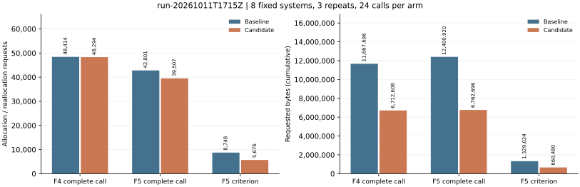

# Boolean F4/F5 construction allocation optimization

The existing Rust Boolean matrix F4/F5 implementation in
[aburan28/crypto](https://github.com/aburan28/crypto) now avoids duplicated
column materialization and most temporary F5 criterion product buffers.
This is an engineering change to construction overhead; the existing
criterion, row order, pruning contract and reduction counters are preserved.

Observed results from the native matched audit, **24 calls per arm across
eight systems and three repetitions**:

| Arm | Allocation requests: baseline → candidate | Cumulative requested bytes: baseline → candidate | Request reduction | Requested-byte reduction |
| --- | ---: | ---: | ---: | ---: |
| Complete F4 call | 48,414 → 48,294 | 11,667,696 → 6,712,608 | 0.25% | 42.47% |
| Complete F5 call | 42,801 → 39,507 | 12,400,920 → 6,762,696 | 7.70% | 45.47% |
| F5 criterion construction | 8,748 → 5,676 | 1,329,024 → 660,480 | 35.12% | 50.30% |

Counts and bytes are measured; percentages are native derived quantities:
`100 × (1 - candidate/baseline)`. Bytes are cumulative requested allocation
traffic, **not peak memory**. No wall-time improvement is established.
[Native comparison](records/comparison.json) retains every case and repetition;
[per-system raw counts](records/per-system-counts.csv) retain both seeds.
No workload regressed on either allocation measure.



The initial baseline, formatted-driver A/A control, candidate and five
alternating replication pairs are all retained. Outputs, rank, pruning
reports and word-XOR counters agree exactly across every matched pair.
All five pairs reproduced the primary JSONL records byte for byte. No
statistical interval was estimated; all raw repetitions are available.

## Implementation and correctness

- [Shared Boolean Macaulay builder](../../src/cryptanalysis/koblitz_groebner.rs):
  compact odd product multiplicities in place; collect each column once using
  the existing high-bit-safe mask hasher, then retain the original monomial
  order. Zero/single-row handling and row/column caps are preserved.
- [Boolean F5 criterion](../../src/cryptanalysis/matrix_f5_f2.rs):
  XOR products directly into a reusable packed row. Store buffers only when a
  new pivot is retained. Preserve the sorted fallback when missing columns
  may cancel. Carry the leading-word cursor forward through reduction.
- Five new correctness tests compare against independent Boolean
  multiplication, exercise zero and constant polynomials, high support bits
  through bit 63, cancellation of absent columns, and prefix/temporary pivot
  reductions across multiple machine words. Existing randomized F4/F5
  row-space and certificate checks remain active.
- The allocation driver in
  [examples/f4_f5_row_build_bench.rs](../../examples/f4_f5_row_build_bench.rs)
  is native Rust. It asserts exact outputs and diagnostics, including
  holdouts, before admitting the comparison.

Validation: 17 F5 tests, 43 Macaulay/Groebner tests and 13 F4 tests passed.
The touched example compiled and its test target passed (zero unit tests;
the driver itself executed all recorded audits).
Across the full run and its independent remainder, **3,838 distinct library
tests passed and 110 were ignored**. One unchanged test,
`cryptanalysis::jv_isogeny_walk::tests::end_to_end_from_a_non_weak_curve_recovers_and_verifies`,
did not complete before the 20-minute execution budget. The original test
process was stopped with SIGTERM at 1,257 seconds (Cargo exit 101), after the
budget checker initially could not identify its executable through `/proc`.
The remaining test run passed with exit 0. No full-suite success is asserted.
See [full log](records/library-tests.log), [remainder](records/library-tests-remainder.log),
[timeout](records/library-timeout.txt) and [exact unfinished test](records/library-pending-tests.txt).
The stalled test's sources are unchanged and do not call the optimized kernels.

## Scope, controls and requirements

| Requirement | Status and evidence |
| --- | --- |
| Optimize the existing F4/F5 implementation | Implemented and allocation-verified for the Boolean Rust implementation; source commit 2e3dffda681a4771be511653180da8354de3bce3 |
| Preserve existing output and accounting | Verified on all eight frozen systems, both seeds and all repetitions; exact native comparison and focused suites |
| Reproducible baseline/candidate evidence | Verified: saved binaries, source/configuration hashes, toolchain, host, input/output digests, A/A and five alternating pairs |
| Full library verification | Partial: 3,838 distinct tests passed, 110 ignored; one unchanged isogeny test exceeded the 20-minute budget; raw termination and coverage retained |
| Reviewable delivery | Local feature-branch commits; publication currently blocked by GitHub HTTP 401 credentials |
| Runtime, peak memory, other coefficient fields, larger systems | Not measured or established |

This iteration uses public synthetic planted Boolean systems. It does not
claim new F5 mathematics, a general-field result, a complete ECDLP speedup,
a matched-rho ratio, an m=83 ECC2K-130 improvement or m=131 transfer.
The WDSat regression measures a different SAT solver/encoding contract;
this standalone Boolean matrix allocation diagnostic freezes its own
matched suite and does not discharge complete-DLP accounting.
No key-recovery or deployed-curve conclusion follows.

Host: Linux x86-64, AMD EPYC 9V74, 5 logical CPUs, 18,882,699,264 bytes RAM;
Rust 1.99.0 (b940084d7), Cargo 1.99.0, default release target, one Rayon worker.
No KIC/F4/F5 tuning environment overrides or RUSTFLAGS were set.
No exclusive CPU reservation was earned, so all wall-time fields remain null.
Input construction, worker startup, warmup, hashing and verification are outside
the allocation interval; complete solver packing, elimination and output
construction are inside. Each criterion call is audited separately.

## Baseline repairs and preserved failures

Original main:
`c95a14de9bfa2711643a9318f3728d5d1109367b`.
It could not compile because source fragments were duplicated. Separate
prerequisite commits retain intact existing implementations and assertions:

- `5e5f1353`: remove the duplicated assertion in factor-base search;
  remove duplicated constructor/field fragments in index calculus; repair the
  duplicated prime arithmetic assertion; add the frozen diagnostic/protocol.
- `e957e48c`: remove duplicate imports/coordinate helpers/legacy return
  fragments, the duplicated Artin-Schreier return body and duplicated statistics
  fields. This is the **unoptimized production baseline** for both arms.
- `ee344374`: restore the undefined legacy JSON test fixture and a test-only
  historical radix helper, leaving original assertions intact; format the
  diagnostic. These test-only repairs do not enter the measured calls.
- `2e3dffda`: the actual F4/F5 optimization and five correctness tests.

Failed build attempts, then successful builds, are retained in
[records](records/): `f4-f5-baseline*.log`,
`f4-f5-candidate-test-build*.log` and
`f4-f5-candidate-example-build.log`. Failed Cargo builds exited 101.
They produced no accepted benchmark measurements. Later runs do not overwrite
those failures. All native audit/compare/replication runs completed with exit 0.

Conductor was unavailable (`conductor check`: command not found; no
`.conductor/WORKFLOW.md` in this checkout). Reversible edits were scoped to a
feature branch, with prerequisite scope expansions recorded before edits.
`gh api user` returned HTTP 401 Bad credentials; `git push --dry-run` also
failed because no GitHub username/credential is configured (exit 128).
Repository publication needs functioning credentials; no pull request has
been opened. Both access logs are retained in `records/`.

## Reproduction

See [PROTOCOL.md](PROTOCOL.md) for the frozen acceptance conditions and
[manifest.json](manifest.json) for commands, statuses and provenance.
Baseline production revision: `e957e48c2b8cf1f84a7fc44a1d673103964a789d`;
candidate: `2e3dffda681a4771be511653180da8354de3bce3`.
A baseline worktree builds its committed original driver; its exact A/A
calibration establishes equivalence with the formatted final driver.

```sh
cargo build --locked --release --example f4_f5_row_build_bench -j 2
target/release/examples/f4_f5_row_build_bench 3 > candidate.jsonl
target/release/examples/f4_f5_row_build_bench compare baseline.jsonl candidate.jsonl
RAYON_NUM_THREADS=1 cargo test --locked --release --lib -- --test-threads=1
cargo test --locked --release --example f4_f5_row_build_bench
```

The formatted A/A driver was built natively against the saved baseline library:

```sh
rustc --edition=2021 --crate-name f4_f5_row_build_bench examples/f4_f5_row_build_bench.rs \
  -C opt-level=3 -C embed-bitcode=no \
  --extern crypto_lib=/workspace/scratch/libcrypto_lib-f4-f5-baseline.rlib \
  --extern serde_json=target/release/deps/libserde_json-d00c0fe8816b70e5.rlib \
  --extern rayon=target/release/deps/librayon-df156b9b076da0b0.rlib \
  --extern blake3=target/release/deps/libblake3-e60f6d89c18cbd96.rlib \
  -L dependency=target/release/deps \
  -o /workspace/scratch/f4-f5-row-build-baseline-formatted
```

Native baseline and candidate binaries remain in this workspace; manifests
retain their SHA-256 hashes. Rendering uses only recorded native values:

```sh
MPLCONFIGDIR=/tmp/f4-f5-mpl XDG_CACHE_HOME=/tmp/f4-f5-render-cache \
  /tmp/f4-f5-report-venv/bin/python render_reports.py
```

[Result PDF](report.pdf) and [editable Typst source](report.typ).
Every page of each run PDF was opened and checked for readable labels,
run IDs, source paths and values before commit.

Run reports:

- [Baseline](reports/run-20261011T1655Z/REPORT.md)
- [A/A calibration](reports/run-20261011T1700Z/REPORT.md)
- [Candidate](reports/run-20261011T1715Z/REPORT.md)
- [Five alternating pairs](reports/run-20261011T1716Z/REPORT.md)

Canonical graphs checked and left unchanged:
`docs/index-calculus-scoreboard.html`,
`docs/ic/progress-timeline.json`,
`docs/performance-gains.html`, `docs/performance-gains/`,
`docs/curves/` and `figures/`. The allocation-only standalone result
does not change their time, IC/rho, curve or scaling facts. This study's
new allocation graph carries the measured comparison.
