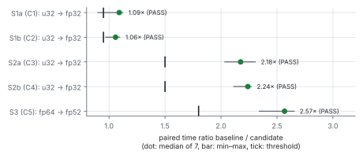
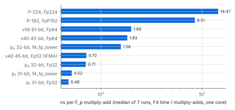
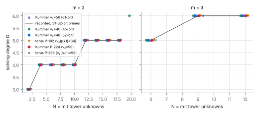
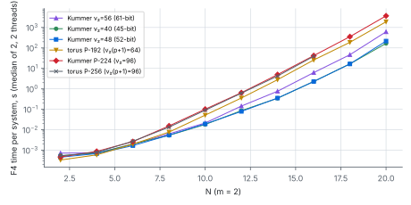

# The F4 tower engine over a generic prime field (2026-10-15)

Lane F, lead 4 of
[`docs/ic/factor-base-encyclopedia/README.md`](../../docs/ic/factor-base-encyclopedia/README.md)
§8: run the PKM tower F4 engine at primes the `u32` engine cannot hold —
Kummer towers at `v₂(p − 1) = 40, 48, 56` and at the NIST P-224 prime
(`v₂(p − 1) = 96`), the Dickson torus tower at P-192 / P-256 — and make it
fast. Round 8 ([`research/pkm_dickson_torus_20261015`](../pkm_dickson_torus_20261015/README.md))
had left `v₂ ≥ 40` blocked by the engine's 32-bit coefficients.

- **Protocol.** [`PROTOCOL.md`](PROTOCOL.md), frozen in `9e2226903` before any
  measured cell (sha256 `9cd5e24a…cdc0499` at that commit); §8 addendum
  (`559dce0de`) committed before the runs it describes.
- **Runs.** `runs/speed/` (speed arms, `run_speed.sh`), `runs/eq/` (equality,
  `run_eq.sh`), `runs/depth/` (measured cells, `run_depth.sh`, fixed binary),
  `runs/depth-v1/` (first depth run, superseded, kept), `runs/ext/`
  (extension cells, `run_ext.sh`). `runs/progress.txt` and each
  `runs/*/progress.txt` log starts, ends and exit statuses.
  Binaries: `runs/BINARIES.sha256`.
- **Analysis.** [`examples/f4_generic_report.rs`](../../examples/f4_generic_report.rs)
  (Rust) writes `runs/speed_report/` and `runs/cells_report/`;
  [`check.sh`](check.sh) writes [`runs/checks.txt`](runs/checks.txt) (gates);
  [`plot.py`](plot.py) only lays out those CSVs.
- **Report.** [`report.pdf`](report.pdf) (Typst source `report.typ`).

**What this is.** Engineering (a new engine and two backends, with speed
claims) plus a stage diagnostic of the solver axis (`AGENTS.md` §2): the F4
solving degree `D` of PKM tower systems at large primes. It prices no
pipeline and reports no `S`. Host: 4 vCPU Xeon @ 2.10 GHz with AVX-512 IFMA,
**shared with another lane (L0, not isolated)**.

## 0. Answers

| question | answer | status |
|:--|:--|:--|
| Does the generic engine at `Fp32` reproduce `f4_fp_tower`? | **Yes, field for field**: 182 rows of every round-8 series `N ≤ 18` (Kummer p₂, split Dickson p₁, torus T31/T24, tower and nulls, `m = 2, 3, 4`) compare with **0 differences** — `D`, width, steps, multiply-adds, every counter. | measured |
| Is it at least as fast at `p < 2³¹`? | **Yes.** Paired median time ratio `u32 / generic` 1.091 (split Dickson p₁, `N = 16`) and 1.058 (torus T31), threshold 0.95. | measured, pre-registered |
| Faster where it can be? | Above `2³¹` (p₂): **2.18×** (`m = 2, N = 16`) and **2.24×** (`m = 3, N = 12`) over `f4_fp_tower` (Shoup lazy rows against eager Barrett). At 45 bits the new `Fp52` AVX-512 IFMA backend is **2.57×** `Fp64`. 5/5 pre-registered claims pass. | measured, pre-registered |
| H_same: is `D` independent of `v₂` and of the prime's size? | **Supported in every valued cell.** Kummer at `v₂ = 40, 48, 56` and at P-224 (`m = 2, N = 2…18`; `m = 3, N = 6, 9, 12`; `m = 4, N = 8`) and the Dickson torus at P-192 (`m = 2, N ≤ 18`; `m = 3, N ≤ 12`) and P-256 (`m = 2, N ≤ 16`; `m = 3, N ≤ 9`) give the recorded 31–32-bit `D` — and also the same width and step count — in all 74 cells; no cell differs. Extension cells: §4. | measured |
| Is it the same computation? | **Yes, to the multiply-add.** On the fixed binary the multiply-add count of a Kummer cell is the same at 45, 52, 61 and 224 bits (`m = 2, N = 18`: 45,952,850,022 at v40, v48, v56 and P-224, two threads; round 8's p₂ count 45,950,147,498 was at one thread, and the chunking — hence the count — depends on the thread count). | measured |

## 1. What was built

- [`src/cryptanalysis/f4_tower_generic.rs`](../../src/cryptanalysis/f4_tower_generic.rs):
  `f4_tower_generic<F: PrimeField>` — the `u32` engine's algorithm
  (pairs, Gebauer–Möller, symbolic preprocessing, Faugère–Lachartre
  elimination, full-rank exit, trace) with coefficients `F::Elem` and the
  dense kernels on Stage 0's lazy accumulators (`row_load` / `row_sub` /
  `row_reduce` / `row_reduce_scaled`; sparse `row_scatter_axpy`). Each
  accumulator row counts its products and reloads at the backend's
  `lazy_capacity`. Block and chunk sizes are the `u32` engine's for every
  backend, so a report does not depend on the backend. The `u32` engine
  (`f4_fp_tower`) is unchanged.
- [`src/cryptanalysis/fp_backend_ifma.rs`](../../src/cryptanalysis/fp_backend_ifma.rs):
  `Fp52` (`p < 2⁵²`), `Fp64`'s Montgomery elements with an accumulator
  `lo + hi·2⁵²` filled by `vpmadd52luq/huq`, four entries per pair of
  instructions; capacity 4095 products; scalar fallback without IFMA.
- [`examples/pkm_tower_pilot.rs`](../../examples/pkm_tower_pilot.rs):
  `--engine generic`, `--backend auto|fp32|fp52|fp64|wide1|wide3|p192|fp224|wide4`,
  `--p P-192|P-224|P-256|proth:K|<decimal>`. `auto`: `Fp32` < 2³², `Fp52` < 2⁵²
  (with IFMA), `Fp64` < 2⁶³, `FpP192` at P-192, `FpWide<3>` ≤ 192 bits,
  `Fp224` ≤ 255 bits, `FpWide<4>`. Above 2⁶³ the systems come from
  [`examples/pkm_tower_wide/wide.rs`](../../examples/pkm_tower_wide/wide.rs),
  generic over the backend (Kummer, Dickson torus; tower and null controls;
  planted and random targets; random draws on canonical integers so one seed
  gives the same system under every backend), with `--verify`.

Usage:

```bash
cargo run --release --example pkm_tower_pilot -- --engine generic --p P-224 \
    --kinds kummer --m 2 --controls tower --t-min 1 --max-t 9 --planted 0 --random 2 --verify
cargo run --release --example pkm_tower_pilot -- --engine generic --p proth:40 ...   # u64 builder, Fp52
```

## 2. Correctness

- **Unit tests** (`cargo test --release --lib -- f4_tower_generic fp_backend_ifma`,
  7/7): every backend that holds the prime — `Fp32` (vector and scalar),
  `Fp64`, `FpWide<1>`, `FpWide<4>`, `Fp224`, `Fp52` (IFMA and scalar), and
  wrappers with lazy capacity 1, 2, 3 — reproduces `f4_fp_tower`'s report and
  basis on random rings and systems at 97, 786433, 2013265921, 3221225473,
  4294967291, with and without the full-rank exit, and on an `N = 12` Kummer
  system; exact refutation and point count against brute force over `V × V` at
  a 40-bit Proth prime and at P-224; the same report and basis under every
  backend at a 56-bit, the 40/48-bit and the P-224 prime; `from_raw`,
  `mul_mono`, `eval` against the `u32` ring; `Fp52` against `BigUint` on edge
  values (0, 1, 2, p − 1, p − 2, (p ± 1)/2) and on rows of a load plus the
  full 4095 products with all-(p − 1) entries. Pilot tests (7/7) include the
  wide builder's towers at P-224 / P-192 and one seed giving identical rows
  under `Fp32`, `Fp64` and `FpWide<4>`.
- **G2, equality runs** ([`runs/checks.txt`](runs/checks.txt)): `u32` vs generic
  `Fp32`: Kummer p₂ 42 rows, split Dickson p₁ 28, torus T31 56, torus T24 56 —
  **0 differences**. Kummer p₂ at `Fp64`, `Fp52`, `FpWide<4>` against `Fp32`:
  22 rows each, 0 differences (FpWide<4> re-run on the fixed binary; §5).
- **G3**: the arms of each speed cell agree on every field but the clock.
- **G4, measured cells**: `pkm_tower_check verify` (independent exhaustive
  count over `V^m`) on every `u64`-builder row: 97/97 agree. The wide
  builder's `--verify` on every finished tower row at P-224, P-192, P-256:
  82/82 ok — the engine refutes exactly the targets without a decomposition,
  and every decomposition found, and every planted point, satisfies every
  input equation and every basis element in `BigUint` arithmetic. No
  `planted_ok = false` anywhere.

## 3. Speed (pre-registered, `runs/speed_report/`)

7 interleaved repetitions per arm, one system per run, one thread on one core
(`taskset -c 3`), shared host (load 1.7–4.5). F4 time per system.

| id | claim | baseline ms | candidate ms | ratio (median of paired) | paired min–max | threshold | verdict |
|:--|:--|--:|--:|--:|:--|--:|:--|
| S1a | split Dickson p₁, m=2 N=16: generic Fp32 vs f4_fp_tower | 3005 | 2791 | 1.091 | 0.900–1.123 | 0.95 | PASS |
| S1b | torus Dickson T31, m=2 N=16: same | 2988 | 2784 | 1.058 | 0.969–1.096 | 0.95 | PASS |
| S2a | Kummer p₂ (> 2³¹), m=2 N=16: same, ≥ 1.5× | 8921 | 4009 | 2.175 | 2.034–2.306 | 1.5 | PASS |
| S2b | Kummer p₂, m=3 N=12: same, ≥ 1.5× | 15578 | 7001 | 2.240 | 2.114–2.270 | 1.5 | PASS |
| S3 | Kummer v40 (45-bit), m=2 N=16: Fp52 IFMA vs Fp64, ≥ 1.8× | 10333 | 4074 | 2.568 | 2.342–2.653 | 1.8 | PASS |



Cost per `F_p` multiply-add in the engine (median, descriptive):

| arm | ns / muladd | × generic Fp32 at p₁ |
|:--|--:|--:|
| p₁ (31-bit), generic Fp32 | 0.479 | 1.00 |
| p₁, f4_fp_tower | 0.516 | 1.08 |
| p₂ (32-bit), generic Fp32 | 0.709 | 1.48 |
| p₂, f4_fp_tower | 1.577 | 3.29 |
| v40 (45-bit), Fp52 IFMA | 0.720 | 1.50 |
| v40, Fp64 | 1.827 | 3.81 |
| v56 (61-bit), Fp64 | 1.995 | 4.16 |
| P-192, FpP192 (torus, N = 14) | 8.51 | 17.8 |
| P-224, Fp224 (Kummer, N = 14) | 14.47 | 30.2 |



The P-192 / P-224 rows come from the speed run's binary, before the block-size
fix (§5); they are descriptive and their multiply-add counts differ from the
fixed binary's by < 0.3 %.

**Tried and dropped (exploratory, not pre-registered).** A 4-limb IFMA
accumulator for P-224/P-256 (ten 52-bit columns, 13 masked IFMA per entry)
was correct against `BigUint` and in the engine but slower than `FpWide<4>`'s
row kernel on this host (microbenchmark 16.9 against 12.4 ns per entry; whole
engine 10.6 against 7.8 s at P-224 `N = 14`), so it was removed. A
limb-sliced (structure-of-arrays) layout over 8 entries is the remaining
route to a faster 224-bit kernel.

## 4. The measured cells (`runs/cells_report/`)

`D / width / steps` (two random targets per cell, plus planted targets at
`N ≤ 8` / `9`, whose step count can be one lower). Reference: the recorded
rows of round 8 (Kummer p₂ = 3·2³⁰ + 1, `R11`; torus T31, `R1`/`R6`) and
round 2 (Kummer p₁, `M4`, for `m = 4`). Every listed cell equals its
reference in `D`, width and steps.

### Kummer, `m = 2`

| N | v₂ = 30 (p₂, recorded) | v₂ = 40 (27·2⁴⁰ + 1) | v₂ = 48 (15·2⁴⁸ + 1) | v₂ = 56 (27·2⁵⁶ + 1) | P-224 (v₂ = 96) | P-224 F4 time |
|--:|:--|:--|:--|:--|:--|--:|
| 2 | 3 / 4 / 2 | 3 / 4 / 2 | 3 / 4 / 2 | 3 / 4 / 2 | 3 / 4 / 2 | 0.0 s |
| 4 | 4 / 16 / 4 | 4 / 16 / 4 | 4 / 16 / 4 | 4 / 16 / 4 | 4 / 16 / 4 | 0.0 s |
| 6 | 4 / 56 / 6 | 4 / 56 / 6 | 4 / 56 / 6 | 4 / 56 / 6 | 4 / 56 / 6 | 0.0 s |
| 8 | 4 / 152 / 8 | 4 / 152 / 8 | 4 / 152 / 8 | 4 / 152 / 8 | 4 / 152 / 8 | 0.0 s |
| 10 | 4 / 337 / 10 | 4 / 337 / 10 | 4 / 337 / 10 | 4 / 337 / 10 | 4 / 337 / 10 | 0.1 s |
| 12 | 5 / 1231 / 13 | 5 / 1231 / 13 | 5 / 1231 / 13 | 5 / 1231 / 13 | 5 / 1231 / 13 | 0.6 s |
| 14 | 5 / 2304 / 15 | 5 / 2304 / 15 | 5 / 2304 / 15 | 5 / 2304 / 15 | 5 / 2304 / 15 | 5.0 s |
| 16 | 5 / 4789 / 17 | 5 / 4789 / 17 | 5 / 4789 / 17 | 5 / 4789 / 17 | 5 / 4789 / 17 | 42 s |
| 18 | 5 / 8644 / 20 | 5 / 8644 / 20 | 5 / 8644 / 20 | 5 / 8644 / 20 | 5 / 8644 / 20 | 355 s |

### Kummer, `m = 3, 4`

| m | N | recorded | v₂ = 40 | v₂ = 48 | v₂ = 56 | P-224 | P-224 F4 time |
|--:|--:|:--|:--|:--|:--|:--|--:|
| 3 | 6 | 5 / 164 / 10 (p₂) | 5 / 164 / 10 | 5 / 164 / 10 | 5 / 164 / 10 | 5 / 164 / 10 | 0.0 s |
| 3 | 9 | 6 / 1186 / 16 (p₂) | 6 / 1186 / 16 | 6 / 1186 / 16 | 6 / 1186 / 16 | 6 / 1186 / 16 | 1.6 s |
| 3 | 12 | 6 / 5019 / 18 (p₂) | 6 / 5019 / 18 | 6 / 5019 / 18 | 6 / 5019 / 18 | 6 / 5019 / 18 | 85 s |
| 4 | 8 | 6 / 1049 / 21 (p₁) | 6 / 1049 / 21 | 6 / 1049 / 21 | 6 / 1049 / 21 | 6 / 1049 / 21 | 0.6 s |

### Dickson torus

| m | N | recorded torus T31 | P-192 (v₂(p + 1) = 64) | P-192 null | P-256 (v₂(p + 1) = 96) |
|--:|--:|:--|:--|:--|:--|
| 2 | 2 | 3 / 4 / 2 | 3 / 4 / 2 | 3 / 4 / 2 | 3 / 4 / 2 |
| 2 | 4 | 4 / 16 / 4 | 4 / 16 / 4 | 4 / 16 / 4 | 4 / 16 / 4 |
| 2 | 6 | 4 / 56 / 6 | 4 / 56 / 6 | 4 / 56 / 6 | 4 / 56 / 6 |
| 2 | 8 | 4 / 152 / 8 | 4 / 152 / 8 | 4 / 152 / 8 | 4 / 152 / 8 |
| 2 | 10 | 4 / 336 / 10 | 4 / 336 / 10 | 4 / 336 / 10 | 4 / 336 / 10 |
| 2 | 12 | 5 / 1223 / 13 | 5 / 1223 / 13 | 5 / 1223 / 13 | 5 / 1223 / 13 |
| 2 | 14 | 5 / 2303 / 15 | 5 / 2303 / 15 | 5 / 2303 / 15 | 5 / 2303 / 15 |
| 2 | 16 | 5 / 4786 / 17 | 5 / 4786 / 17 | 5 / 4786 / 17 | 5 / 4786 / 17 |
| 2 | 18 | 5 / 8639 / 20 | 5 / 8639 / 20 | 5 / 8639 / 20 | — |
| 3 | 6 | 5 / 164 / 10 | 5 / 164 / 10 | — | 5 / 164 / 10 |
| 3 | 9 | 6 / 1184 / 16 | 6 / 1184 / 16 | — | 6 / 1184 / 16 |
| 3 | 12 | 6 / 5018 / 18 | 6 / 5018 / 18 | — | — |




EXTENSION_PLACEHOLDER

**Reading under PROTOCOL §6.** H_same is supported in every series: no valued
cell differs in `D`. Beyond the rule, width and step count also agree in every
cell, and on the fixed binary the multiply-add count is identical across all
five Kummer primes (and between P-192 and P-256 for the torus): the
computation does not see the prime at all at these sizes. This matches round
8's derivation: the Kummer system's coefficients do not involve `ζ`, so
`v₂(p − 1)` cannot enter except through accidental cancellation mod `p`, which
is rarer, not commoner, at larger primes.

## 5. Deviations and disclosures

- **Block-size fix and depth re-run (addendum A).** The first depth run
  (`runs/depth-v1/`) sized the engine's S-row blocks by the accumulator's
  width, so multiply-add counts at wide backends depended on the backend
  (`D`, width and steps did not: v1 and v2 agree on every field but the
  multiply-adds, clocks and the verifier's timing —
  [`runs/depth_v1_vs_v2.txt`](runs/depth_v1_vs_v2.txt), 0 differences in 197
  rows). The fixed binary re-ran §5 into `runs/depth/`.
- **The `FpWide<4>` equality arm** (G2) was first run on the old binary and
  showed 4 differences, all in multiply-adds only (`N = 14, 16`) — the same
  block-size effect. The addendum, written before that arm had finished, said
  it had 0 differences; that was premature. It was re-run on the fixed
  binary: see `runs/checks.txt` (`kummer-p2.wide4.v1.*` kept).
- **Container restart.** The host container restarted during the extension
  run and the first `FpWide<4>` re-run; both were restarted (`run_ext.sh`
  became resumable and skips cells already finished). `runs/progress.txt`.
- The speed arms and the equality runs used the first binary (`eb44c14b…`);
  their `Fp32`, `Fp52`, `Fp64` accumulators are ≤ 16 bytes, where the block
  size was already the `u32` engine's below the clamp, and G2/G3 show they
  match.
- Calibration runs before the protocol are disclosed in PROTOCOL §7.
- Conductor's control plane was down (connection refused); no task card.
