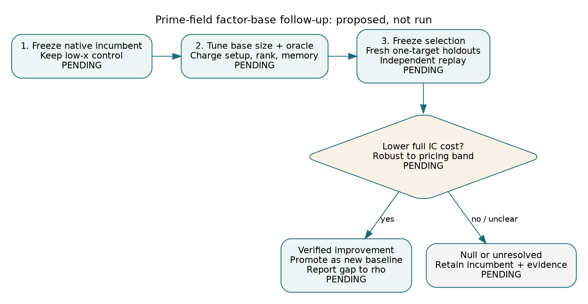

# Next experiment: tune the base and oracle together

Date: 2026-10-16. Status: recommendation and draft experiment; **no new run**.
Scope: the prime-field factor-base study imported by PR #1898. This is a
research handoff, not a manuscript or a new performance result.

## Recommendation

Use low-x as the historical control and optimize **base size plus decomposition
cost** in the existing native IC pipeline. Keep multiplicative-coset/Kummer
bases as challengers. A useful base supplies independent relations cheaply
enough to reduce the full cost to a verified answer; coverage alone does not
decide that cost.

The next bounded experiment is the draft
[XP-20261016-prime-base-oracle-tuning](../../../backlog/XP-20261016-prime-base-oracle-tuning/README.md).
It is not ready to dispatch: the exact native baseline, executable spec,
inputs, budgets, checkpoint and independent replay command must be frozen first.

## Evidence behind the choice

The [historical study](../README.md), preserved in
[PR #1898](https://github.com/aburan28/crypto/pull/1898), found low-x fastest
in its 24-bit exact-join cohort. The coset/random throughput interval includes
no difference. Its algebraic norm solver was a Sage prototype and its join was
native C. Those stage CPU comparisons do not establish a native pipeline
ranking, and neither their timing conditions nor their cohort choose the best
current repository pipeline. The original report, data and hashes stay intact.

Read-only checks of current source reports clarify the possible follow-ups:

- The [generic-field F4 study][wide] already runs small Kummer systems at
  P-224 and Dickson torus systems at P-192/P-256. A wide-field port is no
  longer the first task. Its matching solving degrees concern the recorded
  small systems, not a full DLP at those sizes.
- The [msolve degree study][degree] reports productive degree-8 rounds at
  four-point decomposition, N=20, in its raw presentation. The degree-7
  plateau therefore failed for those runs. The reduced native presentation
  remains a distinct unresolved check. This is not a proof that every tower
  algorithm fails or a claim that the native cell has completed.
- The [charged isogeny-tower study][isogeny] found no benefit over a plain
  matched-size base with its table oracle. This supports measuring the
  base/oracle combination, with construction costs included.

The [encyclopedia][encyclopedia] and backlog remain useful indexes, but their
older statements that no NIST-prime tower system has run, or that the
four-point plateau is entirely untested, need these source-report qualifiers.
This note does not modify their frozen reports or close their backlog cards.

## Ordered work

1. **Freeze the native incumbent and establish correctness.** Use existing
   Rust ecbench components. On each registered prime-order curve, identify
   the lowest-cost currently verified native IC configuration and preserve
   its code/spec/input/receipt hashes. Low-x remains a mandatory historical
   control even if another native configuration is better. Cross-check the
   native decomposition outputs against exact small-group solution sets and
   the archived identities. Do not extend the old Sage execution path.
2. **Screen base size and oracle jointly.** Sweep a preregistered grid around
   the incumbent base size using low-x and the admissible coset/tower base;
   use random bases as controls. Compare actual signed point classes and
   memory, and record lookup-table size separately. Match actual base sizes
   for family comparisons; when optimizing size, explicitly report the size
   change. Freeze the arity in each comparison. Start with existing exact
   native pair-table/subtraction oracles and assess batching or table layout
   only where the code audit shows that work has not already landed.
   Measure verified independent rank per charged work, rank stalls, setup,
   failed attempts and memory as stage diagnostics. Use disjoint tuning and
   fresh holdout curves/targets; the already-inspected archive is a regression
   set, not a fresh holdout. No target scalar labels may select a base.
3. **Validate the selected recipe end to end.** Freeze the selected parameters
   before holdout evaluation. Run incumbent and candidate on identical,
   separate one-target workloads through recovery and independent point
   verification, with matched rho on the same targets. Include cold setup,
   oracle work, failures, filtering, verification and linear algebra. Report
   online cost separately; do not divide a multi-target batch to invent a
   one-target cost. Independently replay the sealed records before promotion.

[Editable diagram](decision.dot), [SVG](decision.svg), [PDF](report.pdf).

## Decision and accounting rules for the future protocol

Use the repository's counted cost S, with an explicit inventory of every
unpriced native counter on every arm, including rho. Emit missing counts
before ranking. Apply the same native-operation weights 0, 0.1 and 1 GAE
to every arm, and show pinned calibration as an additional point only when
available symmetrically. A ranking that reverses inside the band is unresolved.

The acceptance target is a verified reduction from the frozen IC incumbent
on fresh matched workloads, robust throughout that band. An engineering
improvement counts as success even while IC remains above rho. Report both
baseline/candidate and distance-to-rho ratios, sample sizes and paired
uncertainty. Use the repository isolation and A/A requirements for any wall
claim. Preserve caps and unsuccessful runs; a timeout is not a win or a
nonexistence proof. A stage improvement remains a stage improvement until it
reduces the full pipeline cost.

If holdout improvement is unresolved, retain the incumbent and report the
bounded outcome. The existing [heavy PKM degree card][heavy] remains a
separate structural workstream. Reconcile its raw/reduced-presentation
question with the msolve evidence before requesting a large-memory run;
neither that question nor larger NIST-prime coefficients is a prerequisite
for a useful measured constant-factor improvement to the current pipeline.

## Status and reproduction of this handoff

| Deliverable | Status |
| --- | --- |
| Evidence-linked recommendation and diagram | Prepared in this change |
| Draft experiment card | Prepared; not dispatchable |
| Exact native incumbent and runnable protocol | Pending |
| Tuning sweep, holdout solves and independent replay | Not run |

Pinned source-report revision on repository main:

`f334da9fea56bcd1480cd198d238a5e36de36108`.

No new curve, theorem,
benchmark value, asymptotic claim or pipeline ranking is introduced. No
Lean proof or algebraic certificate is claimed. Historical and native CPU
results are not combined. New measurements, if run, need their own reports,
benchmark copies and affected dashboard updates.

The current root AGENTS.md sections 7a-7c were checked for applicability:
the scoreboard, progress timeline, leaderboard and lab browser remain unchanged
because this planning change introduces no new measurement, identity, replay
or corrected end-to-end ratio. Existing study plots are linked, not regenerated.
The diagram is qualitative and marks every execution step as pending.

Run `sh build.sh` in this directory to rebuild the SVG/PNG and PDF from the
DOT and Markdown sources (Graphviz, Pandoc and XeLaTeX). The PDF is checked
page by page before publication. Conductor, Cargo and the backlog executable
are absent in this workspace; their attempted commands returned 127.
The referenced `.conductor/WORKFLOW.md` returned 404. Structural card checking
uses the committed JSON schema here; native `backlog validate` remains a CI
gate and is not reported as passed locally.

[wide]: https://github.com/aburan28/crypto/blob/f334da9fea56bcd1480cd198d238a5e36de36108/research/f4_generic_field_20261015/README.md
[degree]: https://github.com/aburan28/crypto/blob/f334da9fea56bcd1480cd198d238a5e36de36108/research/ic_next10_20261014/03-pkm-degree/README.md
[isogeny]: https://github.com/aburan28/crypto/blob/f334da9fea56bcd1480cd198d238a5e36de36108/research/pkm_isogeny_tower_ecbench_20261015/README.md
[encyclopedia]: https://github.com/aburan28/crypto/blob/f334da9fea56bcd1480cd198d238a5e36de36108/docs/ic/factor-base-encyclopedia/README.md
[heavy]: https://github.com/aburan28/crypto/blob/f334da9fea56bcd1480cd198d238a5e36de36108/backlog/XP-20261015-pkm-m3-n21-m4-n20/README.md
