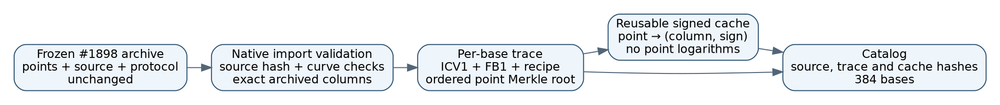

The request is to preserve the exact factor bases used in the completed
four-family evaluation, including their ordering and derivation, and make
them reusable through a lookup cache. This additive historical import covers
**all 384 cases and 52,876 canonical representative rows across those cases**.
Points shared between bases are counted in each base's record. Each representative
also has its negative in the cache. These are the historical 16-, 20- and
24-bit fields; the importer is pinned to that archive. No research campaign
or performance benchmark was run, and no point logarithm was recovered.

## What was already saved

[PR #1898](https://github.com/aburan28/crypto/pull/1898) preserved the full
ordered `base` array in every `results/generic.json` record inside the
[frozen archive](../factor_base_evaluation_20261015/artifacts/factor_base_evaluation.zip).
It also preserved the generation program, protocol, seeds, curve parameters
and family-specific metadata. The points were obtained by lifting coordinates
onto `y² = x³ − 3x + b`; they were **not generated by solving their logarithms**.
The homogeneous relation study did not produce a table of point logarithms.
Its archived `m` field counts base columns; the decomposition arity was three.

Those records were embedded in the larger experiment output. The new native
[exporter](../../src/bin/factor_base_trace.rs) makes each base independently
readable and builds a persistent signed-membership cache. The
[catalog](catalog.json) binds each case to its full FB1 digest, trace digest,
cache digest and order root. All original evidence remains unchanged.

The 48 historical curve models are registered in the existing ICV1 registry
and native alias map. Their identities are computed by the existing Rust
`curve_id::prime` implementation from the frozen parameters and recorded
orders. The [native source records](../../docs/curves/sources/factor-base-evaluation-20261015.json)
feed the existing metadata assembler; no new point counting or Python curve
arithmetic is used for this import. Existing registry records are preserved
exactly, and the exporter refuses unregistered curve identities.

## What each exported record contains

| Record | Meaning |
|---|---|
| Source | Frozen archive member, exact SHA-256, array index, producer and protocol hashes |
| Curve | Existing native ICV1 identity, explicit equation and subgroup order |
| FB1 | Existing `ecbench.factor_base/v1` identity convention and native group keys; full digest retained |
| Ordered representatives | Exact archived `(x,y)` and packed value at every original matrix column |
| Derivation | Family recipe, global seed, RNG seed inputs and recorded `base_extra` |
| Order root | Domain-separated SHA-256 Merkle tree binding curve, full FB1 digest, column and point |
| Cache | Both signs mapped to the original zero-based column and coefficient sign |

The reference generator in the native curve wrapper is the first archived
representative. This is a validation choice, not a historical generator claim
or a known-scalar label. The cached sign is `+1` or `−1` relative to the archived
representative; it is not a discrete logarithm.

The Merkle root commits to the exact ordered list. It does not prove how the
points were generated. **Complete rejected-candidate events and the historical
pre-shuffle acceptance order were not recorded.** The trace says so explicitly.
The frozen producer is the authority for the recipe; its CPython RNG is not
rerun or relabelled as a new native implementation.



## Reuse and verification

Build the native tool, extract the existing frozen archive into a new directory,
then export into a directory that does not exist yet:

```sh
cargo build --release --bin factor_base_trace --bin ecbench
fb_study_dir=research/factor_base_evaluation_20261015
unzip "$fb_study_dir/artifacts/factor_base_evaluation.zip" \
  -d /tmp/fb-history
target/release/factor_base_trace export \
  /tmp/fb-history/results/generic.json /tmp/fb-records
target/release/factor_base_trace verify \
  /tmp/fb-history/results/generic.json /tmp/fb-records
```

The exporter refuses a source whose bytes do not match the frozen SHA-256
recorded in the catalog and exporter.
It refuses overwriting an existing export directory. Verify first against the
frozen source when obtaining records from another location: self-consistent
hashes alone do not authenticate a replacement dataset.

Each catalog entry's `name` identifies `NAME.json` and `NAME.cache`. Look up one
or several points after loading and checking the cache once:

```sh
target/release/factor_base_trace lookup \
  /tmp/fb-records/000-FB1h….json /tmp/fb-records/000-FB1h….cache \
  X Y X2 Y2
```

Each output line is `[column,sign]` or `null` for an on-curve nonmember.
Off-curve coordinates and cache corruption are errors. The actual filename is
in the catalog; the ellipsis above is illustrative. The cache stores sorted
native point keys, so each query uses binary search after loading and integrity
checking. Loading remains proportional to the base size. This is an inventory
and membership tool; it does not replace the decomposition oracle or provide
a measured end-to-end speedup. Existing `ic.pipeline` still uses constructor
specifications, as documented in the
[factor-base protocol](../../docs/ecbench/FACTOR_BASE_PROTOCOL.md).

## Validation and storage status

All 384 records were exported from the pinned source and verified against it.
Verification checks curve membership, `[r]P = O`, canonical signs, uniqueness,
exact point order, native identities, every catalog field, cache bytes and
lookup of **both signs of all 52,876 representatives**. Unit tests exercise
signed column recovery, corruption, invalid/duplicate points and the distinction
between set identity and order identity. These are artifact-validation results,
not new research measurements; historical timing claims retain their original
Sage/C provenance. No cross-method performance ranking is introduced.

The complete trace/cache bundle is saved in the durable store at
`s3://crypto-autoresearcher/store`, under the indexed name
`factor-base-traces/historical-20261015/registered-20261016.zip`.
The [store index](../../store/index.json) records its full SHA-256 and
2,462,662-byte size. Upload succeeded and `store verify --remote` reported
`cache ok, remote ok`. The initial attempt failed with `NoCredentials`;
the authenticated retry passed. No credentials are part of the artifacts.
The catalog and exporter are reviewable in Git; the original point payload
also remains in the frozen Git archive and reproduces every trace/cache byte.
The initial export remains indexed separately. Its points, ordering,
derivation fields and cache bytes are identical; only the curve-registration
status metadata changed before publication. Both objects are immutable.

With store access configured, retrieve the existing bundle without regenerating
any points:

```sh
target/release/ecbench store pull \
  factor-base-traces/historical-20261015/registered-20261016.zip \
  --out /tmp/fb-traces.zip
unzip /tmp/fb-traces.zip -d /tmp/fb-records
```

The next experiment remains the separate, unrun draft
[`XP-20261016-prime-base-oracle-tuning`](https://github.com/aburan28/crypto/blob/d50daae602a2314bdb6fe0d9aa14c4969fe1eb4f/backlog/XP-20261016-prime-base-oracle-tuning/README.md)
in [PR #1963](https://github.com/aburan28/crypto/pull/1963). This import neither
funds nor leases that card. Future measured comparisons must follow current
AGENTS.md pricing bands symmetrically and may count verified engineering
improvements as successes without requiring a win over rho.
