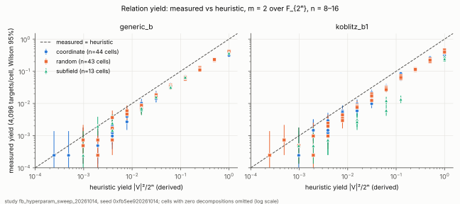
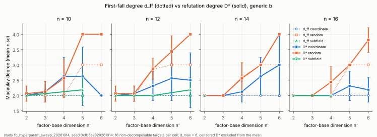
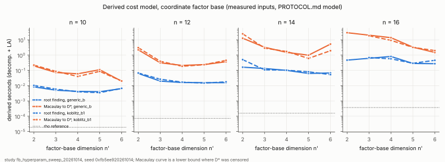
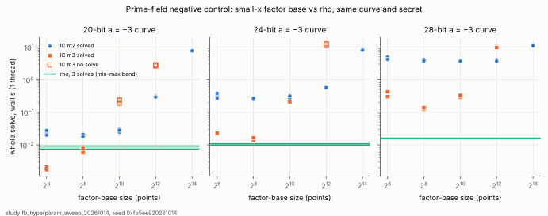

# Factor-base hyperparameter sweep: yield vs `d_ff` vs `D*` vs cost

**Date.** 2026-10-14. **Status.** Measured on synthetic instances. Every cell
passed every control, and the protocol was frozen before the data
([`PROTOCOL.md`](PROTOCOL.md), commit `31199a70a`). **No security claim**:
this is a parameter-space diagnostic on toy fields. It is not an ECDLP speed
claim in ecbench's counted unit, and it says nothing about deployed curves.

**Code.** [`examples/fb_hyperparam_sweep.rs`](../../examples/fb_hyperparam_sweep.rs),
run source `31199a70a`. It builds on `descent_lowgamma::FactorSubspace`,
`pc_degree_harness::refutation_scan` and `prime_fast::{ic_solve,
rho_parallel}`, and modifies none of them.
**Data.** [`data/sweep.json`](data/sweep.json) holds every measured value, plus the
`analysis` and `derived_cost_model` sections that the same binary writes.
[`data/console.log`](data/console.log) is the run log.
**Run report.** [`reports/run-20261014T1804Z/report.pdf`](reports/run-20261014T1804Z/report.pdf).
**Results PDF.** [`REPORT.pdf`](REPORT.pdf).

## Question

Index calculus with summation polynomials has one main design knob: the factor base.
Making it bigger raises relation yield, but it also makes each decomposition system
harder. People usually report one point on that trade-off, sometimes as a first-fall degree. This study
puts yield, the first-fall degree `d_ff`, the refutation degree `D*` and the
measured per-attempt cost of each decomposition oracle on one grid:

- **Binary arm.** `F_{2ⁿ}` with `n = 8…16`, two-point decompositions (`S₃`). The
  factor base is the set of `x`-coordinates in an `F_2`-subspace `V`, with `dim V = n' = 2…6`. There are
  three basis families: `coordinate` (Gaudry/Diem `span{1,…,z^{n'−1}}`),
  `random` (a full-rank basis; the null for structure) and `subfield`
  (`V = F_{2^{n'}}`, `n' | n`; this is the factor base that Frobenius preserves). There are two curve classes:
  `generic_b` (4 random `b` per cell; the null for curve class) and
  `koblitz_b1` (`b = 1`; `S₃` does not depend on `a`). That makes 208 cells.
- **Prime arm (negative control).** `a = −3` prime-order curves of 20, 24 and 28 bits,
  with the small-`x` factor base, `m ∈ {2, 3}`, and factor-base sizes 64…16,384. Each configuration
  completes a whole DLP solve for 3 secrets and is compared with single-thread
  negation rho on the same curve and secret.

## Controls (all 208 cells passed)

| control | requirement | result |
|:--|:--|:--|
| planted decompositions (positive control) | root finding finds all of them, and brute force finds the first 16 | 13,312/13,312, and brute force 3,328/3,328 |
| agreement between oracles | root finding = brute force over `V × V` | 53,248/53,248 targets agree |
| calibration of the refutation detector | decomposable targets never refute | 0 refuted, out of 4 per cell |
| censoring | `D*` reached by `d_max = 6` | 3,264/3,264 non-decomposable targets refuted, none censored |

## Results

The class of each statement is given in brackets (measured, derived or heuristic), as
the `controlled-experiment` skill requires.

**H1: the yield heuristic overestimates by about 2×.** [measured] The heuristic
`|V|²/2ⁿ` lies inside the Bonferroni-adjusted Wilson interval in 63 of 208 cells.
Excluding subfield cells, the median measured/heuristic ratio is 0.49, 0.51,
0.49, 0.46 and 0.36 at `n' = 2…6`. In the 74 cells with heuristic ≤ 0.05 the
median ratio is 0.50. [heuristic explanation, not tested here] For fixed `x₁, x₂`,
`S₃` is quadratic in `x₃` and has roots in `F_{2ⁿ}` for only about half of the pairs (a
trace condition). That gives `≈ |V|²/2^{n+1}`. Toward `n' = 6` the ratio falls
further because the yield saturates (several pairs hit the same target).


**H4: `D*` moves with the knobs much more than `d_ff` does.** [measured]
Across `n'` at fixed `(class, family, n)`, the mean `d_ff` varies by at most 1. For the
coordinate and subfield bases it is often exactly 0. Per target, `d_ff` is 2 (1,907 targets) or 3 (950),
and is undefined below `D*` for 407 of the 3,264.
Over the same ranges the mean `D*` varies by up to 3.0 (coordinate) and 1.6–3.0 (random). This is the
point of the sweep: a single first-fall number does not track how hard the system
is to solve.


**H2: the structure of the basis changes `D*`.** [measured, matched pairs, bootstrap
intervals, Bonferroni over 118 pairs] The `random` basis has a **higher** `D*` than
`coordinate` at matched `(class, n, n')` in 31 of 90 pairs, and lower in none. The
differences are +0.4 to +2.0 degrees and concentrate at `n' ≥ 4`. `subfield` vs `coordinate`
differs in 1 of 28 pairs (`generic_b`, `n = 15`, `n' = 5`: −0.50, interval
[−0.94, −0.13]). Across `n'`, the mean `D*` of the subfield family varies by at most 0.375. This agrees with
EXP-E's low-γ/high-γ contrast (`descent_lowgamma`): structured bases refute at
low degree and random bases do not.

**H3: Koblitz `b = 1` vs generic `b`.** [measured, Bonferroni over 104 pairs]
`D*` differs in **none** of the 104 pairs. Yield does not differ for coordinate
bases (0 of 45 lower, 2 higher) or random bases (0 of 45 lower, 3 higher). For the **subfield
factor base on a Koblitz curve, yield is lower in 7 of 14 pairs and collapses
when `2n' ∤ n`**. Examples: `n = 15`, `n' = 5`: 0/4,096 vs 65/4,096; `n = 9`, `n' = 3`:
0.013 vs 0.065; `n = 12`, `n' = 4`: 0.0061 vs 0.0317. [derived, exact
argument] When `x₁, x₂ ∈ F_{2^{n'}}` and `b ∈ F_2`, the coefficients of `S₃` as a
quadratic in `x₃` lie in `F_{2^{n'}}`. So every decomposable target lies in
`F_{2^{2n'}} ∩ F_{2ⁿ} = F_{2^{gcd(2n',n)}}`, and the yield is at most
`2^{gcd(2n',n)}/2ⁿ`. The cap stays below 1 unless `n = 2n'`. Three of the 14 measured Koblitz × subfield rates sit above the cap. At `n = 14`, `n' = 2` and `n = 15`, `n' = 3` the excess is 1–2 hits out of 4,096 targets, which is within sampling. `n = 12`, `n' = 4` has 25 hits where the cap gives an expected 15 (Poisson tail about 1%). That is the largest deviation, and this study does not follow it up. The Frobenius saving that the cost model credits (relations needed
divided by `n'`) does not make up for it. For example, the derived total at `n = 12`, `n' = 4` is 0.051 s
for Koblitz vs 0.019 s for generic `b`. Only at `n = 2n'` is the cap trivial. Even there the Koblitz yield is 23–40% lower
(`n = 8, 10, 12` with `n' = n/2`: 0.286/0.371, 0.226/0.378, 0.243/0.363), although the derived totals come out
slightly better (for example 0.0057 s vs 0.0137 s at `n = 12`, `n' = 6`).

**Derived cost model.** [derived; inputs measured on this host; model in
PROTOCOL.md] Root finding beats Macaulay-to-`D*` per attempt by 3× to 3,900× in each of the
204 cells where Macaulay was timed. Four cells had no non-decomposable target. With
root finding, the derived total for the coordinate basis varies across `n'` by a factor of 1.6–16
(median 3.6) per `(class, n)`. The yield rises like `|V|²`, while the attempt cost and the relations needed
each rise like `|V|`. So for `m = 2` the optimum is shallow, with no single
sharp interior minimum. The Macaulay curve is not monotone,
because `D*` jumps. Every IC configuration with root finding sits 46–6,800× above the
rho reference `√(π2ⁿ/4)·t_add`. That is the known result that two-point index calculus on binary curves costs about
`2ⁿ` targets, which is worse than rho.


**H5: the prime negative control.** [measured wall time, 1 thread, L0, descriptive]
On the 24-bit and 28-bit curves, every index-calculus configuration that solved is slower than the slowest rho solve (fastest
IC: 13.7 ms with `m = 3`, FB = 256, at 24 bits, against rho at 10.8 ms;
122.6 ms against 16.0 ms at 28 bits). For `m = 2` it is slower at every size, including 20 bits.
**The control's expectation does not hold at 20 bits for `m = 3`**:
FB = 64 (1.7 ms) and FB = 256 (5.8 ms) are faster than the slowest rho (9.2 ms).
At FB = 1,024 and 4,096 on 20 bits, and FB = 4,096 on 24 bits, `ic_solve` returned no
solve in 3/3 runs within 0.2–12.8 s. `ic_solve` returns `None` both when the relation budget runs out
and when the linear algebra fails, so the cause is **not diagnosed**. For `m = 3`, the
`yield` field counts relations per target and goes above 1. ecbench's counted-unit
studies remain the reference for prime index calculus vs rho; this arm only checks
that the sweep's instrument sees the expected ordering at non-toy sizes.


## Limits

- Only `m = 2`. The interior optimum in the original question needs `m ≥ 3`
  (`S₄`, `binary_semaev_s4`, `examples/ffd_s4_subspace.rs`). That is the next
  arm.
- `n ≤ 16` and `n' ≤ 6` are toy sizes, chosen so that every `D*` refutes by `d_max`.
  `d_ff` uses the operational definition in `pc_degree_harness`.
- "Decomposable" means `S₃` has a zero with `x₁, x₂ ∈ V`. It does not check
  that `x₁, x₂` lift to points over `F_{2ⁿ}` (the same convention as the existing
  harness). The yields are therefore upper bounds on relations from rational points.
- Wall times come from one shared 4-vCPU Xeon at 2.10 GHz, L0 isolation, a single run per cell.
  The cost model is derived and not admitted as a speed measurement.
- The Frobenius credit in the cost model (divide by `n'`) is a modelling assumption,
  and nothing here verifies it.

## Reproduce

```sh
cargo run --release --example fb_hyperparam_sweep -- research/fb_hyperparam_sweep_20261014/data
python3 research/fb_hyperparam_sweep_20261014/plot.py   # matplotlib; plots recorded values only
```

The run took 291 s of wall time on the host above (`data/console.log`).
