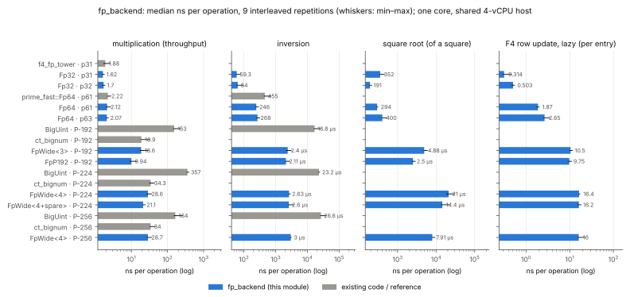
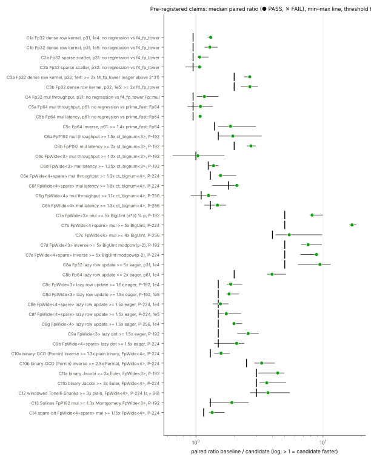

# Variable-time prime-field backends (`fp_backend`), 2026-10-15

Stage 0 of the PKM tower work: one fast, **variable-time** prime-field layer for
the F4 engine at primes up to 2^63 and at NIST P-224 (lane F), and for curve
arithmetic, square roots and Vélu chains at NIST P-192 (lane G).

- Module: [`src/cryptanalysis/fp_backend.rs`](../../src/cryptanalysis/fp_backend.rs)
  (API, lazy-accumulator contract and capacity derivations in its header).
- Harness: [`examples/fp_backend_bench.rs`](../../examples/fp_backend_bench.rs);
  analysis (Rust, claims and tables): [`examples/fp_backend_report.rs`](../../examples/fp_backend_report.rs).
- Protocol, frozen before the measured run (commit `6979448f0`): [`PROTOCOL.md`](PROTOCOL.md).
- Run: [`runs/final/`](runs/final/) (`raw.csv` one row per arm × repetition,
  `summary.csv`, `claims.csv`, `tables.md`, `meta.txt`).
- Report PDF: [`report.pdf`](report.pdf) (Typst source `report.typ`, figures from
  `plot.py`, which only lays out the recorded CSVs).

## API

```rust
pub trait PrimeField: Clone + Debug + Send + Sync {
    type Elem: Copy + Eq + Hash + Debug + Send + Sync;   // always < p, unique representation
    type Wide: Copy + Debug + Send + Sync;               // unreduced accumulator
    fn name(&self) -> &'static str;  fn modulus(&self) -> &BigUint;  fn bits(&self) -> u32;
    fn zero(&self) -> Elem;  fn one(&self) -> Elem;
    fn from_u64(&self, u64) -> Elem;  fn from_i64(&self, i64) -> Elem;  fn from_biguint(&self, &BigUint) -> Elem;
    fn to_u64(&self, Elem) -> Option<u64>;  fn to_biguint(&self, Elem) -> BigUint;
    fn is_zero / is_one;  fn add / sub / mul (Elem, Elem) -> Elem;  fn neg / double / sqr (Elem) -> Elem;
    fn inv(&self, Elem) -> Option<Elem>;  fn batch_inv(&self, &mut [Elem], scratch: &mut Vec<Elem>);
    fn pow(&self, Elem, e: &[u64]) -> Elem;  fn pow_u64;  fn pow_biguint;
    fn legendre(&self, Elem) -> i32;  fn is_square;  fn sqrt(&self, Elem) -> Option<Elem>;
    fn sqrt_pre(&self) -> &SqrtPre<Elem>;
    // lazy accumulation
    fn lazy_capacity(&self) -> u64;
    fn wide_zero(&self) -> Wide;  fn wide_from(&self, Elem) -> Wide;
    fn wide_mul_add(&self, &mut Wide, Elem, Elem);  fn wide_reduce(&self, &Wide) -> Elem;
    fn row_load(&self, row: &[Elem], acc: &mut [Wide]);
    fn row_axpy / row_sub(&self, acc: &mut [Wide], c: Elem, row: &[Elem]);
    fn row_scatter_axpy(&self, acc: &mut [Wide], c: Elem, cols: &[u32], vals: &[Elem]);
    fn row_reduce(&self, &[Wide], &mut [Elem]);  fn row_reduce_scaled(&self, &[Wide], s: Elem, &mut [Elem]);
    fn row_axpy_eager(&self, dst: &mut [Elem], c: Elem, row: &[Elem]);
    fn dot(&self, &[Elem], &[Elem]) -> Elem;
}
pub struct LazyRow<F>;  // counts products, renormalises at lazy_capacity
Fp32::new(p: u64)            // odd p < 2^32, Elem = u32 canonical, Wide = u64
Fp64::new(p: u64)            // odd p < 2^63, Elem = u64 Montgomery, Wide = u128
FpWide::<N, SPARE>::new(&BigUint)   // Elem = [u64; N] Montgomery, Wide = WideAcc<N> (2N+1 words)
type Fp192 = FpWide<3>;  type Fp256 = FpWide<4>;  type Fp224 = FpWide<4, true>;
FpP192::new()                // NIST P-192, Solinas, Elem = [u64; 3] canonical
pub fn inv_bingcd, jacobi_limbs, jacobi_u64, sqrt_tonelli_shanks_plain
```

Lazy-accumulator capacity (products after a load before `wide_reduce`, derived
in the module header, checked by debug assertions): `Fp32` and `Fp64` unbounded
(each step renormalises: subtract the largest multiple of p below 2^63, fold a
carry as 2^64 mod p, or subtract p·2^64); `FpWide<N>` and `FpP192`
2^64 − 2 (2N + 1-word sum below p·R·2^64, reduced by an (N + 1)-word
Montgomery reduction).

Recommended: lane F — `Fp32` for p < 2^32 (identical lazy kernel to today below
2^31), `Fp64` for p < 2^63, `Fp224` for P-224; dense rows through
`row_load`/`row_sub`/`row_reduce`, sparse `sub_tail` through
`row_scatter_axpy` (not per-entry `wide_mul_add`, 1.6× slower above 2^31).
Lane G — `FpP192` for P-192 (p ≡ 3 mod 4: sqrt is one exponentiation).

## Correctness

- `cargo test --release --lib fp_backend`: 8/8 pass (also with
  `debug-assertions` and `overflow-checks` on). Every op of every backend against
  `BigUint` on edge values (0, 1, 2, p − 1, p − 2, (p ± 1)/2, 2^(32k) ± 1) and
  random values at p = 3…17, 2013265921, 2^31 − 1, 10^9 + 7, 2147483659,
  4294967291, 2^61 − 1, 2^62 − 57, 2^63 − 25, two c·2^40 + 1 primes, P-192, a
  190-bit prime, P-224, P-256, the 200-bit prime, 2^127 − 1, 2^128 − 159,
  one-limb primes to 2^64 − 59; binary-GCD inverse and Jacobi on 3,000+ values
  per prime up to a 512-bit prime with zero fallbacks; lazy rows (200 updates
  including all-(p − 1) rows), sparse scatter, `LazyRow` and dot products equal
  eager reduction; Solinas P-192 equals Montgomery P-192 on 2,000 products;
  windowed and plain Tonelli–Shanks agree at P-224.
- Before timing, the harness asserts that every timed kernel's output equals
  `BigUint` or the f4_fp_tower copy's output.

## Results (run `runs/final`, commit `6979448f0`)

Host: Intel Xeon @ 2.10 GHz, 4 vCPU, **shared with another lane, not
isolated (L0)**; one core (`taskset -c 3`), load average 1.0–1.7. 9 interleaved
repetitions per arm, ≈ 40 ms each. Wall-clock ns per operation, median (spread
in the PDF and `summary.csv`).



**All 39 pre-registered claims PASS** (median paired ratio ≥ frozen threshold):



### Pre-registered claims

| id | claim | baseline ns | candidate ns | ratio (median of paired) | paired min–max | threshold | verdict |
|:--|:--|--:|--:|--:|:--|--:|:--|
| C1a | Fp32 dense row kernel, p31, 1e4: no regression vs f4_fp_tower | 0.40 | 0.31 | 1.308 | 1.245–1.343 | 0.95 | PASS |
| C1b | Fp32 dense row kernel, p31, 1e5: no regression vs f4_fp_tower | 0.44 | 0.34 | 1.287 | 1.176–1.476 | 0.95 | PASS |
| C2a | Fp32 sparse scatter, p31: no regression vs f4_fp_tower | 2.03 | 1.92 | 1.068 | 1.032–1.253 | 0.95 | PASS |
| C2b | Fp32 sparse scatter, p32: no regression vs f4_fp_tower | 2.00 | 1.86 | 1.067 | 0.830–1.109 | 0.95 | PASS |
| C3a | Fp32 dense row kernel, p32, 1e4: >= 2x f4_fp_tower (eager above 2^31) | 1.26 | 0.50 | 2.650 | 2.402–2.701 | 2 | PASS |
| C3b | Fp32 dense row kernel, p32, 1e5: >= 2x f4_fp_tower | 1.33 | 0.51 | 2.657 | 2.264–3.057 | 2 | PASS |
| C4 | Fp32 mul throughput, p31: no regression vs f4_fp_tower Fp::mul | 1.88 | 1.62 | 1.165 | 1.024–1.499 | 0.95 | PASS |
| C5a | Fp64 mul throughput, p61: no regression vs prime_fast::Fp64 | 2.22 | 2.12 | 1.086 | 0.862–1.354 | 0.95 | PASS |
| C5b | Fp64 mul latency, p61: no regression vs prime_fast::Fp64 | 5.35 | 4.99 | 1.079 | 1.065–1.111 | 0.95 | PASS |
| C5c | Fp64 inverse, p61: >= 1.4x prime_fast::Fp64 | 455.34 | 245.67 | 1.871 | 1.506–2.945 | 1.4 | PASS |
| C6a | FpP192 mul throughput >= 1.5x ct_bignum<3>, P-192 | 18.86 | 9.94 | 1.951 | 1.510–3.273 | 1.5 | PASS |
| C6b | FpP192 mul latency >= 2x ct_bignum<3>, P-192 | 30.29 | 11.15 | 2.709 | 2.545–2.939 | 2 | PASS |
| C6c | FpWide<3> mul throughput >= 1.0x ct_bignum<3>, P-192 | 18.86 | 18.63 | 1.035 | 0.660–1.668 | 1 | PASS |
| C6d | FpWide<3> mul latency >= 1.25x ct_bignum<3>, P-192 | 30.29 | 21.93 | 1.376 | 1.276–1.501 | 1.25 | PASS |
| C6e | FpWide<4+spare> mul throughput >= 1.3x ct_bignum<4>, P-224 | 34.26 | 21.06 | 1.562 | 1.502–2.065 | 1.3 | PASS |
| C6f | FpWide<4+spare> mul latency >= 1.8x ct_bignum<4>, P-224 | 45.17 | 21.39 | 2.099 | 1.356–2.171 | 1.8 | PASS |
| C6g | FpWide<4> mul throughput >= 1.1x ct_bignum<4>, P-256 | 33.98 | 28.68 | 1.256 | 0.915–1.450 | 1.1 | PASS |
| C6h | FpWide<4> mul latency >= 1.3x ct_bignum<4>, P-256 | 44.27 | 29.96 | 1.477 | 1.166–1.715 | 1.3 | PASS |
| C7a | FpWide<3> mul >= 5x BigUint (a*b) % p, P-192 | 152.81 | 18.63 | 8.203 | 7.922–9.928 | 5 | PASS |
| C7b | FpWide<4+spare> mul >= 5x BigUint, P-224 | 356.77 | 21.06 | 16.911 | 16.223–18.255 | 5 | PASS |
| C7c | FpWide<4> mul >= 4x BigUint, P-256 | 164.41 | 28.68 | 5.420 | 4.249–9.790 | 4 | PASS |
| C7d | FpWide<3> inverse >= 5x BigUint modpow(p-2), P-192 | 16781.68 | 2402.25 | 7.634 | 6.746–9.734 | 5 | PASS |
| C7e | FpWide<4+spare> inverse >= 5x BigUint modpow(p-2), P-224 | 23205.80 | 2603.40 | 8.883 | 6.660–9.138 | 5 | PASS |
| C8a | Fp32 lazy row update >= 5x eager, p31, 1e4 | 2.99 | 0.31 | 9.453 | 6.373–11.393 | 5 | PASS |
| C8b | Fp64 lazy row update >= 2x eager, p61, 1e4 | 7.37 | 1.87 | 3.969 | 3.641–5.078 | 2 | PASS |
| C8c | FpWide<3> lazy row update >= 1.5x eager, P-192, 1e4 | 20.21 | 10.46 | 1.877 | 1.761–2.301 | 1.5 | PASS |
| C8d | FpWide<3> lazy row update >= 1.5x eager, P-192, 1e5 | 20.02 | 10.88 | 1.823 | 1.745–2.177 | 1.5 | PASS |
| C8e | FpWide<4+spare> lazy row update >= 1.5x eager, P-224, 1e4 | 24.72 | 16.22 | 1.557 | 1.370–1.794 | 1.5 | PASS |
| C8f | FpWide<4+spare> lazy row update >= 1.5x eager, P-224, 1e5 | 29.76 | 16.54 | 1.733 | 1.523–2.256 | 1.5 | PASS |
| C8g | FpWide<4> lazy row update >= 1.5x eager, P-256, 1e4 | 31.76 | 16.04 | 1.992 | 1.959–2.292 | 1.5 | PASS |
| C9a | FpWide<3> lazy dot >= 1.5x eager, P-192 | 19.19 | 7.68 | 2.575 | 2.125–3.104 | 1.5 | PASS |
| C9b | FpWide<4+spare> lazy dot >= 1.5x eager, P-224 | 25.54 | 12.41 | 2.093 | 1.397–2.388 | 1.5 | PASS |
| C10a | binary-GCD (Pornin) inverse >= 1.3x plain binary, FpWide<4>, P-224 | 4221.22 | 2630.07 | 1.576 | 1.397–1.840 | 1.3 | PASS |
| C10b | binary-GCD (Pornin) inverse >= 2.5x Fermat, FpWide<4>, P-224 | 8484.14 | 2630.07 | 3.290 | 2.896–4.148 | 2.5 | PASS |
| C11a | binary Jacobi >= 3x Euler, FpWide<3>, P-192 | 5206.57 | 1205.72 | 4.401 | 3.100–4.922 | 3 | PASS |
| C11b | binary Jacobi >= 3x Euler, FpWide<4>, P-224 | 8073.50 | 2187.38 | 3.609 | 3.178–5.100 | 3 | PASS |
| C12 | windowed Tonelli-Shanks >= 3x plain, FpWide<4>, P-224 (s = 96) | 77575.21 | 21013.30 | 3.684 | 2.680–5.443 | 3 | PASS |
| C13 | Solinas FpP192 mul >= 1.3x Montgomery FpWide<3>, P-192 | 18.63 | 9.94 | 1.919 | 1.280–2.587 | 1.3 | PASS |
| C14 | spare-bit FpWide<4+spare> mul >= 1.15x FpWide<4>, P-224 | 28.65 | 21.06 | 1.343 | 1.279–1.669 | 1.15 | PASS |

39 PASS, 0 FAIL, 0 MISSING of 39.

### Median ns per operation (all arms)

| backend | prime | mul_tp | mul_lat | sqr_lat | add_tp | inv | batch_inv | sqrt | legendre | axpy_lazy_1e4 | axpy_eager_1e4 | axpy_lazy_1e5 | axpy_eager_1e5 | dot_lazy_1e4 | dot_eager_1e4 |
|:--|:--|--:|--:|--:|--:|--:|--:|--:|--:|--:|--:|--:|--:|--:|--:|
| BigUint | P-192 | 153 | – | – | – | 16782 | – | – | – | – | – | – | – | – | – |
| BigUint | P-224 | 357 | – | – | – | 23206 | – | – | – | – | – | – | – | – | – |
| BigUint | P-256 | 164 | – | – | – | 26586 | – | – | – | – | – | – | – | – | – |
| Fp32 | p31 | 1.62 | 5.17 | 5.21 | 1.51 | 59.34 | 10.69 | 352 | 44.32 | 0.31 | 2.99 | 0.34 | 3.04 | 1.53 | 1.74 |
| Fp32 | p32 | 1.70 | 5.19 | 5.29 | 1.39 | 63.97 | 10.75 | 191 | 43.65 | 0.50 | 2.94 | 0.51 | 2.97 | 1.14 | 1.71 |
| Fp64 | p31 | 2.16 | 5.07 | 5.01 | 1.55 | 56.54 | 11.33 | 384 | 50.00 | 1.44 | 7.39 | 1.58 | 7.36 | 2.14 | 3.44 |
| Fp64 | p61 | 2.12 | 4.99 | 4.99 | 1.33 | 246 | 10.93 | 294 | 90.94 | 1.87 | 7.37 | 2.04 | 7.81 | 2.12 | 3.21 |
| Fp64 | p63 | 2.07 | 4.99 | 5.01 | 1.34 | 268 | 10.91 | 400 | 96.11 | 2.65 | 7.51 | 3.21 | 8.00 | 2.09 | 3.92 |
| FpP192 | P-192 | 9.94 | 11.15 | 10.19 | 4.18 | 2115 | 32.14 | 2503 | 1236 | 9.75 | 12.07 | 10.08 | 12.24 | 7.37 | 12.12 |
| FpWide<3> | P-192 | 18.63 | 21.93 | 20.51 | 5.00 | 2402 | 54.68 | 4885 | 1206 | 10.46 | 20.21 | 10.88 | 20.02 | 7.68 | 19.19 |
| FpWide<4+spare> | P-224 | 21.06 | 21.39 | 22.58 | 5.30 | 2603 | 65.87 | 14432 | 2164 | 16.22 | 24.72 | 16.54 | 29.76 | 12.41 | 25.54 |
| FpWide<4+spare> | p200 | 22.40 | 21.23 | 20.34 | 5.26 | 2345 | 66.47 | 4585 | 1857 | 15.62 | 24.11 | 16.72 | 25.71 | 11.92 | 24.04 |
| FpWide<4> | P-224 | 28.65 | 31.73 | 30.12 | 5.62 | 2630 | 94.57 | 21013 | 2187 | 16.36 | 32.41 | 17.18 | 32.59 | 11.78 | 31.55 |
| FpWide<4> | P-256 | 28.68 | 29.96 | 29.07 | 5.07 | 3000 | 79.77 | 7914 | 2539 | 16.04 | 31.76 | 17.02 | 35.00 | 13.22 | 33.32 |
| FpWide<4> | p200 | 31.44 | 30.79 | 29.08 | 5.50 | 2350 | 86.50 | 6422 | 1885 | 17.09 | 33.75 | 17.93 | 33.47 | 11.96 | 33.90 |
| ct_bignum | P-192 | 18.86 | 30.29 | 30.75 | – | – | – | – | – | – | – | – | – | – | – |
| ct_bignum | P-224 | 34.26 | 45.17 | 44.19 | – | – | – | – | – | – | – | – | – | – | – |
| ct_bignum | P-256 | 33.98 | 44.27 | 44.16 | – | – | – | – | – | – | – | – | – | – | – |
| f4_fp_tower | p31 | 1.88 | – | – | – | – | – | – | – | – | – | – | – | – | – |
| f4_fp_tower | p32 | 1.83 | – | – | – | – | – | – | – | – | – | – | – | – | – |
| prime_fast::Fp64 | p61 | 2.22 | 5.35 | – | – | 455 | – | – | – | – | – | – | – | – | – |

### Other arms (median ns per op, min–max over repetitions)

| arm | median | min | max |
|:--|--:|--:|--:|
| `Fp32/p31/axpy_dense_1e4` | 0.31 | 0.30 | 0.39 |
| `Fp32/p31/axpy_dense_1e5` | 0.34 | 0.33 | 0.36 |
| `Fp32/p31/scatter_sparse` | 1.92 | 1.80 | 2.08 |
| `Fp32/p31/scatter_sparse_scalar` | 2.01 | 1.90 | 2.32 |
| `Fp32/p32/axpy_dense_1e4` | 0.50 | 0.46 | 0.54 |
| `Fp32/p32/axpy_dense_1e5` | 0.51 | 0.48 | 0.65 |
| `Fp32/p32/scatter_sparse` | 1.86 | 1.80 | 2.41 |
| `Fp32/p32/scatter_sparse_scalar` | 3.05 | 2.98 | 4.21 |
| `FpWide<3>/P-192/inv_fermat` | 5236.58 | 5172.88 | 5498.13 |
| `FpWide<3>/P-192/inv_plain_binary` | 2785.34 | 2730.96 | 2997.74 |
| `FpWide<3>/P-192/legendre_euler` | 5206.57 | 5082.48 | 5962.41 |
| `FpWide<4>/P-224/inv_fermat` | 8484.14 | 8273.58 | 11182.46 |
| `FpWide<4>/P-224/inv_plain_binary` | 4221.22 | 3990.21 | 4719.99 |
| `FpWide<4>/P-224/legendre_euler` | 8073.50 | 7497.28 | 11154.57 |
| `FpWide<4>/P-224/sqrt_ts_plain` | 77575.21 | 75615.26 | 110226.91 |
| `f4_fp_tower/p31/axpy_dense_1e4` | 0.40 | 0.39 | 0.48 |
| `f4_fp_tower/p31/axpy_dense_1e5` | 0.44 | 0.41 | 0.49 |
| `f4_fp_tower/p31/scatter_sparse` | 2.03 | 1.89 | 2.61 |
| `f4_fp_tower/p32/axpy_dense_1e4` | 1.26 | 1.23 | 1.46 |
| `f4_fp_tower/p32/axpy_dense_1e5` | 1.33 | 1.28 | 1.54 |
| `f4_fp_tower/p32/scatter_sparse` | 2.00 | 1.94 | 2.15 |

## Reading the numbers

- **F4 u32 path (lane F).** Below 2^31 the `Fp32` dense kernel is the same
  arithmetic as `f4_fp_tower` (`lazy_axpy`, same vector dispatch); it measured
  1.29–1.31× faster than the verbatim copy, a difference of code layout around
  identical arithmetic, so read C1 as "no regression", not as a kernel gain.
  Above 2^31 `f4_fp_tower` reduces every product; `Fp32`'s Shoup + carry-fold
  kernel is 2.65× faster there (C3). Sparse scatter: 1.07× (C2).
- **Lazy vs eager reduction** (the F4 speed lever): row update 9.5× (`Fp32`),
  4.0× (`Fp64`), 1.6–2.0× (192–256-bit); dot product 2.1–2.6× at 192/224 bits.
  Per entry update: 0.31 ns (p31), 1.87 ns (p61), 10.5 ns (P-192), 16.2 ns
  (P-224), 16.0 ns (P-256).
- **Wide multiplication** vs constant-time `ct_bignum`: `FpP192` 1.95×
  throughput / 2.71× latency, `Fp224` 1.56× / 2.10×, `FpWide<4>` at P-256
  1.26× / 1.48×; generic `FpWide<3>` at P-192 only 1.04× in throughput (spread
  0.66–1.67) — use `FpP192` there. vs `BigUint`: 5.4–16.9×.
- **Inverse:** 246 ns at p61 (1.87× `prime_fast`), 2.4 µs at P-192, 2.6 µs at
  P-224, 3.0 µs at P-256 — about 105–130 multiplications; `batch_inv` 32–95 ns per
  element at 192–256 bits.
- **Square root:** 2.5 µs at P-192 (`FpP192`), 14.4 µs at P-224 (s = 96,
  windowed Tonelli–Shanks; 3.7× the plain loop), 7.9 µs at P-256.
- Not measured: whole-F4 or whole-curve timings (lanes F and G measure those
  when they port), multi-threaded kernels, an isolated host.

## Not done

- No Solinas reduction for P-224 (its 2^96 structure is not word aligned);
  the spare-bit Montgomery `Fp224` is used instead (1.34× `FpWide<4>`, C14).
- No SIMD (AVX-512 IFMA) kernels for wide fields; the generic CIOS is compiled
  for baseline x86-64 (no BMI2/ADX).
- `f4_fp_tower` / `f4_fp` are not ported (lane F).
