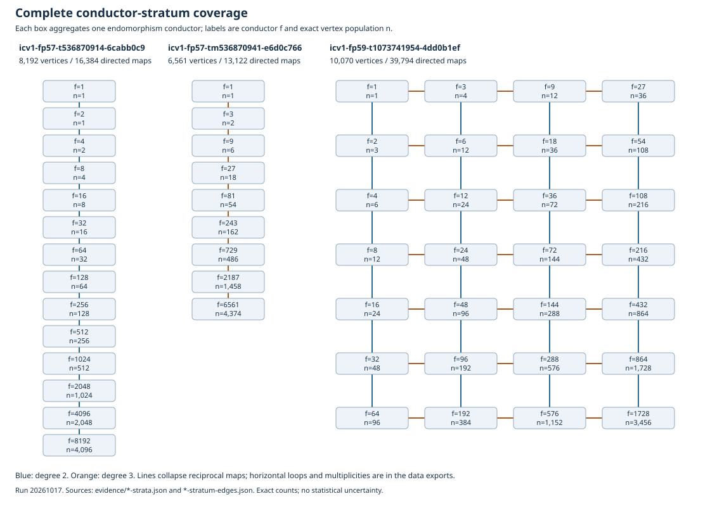

# Three additional complete ordinary isogeny classes

All three full vertex classes and their selected-degree kernel graphs were
generated and replayed. These are additional tractable 57/59-bit examples;
the original A/C/D/E full datasets remain unfinished. Maximum conductors
are 8192, 6561 and 1728, smaller than the original large-case conductors.

| Source model | p | Maximum conductor | Vertices | Directed maps | Strata |
| --- | ---: | ---: | ---: | ---: | ---: |
| icv1-fp57-t536870914-6cabb0c9 | 72057594692239361 | 8192 | 8192 | 16384 | 14 |
| icv1-fp57-tm536870941-e6d0c766 | 72057601940934853 | 6561 | 6561 | 13122 | 9 |
| icv1-fp59-t1073741954-4dd0b1ef | 288230445959117953 | 1728 | 10070 | 39794 | 28 |

The 24,823 vertices, 69,300 directed maps and 51 strata are exact recorded
counts. Degree sets are respectively {2}, {3}, {2,3}. Every vertex is
expanded, the frontier is empty, every kernel set is regenerated, exact
rational-map identities replay, and every conductor population agrees with
the native preflight. A second replay used database copies and left the
original graph hashes unchanged. Replay shares the construction arithmetic;
an independent implementation audit is NOT_RUN. The examples are ordinary
curves with D_K = -7, -11 and -19; no new structural theorem is claimed.

`inputs/*-floor.json` gives a verified model with End(E) conductor equal to
the listed maximum. `inputs/{two,three,mixed}.json` starts at conductor 1.
Each stratum has an explicit representative and outgoing rational maps in
the downloadable archive. Model coefficients, j-invariants and conductors
for all vertices are in nodes.csv. Every directed kernel, target and target
isomorphism is in edges.jsonl and the SQLite graph. Parallel kernels and
loops are retained. All isogeny degrees and their compositions form an
infinite family; this archive enumerates the stated finite degree sets.

Reproduction: see ../../run.sh, ../../generator/, ../../PROTOCOL.md and
../../evidence/. Generation protocol commit 3b7f4b39c; frozen input and
execution commit 946ab7419. The delivered executable is the already tested
7c2e8f46a implementation with source SHA d3c77f50dc2e737de38561203ce3693f7899fe3db502b8e863c7ac69e5818bed.
Host: Linux x86_64, 4 CPU quota, 16 GiB RAM. This is a correctness/census
run; no solver runtime or performance comparison is admitted.

ECDLP min/max/mean, Pollard rho/PH/BSGS campaigns, direct elliptic-curve IC,
factor-base relation yield, and finite-field reductions remain NOT_RUN for
these three classes. No IC/rho ratios or timing data changed, so the
canonical IC progress timeline and scoreboard retain their prior values.
The curve roster, cover index and browser are refreshed separately.

The Conductor executable is unavailable (127); no task reservation was
obtained. See the prior study for the separate remaining storage blocker
for A/C/D/E. No process continues generation after this completed run.
