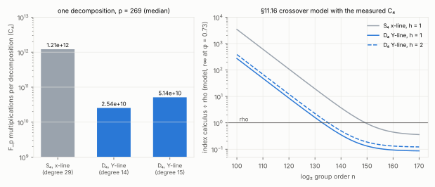

# C8: the `D₄` symmetry cuts `C₄` 48×, and the `k = 4` crossover moves from `2^{150}` to `2^{135}`

2026-10-13.  Protocol: [`PROTOCOL.md`](PROTOCOL.md), registered before the
measured runs.  Code: `src/cryptanalysis/gaudry_quartic_d4.rs`,
`examples/gaudry_quartic_d4.rs`; the Macaulay solve of
`gaudry_quartic` made generic in the number of unknowns (its 4-unknown path
keeps every count of the committed `d = 3…5` panel).  Report:
[`REPORT.pdf`](REPORT.pdf).  **Class: engineering** (a constant: `C₄` and
`r∞`; no exponent moves).

## What was built

Candidate C8 of `research/pdp_root_finder_requirements_20261012` §8.  A
curve over `F_{p⁴}` with a rational 2-torsion point `T = (x₀, 0)`,
`f'(x₀) = c²`, and FGHR's coordinate `Y = (x − x₀ − c)/(x − x₀ + c)`, with
`Y(P + T) = −Y(P)`; the base is `{P : Y(P) ∈ F_p}`.  Since `2T = 0`, `S₅`
in `Y` (denominators cleared) is invariant under permutations and even sign
changes of `(Y₁, …, Y₄)`, the Weyl group `D₄` of order 192.  In its
invariants `σ_k = e_k(Y²)` and `π = Y₁Y₂Y₃Y₄`, with `σ₄ = π²` as a fifth
unknown, the decomposition system is four equations of degree 4 and
`π² − σ₄`: **Bézout 512** (Gaudry's `S₄` form: 4,096), **Macaulay degree
14** (29), a **13,412 × 11,628** matrix (41,780 × 40,920).

`S₅`'s coefficients on the 105 invariant monomials are interpolated and
checked on fresh points (a unit test at `p = 13`; 8 points every run): the
invariance holds exactly.

## Result (`p = 269`, instance seed 1)

| | `S₄`, `x`-line (`../gaudry_quartic_replay_20261013`) | `D₄`, `Y`-line, degree 14 | `D₄`, degree 15 |
|:--|--:|--:|--:|
| quotient dimension | 4,096 | 512 | 512 |
| `C₄` (`F_p` multiplications, all phases) | `1.213–1.227·10¹²` | **`2.535–2.552·10¹⁰`** | `5.13–5.14·10¹⁰` |
| elimination / normal forms / char. poly. | `5.82·10¹¹` / `5.46·10¹¹` / `7.06·10¹⁰` | `1.90·10¹⁰` / `6.23·10⁹` / `1.41·10⁸` | `4.46·10¹⁰` / `6.52·10⁹` / `1.41·10⁸` |
| wall a solve (4 threads) | 164–203 s | 4.2–5.6 s | 8.3–9.7 s |

**`C₄` falls 47.5–48.4×.**  Every solved target's decompositions equal an
independent meet-in-the-middle enumeration over the same base (19 of 19:
9 planted, each with its 8 even `T`-translates or 2, and 10 uniform, one
with 8).

**Decomposition rate** (4,000 uniform targets per curve, exact enumeration
on both bases of the same curve, `raw/hit_rate.jsonl`): the `Y`-line base
decomposes 12 and 24 targets against the `x`-line base's 197 and 138; at
equal base size the ratio is 0.092 and 0.174, **0.133 pooled**, about the
`1/8` the 8 even translates imply (each decomposition hits its target 7.5
and 7.3 times on average).  So a relation costs `≈ 181` solves instead of
24, but a column is `{±P, ±(P + T)}`, so half as many relations are needed
and the linear algebra has half the unknowns.

**Crossover** (§11.16's model, `RESEARCH_RESIDUAL_WALKS.md`, with the
measured `C₄` and rate):

```text
S / rho = √h · ( 181 · (p/4) · C₄ / (126 p²)  +  r∞ / 4 )
```

| | `r∞` (φ = 0.73 … 1) | `n*`, `h = 1` | `n*`, `h = 2` | `n*`, `h = 4` | past `n*`, `S / rho` → |
|:--|:--|--:|--:|--:|--:|
| `S₄`, `x`-line (§11.17) | 0.34 … 0.63 | `2^{149.4}` … `2^{152.7}` | — | — | 0.34 … 0.63 |
| **`D₄`, `Y`-line** | 0.085 … 0.158 | `2^{132.9}` … `2^{133.3}` | **`2^{135.1}` … `2^{135.8}`** | `2^{137.4}` … `2^{138.5}` | 0.12 … 0.22 (`h = 2`) |

The 2-torsion forces an even group order, so rho runs in a subgroup at
least 2× smaller (`h ≥ 2`): **the crossover moves about 14–17 bits
earlier, from `2^{150}` to `2^{135}`, and past it index calculus tends to
0.12–0.22× rho instead of 0.34–0.63×.**  The model is §11.16's, unchanged:
extrapolated exponents (`n^{1/4}` relations, `n^{1/2}` linear algebra and
rho), not a measured end-to-end `S`.



## Predictions (PROTOCOL.md)

- D1 (dimension 512; degree 14 closes on every target; exact): **19 of 20**.
  Planted target 8 does not close at 14 or 15: its quotient has dimension
  517, a degenerate system (excess components), not a degree bound.  A
  pipeline discards the trial: one wasted solve in 20 adds about 5 % to the
  relation phase.  Its cause is not established.  Exactness held on all 19.
- D2 (`C₄ ≤ 3·10¹⁰`, ≥ 40× below): **held**, 47.5–48.4×.
- D3 (rate ratio `1/8 ± 30 %` per curve): **held on curve 1** (0.092),
  **missed on curve 2** (0.174, +39 %, from 24 hits); pooled 0.133.
- D4 (`n*` between `2^{131}` and `2^{137}`): **held**, `2^{135.1}–2^{135.8}`
  at `h = 2`.
- Decision rule: `C₄` fell ≥ 10× → the next step is the `k = 4` ladder in
  ecbench.

## Open

- The degenerate target (dimension 517): which `Y_R` produce it and how
  often (one in 20 here).
- The `k = 4` pipeline end to end (relations, folded columns, linear
  algebra) in ecbench, to replace the model by a measured `S`.
- `C₄` against Magma on this system: `scripts/` of
  `../magma_f4_comparison_20261013/` covers the `S₄` form; the `D₄` system
  is not exported yet.

## Reproduction

```sh
cargo build --release --example gaudry_quartic_d4
target/release/examples/gaudry_quartic_d4 --p 269 --seed 1 --targets 10 --planted --json raw/solves_planted.jsonl
target/release/examples/gaudry_quartic_d4 --p 269 --seed 1 --targets 10 --json raw/solves_uniform.jsonl
target/release/examples/gaudry_quartic_d4 --p 269 --seed 1 --targets 9 --planted --macaulay 15 --json raw/solves_planted_deg15.jsonl
for s in 1 2; do target/release/examples/gaudry_quartic_d4 --p 269 --seed $s --hit-rate 4000 --json raw/hit_rate.jsonl; done
```

Environment: Claude Code cloud container, Intel Xeon @ 2.10 GHz, 4 vCPU,
15 GiB RAM, rustc 1.97.0.  Conductor's control plane was unreachable: no
task card.
