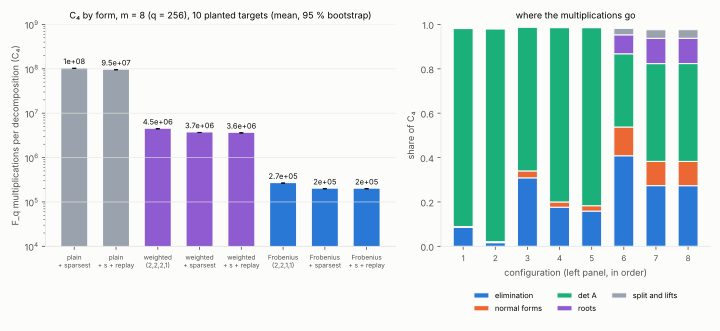
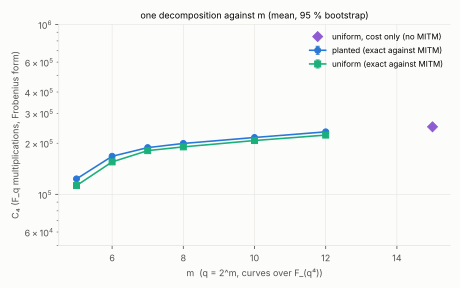
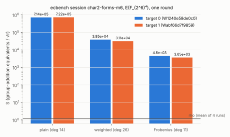
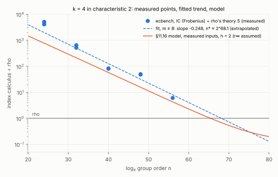

# `k = 4` index calculus in characteristic 2: a Frobenius-reduced D₄ system, `C₄` 481× lower, the gap to rho closing at `n^{−1/4}` (crossover extrapolated near `2^68`)

2026-10-15. Protocol: [`PROTOCOL.md`](PROTOCOL.md), registered (commit
`666438375`) before any claim data. Every run, pilots and failures included,
is in [`EXPERIMENTS.md`](EXPERIMENTS.md). Report:
[`REPORT.pdf`](REPORT.pdf). **Class: engineering.** This is a constant in
one decomposition, plus a measured trend. The exponent of Gaudry/Diem index
calculus is unchanged, and no run here reaches the crossover.

## Question

The odd-characteristic study (`research/gaudry_quartic_d4_cost_20261014`,
#1863) made the `k = 4` D₄ decomposition over `F_{p⁴}` 370× cheaper. Does the
same programme work for curves over `F_{q⁴}`, `q = 2^m`, how far does
characteristic 2 take it, and how does the end-to-end gap to rho move with
`m`?

## The system

- **Curve and symmetry.** The curve has its 2-torsion point
  `T = (0, √b)`. Then `t = β/(x + β)`, with `β = b^{1/4}`, turns `+T` into
  `t ↦ t + 1`.
- **Invariants.** `w = t² + t`, the elementary symmetric functions
  `s_k = e_k(w)`, and `π = Σ t` with `π² + π = s₁`.
- **The interpolated relation.** Only 21 of 105 monomials carry it (pilot
  E3). Every one has even exponents in `s₂`, `s₃` and `π`.
- **Frobenius form.** Substituting `(s₂², s₃², s₄, π²)` gives a system in
  weights `(2, 2, 1, 1)` with 64 solutions. Its Macaulay degree is 11: a
  387 × 448 matrix, against 11,728 × 11,628 for the plain form.
- **Solving.** The chain eigen step, sparsest pivots and replay with top-up
  are carried over from #1863.

## Part A: one decomposition (`C₄`, `F_q` multiplications; ladder and ablation, E14)

| configuration (`m = 8`, 10 planted) | Macaulay matrix | `C₄` (mean) |
|:--|:--|--:|
| plain (degree 14) + sparsest + replay | 11,116 × 11,628 | 9.54·10⁷ |
| weighted (2,2,2,1), degree 26, + sparsest + replay | 3,688 × 4,200 | 3.60·10⁶ |
| **Frobenius (2,2,1,1), degree 11, + sparsest + replay** | 384 × 448 | **1.98·10⁵** |

- **Paired ratios** (95 % bootstrap, `raw/summary.json`):

  | comparison | ratio |
  |:--|--:|
  | plain ÷ weighted | **26.5×** (26.4–26.6) |
  | weighted ÷ Frobenius | **18.1×** (18.08–18.18) |
  | plain ÷ Frobenius | **481×** (479–483) |
  | sparsest pivots in the Frobenius form | 1.33× |
  | replay in the Frobenius form | 1.0004× |

- **Across `m`:** Frobenius `C₄` grows slowly, only through root finding.

  | `m` | `C₄` |
  |--:|--:|
  | 5 | 1.13·10⁵ |
  | 6 | 1.55·10⁵ |
  | 8 | 1.90·10⁵ |
  | 10 | 2.07·10⁵ |
  | 12 | 2.23·10⁵ |
  | 15 | 2.50·10⁵ (cost only) |

- **Exactness:** every closed solve equals the meet-in-the-middle
  enumeration (512 closed solves recorded, 0 disagreements).
- **Closing:** no uniform target fails to close. Planted failures are 5 at
  `m = 5` and 3 at `m = 6`, and every decomposition of each failing target
  contains a pair `{t, t + 1}`. These are positive-dimensional families
  (E6), not a solver defect.





## Part B: end to end (ecbench, `S` = group-addition equivalents ÷ √r)

### Three forms at `m = 6` (session `ECBS1h03a1d62aba88`, 10/10 verified)

| arm | target 0 `S` | target 1 `S` | trials | relations |
|:--|--:|--:|--:|--:|
| rho, negation map | 1.017 | 1.314 | | |
| IC, plain | 713,704 | 722,233 | 5,397 / 4,353 | 14 / 12 |
| IC, weighted | 38,542 | 31,128 | 5,397 / 4,353 | 14 / 12 |
| **IC, Frobenius** | **4,501** | **3,654** | 5,397 / 4,353 | 14 / 12 |

- `ecbench compare` (cluster interval over 2 targets):
  - Frobenius ÷ plain = **0.0057** (0.0051–0.0063), i.e. 176×;
  - Frobenius ÷ weighted = 0.117 (0.117–0.117);
  - weighted ÷ plain = 0.0485 (0.043–0.054).
- The three IC arms use identical trials and relations on each target.
- Frobenius IC is still 3,499× rho at this size (2,781–4,427).



### The ladder (sessions `ECBS1h4d63e1551dc1`, `m = 6–12`, 24/24; `ECBS1hb9229e3a0f30`, `m = 14`, 3/3)

| `m` | `log₂ n` | `h` | IC `S` (two targets) | trials / relation | IC ÷ rho theory (0.886) | IC ÷ rho measured |
|--:|--:|--:|:--|--:|:--|:--|
| 6 | 24 | 14 | 4,501; 3,654 | 386; 363 | 5,080; 4,124 | 4,427; 2,781 |
| 8 | 32 | 6 | 573.9; 459.6 | 247; 191 | 648; 519 | 919; 438 |
| 10 | 40 | 2 | 71.4; 73.4 | 179; 183 | 80.6; 82.9 | 98.9; 38.4 |
| 12 | 48 | 10 | 44.0; 42.6 | 182; 177 | 49.7; 48.1 | 47.2; 50.3 |
| 14 | 56 | 2 | 5.37 (one target) | 186 | **6.06** | 4.27 |

- Every run verified; rho's `S` is 0.62–1.91 throughout.
- IC is still **6.1×** rho's theoretical cost at `m = 14` (`n ≈ 2^56`), and
  4.3× rho's measured run.
- Wall time (L1, descriptive only) is 2,903 s for IC against 168 s for rho.
  No size measured here has IC beating rho.



### Trend and crossover (`raw/summary.json`)

- **Fit.** Fitting `log₂(S_IC / 0.886)` against `log₂ n` for `m ≥ 8` (7
  points) gives slope **−0.248**; the `n^{−1/4}` expected is −0.25.
- **Extrapolation.** The fit crosses rho at **`n* ≈ 2^{68.1}`**. Leaving one
  point out, the slope ranges from −0.223 to −0.258 and `n*` from `2^{66.7}`
  to `2^{71.6}`. This is an extrapolation, not a measurement.
- **Model.** The §11.16 model with this study's measured `C₄` and
  trials per relation puts the crossover at `2^{63.1}`–`2^{69.0}` (`m*` ≈
  15.8–17.3) for `h = 1, 2, 4`. Its `r_∞` is carried over from the odd
  study, an assumption.
- **The uneven steps** (1.6× from `m = 10` to 12, 8× from 12 to 14) follow
  the cofactor `h`, which goes 6, 2, 10, 2. The IC cost is spread over the
  whole group, while `S` divides by `√r = √(n/h)`. Dividing the ratio by
  `√h` gives even steps of about 4× per two units of `m`. This is a post-hoc
  reading: the registered fit does not correct for `h`.

## Predictions (PROTOCOL.md)

| prediction | registered | measured | |
|:--|:--|:--|:--|
| A1 exact | every closed solve equals MITM | 0 disagreements | **held** |
| A2 `C₄` (Frobenius) | in `[8·10⁴, 4·10⁵]` at every `m` | 1.13–2.50·10⁵ | **held** |
| A3 closing | no uniform failure at `m ≥ 6`; planted failures all paired | 0 uniform; 3 planted at `m = 6`, all paired | **held** |
| A4 ablation | Frobenius ≥ 5× below weighted, weighted ≥ 2× below plain | 18.1×, 26.5× | **held** |
| B1 | all verify, replays identical, equal trials (±5 %), plain > weighted > Frobenius | 37/37 verified; replay audit 37/37 reproduced; trials identical; order held | **held** |
| B2 ratio to rho theory | `m = 8` `[150, 2000]`, 10 `[40, 600]`, 12 `[10, 200]`, 14 `[3, 60]` | 519–648, 80.6–82.9, 48.1–49.7, 6.06 | **held** |
| C1 slope | `[−0.35, −0.15]` | −0.248 | **held** |
| C2 crossover | `n*` and the model's in `[2^{60}, 2^{85}]` | `2^{68.1}`; model `2^{63.1}–2^{69.0}` | **held** |

**Replay audit** (`ecbench verify --replay-all`, `audits/`):

| session | runs re-executed | identical counts |
|:--|--:|--:|
| `char2-ladder` | 24 | 24 |
| `char2-forms-m6` | 10 | 10 |
| `char2-m14` | 3 | 3 |

## Scope

- The curves over `F_{2^{4m}}` used here are not standard curves.
- The crossover is an extrapolation of 7 points over `log₂ n` 32–56 plus a
  model. Neither is a measurement, and `m = 14` is one target.
- This says nothing about prime-degree binary fields. Those leads are
  settled separately in #1885: all three negative.

## Run reports

- [`reports/run-20261015T0530Z-ladder`](reports/run-20261015T0530Z-ladder/report.pdf): Part A, E14.
- [`reports/run-20261015T0530Z-forms-m6`](reports/run-20261015T0530Z-forms-m6/report.pdf): session B1.
- [`reports/run-20261015T0802Z-ladder`](reports/run-20261015T0802Z-ladder/report.pdf): session B2.
- [`reports/run-20261015T0852Z-m14`](reports/run-20261015T0852Z-m14/report.pdf): session B3.

## Reproduction

```sh
cargo build --release --example gaudry_quartic_bin --example gaudry_quartic_bin_summary --bin ecbench
RAYON_NUM_THREADS=3 research/gaudry_quartic_d4_char2_20261015/run_ladder.sh
for s in forms-m6 ladder m14; do
  target/release/ecbench run --spec research/gaudry_quartic_d4_char2_20261015/specs/SPEC-char2-$s.json \
    --out research/gaudry_quartic_d4_char2_20261015/sessions/char2-$s --cpus auto --wait --allow-busy
  target/release/ecbench verify --dir research/gaudry_quartic_d4_char2_20261015/sessions/char2-$s --replay-all
done
target/release/examples/gaudry_quartic_bin_summary research/gaudry_quartic_d4_char2_20261015
python3 research/gaudry_quartic_d4_char2_20261015/figures/plot.py   # layout only
```

Environment: Claude Code cloud container, Xeon @ 2.10 GHz, 4 vCPU, with one
core reserved per session. Binary sha256 `92610bdf…` throughout. B1 records
commit `666438375`; B2 and B3 record `f0a8f49d9`, which differs only in
data and docs. Conductor task T-2.
