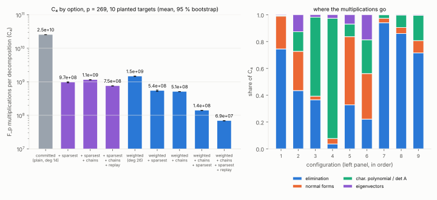
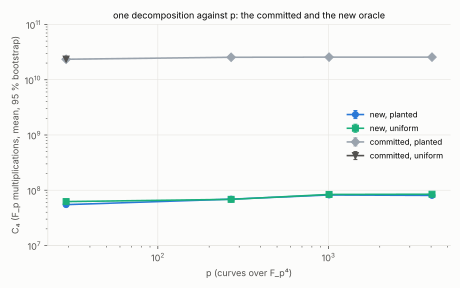
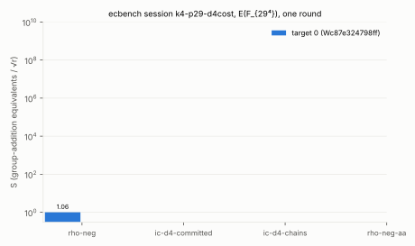
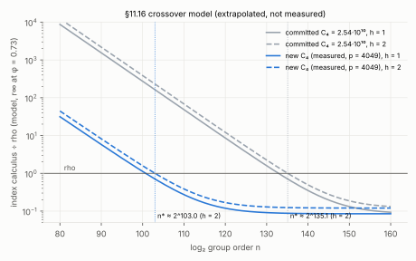

# A cheaper `k = 4` decomposition: `C₄` 2.5·10¹⁰ → 6.9·10⁷, `S` ÷ 400 on `E(F_{29⁴})`, crossover with rho (model) `2^{135}` → `2^{103}`

2026-10-14. Protocol: [`PROTOCOL.md`](PROTOCOL.md), registered (commit
`2be9ad3d7`) before the ladder and the session. Code frozen at `2b49f38d1`.
Report: [`REPORT.pdf`](REPORT.pdf). Run reports:
[`reports/run-20261014T2008Z`](reports/run-20261014T2008Z/) (ladder) and
[`reports/run-20261014T2007Z`](reports/run-20261014T2007Z/) (ecbench session).
**Class: engineering.** This is a constant in the cost of one
decomposition. The method's exponent (`q^{2−2/n}` at `n = 4`) is unchanged,
and so is the asymptote past the crossover (`r∞`).

## What changed

The `D₄` oracle (`gaudry-d4`) has four options. With all of them off it is
the committed oracle, operation for operation. Its counts on the committed
study's planted solves (`../gaudry_quartic_d4_20261013/raw/solves_planted.jsonl`,
targets 0–2) were reproduced exactly.

| option | what | where the saving is |
|:--|:--|:--|
| `weighted=1` | substitute `σ₄ = π²`; four equations in `(σ₁, σ₂, σ₃, π)`, weights `(2, 2, 2, 1)`, each of weighted degree 8. The Hilbert series is `(1+t²+t⁴+t⁶)³(1+t+…+t⁷)`, so the weighted Macaulay degree is **26** (22–25 do not close) | matrix **3,979 × 4,200** against 13,412 × 11,628 |
| `chains=1` | 44 of the 512 products `π·b` leave the standard monomials, so `M_π` is block-companion along `π`-chains. The step computes 44 border normal forms (not 2,877 memoised pivot columns), `det A(λ)` of a 44 × 44 polynomial matrix (scanned over `F_p` for `p ≤ 513`, otherwise interpolated from 513 points and its roots found) and 44 × 44 kernels for eigenvectors. Degenerate eigenspaces are split by `σ₁, σ₂, σ₃` on the standard monomials whose products stay standard | normal forms 7.4·10⁸ → 6.3·10⁶; char. poly. + eigenvectors 2.7·10⁸ → 1.3·10⁷ (`p = 269`) |
| `sparsest=1` | the sparsest candidate row is the pivot of each elimination column | elimination 4.8·10⁸ → 1.2·10⁸ (weighted), 1.9·10¹⁰ → 4.2·10⁸ (plain) |
| `replay=1` | F4Remake: the first solved system's zero rows are not eliminated. If the replayed rank falls short, held rows are reduced in until the recorded (generic) rank is reached, which a specialised system cannot exceed | elimination 1.2·10⁸ → 4.9·10⁷ |

## Part A — one decomposition (`raw/`, `raw/summary.json`)

Means over targets with 95 % bootstrap intervals (10,000 resamples, from
`examples/gaudry_quartic_d4_summary.rs`). With replay, the first, recorded
solve is excluded from the mean and listed separately. **Every
decomposition set equals the meet-in-the-middle enumeration, in all 648
solves that closed.** On every paired target both oracles closed (86 pairs,
78 distinct targets, recorded first solves excluded), they return the same
rational solutions and decompositions. So do the ablation's other pairs.

**Ablation** (`p = 269`, seed 1, 10 planted targets; 9 close in every
configuration, as in the committed study):

| configuration | `C₄` (`F_p` mult.) | 95 % interval |
|:--|--:|:--|
| committed (plain, degree 14) | 2.547·10¹⁰ | 2.544–2.550·10¹⁰ |
| + sparsest | 9.67·10⁸ | 9.32–9.96·10⁸ |
| + sparsest + chains | 1.148·10⁹ | 1.140–1.154·10⁹ |
| + sparsest + chains + replay | 7.54·10⁸ | 7.49–7.59·10⁸ |
| weighted (degree 26) | 1.459·10⁹ | 1.433–1.483·10⁹ |
| weighted + sparsest | 5.44·10⁸ | 5.17–5.67·10⁸ |
| weighted + chains | 5.090·10⁸ | 5.088–5.091·10⁸ |
| weighted + chains + sparsest | 1.400·10⁸ | 1.392–1.407·10⁸ |
| **weighted + chains + sparsest + replay** | **6.89·10⁷** | 6.85–6.93·10⁷ (first solve 1.41·10⁸) |

Paired ratios: committed/new **369.8×** (367.9–371.6). Sparsest pivots
alone: **26.4×** (25.6–27.3). The weighted form against the plain form at
equal linear algebra (`sparsest + chains + replay` both): **10.95×**
(10.90–11.02).

**Read the 370× with this in mind.** The largest single factor, 26×, is
pivot choice: the committed elimination took the lowest-indexed row as
pivot and paid for the fill-in. A competent sparse eliminator on the old
system (Magma's F4, say) would not have paid that. The gain that belongs to
the new formulation is the weighted grading plus the chain step, about 11×
at equal linear algebra.

**Ladder** (`--weighted --chains --sparsest --replay` against committed, same targets):

| p | new, planted | new, uniform | committed, planted | committed/new (paired) | new unsolved |
|--:|--:|--:|--:|--:|:--|
| 29 (ecbench curve) | 5.49·10⁷ | 6.23·10⁷ | 2.35·10¹⁰ | 430× (418–440), uniform 381× (367–391) | 3/20 planted, 3/300 uniform |
| 269 | 6.90·10⁷ | 6.84·10⁷ | 2.55·10¹⁰ | 370× (368–372) | 1/20 planted, 0/50 |
| 1009 | 8.21·10⁷ | 8.39·10⁷ | 2.56·10¹⁰ | 311× (310–312) | 0 |
| 4049 | 8.06·10⁷ | 8.47·10⁷ | 2.56·10¹⁰ | 318× (318–318, 2 pairs) | 0 |

The rise from `p = 269` to `p = 1009` is the interpolated `det A` path
(513 points instead of `p`) and root finding, whose cost grows like `log p`
(1.5·10⁶ at 1009, 3.5·10⁶ at 4049). The committed oracle also fails on the
same 3 of 20 planted targets at `p = 29`. On uniform targets the new form
failed on 1 of the first 50 that the committed one closed (target 35, a
weighted quotient of dimension 511). Wall time per solve fell from 6–31 s
to 0.3–0.4 s (3 threads, beside the session; descriptive).





## Part B — ecbench session (`sessions/k4-p29-d4cost/`, `ECBS1h4687f1d786c2`)

`fp4_torsion(29, 1, 16)` (`#E = 16 · 44,263`; its ICV1 id is in `sessions/k4-p29-d4cost/plan.json`, not yet in the registry),
two targets. Target 0 is the sealed `k4-p29-zero` target. Both IC arms use
`fghr-y-line:zero=1` and charge unsolved systems. All 8 runs verified.

| arm | target 0 `S` | target 1 `S` | trials | relations | unsolved systems (charged) |
|:--|--:|--:|:--|:--|:--|
| `rho-neg` (reference) | 1.065 | 1.412 | | | |
| `ic-d4-committed` (`macaulay=14`) | 6.571·10⁸ | 7.228·10⁸ | 574 / 635 | 9 / 8 | 9 / 8 |
| **`ic-d4-chains`** (new) | **1.653·10⁶** | **1.780·10⁶** | 574 / 635 | 9 / 8 | 11 / 13 |
| `rho-neg-aa` (control) | 1.065 | 1.412 | | | |

`ecbench compare`: **new/committed = 0.0025** in ops (cluster interval
0.0025–0.0025 over 2 targets), i.e. **398× and 406×** per target.
New/rho = 1.39·10⁶ (1.26–1.55·10⁶): **index calculus still loses to rho by
six orders of magnitude at this size**, against 5.6·10⁸ for the committed
oracle. The committed arm's target-0 `S` (6.57·10⁸) is the sealed session's
6.49·10⁸ plus its 9 unsolved systems, now charged (1.6·10¹¹ `F_p`
multiplications). The new arm's solves cost 5.9·10⁷ and 5.7·10⁷ a trial on
average (`C₄` with every attempt, the precompute and the recorded first
solve included), with 568/3 and 625/4 replays/fallbacks. Wall: 7,321 and
7,928 s against 221 and 235 s on one reserved core. The IC runs graded L1,
so wall is not admitted and `S` does not depend on it.



Audit: `audits/k4-p29-d4cost.audit.json` (`ecbench verify --replay-all`):
**OK, 8 records, 8 verified, 8 replays reproduced, 0 problems.**

## Part C — crossover (§11.16's model, extrapolated)

`S/rho = √h (181 (p/4) C₄ / (126 p²) + r∞/4)`. `C₄` is the new oracle's
pooled replayed mean at `p = 4049` (8.34·10⁷, 8.26–8.41·10⁷), with root
finding extrapolated linearly in `log₂ p` from 1009 and 4049. The
committed `C₄ = 2.54·10¹⁰` reproduces the earlier study's figures.

| | `h = 1` | `h = 2` | `h = 4` |
|:--|:--|:--|:--|
| committed `C₄` (φ = 0.73 … 1) | `2^{132.9}` … `2^{133.3}` | `2^{135.1}` … `2^{135.8}` | `2^{137.4}` … `2^{138.5}` |
| **new `C₄`** | `2^{100.7}` … `2^{101.2}` | **`2^{103.0}` … `2^{103.7}`** | `2^{105.4}` … `2^{106.5}` |

On the model, the crossover with rho moves about 32 bits earlier. Past it,
IC still tends to the same 0.12–0.22× rho (`h = 2`), because `r∞` did not
move. This is a model with extrapolated exponents (`n^{1/4}` relations,
`n^{1/2}` linear algebra and rho), not a measured `S`: Part B measures the
constant at `p = 29` only. It also assumes the solve's counted
multiplications stay constant in `p` apart from root finding (the system's
shape does not depend on `p`). At `p ≈ 2^{26}` the elements no longer fit
the `u16` rows used here; the count does not change, the implementation
would.



## Predictions (PROTOCOL.md)

- **A1 (exact): held.** 648/648 closed solves agree with the enumeration,
  and every paired target gives the same solution sets.
- **A2 (`C₄` in `[4·10⁷, 1.2·10⁸]`, ≥ 200× below): held.** 5.5–8.5·10⁷;
  311–430×.
- **A3 (≤ 3 % uniform unsolved): held.** 1.0 % at `p = 29`, 0 elsewhere.
  Planted targets at `p = 29`: 3/20, as for the committed oracle.
- **A4 (sparsest ≥ 10×; weighted ≥ 5× at equal linear algebra): held.**
  26.4× and 10.95×.
- **B1 (verified, replays identical): held.** 8/8 verified; `verify
  --replay-all`: audit OK, 8 of 8 replays reproduced, 0 problems.
- **B2 (trials within 5 %): held.** Identical, 574 and 635, with the same
  relation counts.
- **B3 (`S_committed/S_new` in `[250, 500]`; target 0 about 1.7·10⁶):
  held.** 398× and 406×; 1.65·10⁶.
- **C1 (`n*` at `h = 2` in `[2^{95}, 2^{110}]`): held.** `2^{103.0}`–`2^{103.7}`.

## What did not work, and what was not tried

- **Weighted degree below 26.** The quotient has dimension 502–511 at
  22–25: the border is not reached. This matches the Hilbert series (degree 25).
- **Chains on the plain form.** `σ₁` has 260 chains (`p = 269`), so
  `det A` costs more than the dense characteristic polynomial (6.8·10⁸
  against 1.4·10⁸). The step pays only with `π`'s 44.
- **Replay without top-up.** At `p = 29`, 42 % of replays fell back to a
  full solve in the pilot, because the recorded pivot rows are singular for
  the new system with probability of order `1/p`. The top-up removed this
  (568/3 and 625/4 in the session).
- **Solving the degenerate systems.** About 1 % of uniform systems at
  `p = 29` (2 % of the session's trials) have a weighted quotient of
  dimension 509–511 (no regular top part) and do not close. Re-solving them
  with the committed form would cost about 2.3·10¹⁰ each, roughly 370 new
  solves; dropping the trial costs 1–2 % more trials. They are charged and
  dropped. Their cause (a degree fall at specific `Y_R`) is not
  characterised.
- **Not tried:** F4 with the `D₄`-weighted sugar strategy, Wiedemann on the
  Macaulay matrix (estimated about `n · nnz` = 3.5·10⁹ per right-hand side,
  worse than the elimination), and a comparison with Magma on the weighted
  system (kit submission 15 has the plain one).
- **No challenge verdict.** There is no `docs/bounds` domain, bound record
  or challenge for `F_{p⁴}` curves. This is a paired session (`compare`),
  not a frontier move. Sealing one needs the incumbent's bound first.

## Reproduction

```sh
cargo build --release --example gaudry_quartic_d4 --example gaudry_quartic_d4_summary --bin ecbench
RAYON_NUM_THREADS=3 research/gaudry_quartic_d4_cost_20261014/run_ladder.sh
target/release/examples/gaudry_quartic_d4_summary research/gaudry_quartic_d4_cost_20261014/raw
target/release/ecbench run --spec research/gaudry_quartic_d4_cost_20261014/specs/SPEC-k4-p29-d4cost.json --out OUT --cpus auto --wait --allow-busy
target/release/ecbench verify --dir OUT --replay-all
python3 research/gaudry_quartic_d4_cost_20261014/figures/plot.py   # layout only
```

Environment: Claude Code cloud container, Intel Xeon @ 2.10 GHz, 4 vCPU,
AVX-512, rustc 1.97.0. `ecbench` sha256 `67b8cc95…3e22`. The ladder ran on 3
threads beside the session. Conductor task `T-1` (local control plane).
