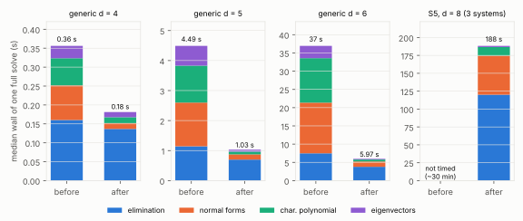

# The `k = 4` Macaulay solve, 6× faster in wall time, the same arithmetic

2026-10-13.  Commit `029309579` (`src/cryptanalysis/gaudry_quartic.rs`).
Wall-time engineering of the `S₅` solve behind `C₄`, the per-decomposition
cost of Gaudry's index calculus over `F_{p⁴}`
(`research/notes/index-calculus/RESEARCH_RESIDUAL_WALKS.md` §11.17).
**Class: engineering.**  The counted cost `C₄` does not change, so the
crossover with rho does not move; what changes is that a full `S₅` solve
now takes about 3 minutes on this host instead of about 30, which is what
let [`../gaudry_quartic_replay_20261013/`](../gaudry_quartic_replay_20261013/README.md)
finish its full-size measurement.

## What changed

Profiling a generic degree-6 solve (43 s) showed three phases far below the
hardware: the characteristic polynomial and the eigenvectors reduced every
product through a `u128` remainder (a library call per entry); the normal
forms ran on one thread; and the release build targets baseline x86-64, on
which the elimination's multiply-and-reduce barely vectorises.

- Characteristic polynomial and eigenvectors on `u16` rows with the
  vectorised `axpy`, rows in parallel.  The Hessenberg step at column `j` is
  a similarity by `I + Σ fᵢ E_{i,j+1}`, whose elementary factors commute, so
  its row operations can all precede its column operations: the same matrix.
- Normal forms resolved right to left in blocks of 128 columns: the terms on
  columns already resolved are summed in parallel, the terms inside the
  block afterwards, in order.
- `axpy` compiled also for AVX2 and AVX-512 and chosen at run time.

Same operations, same counts, same outputs: on the committed `d = 3…5`
replay panel every multiplication count, pivot count, dimension and solution
set is identical; a unit test pins the new kernels to `gaudry_cubic`'s
routines in values and counts; in this benchmark all 36 solves per arm agree
in `total_muls`; and the `S₅` solve's count is `1.2269·10¹²` on system 1,
§11.17's `C₄ = 1.227·10¹²`.

## Result

Interleaved before/after (`run.sh`): binaries from `5a58e9e98` (before) and
`029309579` (after), generic planted systems at `p = 269`, two systems a
run, each run a full solve and a replay, three rounds alternating arms; 12
solves per arm and degree.  Median wall time of a solve, in ms:

| `d` | quotient dim | elimination | normal forms | char. polynomial | eigenvectors | whole solve |
|--:|--:|--:|--:|--:|--:|--:|
| 4 | 256 | 155 → 128 (1.2×) | 91 → 15 (5.9×) | 70 → 17 (4.1×) | 33 → 14 (2.4×) | 354 → 184 (**1.9×**) |
| 5 | 625 | 1,074 → 690 (1.6×) | 1,456 → 179 (8.1×) | 1,192 → 93 (12.8×) | 608 → 73 (8.3×) | 4,368 → 1,067 (**4.1×**) |
| 6 | 1,296 | 7,116 → 3,682 (1.9×) | 13,961 → 1,412 (9.9×) | 12,342 → 507 (24.3×) | 3,364 → 169 (20.0×) | 37,433 → 5,862 (**6.4×**) |

The gain grows with the size.  `S₅` (`d = 8`, quotient dimension 4,096,
41,780 × 40,920 Macaulay matrix), after: 164–203 s a full solve, three
systems (`../gaudry_quartic_replay_20261013/raw/s5_p269.jsonl`); before:
not timed here (the earlier runs took about 30 minutes a solve on this
host, and the last one was lost to a container restart).  The elimination
is now about 64 % of the wall time and the next lever on it.



Report: [`REPORT.pdf`](REPORT.pdf).  Raw: `raw/<arm>_r<round>_d<d>.jsonl`,
`raw/binaries.txt` (SHA-256 prefixes, before then after).

## Environment

Claude Code cloud container, Intel Xeon @ 2.10 GHz, 4 vCPU (AVX-512),
15 GiB RAM, rustc 1.97.0; shared host, nothing else running during the
benchmark; all four threads (rayon).  Conductor's control plane was
unreachable: no task card.

## Reproduction

```sh
git worktree add /tmp/before 5a58e9e98 && (cd /tmp/before && cargo build --release --example gaudry_quartic_replay)
cargo build --release --example gaudry_quartic_replay
BEFORE=/tmp/before/target/release/examples/gaudry_quartic_replay AFTER=target/release/examples/gaudry_quartic_replay research/gaudry_quartic_speed_20261013/run.sh
```
