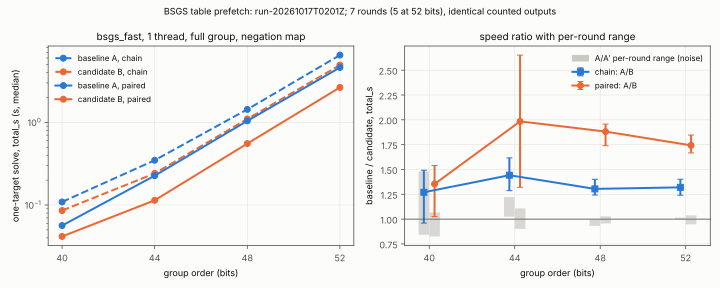
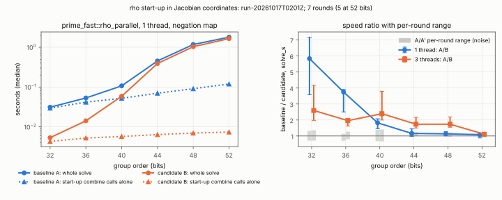

# Memory-level parallelism in BSGS, inversion-free rho start-up

Study of 2026-10-17 · Conductor task T-1 · protocol
[`PROTOCOL.md`](PROTOCOL.md) (frozen before timing, one amendment) · run
[`reports/run-20261017T0201Z/`](reports/run-20261017T0201Z/)
([run report](reports/run-20261017T0201Z/report.pdf)) · results report
[`REPORT.pdf`](REPORT.pdf) · PR #2048.

**Class: engineering** (AGENTS.md §3).
- Two changes to the single-word generic-DLP engines lower wall time. Every
  counted output is identical between the arms:
  - BSGS: table entries, baby steps, giant steps, candidates and verified
    answers;
  - rho: total steps, distinguished points and the recovered logarithm;
  - the field operations per visited point.
- `S` does not move, so no IC/rho ratio moves. This study changes no
  scoreboard, leaderboard or progress-chart figure (§7a).
- The results hold for one host class: an x86-64 Sapphire/Emerald
  Rapids–class Xeon at 2.1 GHz, 4 vCPU, KVM guest, 2 MiB L2 per core, 260 MiB
  shared L3.

## What changed

1. **`bsgs_fast`: table slots are prefetched before they are probed.**
   - Exploratory timing on this host showed the solver waiting on its
     table:
     - With the paired kernel at one thread, a baby insert cost about 68 ns
       and a giant probe about 56 ns, against about 7 ns of field
       arithmetic per point.
     - The table is `8·2^⌈log₂ 2m⌉` bytes: 8 MiB at 40 bits, 1 GiB at 52.
     - At a load factor near ½, the probe loop's "empty?" branch depends on
       the missing load, so successive misses do not overlap.
   - The kernels now hand each visited point's `x` to a `hint` callback
     before `visit` sees it:
     - `chain`: as the new point is computed, a round before its visit;
     - `paired` and `co-Z`: a round is computed and hinted in one pass,
       then visited in a second pass in the original order.
   - `BabyTable::prefetch` issues `PREFETCHT0` on x86-64 and `PRFM` on
     aarch64.
   - Test `hints_precede_visits_and_order_is_single_pass` pins the exact
     visit order, the hint before every fast-path visit, and the steps
     charged on an early stop.
2. **`prime_fast`: `FastCurve::mul` runs in Jacobian coordinates, and
   `combine` is one Straus–Shamir chain.**
   - `rho_parallel` calls `combine(g, q, u, v)` once per entry of its
     1024-entry `r`-adding table and once per walk start.
   - Each call was two affine double-and-add multiplications that paid a
     binary-GCD inversion per group operation.
   - None of it is in `total_steps`. All of it is inside the one-target
     online interval, because the table depends on `Q`.
   - Test `jacobian_mul_and_combine_match_the_affine_ladder` checks the new
     code against the old affine ladder:
     - on every point of four small curves, 2-torsion and every point order
       included;
     - for scalars below, at and past the group order;
     - on the 24-, 40- and 56-bit ladder curves.

**Tried and rejected: `MADV_HUGEPAGE` on the table.**
- Exploratory numbers, `taskset` only, not isolated: the 44-bit paired
  search phase fell from about 6–7 ms to about 4.6–5.1 ms, but the build
  phase became erratic at 0.10–0.20 s, against about 0.11 s with prefetch
  alone.
- The host's THP defrag is `madvise`, so the advised first touch compacts
  synchronously.
- Not shipped.

## Method

[`PROTOCOL.md`](PROTOCOL.md) gives the full method. In brief:

- **Arms.** A is `main` at `b1bf5b893`; A′ is the same binary, as the A/A
  control; B is the candidate commit `c699775dd`.
- **Rounds.** 7 rounds (5 at 52 bits), with the order rotated each round
  (`A B A′`, `B A′ A`, `A′ A B`).
- **Workload.** One target per process, a cold full-group solve.
- **Isolation.** Every run is under `tools/isolated_bench.py run`.
- **Amendment 1.** The isolation tool refuses to reserve all four CPUs, so
  the multi-thread arms use 3 threads on CPUs 1–3. This was amended before
  they ran.
- **Verdict rule.** A configuration *improves* only if every per-round A/B
  ratio exceeds the largest per-round A/A′ ratio. Contended runs are left
  out of every statistic: 26 of 438.
- **Analysis.** Computed natively by
  [`examples/generic_dlp_analyze.rs`](../../examples/generic_dlp_analyze.rs)
  into
  [`summary.json`](reports/run-20261017T0201Z/summary.json).
  [`scripts/plot.py`](scripts/plot.py) only lays that file out.

Curves (frozen in [`inputs/curves.json`](inputs/curves.json); `#E` checked
with PARI/GP `ellcard`; prime order, cofactor 1):

| role | bits | curve |
|:--|--:|:--|
| BSGS (`y² = x³ + 7`, W11 study curves) | 40 | `icv1-fp40-t1502959-42c6aada` |
| | 44 | `icv1-fp44-tm1269095-f56aca35` |
| | 48 | `icv1-fp48-t14984575-af5d5615` |
| | 52 | `icv1-fp52-tm131765273-051185e0` |
| rho (`find_a3_curve(bits, 3)`, `a = −3`) | 32 | `icv1-fp32-t7319-90da43e9` |
| | 36 | `icv1-fp36-t454193-44a20818` |
| | 40 | `icv1-fp40-tm924137-0ecaaeb9` |
| | 44 | `icv1-fp44-tm6431881-43acc95d` |
| | 48 | `icv1-fp48-tm15186475-c683ebfc` |
| | 52 | `icv1-fp52-t113543683-af85fb1e` |

## Results

All figures below are measured and come from
[`summary.json`](reports/run-20261017T0201Z/summary.json).

- **Ratio.** Each cell is baseline A ÷ candidate B, as a ratio of medians,
  followed by the per-round [min, max]. A/A′ gives the noise band.
- **Pinned outputs.** Every configuration shows *identical* pinned outputs
  across its A, A′ and B samples.
- **Field operations.** `lit2026_w11_bsgs_opcount` gives 120 B rows that
  equal their A rows in multiplications, squarings, inversions, additions,
  points visited and slow rounds, with 0 mismatches.



### BSGS (`bsgs_fast`, full group, negation map, one target, one thread)

| bits | kernel | A median `total_s` | B median `total_s` | A/B | A/B per round | A/A′ per round | verdict |
|--:|:--|--:|--:|--:|:--|:--|:--|
| 40 | chain | 0.1090 | 0.0858 | 1.270 | [0.959, 1.492] | [0.842, 1.481] | no measurable change |
| 40 | paired | 0.0565 | 0.0417 | 1.354 | [1.026, 1.540] | [0.825, 1.067] | no measurable change |
| 44 | chain | 0.3482 | 0.2414 | 1.442 | [1.287, 1.617] | [1.024, 1.222] | improves |
| 44 | paired | 0.2265 | 0.1142 | 1.984 | [1.320, 2.652] | [0.902, 1.108] | improves |
| 48 | chain | 1.4351 | 1.1003 | 1.304 | [1.243, 1.401] | [0.932, 0.996] | improves |
| 48 | paired | 1.0429 | 0.5543 | 1.881 | [1.739, 1.957] | [0.956, 1.028] | improves |
| 52 | chain | 6.5163 | 4.9373 | 1.320 | [1.241, 1.402] | [0.999, 1.015] | improves |
| 52 | paired | 4.6114 | 2.6462 | 1.743 | [1.667, 1.847] | [0.947, 1.038] | improves |
| 48, 3 threads | chain | 0.5810 | 0.4350 | 1.336 | [1.232, 1.440] | [0.942, 1.165] | improves |
| 48, 3 threads | paired | 0.4152 | 0.2767 | 1.501 | [1.386, 1.853] | [0.855, 1.122] | improves |

- **Phases.** The build phase (`build_s`, baby inserts) and the search
  phase (`search_s`, giant probes) both moved: paired `search_s` A/B was
  1.885 at 44 bits, 2.000 at 48 and 1.667 at 52 (verdict *improves* each
  time); [`summary.json`](reports/run-20261017T0201Z/summary.json) has
  every phase row.
- **Where `total_s` comes from.** The frozen one-target secrets come from
  the W11 driver's generator seeded with `bits`, and their logarithms are
  small against `n`. The giant phase therefore stops after few strides, and
  `total_s` is mostly the table build.
  - Giant steps are pinned identical between arms, so a `search_s` ratio is
    a per-giant-step ratio.
  - An average-case target would spend about as long searching as building,
    at the same per-point ratios. That is an inference from the two phases'
    ratios, not a separate measurement.
- **40 bits.** The 8 MiB table at 40 bits shows medians 1.27–1.35× lower,
  but the per-round A/B range overlaps the A/A′ range. By the protocol's
  rule this is no measurable change.



### Rho (`prime_fast::rho_parallel`, negation map, one target)

| bits | threads | A median `solve_s` | B median `solve_s` | A/B | A/B per round | A/A′ per round | verdict | start-up `combine` calls alone, A/B |
|--:|--:|--:|--:|--:|:--|:--|:--|--:|
| 32 | 1 | 0.0312 | 0.0053 | 5.836 | [3.577, 7.177] | [0.708, 1.317] | improves | 6.857 |
| 36 | 1 | 0.0532 | 0.0142 | 3.745 | [2.505, 3.912] | [0.698, 1.139] | improves | 7.961 |
| 40 | 1 | 0.1071 | 0.0588 | 1.822 | [1.448, 2.075] | [0.675, 1.389] | improves | 9.105 |
| 44 | 1 | 0.4518 | 0.3894 | 1.160 | [0.979, 1.457] | [0.954, 1.206] | no measurable change | 10.959 |
| 48 | 1 | 1.1729 | 1.0332 | 1.135 | [1.070, 1.270] | [0.942, 1.045] | improves | 13.023 |
| 52 | 1 | 1.7896 | 1.6480 | 1.086 | [0.902, 1.151] | [0.830, 1.136] | no measurable change | 16.094 |
| 32 | 3 | 0.0283 | 0.0109 | 2.595 | [1.978, 4.169] | [0.708, 1.359] | improves | 6.774 |
| 36 | 3 | 0.0714 | 0.0364 | 1.961 | [1.627, 2.097] | [0.799, 1.271] | improves | 8.029 |
| 40 | 3 | 0.0728 | 0.0304 | 2.393 | [1.997, 3.793] | [0.661, 1.406] | improves | 8.500 |
| 44 | 3 | 0.1612 | 0.0928 | 1.737 | [1.496, 2.166] | [0.981, 1.246] | improves | 10.996 |
| 48 | 3 | 0.2142 | 0.1233 | 1.737 | [1.546, 2.195] | [0.947, 1.218] | improves | 13.506 |
| 52 | 3 | 1.2046 | 1.0852 | 1.110 | [1.014, 1.144] | [0.909, 1.035] | no measurable change | 14.783 |

- **The start-up column.** It times, alone, as many `combine` calls as the
  table and the initial walk starts make. It is a derived estimate of the
  start-up share, not a phase of the solve.
- **Where the solve ratio falls.** Start-up is a fixed cost and the walk
  grows as `√n`, so the whole-solve ratio falls as the size grows.
- **Rows with no measurable change.** At 44 and 52 bits at one thread, and
  at 52 bits at three, the gain is inside the noise. Those rows report no
  measurable change.

### External reference (AGENTS.md §15)

**Tool and setup.**
- PARI/GP 2.15.4 (Ubuntu noble `pari-gp`), single-threaded
  (`nbthreads = 1`).
- `elllog(E, Q, G, n)` on the same curves and the same targets, `#E`
  checked with `ellcard` before timing.
- Timed by gp's `getabstime()` around `elllog` alone: 3 repetitions per
  curve, each under `isolated_bench.py` on CPU 3, none contended.
- Every PARI answer equals the planted secret, and `[x]G = Q` was checked.

**Which algorithm PARI ran is not observable here.** `elllog`'s help text
names none, and neither `\g 5` nor `setdebug("bb_group", 5)` /
`setdebug("ell", 3)` prints one.

**Native arms.** The BSGS curves use the paired kernel's `total_s`; the rho
curves use `solve_s`. Both are at one thread.

| curve | bits | PARI `elllog` median (s, n = 3) | baseline A median (s) | candidate B median (s) | B / PARI | A / PARI |
|:--|--:|--:|--:|--:|--:|--:|
| BSGS curve | 40 | 1.006 | 0.0565 | 0.0417 | 0.0415 | 0.0561 |
| | 44 | 4.462 | 0.2265 | 0.1142 | 0.0256 | 0.0508 |
| | 48 | 18.495 | 1.0429 | 0.5543 | 0.0300 | 0.0564 |
| | 52 | 27.749 | 4.6114 | 2.6462 | 0.0954 | 0.1662 |
| rho curve | 32 | 0.032 | 0.0312 | 0.0053 | 0.1669 | 0.9740 |
| | 36 | 0.141 | 0.0532 | 0.0142 | 0.1007 | 0.3770 |
| | 40 | 0.679 | 0.1071 | 0.0588 | 0.0866 | 0.1577 |
| | 44 | 3.162 | 0.4518 | 0.3894 | 0.1231 | 0.1429 |
| | 48 | 11.754 | 1.1729 | 1.0332 | 0.0879 | 0.0998 |
| | 52 | 80.788 | 1.7896 | 1.6480 | 0.0204 | 0.0222 |

**Who is faster.** On this host, at every size measured, both native arms
solve these one-target instances faster than PARI/GP's `elllog`: the
candidate in 2.0–16.7% of PARI's time.
- At 32 bits the baseline rho was level with PARI (A/PARI = 0.974),
  because its start-up dominated.

**Growth with size.** This is `log₂` of the median-time ratio per bit, from
`summary.json` `external_growth`; `√n` scaling is 0.5.

| curves | PARI | baseline A | candidate B |
|:--|--:|--:|--:|
| rho, 32→52 bits | 0.565 | 0.292 | 0.413 |
| BSGS, 40→52 bits | 0.399 | 0.529 | 0.499 |

- **Rho curves.** The native arms grow more slowly than `√n` over this
  range because their fixed start-up is amortised. So the gap at 52 bits
  is not a constant to extrapolate.
- **BSGS curves.** PARI's slope is below `√n`. These targets have small
  logarithms, and the method PARI chose evidently benefits from that. This
  is an inference; the algorithm is not observable.
- **"Faster than PARI/GP" holds only at the sizes and on the host
  measured.**

**Not compared** (§15).
- The fastest published ECDLP implementations for prime curves are
  record-scale distinguished-point rho on GPUs, FPGAs and PlayStation 3
  clusters, at 100 bits and more, on other hardware.
- No such tool for single-word curves is installed here. Sage is not
  installed, and Magma needs a licence that this host does not have.
- This study therefore makes no "fastest" claim. Those comparisons remain
  missing.

## Interpretation (labelled as such)

- **BSGS on large tables was bound by memory latency, not arithmetic.**
  Taking the probe's miss off the dependency chain saved 23–31% of the
  chain kernel's one-target time and 43–50% of the paired kernel's at
  44–52 bits (`1 − B/A`, from the ratios above).
  - The paired kernel gains more because its arithmetic per point is
    3.8–4.5× smaller.
    - This run's `opcount.jsonl` gives 3.84–3.94 M-equivalents per point
      for paired (`K = 16`) against 14.6–17.9 for chain, counting a Fermat
      inversion as its multiplications.
    - It was the more memory-bound of the two.
  - The 3-thread gain is smaller (1.50× paired) because the threads share
    one table and one memory system.
- **Rho was dominated by its uncounted start-up at small sizes.**
  - At 32 bits, single-threaded, the baseline's start-up calls alone took
    29.5 ms (median), in a 31.2 ms solve.
  - The candidate's whole solve takes 5.3 ms.
  - The start-up is now 6.8–16.1× cheaper.
  - Where `rho_parallel` serves as a wall-time reference, this makes it a
    stronger, faster one, with an unchanged step count.

## What this does not establish

- Nothing about `S`, about the counted cost of either method, or about any
  IC/rho comparison.
- Nothing about arm64, GPUs, other x86 parts, or bare-metal hosts.
- Nothing about averages over targets. This is one frozen target per curve,
  as the protocol fixes.

## Next improvements (named, not started)

1. **One-target BSGS: interleaved negation-map BSGS.**
   - The non-interleaved search costs `≈ 1.00√n` on average. Interleaving
     the baby and giant lists with stride `√(2n)` costs `≈ 0.943√n`, a
     derived figure.
   - This is an algorithmic change to the counted cost: a fresh protocol,
     and the multi-target table reuse is lost.
2. **BSGS baby phase at one worker.** The `compare_exchange` insert is a
   full barrier on x86. A single-worker plain-store path would remove it.
   This is engineering, with output pinned.
3. **Rho walk.** Drop the per-step `(a, b)` tracking (re-walk from the seeds
   on a collision), or use lazy reduction.
4. **`bsgs_fast::FastCurve::scalar_mul`.** It is still affine and pays a
   Fermat inversion per operation, for chain seeding and verification. That
   is small at these sizes, dominant on tiny intervals.
5. **Correctness findings from the same audit.** They land in their own PR:
   - the `pollard_collab` negation-map 2-cycle escape never fires;
   - Pohlig–Hellman digits cost `O(q)` and its factorisation can run
     unboundedly.

   Further findings (Gaudry–Schost and collab branch bits overlapping the DP
   bits; grumpy giants not following Bernstein–Lange; `aut_folded_rho` not
   folding; `Point::scalar_mul_ct`'s generic fallback not constant-time) are
   listed in [`AUDIT_FINDINGS.md`](AUDIT_FINDINGS.md).

## Reproduce

```sh
# baseline binaries from b1bf5b893, candidate from this branch, then:
research/generic_dlp_memory_parallelism_20261017/scripts/run_arms.sh <raw> <base_bin_dir> <cand_bin_dir> bsgs1   # and rho1, bsgs3, rho3
research/generic_dlp_memory_parallelism_20261017/scripts/pari_elllog.sh <raw> <role> <bits> <k> <label>
cargo run --release --example generic_dlp_analyze -- research/generic_dlp_memory_parallelism_20261017/reports/run-20261017T0201Z
python3 research/generic_dlp_memory_parallelism_20261017/scripts/plot.py research/generic_dlp_memory_parallelism_20261017/reports/run-20261017T0201Z
```

The run's interruptions are listed with their times in
[`interruptions.txt`](reports/run-20261017T0201Z/interruptions.txt):

1. A build held the bench lock while the script ran without `--wait`. The
   script stopped cleanly and resumed from the next label.
2. The live output was moved out of the repository to stop stop-hook
   commits. The run stopped between samples and resumed.
3. The multi-thread parts started under amendment 1.

No recorded sample was rerun or overwritten: the script skips recorded
labels.
