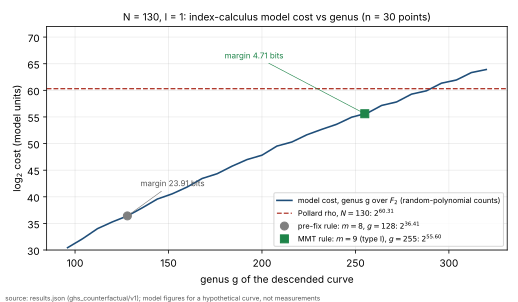

# N = 130 GHS counterfactual under the MMT magic number (2026-10-13)

Closes the open item left by
[`docs/audits/GHS_MAGIC_NUMBER_MMT_CORRECTION_20261013.md`](../../docs/audits/GHS_MAGIC_NUMBER_MMT_CORRECTION_20261013.md):
the cost of the `N = 130`, `l = 1` row of
[`RESEARCH_ECC2K130_HYPERELLIPTIC.md`](../notes/ecc2k130/RESEARCH_ECC2K130_HYPERELLIPTIC.md)
§7 at the genus the corrected magic number actually allows.  Status labels:
**derived** (exact computation or theorem), **model** (the note's index-calculus
cost model, a figure for a hypothetical curve), **checked** (two independent
implementations agree), **interpretation** (labelled, not a result).

## Question and scope

Over `F_{2^130}/F_2` (`n = 130`) the old table priced genus 128 (`m = 8`) at
`2^36.41` against rho `2^60.31`.  Under Maurer–Menezes–Teske (2002), eq. (5)
no `b` has `m = 8`.  What does the least admissible genus cost?  The
admissibility rule (`l · genus ≥ N − 2`), the cost model and the rho reference
are the note's, unchanged.  No registry curve, subgroup or generator is involved:
this is an abstract tower, so there is no ICV1/EC1 identity to cite.

## Findings

| # | statement | status |
|---|---|---|
| 1 | Attainable `(m, type)` over `F_{2^130}/F_2` start `1, 2, 5, 6, 9, 10, 13, 14, …`; `m = 8` does not occur. The least admissible outcome is `m = 9`, **type I, genus 255** (`Ord_b = Φ_5(x)^2`, degree 8, `(x−1) ∤ Ord_b`). `m = 9` type II, genus 256, also occurs. | derived; the formula equals an exhaustive scan of `F_{2^10}`, `F_{2^12}` at every tower tested (tests below) |
| 2 | A concrete `b ∈ F_{2^130}` (modulus `z^130 + z^3 + 1`, `a = 1`) has `Ord_b = Φ_5^2`: `magic_number = 9`, `ghs_genus_with_type = (255, type I)`, `mmt_condition_8` holds. | derived (test `genus_255_witness_exists_over_f2_130`) |
| 3 | Cost at genus 255: **`2^55.60`** (smoothness bound `b = 27`, relations `2^54.46`, linear algebra `2^54.60`), against rho `2^60.31`: **−4.71 bits**. Genus 256 (type II): `2^55.65`. Old row: genus 128, `2^36.41`, −23.91 bits. | model, checked: native `window::price` and the legacy Python `price_index_calculus` agree to 0.01 bit at 128, 255 and 256 |
| 4 | On this grid the model cost crosses rho between genus 288 (`2^59.91`) and 296 (`2^61.34`). | model |
| 5 | The \"breaks rho: yes\" entry survives in the model, with its margin cut by 19.2 bits (23.905 → 4.711). | model |
| 6 | The note's §8 estimates one relation trial at *perhaps* `2^7` curve additions. A 4.71-bit margin does not absorb that; the old 23.9-bit one did, with 16 bits to spare. | interpretation: the \"yes\" is not robust to the unit conversion the note itself estimates, which is itself unmeasured |

### The rest of the table (all rows recomputed; same rule, `F_2` factorisation)

| `l` | `n` | old `(m, genus)` → cost | now `(m, type, genus)` → cost | below rho? (now) |
|---:|---:|---|---|:--:|
| 1 | 130 | (8, 128) → 2^36.41 | (9, I, 255) → **2^55.60** | yes (model) |
| 2 | 65 | (7, 64) → 2^299.93 † | (13, I, 4095) → 2^43242.05 † | no |
| 13 | 10 | (5, 16) → 2^68.63 † | (5, I, 15) → 2^64.52 † | no |
| 26 | 5 | (4, 8) → 2^60.80 † | (5, I, 15) → 2^88.78 † | no |
| 5, 10, 65 | 26, 13, 2 | not in the note's table | (13, I, 4095) 2^43248.04 † · (13, I, 4095) 2^43258.04 † · (2, II, 2) 2^66.00 † | no |

† `l ≥ 2` rows use the note's fixed-genus model `g!·q^(2−2/g)`, which the note
calls pessimistic, not tight, once `g` is large against `log q`.  Read them as
"not shown to break", not as "does not break".  Full rows, including the
available-`m` lists, are in `results.json`.  `N = 131`: least admissible
`m = 131` (type I), floor 130 bits against rho `2^60.81`; the old floor was
129.  No change of verdict.

### A second error in the old table, independent of the `+1`

The note's script computed the available magic numbers with
`achievable_dims(n, 1 << l)`, the dimensions of Frobenius-stable subspaces of
`F_q^n` for `q = 2^l` (factorising `x^n − 1` over `F_q`).  The magic number is an
`F_2`-dimension, so the factorisation is over `F_2` for every `l`.  This changed the
`l = 2` and `l = 26` rows (and `l = 5, 10`) beyond the `+1` and the genus type.
Evidence: exhaustive scans of `F_{2^12}` at `(n, l) = (6, 2), (4, 3), (3, 4), (2, 6)`
find exactly the `F_2` set (for `n = 3, l = 4` the `F_q` set would allow `m = 2`; no
`b` has it).  At `l = 1` the two coincide, so this does not affect the genus-255
row.

## Method and checks

`cargo run --release --example ghs_counterfactual -- --out results.json`
(`examples/ghs_counterfactual.rs`, module
`curve_construction::counterfactual`).  Pricing is the existing
`curve_construction::window::price` on `#C(F_{2^k}) = 2^k + 1`, `b ≤ 200`.
Tests (`cargo test --release --lib curve_construction::counterfactual`, 5 pass):

- `legacy_rule_reproduces_the_note_table` — the pre-fix rule reproduces the note's
  `2^36.41`, `2^299.93`, `2^68.63`, `2^60.80` and `129` to 0.01, so the port
  prices as the note did;
- `attainable_pairs_match_an_exhaustive_scan` (`l = 1`, `F_{2^10}`, `F_{2^12}`) and
  `…_for_l_above_1`;
- `n130_l1_least_admissible_is_genus_255` — pins `m = 9`, type I, genus 255 and the
  cost to 0.01;
- `genus_255_witness_exists_over_f2_130`.

Independent cross-check (not part of the repository's native pipeline): the
legacy `scripts/ecc2k130_hyperelliptic_cover_boundary.py::price_index_calculus`,
loaded by path, gave `2^36.41` (`b = 17`), `2^55.60` (`b = 27`) and `2^55.65` at
genus 128, 255 and 256, for `b ≤ 44` and `b ≤ 200` alike.

## Run record

| field | value |
|---|---|
| command | `cargo run --release --example ghs_counterfactual -- --out results.json` |
| tree | base `d7e14e230` plus the files of the commit that adds this directory (see the PR) |
| host | Linux 6.18.44, 4 cores, `rustc 1.97.0`; no isolation level claimed; wall time not used |
| `results.json` sha256 | `694cd33808a6cf9778e24e80f9c6fcfc59ddd9304ae17ce0e4bca71c1a43c5e1` |
| failed or skipped runs | none; the first test run failed its two pins (a placeholder cost constant, and the legacy `l = 2` row, which exposed the `F_q` error above) and is preserved in the session history, not hidden |

## Graph

`cost_vs_genus.svg` / `.png` from `plot_cost_vs_genus.py`, which only plots
`results.json` (30 genera, 96–320).  PDF: `report.pdf` (source `report.typ`).

## Not established

- A genus-255 curve over `F_2` with the ECDLP subgroup in its Jacobian: the GHS
  cover, the norm–conorm map, subgroup preservation and the Jacobian order are not
  constructed.  Finding 2 shows only that a `b` with the right invariants exists.
- The admissibility rule `l · genus ≥ N − 2` is the note's heuristic and was not
  re-derived.
- The cost unit (finding 6) and the random-polynomial point-count model (the note
  measured 0.2 bit against an exact zeta function at genus 130 only).
- `N = 130` is a counterfactual to explain why `N = 131` differs; it is not a
  claim about any deployed curve.
- Conductor: `conductor check` could not run in this container (the control plane
  needs Postgres through Docker, which is unavailable); no reservation was taken.
