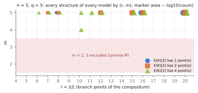

# GHS cover census at larger `q` (`n = 3`) and for `n = 5`

2026-10-14. Conductor T-2467. Extends
[`research/ghs_cubic_cover_census_20261012/`](../ghs_cubic_cover_census_20261012/README.md)
(PR #1759, "the merged census"). **Structural stage diagnostic on toy
fields.** It counts covers by Riemann–Hurwitz genus. No curve over `F_q` is
constructed, no transfer map is evaluated, no discrete logarithm is solved,
and no speedup is claimed.

Protocol: [PROTOCOL.md](PROTOCOL.md), committed (`2d95bde3f`) before any
panel ran, with one amendment (`338cd011a`, hypothesis H) added after panel
D and before panels A, B, C, E produced output; protocol-versioned at commit,
not independently preregistered. Run `20261014T0050Z`:
[records](results/run-20261014T0050Z/), [environment and timings](results/run-20261014T0050Z.env.txt),
[reproduction checks](results/run-20261014T0050Z/reproduction-checks.txt),
[run report](reports/run-20261014T0050Z/run-report.pdf). This report as PDF:
[REPORT.pdf](REPORT.pdf). Tool: [cover_census_n.rs](cover_census_n.rs)
(dependency-free Rust). Lean: [lean/CoverCensusN5.lean](lean/CoverCensusN5.lean).

## Question

For `E: y² = x³ + a₂x² + a₄x + a₆` over `K = F_{q^n}` and the `x`-line with
branch set `B = x(E[2])`, the smallest genus of the `(Z/2)^m` compositum of
the `n` conjugate double covers over every `F_q`-structure `τ`
(`g = 2^{m−2}(r−4)+1`). (1) Does the merged `n = 3` pattern — class minimum
13 / 5 / 3 for `#E(K)` odd / 2 mod 4 / 0 mod 4 — hold at larger `q`?
(2) For `n = 5`, what is the minimal genus and what governs it?

## Result in brief

- **The new enumeration reproduces the merged census exactly**: every
  `q = 5, 7` curve record and `mod4` histogram, and the `q = 11` sample.
  At `n = 5` it agrees with the generalised cocycle search on every curve.
- **`n = 3`:** at `q = 11` (2 662 curves, exhaustive) the class pattern
  13 / 5 / 3 holds on every curve. At `q = 13` (4 400 curves, exhaustive)
  **the pre-registered prediction fails in one row**: 2 of 1 100 curves of
  order 2 mod 4 have class minimum 9. Both lie in the trace-zero class
  `#E(K) = q³ + 1`, as do the merged census's two `q = 5` exceptions
  (post-hoc observation). The `q = 17` sample (200) is consistent.
  New theorem: **`#E(K) ≡ 2 mod 4` ⇒ genus ≥ 5 on every structure, for
  every `q`.** So "2 mod 4 never reaches 3", previously only observed, is
  now proved; the odd-order bound of 13 was already proved.
- **`n = 5`:** the minimal genus is governed by the 2-torsion type, with
  derived floors **33 (odd) / 33 (2 mod 4) / 25 (`E(K)[2] = Z/2`, 4 | #E) /
  5 (`E(K)[2] = (Z/2)²`)**. Further theorems: `m ∈ {1, 4, 5}`; no genus
  in 6–16; for odd order the minimum is 33 exactly when `j ∉ F_q`. All
  floors are attained at `q = 3` (exhaustive, 488 curves). Genus 5 occurs
  on 20 of 81 split curves at `q = 3` and on none of the 31 split models
  censused at `q = 5` (sample). 0 violations of any derived statement, in
  any arm.

## How the census is computed (new enumeration)

Every structure is `τ = MσM^{−1}` (Lang), one per coset `M·PGL2(F_q)`, and
`τ^iB = Mσ^i(M^{−1}B)`, so the genus of `(B, τ)` is that of
`(B' = M^{−1}B, σ)`. The tool runs `N = M^{−1}` over a transversal of
`PGL2(F_q)\PGL2(K)` given by normal forms of `(N(∞), N(0), N(1))` and takes
`σ^iB'` as coefficient-wise Frobenius images; a gcd test
(`gcd(B', σ^kB') = 1`, `k ≤ (n−1)/2`) settles the pairwise-disjoint
structures (`m = n`, `r = 4n`) without forming unions. Cost per curve
`(Q³ − Q)/(q³ − q)` instead of the merged search's `Q³` per field and
`|PGL2(K)|`-scan per curve. The merged cocycle search, generalised to
`A·A^σ···A^{σ^{n−1}}` scalar, is kept as a second method.

**Reproduction (all exact, [checks](results/run-20261014T0050Z/reproduction-checks.txt)):**

| check | what was compared | result |
| --- | --- | --- |
| R1 | `n = 3`, `q = 5, 7`, every curve: `A_idx, B_idx, order, maxprime, min_genus, types_at_min, structures_by_genus, m1_structures, min_genus_2isog, min_genus_class` against merged run `20261013T0403Z`; and its `mod4` histograms | identical, 252 + 690 curve records, 9 + 9 histograms |
| R2 | `n = 3`, `q = 11`, the merged 120-curve sample (same seed and stream), same fields minus class minimum | identical, 120 records |
| R3 | `n = 5`, `q = 3`, every curve: coset method against the generalised cocycle search (all fields but `mismatch`) | identical, 488 records |
| pilot | `n = 3`, `q = 3`, both methods | identical, 56 records |

The subcover-sum identity (genus = sum of `(s−2)/2` over the nonzero
vectors of the span) held on every structure evaluated in full in every arm
(`mismatches` = 0), and every curve counted exactly `(Q³ − Q)/(q³ − q)`
structures (asserted by the tool).

## Panels

| panel | `n` | `q` | coverage | models | structures per model | wall time |
| --- | --- | --- | --- | --- | --- | --- |
| R1 | 3 | 5, 7 | every class | 252, 690 | 16 275, 120 099 | 6 s, 42 s |
| R2 | 3 | 11 | merged 120-curve sample | 120 + 127 neighbours | 1 786 323 | 142 s |
| A | 3 | 11 | every class | 2 662 | 1 786 323 | 918 s |
| B | 3 | 13 | every class | 4 400 | 4 855 539 | 4 956 s |
| C | 3 | 17 | sample of 200 | 200 + 187 neighbours | 24 221 379 | 1 245 s |
| D | 5 | 3 | every class | 488 | 597 861 | 98 s (cocycle method, R3: 3 232 s) |
| E | 5 | 5 | sample of 60 | 60 + 64 neighbours | 254 313 125 | 4 746 s (after one restart, below) |
| pilot | 3 | 3 | every class (char 3) | 56 | 819 | < 1 s |

Wall times on a shared host at load average 60–260 (6 threads), bookkeeping
only. Panel E was killed once when the host restarted, about 2 h 15 min in,
before it had written any curve record (the tool writes records at the end);
it was rerun from scratch with the same command and seed, and the
interruption is recorded in `env.txt`. No other arm was interrupted.

Each model is censused over **all** its structures, so every per-curve
minimum is exact. A, B, D (and R1) cover every `K`-isomorphism class and give
isogeny-class minima; C and E are fixed-seed samples of curves (with their
2-isogeny neighbours), so their fractions are sample counts and class minima
are not computed.

## `n = 3`: the mod-4 pattern at `q = 5 … 17`

Curves (isomorphism classes) by minimal genus. "self" = the curve, "≤1 step"
= the curve and its `K`-rational 2-isogeny neighbours, "class" = all curves
with the same `#E(K)`.

| field (coverage) | `#E(K)` | curves | self | ≤1 step | class |
| --- | --- | --- | --- | --- | --- |
| q = 5 (all, = merged) | odd | 84 | 13: 84 | 13: 84 | 13: 84 |
| | 2 mod 4 | 64 | 5: 60, 9: 4 | 5: 60, 9: 4 | 5: 62, **9: 2** |
| | 0 mod 4 | 104 | 3: 62, 5: 42 | 3: 104 | 3: 104 |
| q = 7 (all, = merged) | odd | 232 | 13: 232 | 13: 232 | 13: 232 |
| | 2 mod 4 | 172 | 5: 168, 9: 4 | 5: 168, 9: 4 | 5: 172 |
| | 0 mod 4 | 286 | 3: 157, 5: 126, 9: 3 | 3: 286 | 3: 286 |
| q = 11 (all, panel A) | odd | 888 | 13: 888 | 13: 888 | 13: 888 |
| | 2 mod 4 | 666 | 5: 660, 9: 6 | 5: 660, 9: 6 | 5: 666 |
| | 0 mod 4 | 1108 | 3: 551, 5: 554, 9: 3 | 3: 1100, 5: 8 | 3: 1108 |
| q = 13 (all, panel B) | odd | 1468 | 13: 1468 | 13: 1468 | 13: 1468 |
| | 2 mod 4 | 1100 | 5: 1092, 9: 8 | 5: 1092, 9: 8 | 5: 1098, **9: 2** |
| | 0 mod 4 | 1832 | 3: 888, 5: 938, 9: 6 | 3: 1832 | 3: 1832 |
| q = 17 (sample of 200, panel C) | odd | 67 | 13: 67 | 13: 67 | not computed |
| | 2 mod 4 | 55 | 5: 55 | 5: 55 | not computed |
| | 0 mod 4 | 78 | 3: 32, 5: 46 | 3: 77, 5: 1 | not computed |
| q = 3 (all, pilot, char 3) | odd | 20 | 13: 20 | 13: 20 | 13: 20 |
| | 2 mod 4 | 14 | 5: 12, 9: 2 | 5: 12, 9: 2 | 5: 12, 9: 2 |
| | 0 mod 4 | 22 | 3: 14, 5: 6, 7: 1, 9: 1 | 3: 20, 7: 2 | 3: 20, **7: 2** |


**Prediction P3 (pre-registered) is falsified at `q = 13`, in the 2 mod 4
row only.** Odd → 13 and 0 mod 4 → 3 hold on every curve at `q = 11` and
`q = 13` (888 + 1468 odd, 1108 + 1832 0 mod 4 curves); 2 mod 4 → 5 holds on
all 666 curves at `q = 11` but **2 of 1100 curves at `q = 13` have class
minimum 9**. The derived statements held everywhere: no odd curve below 13
(every odd structure is 13 or 17), no 2 mod 4 curve below 5.

**Observation (post hoc, not predicted; bounded census):** in every
exhaustive field with `p > 3` (`q = 5, 7, 11, 13`), every curve that misses
the mod-4 class pattern lies in the trace-zero isogeny class
`#E(K) = Q + 1` (`Q = q³`): 126 at `q = 5` (both merged exceptions) and
2198 at `q = 13` (both new exceptions), each with `j ∈ F_q` and a
`τ`-stable structure (`m1 = 1`). That class is 2 mod 4 exactly when
`q ≡ 1 mod 4`; for `q ≡ 3 mod 4` (`q = 7, 11`, `Q + 1 = 344, 1332`) it is
0 mod 4 and does reach genus 3. Restated with this class removed, the
pattern 13 / 5 / 3 holds on every curve of the four fields. The `q = 3`
pilot (characteristic 3, outside the merged scope) has further exceptions:
the trace-zero class 28 (0 mod 4, minimum 7) and two 2 mod 4 classes (18,
38) with minimum 9. Why the trace-zero class misses is not derived here.

Within one 2-isogeny step, genus 3 is reached by every 0 mod 4 curve at
`q = 13` and by 1100 of 1108 at `q = 11`; the other 8 need a longer path
(their class minimum is 3). At `q = 17`, 77 of 78 sampled 0 mod 4 curves
reach 3 within one step.

## `n = 5`: what governs the minimal genus

Curves by minimal genus, by 2-torsion type. Derived floor in brackets
(Prop. O5, Cor. T5, Lemma E).

| field (coverage) | `#E(K)`, `E(K)[2]` [floor] | curves | self | ≤1 step | class |
| --- | --- | --- | --- | --- | --- |
| q = 3 (all, panel D) | odd, 1 [33] | 164 | 33: 160, 97: 4 | 33: 160, 97: 4 | 33: 160, 97: 4 |
| | 2 mod 4, 2 [33] | 122 | 33: 120, 65: 2 | 33: 120, 65: 2 | 33: 122 |
| | 0 mod 4, 2 [25] | 121 | 25: 60, 33: 60, 65: 1 | 5: 20, 17: 90, 25: 11 | 5: 40, 17: 80, 25: 1 |
| | 0 mod 4, 4 [5] | 81 | **5: 20**, 17: 50, 25: 11 | 5: 40, 17: 40, 25: 1 | 5: 40, 17: 40, 25: 1 |
| q = 5 (sample of 60, panel E) | odd, 1 [33] | 14 | 33: 14 | 33: 14 | not computed |
| | 2 mod 4, 2 [33] | 24 | 33: 24 | 33: 24 | not computed |
| | 0 mod 4, 2 [25] | 13 | 25: 6, 33: 7 | 17: 5, 25: 8 | not computed |
| | 0 mod 4, 4 [5] | 9 | 17: 3, 25: 6 | 17: 7, 25: 2 | not computed |

Finer 2-adic data at `q = 3` (class minimum by `v₂(#E(K))`): `v₂ = 0` → 33
(160) or 97 (4); `v₂ = 1` → 33 (122); `v₂ = 2` → 17 (80), 25 (2);
`v₂ = 3` → 5 (40), 17 (20); `v₂ = 4` → 5 (40); `v₂ = 5` → 17 (20). On
the curve itself genus 5 occurs only with `#E(K)[4] = 8`
(`E(K)[2^∞] ⊇ Z/2 × Z/4`; 20 of 60 such curves, 0 of 21 with
`#E(K)[4] = 4`).


**What governs the `n = 5` minimum is the 2-torsion Galois type, sharpened by
#E(K) mod 4: a derived floor for each type, attained in the data.**

- *Odd order* (`E(K)[2] = 0`): minimum 33 for every curve with
  `j(E) ∉ F_q` (160 at `q = 3`, 14 of 14 sampled at `q = 5`), attained by
  exactly one structure, as Proposition O5 says; 97 for the 4 odd curves
  at `q = 3` with `j ∈ F_q` (descended, `m1 = 1`). Derived and confirmed;
  no isogeny changes it.
- *2 mod 4* (`E(K)[2] = Z/2`, `T ∉ 2E(K)`): floor 33 (Cor. T5), and the class
  minimum is 33 on all 122 curves at `q = 3`; 24 of 24 sampled at `q = 5`
  have 33 on the curve itself.
- *0 mod 4 with `E(K)[2] = Z/2`*: floor 25 on the curve itself (Cor. T5),
  reached by 60 of 121 at `q = 3` and 6 of 13 sampled at `q = 5`. One
  2-isogeny step moves them to split curves: class minimum 5 for 40 and 17
  for 80 of 121 at `q = 3`.
- *Split 2-torsion*: only these can reach genus 5 (Lemma E), via
  `B ∼ O(x) ∖ {σ^j x}` (four of the five conjugates of a point
  `x ∈ K ∖ F_q`). At `q = 3`, 20 of 81 split curves reach 5 on themselves
  and 40 of 81 in their class. **At `q = 5` none of the 9 sampled split
  curves, and none of the 31 split models censused including neighbours,
  reaches 5** (minimum 17). Expected if the genus-5 configurations are rare
  for larger `q`: they form a family of about `5(q⁵ − q)/(q³ − q) ≈ 5q²`
  structures, against about `Q = q⁵` curves (a heuristic count, not a
  derivation). With 9 sampled split curves this is a small-sample statement,
  not an estimate of the rate.

**Hypothesis H** (registered after panel D, before panel E's output): at
`q = 3`, `E(K)[2] = Z/2` curves reach 25 on themselves only with
`v₂ ≥ 3`; the prediction was that this restriction disappears at
`q ≡ 1 mod 4`. At `q = 5`, 5 of the 8 sampled `E(K)[2] = Z/2`, `v₂ = 2`
curves have genus 25 (8 ≥ 5, so the test was powered): **H held**, which
fits the exponent explanation in the amendment. It is still unproved.

So the answer to "does `n = 5` follow `#E(K) mod 4`?" is no, not in the
`n = 3` sense. Odd and 2 mod 4 sit at the same derived value (33) and never
go lower. The 0 mod 4 class splits by the 2-torsion field (25 vs 5 on the
curve itself) and, over the isogeny class, reaches 5 or stops at 17 (`q = 3`,
exhaustive) for reasons the census does not explain: within 0 mod 4 at
`q = 3` the class minimum follows `v₂` only loosely (table above). The
trace-zero class `#E(K) = Q + 1 = 244` at `q = 3` stops at 25.

Structures by `(r, m)` over all models (`mr` records): `m ∈ {1, 4, 5}` only,
`m = 4` only for split 2-torsion and `r ∈ {5, 10}`, as Lemma M and Lemma E
require.




At `q = 5` the configuration `(m, r) = (4, 5)` (genus 5) does not occur in
any of the 124 censused models, while `(4, 10)` (genus 25) does.

## Derivations (full statements and proofs in PROTOCOL.md, "Derived statements")

All were written into the protocol before the panels ran; the tool checks
each on every curve (`violations`, `derived_checks`): **0 violations in
every arm.**

| statement | content | status |
| --- | --- | --- |
| Lemma M | span of `{σ^i 1_{B'}}` is a cyclic `F_2[x]/(x^n−1)`-module: `m ∈ {1,2,3}` (`n = 3`), **`m ∈ {1,4,5}` (`n = 5`)**, `m = n−1` iff every point of `U` lies in an even number of the `σ^iB'` | proved (paper); Lean: the single-orbit case `Rot5.span_sizes` |
| Lemma D0 | `n` prime, `m ≥ 2` ⇒ `g ≥ n` | proved (paper) |
| Lemma E | `m = n−1` forces all four branch points `K`-rational; `n = 5`: `g ∈ {5, 25}`; `n = 3`: `(m,r) = (2,6)` | proved (paper) |
| Corollary | `n = 5` genera are 5, 25 or `8(r−4)+1 ≥ 17`: **nothing in 6–16; genus 5 only if `E(K)[2] = (Z/2)²`** | proved (paper); Lean: arithmetic `Spectrum.n5_gap` |
| Prop. O5 | odd `#E(K)`, `n = 5`: genera in `{33, 97, 129}`; **exactly one structure** has `θ`-orbit 3, and it is `m = 1` iff `B` descends; for `j ∉ {0,1728}`: **minimum 33 iff `j(E) ∉ F_q`, else ≥ 97** | proved (paper); Lean: orbit step `Orbit.period_three_or_fifteen` |
| Prop. T | type `(1,1,2)`: `χ = [cr(a₁,a₂;β,β̄)] ∈ U₁/U₁²` is trivial iff `4 \| #E(K)`; the configuration `{β,β^q} ∪ {x, σ^kx}` forces `χ = 1` | proved (paper); Lean: exponent parity `Parity.even_one_sub_neg_pow` |
| Cor. T3 | **`n = 3`: `#E(K) ≡ 2 mod 4` ⇒ every structure has `g ≥ 5`** (proof of the merged census's observation) | proved (paper) |
| Cor. T5 | `n = 5`: `E(K)[2] = Z/2` ⇒ `g ≥ 25`; `#E(K) ≡ 2 mod 4` ⇒ `g ≥ 33` | proved (paper) |
| Lemma H | `m ≥ 3`: hyperelliptic iff an involution of the cover group has genus-0 quotient (exact, not just sufficient); `m ≥ 4` never hyperelliptic | proved (paper) |

So for `n = 3` the merged census's "2 mod 4 never reaches 3" and "odd ≥ 13"
are now both theorems (for every `q`), and its observation that genus 3
needs `4 | #E(K)` follows: every genus-3 configuration is split or carries
the trivial cross-ratio class of Proposition T. For `n = 5` the floors by
2-torsion type are 33 (odd), 33 (2 mod 4), 25 (`E(K)[2] = Z/2`,
`4 | #E(K)`) and 5 (`E(K)[2] = (Z/2)²`); the census shows which are
attained.

Lean ([CoverCensusN5.lean](lean/CoverCensusN5.lean), toolchain v4.34.1, no
Mathlib, `lake build` log in [lean/build.log](lean/build.log)):

| report statement | Lean declaration | status / axioms |
| --- | --- | --- |
| Prop. O5 orbit step: `τ¹⁵θ = θ`, `τ⁵θ ≠ θ` ⇒ returns before 15 are multiples of 3, `τθ ≠ θ` | `Orbit.period_three_or_fifteen` (via `Orbit.ret_gcd`) | proved; `propext`, `Quot.sound` |
| merged `OrbitNine` re-derived | `Orbit.no_short_return_nine` | proved; `propext`, `Quot.sound` |
| Lemma M for one free 5-orbit (span sizes 1, 2, 16, 32; 16 iff rotations sum to 0) | `Rot5.span_sizes` (`decide`, kernel-checked) | proved; `propext` |
| Prop. T exponent `1 − (−q)^k` even | `Parity.even_one_sub_neg_pow` | proved; `propext`, `Quot.sound` |
| `n = 5` genus spectrum arithmetic | `Spectrum.n5_gap` | proved; no axioms |
| Lang reduction, Lemma M for arbitrary `σ`-sets, Lemma E, simple transitivity in O5, the cross-ratio invariant and 2-descent in T, genus formula, Lemma H | none | **not formalized** (needs field, module and curve theory absent without Mathlib) |

No `sorry`, no custom axioms, no `native_decide`. No identity certificate:
no polynomial identity is claimed.

## What this does and does not say

- **Measured, bounded:** the `n = 3` pattern at `q = 11, 13` (every
  curve) and `q = 17` (sample of 200); `n = 5` at `q = 3` (every curve)
  and `q = 5` (sample of 60 plus 64 neighbours). Every model is censused
  over all of its structures. A bounded census is not a theorem: the
  trace-zero observation and the `n = 5` attainment rates are observations.
- **Proved (paper proofs in PROTOCOL.md; Lean for the orbit, single-orbit
  module, parity and spectrum steps):** the floors and the spectrum listed
  under Derivations. These hold for every odd `q` (char ≠ 2) and do not
  depend on the census. They rest on the merged census's construction
  (branch-set genus formula), which this study does not re-derive.
- **Cost context (published asymptotics, not measured):** genus 3 is below
  the rho exponent for `n = 3` (merged PROTOCOL.md references). For
  `n = 5`, rho on `E(K)` costs about `q^{5/2}`; index calculus on a
  genus-`g` Jacobian over `F_q` costs about `q^{2−2/g}` (Diem 2011), which
  is below `q^{5/2}` for every `g`. So even genus 33 is "sub-rho" in the
  exponent, but the constants grow very quickly with `g`. This study prices
  nothing and makes no attack claim.
- **Not established:** that the covers descend to `F_q` with a transfer
  injective on the large prime subgroup (cited for odd `n`, not verified);
  `n = 4` (descent not decidable from branch data, left out, PROTOCOL.md);
  degree-2 maps other than `x`; why the trace-zero class misses the `n = 3`
  pattern; any reason for the `q = 3` `v₂ ≥ 3` restriction beyond the
  heuristic exponent argument; how often genus 5 occurs at `n = 5` for
  `q ≥ 5`; hyperellipticity of `n = 3`, `m = 2` covers.
- **Next discriminating step:** an exhaustive, or much larger, split-curve
  census at `n = 5`, `q = 5`, targeted at the genus-5 family
  `B ∼ O(x) ∖ {σ^j x}`. Enumerating `x` up to `PGL2(F_q)` (about `q²`
  orbits) gives every genus-5 curve directly, without the `q¹²` structure
  scan. That would say whether genus 5 at `n = 5` thins out like `q^{−3}`.

## Graphs checked and left unchanged

No canonical graph changes: no ECDLP rung, no timing claim, no cost ratio,
so no dashboard, leaderboard or `benchmarks/` entry (wall times in
`env.txt` are bookkeeping on a shared host, not performance results). The
merged census's figures are unchanged; this study's figures are new.

## Reproduce

```sh
sh run.sh 20261014T0050Z <bin-dir>          # with STOP_AFTER_REPRO=1: pilot, R1, R2, panel D, R3
sh compare.sh 20261014T0050Z <scratch-dir>  # R1-R3 (jq + cmp)
sh run_panels.sh 20261014T0050Z <bin-dir>   # panels A, B, C, E
python3 reports/plot.py results/run-20261014T0050Z reports/run-20261014T0050Z   # renders recorded values only
cd lean && lake build
typst compile REPORT.typ
```
