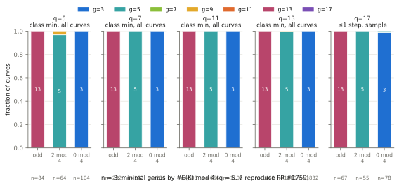
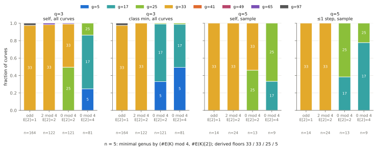
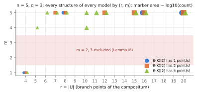

# GHS cover census at larger `q` (`n = 3`) and for `n = 5`

2026-10-14. Conductor T-2467. Extends
[`research/ghs_cubic_cover_census_20261012/`](../ghs_cubic_cover_census_20261012/README.md)
(PR #1759, "the merged census"). **Structural stage diagnostic on toy
fields.** It counts covers by Riemann–Hurwitz genus. No curve over `F_q` is
constructed, no transfer map is evaluated, no discrete logarithm is solved,
and no speedup is claimed.

Protocol: [PROTOCOL.md](PROTOCOL.md), committed (`2d95bde3f`) before any
panel ran, with one amendment (`338cd011a`, hypothesis H) added after panel
D and before panels A, B, C, E produced output; protocol-versioned at commit,
not independently preregistered. Run `20261014T0050Z`:
[records](results/run-20261014T0050Z/), [environment and timings](results/run-20261014T0050Z.env.txt),
[reproduction checks](results/run-20261014T0050Z/reproduction-checks.txt),
[run report](reports/run-20261014T0050Z/run-report.pdf). This report as PDF:
[REPORT.pdf](REPORT.pdf). Tool: [cover_census_n.rs](cover_census_n.rs)
(dependency-free Rust). Lean: [lean/CoverCensusN5.lean](lean/CoverCensusN5.lean).

## Question

For `E: y² = x³ + a₂x² + a₄x + a₆` over `K = F_{q^n}` and the `x`-line with
branch set `B = x(E[2])`, the smallest genus of the `(Z/2)^m` compositum of
the `n` conjugate double covers over every `F_q`-structure `τ`
(`g = 2^{m−2}(r−4)+1`). (1) Does the merged `n = 3` pattern — class minimum
13 / 5 / 3 for `#E(K)` odd / 2 mod 4 / 0 mod 4 — hold at larger `q`?
(2) For `n = 5`, what is the minimal genus and what governs it?

## Result in brief

RESULT_BRIEF

## How the census is computed (new enumeration)

Every structure is `τ = MσM^{−1}` (Lang), one per coset `M·PGL2(F_q)`, and
`τ^iB = Mσ^i(M^{−1}B)`, so the genus of `(B, τ)` is that of
`(B' = M^{−1}B, σ)`. The tool runs `N = M^{−1}` over a transversal of
`PGL2(F_q)\PGL2(K)` given by normal forms of `(N(∞), N(0), N(1))` and takes
`σ^iB'` as coefficient-wise Frobenius images; a gcd test
(`gcd(B', σ^kB') = 1`, `k ≤ (n−1)/2`) settles the pairwise-disjoint
structures (`m = n`, `r = 4n`) without forming unions. Cost per curve
`(Q³ − Q)/(q³ − q)` instead of the merged search's `Q³` per field and
`|PGL2(K)|`-scan per curve. The merged cocycle search, generalised to
`A·A^σ···A^{σ^{n−1}}` scalar, is kept as a second method.

**Reproduction (all exact, [checks](results/run-20261014T0050Z/reproduction-checks.txt)):**

| check | what was compared | result |
| --- | --- | --- |
| R1 | `n = 3`, `q = 5, 7`, every curve: `A_idx, B_idx, order, maxprime, min_genus, types_at_min, structures_by_genus, m1_structures, min_genus_2isog, min_genus_class` against merged run `20261013T0403Z`; and its `mod4` histograms | identical, 252 + 690 curve records, 9 + 9 histograms |
| R2 | `n = 3`, `q = 11`, the merged 120-curve sample (same seed and stream), same fields minus class minimum | identical, 120 records |
| R3 | `n = 5`, `q = 3`, every curve: coset method against the generalised cocycle search (all fields but `mismatch`) | identical, 488 records |
| pilot | `n = 3`, `q = 3`, both methods | identical, 56 records |

The subcover-sum identity (genus = sum of `(s−2)/2` over the nonzero
vectors of the span) held on every structure evaluated in full in every arm
(`mismatches` = 0), and every curve counted exactly `(Q³ − Q)/(q³ − q)`
structures (asserted by the tool).

## Panels

| panel | `n` | `q` | coverage | models | structures per model | wall time |
| --- | --- | --- | --- | --- | --- | --- |
PANEL_TABLE

Each model is censused over **all** its structures, so every per-curve
minimum is exact. A, B, D (and R1) cover every `K`-isomorphism class and give
isogeny-class minima; C and E are fixed-seed samples of curves (with their
2-isogeny neighbours), so their fractions are sample counts and class minima
are not computed.

## `n = 3`: the mod-4 pattern at `q = 5 … 17`

Curves (isomorphism classes) by minimal genus. "self" = the curve, "≤1 step"
= the curve and its `K`-rational 2-isogeny neighbours, "class" = all curves
with the same `#E(K)`.

N3_TABLE



N3_TEXT

## `n = 5`: what governs the minimal genus

N5_TABLE



N5_TEXT

Structures by `(r, m)` over all models (`mr` records): `m ∈ {1, 4, 5}` only,
`m = 4` only for split 2-torsion and `r ∈ {5, 10}`, as Lemma M and Lemma E
require.



MR_FIG_E

## Derivations (full statements and proofs in PROTOCOL.md, "Derived statements")

All were written into the protocol before the panels ran; the tool checks
each on every curve (`violations`, `derived_checks`): **0 violations in
every arm.**

| statement | content | status |
| --- | --- | --- |
| Lemma M | span of `{σ^i 1_{B'}}` is a cyclic `F_2[x]/(x^n−1)`-module: `m ∈ {1,2,3}` (`n = 3`), **`m ∈ {1,4,5}` (`n = 5`)**, `m = n−1` iff every point of `U` lies in an even number of the `σ^iB'` | proved (paper); Lean: the single-orbit case `Rot5.span_sizes` |
| Lemma D0 | `n` prime, `m ≥ 2` ⇒ `g ≥ n` | proved (paper) |
| Lemma E | `m = n−1` forces all four branch points `K`-rational; `n = 5`: `g ∈ {5, 25}`; `n = 3`: `(m,r) = (2,6)` | proved (paper) |
| Corollary | `n = 5` genera are 5, 25 or `8(r−4)+1 ≥ 17`: **nothing in 6–16; genus 5 only if `E(K)[2] = (Z/2)²`** | proved (paper); Lean: arithmetic `Spectrum.n5_gap` |
| Prop. O5 | odd `#E(K)`, `n = 5`: genera in `{33, 97, 129}`; **exactly one structure** has `θ`-orbit 3, and it is `m = 1` iff `B` descends; for `j ∉ {0,1728}`: **minimum 33 iff `j(E) ∉ F_q`, else ≥ 97** | proved (paper); Lean: orbit step `Orbit.period_three_or_fifteen` |
| Prop. T | type `(1,1,2)`: `χ = [cr(a₁,a₂;β,β̄)] ∈ U₁/U₁²` is trivial iff `4 \| #E(K)`; the configuration `{β,β^q} ∪ {x, σ^kx}` forces `χ = 1` | proved (paper); Lean: exponent parity `Parity.even_one_sub_neg_pow` |
| Cor. T3 | **`n = 3`: `#E(K) ≡ 2 mod 4` ⇒ every structure has `g ≥ 5`** (proof of the merged census's observation) | proved (paper) |
| Cor. T5 | `n = 5`: `E(K)[2] = Z/2` ⇒ `g ≥ 25`; `#E(K) ≡ 2 mod 4` ⇒ `g ≥ 33` | proved (paper) |
| Lemma H | `m ≥ 3`: hyperelliptic iff an involution of the cover group has genus-0 quotient (exact, not just sufficient); `m ≥ 4` never hyperelliptic | proved (paper) |

So for `n = 3` the merged census's "2 mod 4 never reaches 3" and "odd ≥ 13"
are now both theorems (for every `q`), and its observation that genus 3
needs `4 | #E(K)` follows: every genus-3 configuration is split or carries
the trivial cross-ratio class of Proposition T. For `n = 5` the floors by
2-torsion type are 33 (odd), 33 (2 mod 4), 25 (`E(K)[2] = Z/2`,
`4 | #E(K)`) and 5 (`E(K)[2] = (Z/2)²`); the census shows which are
attained.

Lean ([CoverCensusN5.lean](lean/CoverCensusN5.lean), toolchain v4.34.1, no
Mathlib, `lake build` log in [lean/build.log](lean/build.log)):

| report statement | Lean declaration | status / axioms |
| --- | --- | --- |
| Prop. O5 orbit step: `τ¹⁵θ = θ`, `τ⁵θ ≠ θ` ⇒ returns before 15 are multiples of 3, `τθ ≠ θ` | `Orbit.period_three_or_fifteen` (via `Orbit.ret_gcd`) | proved; `propext`, `Quot.sound` |
| merged `OrbitNine` re-derived | `Orbit.no_short_return_nine` | proved; `propext`, `Quot.sound` |
| Lemma M for one free 5-orbit (span sizes 1, 2, 16, 32; 16 iff rotations sum to 0) | `Rot5.span_sizes` (`decide`, kernel-checked) | proved; `propext` |
| Prop. T exponent `1 − (−q)^k` even | `Parity.even_one_sub_neg_pow` | proved; `propext`, `Quot.sound` |
| `n = 5` genus spectrum arithmetic | `Spectrum.n5_gap` | proved; no axioms |
| Lang reduction, Lemma M for arbitrary `σ`-sets, Lemma E, simple transitivity in O5, the cross-ratio invariant and 2-descent in T, genus formula, Lemma H | none | **not formalized** (needs field, module and curve theory absent without Mathlib) |

No `sorry`, no custom axioms, no `native_decide`. No identity certificate:
no polynomial identity is claimed.

## What this does and does not say

DOES_NOT

## Graphs checked and left unchanged

No canonical graph changes: no ECDLP rung, no timing claim, no cost ratio,
so no dashboard, leaderboard or `benchmarks/` entry (wall times in
`env.txt` are bookkeeping on a shared host, not performance results). The
merged census's figures are unchanged; this study's figures are new.

## Reproduce

```sh
sh run.sh 20261014T0050Z <bin-dir>          # with STOP_AFTER_REPRO=1: pilot, R1, R2, panel D, R3
sh compare.sh 20261014T0050Z <scratch-dir>  # R1-R3 (jq + cmp)
sh run_panels.sh 20261014T0050Z <bin-dir>   # panels A, B, C, E
python3 reports/plot.py results/run-20261014T0050Z reports/run-20261014T0050Z   # renders recorded values only
cd lean && lake build
typst compile REPORT.typ
```
