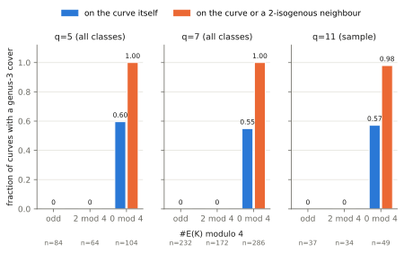
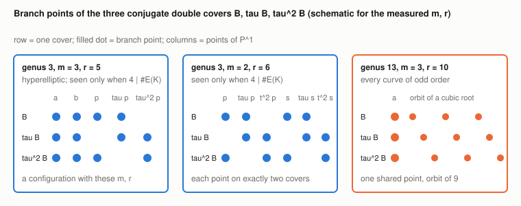

# Cover census over cubic extensions: the minimal GHS genus is set by `#E(K) mod 4`

2026-10-12. Conductor T-2261. **Structural stage diagnostic on toy fields.**
It counts covers by Riemann–Hurwitz genus. No curve over `F_q` is
constructed, no transfer map is evaluated, no discrete logarithm is solved,
and no speedup is claimed. Protocol frozen before the first run:
[PROTOCOL.md](PROTOCOL.md). Run `20261013T0305Z`:
[records](results/run-20261013T0305Z.jsonl),
[environment](results/run-20261013T0305Z.env.txt),
[run report](reports/run-20261013T0305Z/run-report.pdf). This report as
PDF: [REPORT.pdf](REPORT.pdf). Follows
`research/weak_subfield_hyperelliptic_decomposition_20261012/` (PR #1757),
which showed that same-field higher-genus representations do not help.

## Question

For `E` over `K = F_{q³}`, what is the smallest genus of a curve over `F_q`
that the odd-characteristic GHS construction attaches to `E`, over every
`F_q`-structure on the `x`-line? What changes after a 2-isogeny, and over
the whole isogeny class?

## Result

With one exception the minimal genus over the isogeny class follows
`#E(K) mod 4` (counts are isomorphism classes of curves):

| `#E(K)` | minimal genus over the isogeny class | status |
| --- | --- | --- |
| odd | 13 | derived (below) and measured, 316 of 316 curves at q = 5, 7 and 37 of 37 sampled at q = 11 |
| 2 mod 4 | 5 (one exception: 9) | measured: 5 on 234 of 236 curves at q = 5, 7, 9 on the other two (one class at q = 5); never 3 |
| 0 mod 4 | 3 | measured, 390 of 390 curves at q = 5, 7 |

Genus 3 is the only value below the rho exponent (PROTOCOL.md), so on
these fields a cover that could matter exists exactly for the classes
with `4 | #E(K)`, and a curve of prime order, or of order twice an odd
number, has none. The "2 mod 4" and "0 mod 4" rows are observations on
`q ∈ {5, 7}` (and a sample at `q = 11`), not theorems.



## Measurements (run 20261013T0305Z, exact counts)

Tool: [cover_census.rs](cover_census.rs). For each curve it runs through
every cocycle `A` (the tool found exactly `(Q³−Q)/(q³−q)` of them in each
field: 16275, 120099, 1786323). The genus formula agreed with the sum of
the genera of the quadratic subcovers on every structure where it was
checked (genus at most 5, or at the running minimum): 0 mismatches.

Curves by minimal genus, split by `#E(K) mod 4`. "self" is the curve,
"≤1 step" the minimum over the curve and its `K`-rational 2-isogeny
neighbours, "class" the minimum over all curves with the same `#E(K)`.

| field | `#E(K)` | curves | self: genus 3 / 5 / 9 / 13 | ≤1 step: genus 3 / 5 / 9 / 13 | class: genus 3 / 5 / 9 / 13 |
| --- | --- | --- | --- | --- | --- |
| q = 5, all 252 classes | odd | 84 | 0 / 0 / 0 / 84 | 0 / 0 / 0 / 84 | 0 / 0 / 0 / 84 |
| | 2 mod 4 | 64 | 0 / 60 / 4 / 0 | 0 / 60 / 4 / 0 | 0 / 62 / 2 / 0 |
| | 0 mod 4 | 104 | 62 / 42 / 0 / 0 | 104 / 0 / 0 / 0 | 104 / 0 / 0 / 0 |
| q = 7, all 690 classes | odd | 232 | 0 / 0 / 0 / 232 | 0 / 0 / 0 / 232 | 0 / 0 / 0 / 232 |
| | 2 mod 4 | 172 | 0 / 168 / 4 / 0 | 0 / 168 / 4 / 0 | 0 / 172 / 0 / 0 |
| | 0 mod 4 | 286 | 157 / 126 / 3 / 0 | 286 / 0 / 0 / 0 | 286 / 0 / 0 / 0 |
| q = 11, sample of 120 | odd | 37 | 0 / 0 / 0 / 37 | 0 / 0 / 0 / 37 | not computed |
| | 2 mod 4 | 34 | 0 / 33 / 1 / 0 | 0 / 33 / 1 / 0 | not computed |
| | 0 mod 4 | 49 | 28 / 21 / 0 / 0 | 48 / 1 / 0 / 0 | not computed |

At `q = 5` two curves of order 2 mod 4 sit in an isogeny class whose
minimum is 9; at `q = 7` every such class reaches 5.

Types at the minimum (number of curves; a curve can have both genus-3
types):

| field | genus 3, `m=2, r=6` only | both | genus 3, `m=3, r=5` only (hyperelliptic) | genus 5, `m=3, r=6` (hyperelliptic) | genus 9, `m=3, r=8` | genus 13, `m=3, r=10` |
| --- | --- | --- | --- | --- | --- | --- |
| q = 5 | 18 | 24 | 20 | 102 | 4 | 84 |
| q = 7 | 66 | 49 | 42 | 294 | 7 | 232 |
| q = 11 (sample) | 18 | 4 | 6 | 54 | 1 | 37 |

A genus-3 curve has between 2 and 18 structures attaining it at `q = 5`
and between 2 and 24 at `q = 7`, out of 16275 and 120099. The smallest
cofactor among curves with a genus-3 cover is 4 (`#E(K) = 124 = 4·31` at
`q = 5`, `332 = 4·83` at `q = 7`).



## Derivation for odd order

**Proposition (derived; orbit step in Lean).** If `#E(K)` is odd, every
structure gives genus at least 13, and 13 is attained.

*Proof.* The branch set is one `K`-rational point `a` and the three roots
of a cubic irreducible over `K`. A root `θ` has `τ⁹θ = θ` and `τ³θ ≠ θ`
(`τ³` is the Frobenius of `K`), so `τ^kθ ≠ θ` for `1 ≤ k ≤ 8`
(`OrbitNine.no_short_return`) and the nine iterates are distinct. They are
all branch points of some `τ^i B`, so `r ≥ 9 + 1`, with equality iff
`τa = a`. No two of `B, τB, τ²B` coincide and their triple symmetric
difference contains `θ`, so `m = 3` and `g = 2(r − 4) + 1 ≥ 13`. ∎

The same holds for every curve isogenous over `K`, since the order is an
isogeny invariant. P2 of the protocol predicted "at least 5"; the proof
and the data give 13.

Lean: [lean/OrbitNine.lean](lean/OrbitNine.lean), toolchain v4.34.1, no
Mathlib; `#print axioms` reports `propext` only.

| Report statement | Lean declaration | Status |
| --- | --- | --- |
| no return of `θ` before 9 steps | `no_short_return` | proved |
| `τ³` is the Frobenius of `K`; branch set; genus formula | none | **not formalized** |

No identity certificate: the report claims no polynomial identity.

## What this does and does not say

- **Prime-order curves over a cubic extension have no small cover of this
  kind**, and no isogeny changes that. The route needs cofactor at least 4.
- **For `4 | #E(K)` a genus-3 cover is one 2-isogeny away** on 438 of 439
  curves examined (104 + 286 + 48); the remaining `q = 11` curve was not
  followed further.
- **Not established:** that the genus-3 curve has a model over `F_q` with
  the map `E(K) → Jac(C)(F_q)` injective on the odd part (standard for
  odd `n`, cited from memory, not verified here); whether the `m = 2`
  curves are plane quartics; any cost. The exponents in PROTOCOL.md are
  published asymptotics, not measurements.
- **Scope:** `n = 3`, `q ∈ {5, 7, 11}`, odd characteristic above 3, the
  `(2,…,2)` construction only. Other covers (trigonal, `n = 5, 7`,
  characteristic 2) are not covered. A bounded census is not a proof for
  all `q`.

## Next discriminating step

Build the genus-3 curve over `F_q` for one `q = 7` class of order `4·ℓ`
and check the transfer on the order-`ℓ` subgroup. If it is injective, a
genus-3 index-calculus count against rho on that toy instance is the
first measurement that could say anything about cost. If the `F_q`-model
fails to exist, the census counts something the attack cannot use.

## Graphs checked and left unchanged

No canonical graph changes (no ECDLP rung, no timing; no `benchmarks/`
entry).

## Reproduce

```sh
rustc -O cover_census.rs && ./cover_census 5 && ./cover_census 7 && ./cover_census 11 120
python3 reports/plot.py results/run-20261013T0305Z.jsonl reports/run-20261013T0305Z   # layout only
cd lean && lake build
```
