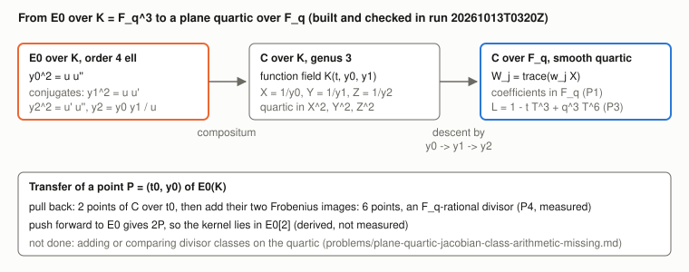
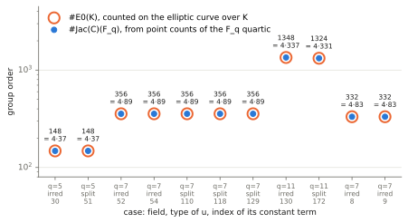

# An explicit genus-3 plane quartic over `F_q` for an elliptic curve over `F_{q³}`

2026-10-12. Conductor T-2267. **Structural stage diagnostic on toy fields.**
A curve is built and its Frobenius checked. No discrete logarithm is
solved, no index calculus is run, and no speedup is claimed. Protocol
frozen before the first run: [PROTOCOL.md](PROTOCOL.md). Run
`20261013T0320Z`: [records](results/run-20261013T0320Z.jsonl),
[environment](results/run-20261013T0320Z.env.txt),
[run report](reports/run-20261013T0320Z/run-report.pdf). Addendum run
`20261013T0347Z` (the order-332 class at q = 7, see below):
[records](results/run-20261013T0347Z.jsonl),
[environment](results/run-20261013T0347Z.env.txt),
[run report](reports/run-20261013T0347Z/run-report.pdf). This report as
PDF: [REPORT.pdf](REPORT.pdf). Follows
`research/ghs_cubic_cover_census_20261012/` (PR #1759), which counted
these covers by genus without building them.

## Question

The census found that every isogeny class with `4 | #E(K)` over
`K = F_{q³}` has a genus-3 cover by branch data. Does that cover exist as
a curve over `F_q` whose Jacobian has `#E(K)` rational points, and is the
transfer of points an explicit `F_q`-rational object?

## Result

Yes on all eleven cases built (`q ∈ {5, 7, 11}`, `#E0(K) = 4ℓ`; nine in
the first run, the two of the order-332 class at q = 7 in the addendum).
For each:

- the curve is a **smooth plane quartic with coefficients in `F_q`**, so
  it is not hyperelliptic;
- its point counts over `F_q`, `F_{q²}`, `F_{q³}` give L-polynomial
  `1 − t_E T³ + q³T⁶`, hence **`#Jac(C)(F_q) = #E0(K)`**;
- every transfer divisor tested is an `F_q`-rational divisor on it.

So, in the eleven built cases, the covers that the census of PR #1759
counted by branch data exist as curves over `F_q` with the predicted
Jacobian order. That is a statement about these eleven cases only, not
about every cover the census counted. What is still not shown by execution is the transfer as a group homomorphism,
because no class arithmetic on a plane quartic is implemented
([problem record](../../problems/plane-quartic-jacobian-class-arithmetic-missing.md)).



## Construction (derived; two steps in Lean)

`u ∈ K[t]` monic quadratic, `u' = u^σ`, `u'' = u^{σ²}`, six distinct
roots, `u, u', u''` linearly independent.

1. `E0 : y0² = u·u''`, `E1 = E0^σ : y1² = u·u'`, `E2 : y2² = u'·u''`
   with `y2 = y0·y1/u` (`DescentCycle.third_cover`).
2. `σ~ : y0 ↦ y1 ↦ y2 ↦ y0`, `t ↦ t`, `σ` on `K`, has order 3
   (`DescentCycle.cycle_closes`), so the compositum descends to `F_q`.
3. With `X = 1/y0, Y = 1/y1, Z = 1/y2`: `(u : u' : u'') = (Z² : X² : Y²)`.
   If `(1, t, t²)ᵀ = R·(u, u', u'')ᵀ` then `t·t = 1·t²` reads
   `G = (R₁·w)² − (R₀·w)(R₂·w) = 0`, `w = (Z², X², Y²)`: a quartic in
   `X², Y², Z²`. The three differentials `dt/y_i` are holomorphic and
   `(X : Y : Z)` is the canonical map, so a smooth `G` means `C` is not
   hyperelliptic.
4. `σ~` permutes `X → Y → Z`. In `W_j = ω_j X + ω_j^σ Y + ω_j^{σ²} Z`,
   `ω = (1, g, g²)`, the quartic has `F_q` coefficients up to a scalar.
5. Transfer `φ = (1 + Fr + Fr²)∘π0^*`, with
   `Fr(t, y0, y1, y2) = (t^q, y2^q, y0^q, y1^q)`. `π_j_* ∘ π_0^* = 0` for
   `j ≠ 0` (it factors through the `t`-line), so `π0_* ∘ φ = [2]` and
   `ker φ ⊂ E0[2]`. With `#Jac(C)(F_q) = #E0(K) = 4ℓ`, `φ` maps
   `E0(K)[ℓ]` isomorphically onto `Jac(C)(F_q)[ℓ]`.

| Report statement | Lean declaration | Status |
| --- | --- | --- |
| `(u·y2)² = u²·u'·u''` | `third_cover` | proved, any commutative multiplication |
| `u·(y1·y2) = (u·u')·y0` (cycle closes) | `cycle_closes` | proved |
| cancelling `u`; the function field; descent; step 5 | none | **not formalized** |

Lean: [lean/DescentCycle.lean](lean/DescentCycle.lean), toolchain v4.34.1,
no Mathlib, no axioms.

Identity certificates (`identity.certificate/v1`, see
[docs/identity-certificates/README.md](../../docs/identity-certificates/README.md)).
The two Lean statements are conditional on the curve equations, so they are
not themselves polynomial identities. The polynomial identities underneath
them are the cofactor expansions of the conclusion differences in the
relations `y0² − u·u''`, `y1² − u·u'`, `u·y2 − y0·y1`, and those are
certified, with the Lean file as the `proof` pointer (recorded, not run by
the checker):

| Identity | Certificate | File |
| --- | --- | --- |
| `(u·y2)² − u²·u'·u''` `= (u·y2 − y0·y1)(u·y2 + y0·y1) + y1²(y0² − u·u'') + u·u''(y1² − u·u')` | `IDC1h4304bc232b34fa40` | [third_cover.json](certificates/third_cover.json) |
| `u·y1·y2 − u·u'·y0 = y1(u·y2 − y0·y1) + y0(y1² − u·u')` | `IDC1h14765be340922acc` | [cycle_closes.json](certificates/cycle_closes.json) |

Issued and self-checked by `examples/identity_certificate_ghs_cubic_genus3.rs`
(32 points each). Not certified: the step from the cofactor identity to
`y2² = u'·u''` (cancelling `u`), the function field, the descent, and the
quartic equation `G` of step 3, which is a linear-algebra consequence over
`K` of the matrix `R` and is instead checked by the point counts below.

## Measurements (run 20261013T0320Z, exact counts)

Tool: [genus3_build.rs](genus3_build.rs). The records of both runs were
regenerated after review (see "Review changes" below); every pre-existing
field is unchanged. `u = t² + bt + c` in
lexicographic order of field index; the first cases with `#E0(K) = 4ℓ`.
`N_k` are projective point counts of the `F_q` quartic over `F_{q^k}` by
exhaustion; `N3` was also counted on the `K` model and agreed in all
nine cases.

| `q` | `u` (index of `b`, `c`) | roots of `u` in `K` | `#E0(K)` | `t_E` | in `F_q` | smooth | `N1, N2, N3` | predicted | `#Jac(C)(F_q)` |
| --- | --- | --- | --- | --- | --- | --- | --- | --- | --- |
| 5 | 5, 30 | 0 | 148 = 4·37 | −22 | yes | yes | 6, 26, 192 | 6, 26, 192 | 148 |
| 5 | 5, 51 | 2 | 148 = 4·37 | −22 | yes | yes | 6, 26, 192 | 6, 26, 192 | 148 |
| 7 | 7, 52 | 0 | 356 = 4·89 | −12 | yes | yes | 8, 50, 380 | 8, 50, 380 | 356 |
| 7 | 7, 54 | 0 | 356 = 4·89 | −12 | yes | yes | 8, 50, 380 | 8, 50, 380 | 356 |
| 7 | 7, 110 | 2 | 356 = 4·89 | −12 | yes | yes | 8, 50, 380 | 8, 50, 380 | 356 |
| 7 | 7, 118 | 2 | 356 = 4·89 | −12 | yes | yes | 8, 50, 380 | 8, 50, 380 | 356 |
| 7 | 7, 129 | 2 | 356 = 4·89 | −12 | yes | yes | 8, 50, 380 | 8, 50, 380 | 356 |
| 11 | 11, 130 | 0 | 1348 = 4·337 | −16 | yes | yes | 12, 122, 1380 | 12, 122, 1380 | 1348 |
| 11 | 11, 172 | 2 | 1324 = 4·331 | 8 | yes | yes | 12, 122, 1308 | 12, 122, 1308 | 1324 |
| 7† | 49, 8 | 0 | 332 = 4·83 | 12 | yes | yes | 8, 50, 308 | 8, 50, 308 | 332 |
| 7† | 49, 9 | 0 | 332 = 4·83 | 12 | yes | yes | 8, 50, 308 | 8, 50, 308 | 332 |

† Addendum run `20261013T0347Z`: the second `4ℓ` isogeny class at `q = 7`
(`#E0(K) = 332`, trace `+12`, the sign opposite to the 356 class's `−12`).
The frozen first-in-index rule of the first run reached only the 356 class.
Exhausting the parametrization `u = t² + bt + c`, this class has exactly
two irreducible-`u` representatives satisfying the genus-3 conditions and
**no split-`u` representative** (65432 candidates examined). The order-356
run was not exhaustive, so this is not a multiplicity comparison between
the two classes.

Example, `q = 7`, `u` index (7, 110), over `F_7`:

    W2⁴ + W1²W2² + 6W1³W2 + 6W1⁴ + 4W0W2³ + W0W1W2² + 4W0W1²W2 + 4W0W1³
      + W0²W2² + 4W0²W1W2 + 5W0²W1² + 6W0³W2 + 6W0⁴ = 0

All eleven quartics are in the records (`quartic_Fq`, entries
`[i, j, k, coefficient]` for `W0^i W1^j W2^k`; the two order-332 quartics
are in the addendum run's records).

Transfer divisors (P4). For each affine `P = (t0, y0) ∈ E0(K)` with
`y0 ≠ 0` and `u·u'(t0)` a non-zero square, the two points of `C` over `P`
and their two Frobenius images each. `#E0(K)` is accounted exactly:
`#E0(K) = tested + nonsquare + ramification + 2`, where the 2 are the points
at infinity of the quartic model (never tested), `ramification` are the
points with `y0 = 0` (never tested; 0 when `u` is irreducible, 4 when `u`
splits), and `nonsquare` are the affine points with `y0 ≠ 0` for which
`u·u'(t0)` is zero or a non-square (their preimages are not K-rational or
are ramified, and need a field the tool does not build). The records carry
all four counts (`e0_points_tested`, `e0_affine_points_nonsquare_uu1`,
`e0_ramification_points_y0_zero`, `e0_points_at_infinity`) and the tool
asserts the sum.

| `q` | `u` | `#E0(K)` | E0 points tested | tests (6 per point) | on the `F_q` quartic | `q`-power = model `Fr` | projected point satisfies the E0 equation | nonsquare `u·u'` | `y0 = 0` | infinity |
| --- | --- | --- | --- | --- | --- | --- | --- | --- | --- | --- |
| 5 | 5, 30 | 148 | 94 | 564 | 564 | 564 | 564 | 52 | 0 | 2 |
| 5 | 5, 51 | 148 | 94 | 564 | 564 | 564 | 564 | 48 | 4 | 2 |
| 7 | 7, 52 / 7, 54 | 356 | 188 | 1128 | 1128 | 1128 | 1128 | 166 | 0 | 2 |
| 7 | 7, 110 / 118 / 129 | 356 | 182 | 1092 | 1092 | 1092 | 1092 | 168 | 4 | 2 |
| 11 | 11, 130 | 1348 | 688 | 4128 | 4128 | 4128 | 4128 | 658 | 0 | 2 |
| 11 | 11, 172 | 1324 | 646 | 3876 | 3876 | 3876 | 3876 | 672 | 4 | 2 |
| 7† | 49, 8 / 49, 9 | 332 | 152 | 912 | 912 | 912 | 912 | 178 | 0 | 2 |

† Addendum run `20261013T0347Z` (order-332 class).

"Projected point satisfies the E0 equation" (record field
`projected_points_on_E0`) is only the check that the `(t, y0)` coordinates
of each tested point satisfy `y0² = u·u''`. It is **not** the pushforward
`π0_*` of a divisor and does not verify `π0_*φ(P) = [2]P`; that check is
not executed (see Scope and limits).



All eleven cases (nine from the first run, two order-332 from the
addendum); the run-20261013T0320Z report keeps the nine-case graph.
P1, P2, P3 and P4 hold on every case; no falsifier fired.

## Scope and limits

- **Not executed:** the pushforward `π0_*` of a divisor and the identity
  `π0_*φ(P) = [2]P`; `φ` as a homomorphism, its injectivity on `E0[ℓ]`,
  any discrete logarithm, any relation collection. These need class
  arithmetic on the quartic; see the problem record.
- **Selection.** The frozen rule takes the first cases in index order.
  All five `q = 7` cases of the first run landed in one isogeny class
  (`#E0(K) = 356`); the other `4ℓ` class at `q = 7` (332) was built in the
  addendum run after a target-order argument was added to the tool (the
  argument defaults to off, so the first run reproduces byte for byte).
  Most candidates were skipped as linearly dependent (2394 of 2443 at
  `q = 7`) because `b ∈ F_q` comes first in index order.
- **One construction.** Only the `m = 2, r = 6` type. The hyperelliptic
  `m = 3, r = 5` type is not built.
- **Cost (published asymptotics, not measured):** index calculus on a
  smooth plane quartic over `F_q` is reported at about `q` operations
  (Diem), against about `q^{3/2}` for rho on `E(K)`. These toy fields are
  far too small to compare anything.
- `n = 3`, `q ∈ {5, 7, 11}`, odd characteristic above 3.

## Next discriminating step

Implement linear equivalence on a plane quartic and execute the transfer
on the `q = 7` case (7, 110); then relation collection by lines through
pairs of `F_q`-points, counted against rho. The acceptance conditions are
in the problem record.

## Curve identity (ICV1)

Each source `E0` is recorded as the short Weierstrass model
`Y² = X³ − 27·I·X − 27·J` of the Jacobian of the quartic `y0² = u·u''`
(`I, J` the quartic's invariants; the quartic has `K`-rational points at
infinity, so the Jacobian is `E0`), over
`F_{q³} = F_q[x]/(x³ + c₂x² + c₁x + c₀)` with the modulus the tool built.
The tool emits the field modulus and `(a, b)` as coefficient lists
(`E0_weierstrass_ext`) and asserts that the Weierstrass model has the same
order as the quartic. [reports/e0_icv1.py](reports/e0_icv1.py) recounts that order
independently with `scripts/curve_id.py` and computes each model's ICV1
identity, written to [results/e0_icv1.json](results/e0_icv1.json) (field
modulus, `a`, `b`, order, ICV1 string, model JSON, for all 11 cases). The
order agrees with `order_E0` in all eleven.

**Not registered yet.** `docs/curves/registry.json` has not been updated:
registering needs `scripts/build_curve_registry.py` and a harvester for this
record shape, under `docs/curves/`, which is reserved by Conductor task
T-2240. Until the registration PR lands, this README writes no slug (an
unregistered slug fails `scripts/check_curve_names.py`); cases are named by
`(q, u index)` as in the tables, and the exact binding of each case to its
field and model is `results/e0_icv1.json`.

## Review changes

- `points_skipped` counted only the affine points with non-square or zero
  `u·u'`; it omitted the 2 points at infinity and, when `u` splits, the 4
  points with `y0 = 0`. Replaced by `e0_affine_points_nonsquare_uu1` plus the
  other explicit counts above; the original values are unchanged.
- `pushforward_on_E0` renamed `projected_points_on_E0` (values unchanged).
- Runs `20261013T0320Z` and `20261013T0347Z` regenerated with the updated
  tool (new `source sha256` in each `.env.txt`); `all11.jsonl` rebuilt.

## Graphs checked and left unchanged

No canonical graph changes (no ECDLP rung, no timing; no `benchmarks/`
entry).

## Reproduce

```sh
rustc --edition 2021 -O genus3_build.rs && ./genus3_build 5 1 1 && ./genus3_build 7 3 2 && ./genus3_build 11 1 1
./genus3_build 7 3 2 332                 # addendum: the order-332 class at q = 7
python3 reports/plot.py results/run-20261013T0320Z.jsonl reports/run-20261013T0320Z   # layout only
cat results/run-20261013T0320Z.jsonl results/run-20261013T0347Z.jsonl > results/all11.jsonl
python3 reports/plot.py results/all11.jsonl reports/run-20261013T0347Z   # then orders.* renamed to orders_all11.*
cd lean && lake build
python3 reports/e0_icv1.py                 # from the repository root: results/e0_icv1.json
cargo run --example identity_certificate_ghs_cubic_genus3 -- research/ghs_cubic_genus3_build_20261012/certificates
```

The fourth argument to `genus3_build` is an optional target order (0 or
absent keeps the original first-in-index rule); `./genus3_build 7 3 2`
reproduces the q = 7 records of run `20261013T0320Z` byte for byte.
