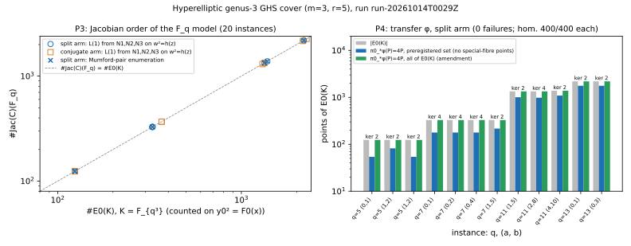

# The hyperelliptic genus-3 GHS cover (`m = 3, r = 5`): explicit `F_q` model, Frobenius, and the transfer executed with Cantor arithmetic

2026-10-13. Conductor T-2463. **Structural stage diagnostic on toy fields.**
It builds the curve, checks its Frobenius and executes the transfer
`E0(F_{q³}) → Jac(C)(F_q)` as a group map. It runs no index calculus,
collects no relations, solves no discrete logarithm and claims no cost or
speedup. Protocol frozen before the recorded run, with one dated amendment
written after development runs: [PROTOCOL.md](PROTOCOL.md). Recorded run
`20261014T0029Z`: [records](results/run-20261014T0029Z.jsonl),
[environment](results/run-20261014T0029Z.env.txt),
[run report](reports/run-20261014T0029Z/run-report.pdf). This report as PDF:
[REPORT.pdf](REPORT.pdf). Tool: [hyper_genus3.rs](hyper_genus3.rs)
(dependency-free Rust, single-threaded, seed 20261013).

Follows the census `research/ghs_cubic_cover_census_20261012/` (PR #1759),
which counted this type without building it, and the plane-quartic build of
the `m = 2` type (PR #1761), whose curves have no class arithmetic in the
repository (`problems/plane-quartic-jacobian-class-arithmetic-missing.md`).
This type is hyperelliptic, so the transfer can be executed here.

## Result

All five predictions hold on all 20 instances (`q = 5, 7, 11, 13`; 12
split, 8 conjugate), with zero failures:

| prediction | outcome |
| --- | --- |
| P1 descent | conic, `x(z)`, `h(z)` have `F_q` coefficients on 20/20; on 200 random `L`-points of `C` per instance the map `(x, y0, y1, y2) ↦ (z, w)` lands on `w² = h(z)`, gives back `x`, commutes with Frobenius and inverts (4000/4000 each check); every split case has exactly one `F_q`-point of `D` over `a` |
| P2 genus 3, smooth, hyperelliptic | `deg x(z) = 4`, `h` squarefree of degree 7 (split, imaginary model) or 8 (conjugate) on 20/20 |
| P3 Frobenius | `N1 = q+1`, `N2 = q²+1`, `N3 = q³+1−3t_E` on the `F_q` model, equal to the fibre-by-fibre count on the `K`-model, on 20/20; `L(T) = 1 − t_E T³ + q³T⁶`, `#Jac(C)(F_q) = L(1) = #E0(K)`; split arm: exhaustive enumeration of reduced Mumford pairs gives the same order (12/12) |
| P4 transfer (split arm) | every `φ(P)` is a reduced Mumford pair over `F_q`; homomorphism 400/400 random pairs and 100/100 doublings per instance (4800 + 1200 total); `φ(G) ≠ 0`, `ℓ·φ(G) = 0` for a generator of `E0(K)[ℓ]` (12/12); `ker φ` has order 2 or 4, lies in `E0(K)[4]` and contains `T1` (12/12); `π0_*(φ(P)) = 4P` on every `P ∈ E0(K)` (12/12 instances, 0 failures) |
| P5 census | (a) at `q = 5, 7` the census record of `E0` and of both conjugates is genus-3 with type `m = 3, r = 5, hyperelliptic` and the same order (11 instances × 3); at `q = 11, 13` the curves are outside the census sample (no record, not a failure); (b) all 167,472 enumerated `(p, Q)` candidates over both arms have `4 \| #E0(K)` |

`φ` is therefore an injective group map on the `ℓ`-part, but **not** an
isomorphism: its kernel has order 2 (8 of 12 split instances) or 4 (4 of 12,
cyclic, elements of order 4), and the image has index 2 or 4 in
`Jac(C)(F_q)`.

## Construction (derived; verified by the run)

`K = F_{q³}`, `σ` the `q`-power, `L = F_{q⁶}`. Take `p ∈ K \ F_q`,
`r_i = p^{q^i}`, a monic squarefree `Q ∈ F_q[x]` (split `(x−a)(x−b)`, or
irreducible), `F0 = Q(x−r0)(x−r1)`, `F1 = F0^σ = Q(x−r1)(x−r2)`,
`F2 = Q(x−r2)(x−r0)`, `N = (x−r0)(x−r1)(x−r2) ∈ F_q[x]`, `E0 : y0² = F0`.
In the census language: `τ = σ`, `B = {a, b, r0, r1}`, `r = 5`, `m = 3`,
genus 3.

1. `C = K(x, y0, y1, y2)` with `y_i² = F_i`; descent datum
   `σ~ : y0 ↦ y1 ↦ y2 ↦ y0`; Frobenius of the `F_q`-model on points
   `Fr(x, y0, y1, y2) = (x^q, y2^q, y0^q, y1^q)`.
2. `D = C/ι`, `ι : y_i ↦ −y_i`. With `u01 = y0y1/(Q(x−r1))` (and cyclically)
   `u01² = (x−r0)(x−r2)`, `u01u12u20 = N`. `X0 = u12u20, X1 = u20u01,
   X2 = u01u12` span `L(−K_D)`: `X0² = N(x−r1)`, … , hence the conic
   `(r2−r0)X0² + (r0−r1)X1² + (r1−r2)X2² = 0`, and
   `x = (r0X0² − r1X2²)/(X0² − X2²)`. `σ~` cycles the `X_i`, so in
   `Z_j = Σ_i θ_j^{q^i} X_i` the conic has `F_q` coefficients.
3. Parametrize the `F_q`-conic by lines through an `F_q`-point `P*`:
   `x = xn(z)/xd(z)`. Then `w = y0y1y2·xd(z)/(Q(x)N(x))` is `F_q`-rational,
   `ι`-odd, and `w² = h(z) = xn² + c1·xn·xd + c0·xd²` because
   `F0F1F2 = Q³N²`. The branch points of `C → D` are the 8 points of `D` over
   `a, b`. In the split arm one `F_q`-point of `D` lies over `a`; taking it as
   `P*` with its tangent at `z = ∞` gives `deg h = 7`.
4. Transfer, base point `O = (r0, 0)` of `E0`:
   `φ(P) = Σ_{j=0}^{2} Fr^j(π0^*[P] − 4∞)`, computed by Cantor-adding the 12
   points `(z, w)` of the four preimages and their Frobenius images over `L`.
   `π0^*[O]` is two `ι`-pairs, `~ 4∞`.
5. Kernel bound: `deg π0 = 4`, and `π0_*∘Fr^j∘π0^*` kills `[P] − [O]` for
   `j = 1, 2` (it is twice a difference of `x`-fibres), so `π0_*∘φ = [4]`
   (the `m = 2` build had `[2]` because there `deg π0 = 2`) and
   `ker φ ⊆ E0(K)[4]`. `K(E0)(u12)` is an unramified double cover of `E0`
   inside `C` (`u12² = (x−r1)(x−r0)`), so `π0^*` kills
   `T1 = [(r1, 0)] − [O]`.

Exceptional points of `E0(K)` (`x ∈ {a, b, r0, r1, r2, ∞}`; 6 or 8 per
instance) get `φ(P)` as `φ(P ⊕ R) − φ(R)` for three eligible `R` (a linear
equivalence on `E0`); the three values agree on every one, and agree with the
directly derived values `φ(O) = 0`, `φ((r1,0)) = 0`, `φ((a,0)) = [u_a, 0]`,
`φ((b,0)) = [u_b, 0]`. Every point of `E0(K)` is accounted for.

## Explicit example over `F_7`

`K = F_7[t]/(t³ + 3)`, `p = t`, so `r = (t, 2t, 4t)` and `N = x³ + 3`;
`Q = x(x − 1)`, `E0 : y0² = x(x−1)(x−t)(x−2t)`, `#E0(K) = 328 = 8·41`,
`t_E = 16`. The tool's `F_q`-model (coefficients high to low):

    C : w² = 6z⁷ + z⁶ + 3z⁵ + 2z⁴ + 2z³ + 5z² + 6z + 6        over F_7
    x(z) = (z³ + 5z² + 6z + 6) / (z⁴ + 2z³ + 5z² + 6z + 5)     (x(∞) = a = 0)
    w = y0·y1·y2·xd(z) / (x(x−1)(x³+3))

`N1, N2, N3 = 8, 50, 296`, `L(T) = 1 − 16T³ + 343T⁶`,
`#Jac(C)(F_7) = 328` (also by enumeration of all 328 reduced Mumford pairs).
For the generator `G` of `E0(K)[41]` drawn by the seed,
`φ(G) = (z³ + 2z² + 5z + 4, 4z² + 2z + 3)`, nonzero, with `41·φ(G) = 0`.
`ker φ` is cyclic of order 4 and contains `T1`; the image has 82 elements.
Census: the class of `E0` (and of `E0^σ`, `E0^{σ²}`) is recorded in
`run-20261013T0403Z` with `min_genus = 3`, type `m = 3, r = 5,
hyperelliptic`, order 328.

## Per-instance measurements (run `20261014T0029Z`)

`Q` is `[a, b]` (split) or `[c1, c0]` for `x² + c1x + c0` (conjugate); `p`
in the census basis `[d0, d1, d2]`; census hits are records found for
`E0, E0^σ, E0^{σ²}`.

| q | arm | Q | p | `#E0(K)` | `t_E` | deg h | `N1, N2, N3` | `L(1)` | Mumford enum. | census hits |
| --- | --- | --- | --- | --- | --- | --- | --- | --- | --- | --- |
| 5 | split | [0,1] | [0,1,0] | 124 = 4·31 | 2 | 7 | 6, 26, 120 | 124 | 124 | 1/1/1 |
| 5 | split | [1,2] | [0,1,0] | 124 = 4·31 | 2 | 7 | 6, 26, 120 | 124 | 124 | 1/1/1 |
| 5 | conjugate | [0,3] | [0,1,0] | 124 = 4·31 | 2 | 8 | 6, 26, 120 | 124 | – | 1/1/1 |
| 5 | conjugate | [2,4] | [0,1,0] | 124 = 4·31 | 2 | 8 | 6, 26, 120 | 124 | – | 1/1/1 |
| 5 | split | [1,2] | [1,1,0] | 124 = 4·31 | 2 | 7 | 6, 26, 120 | 124 | 124 | 1/1/1 |
| 7 | split | [0,1] | [0,1,0] | 328 = 8·41 | 16 | 7 | 8, 50, 296 | 328 | 328 | 1/1/1 |
| 7 | split | [0,2] | [0,1,0] | 328 = 8·41 | 16 | 7 | 8, 50, 296 | 328 | 328 | 1/1/1 |
| 7 | split | [0,4] | [0,1,0] | 328 = 8·41 | 16 | 7 | 8, 50, 296 | 328 | 328 | 1/1/1 |
| 7 | split | [1,5] | [0,1,0] | 328 = 8·41 | 16 | 7 | 8, 50, 296 | 328 | 328 | 1/1/1 |
| 7 | conjugate | [0,1] | [0,1,0] | 368 = 16·23 (amendment) | −24 | 8 | 8, 50, 416 | 368 | – | 1/1/1 |
| 7 | conjugate | [0,2] | [0,1,0] | 368 = 16·23 (amendment) | −24 | 8 | 8, 50, 416 | 368 | – | 1/1/1 |
| 11 | split | [1,5] | [0,1,0] | 1336 = 8·167 | −4 | 7 | 12, 122, 1344 | 1336 | 1336 | 0/0/0 |
| 11 | split | [2,8] | [0,1,0] | 1336 = 8·167 | −4 | 7 | 12, 122, 1344 | 1336 | 1336 | 0/0/0 |
| 11 | split | [4,10] | [0,1,0] | 1384 = 8·173 | −52 | 7 | 12, 122, 1488 | 1384 | 1384 | 0/0/0 |
| 11 | conjugate | [1,1] | [0,1,0] | 1336 = 8·167 | −4 | 8 | 12, 122, 1344 | 1336 | – | 0/0/0 |
| 11 | conjugate | [2,10] | [0,1,0] | 1304 = 8·163 | 28 | 8 | 12, 122, 1248 | 1304 | – | 0/0/0 |
| 13 | split | [0,1] | [0,1,0] | 2188 = 4·547 | 10 | 7 | 14, 170, 2168 | 2188 | 2188 | 0/0/0 |
| 13 | split | [0,3] | [0,1,0] | 2188 = 4·547 | 10 | 7 | 14, 170, 2168 | 2188 | 2188 | 0/0/0 |
| 13 | conjugate | [2,6] | [0,1,0] | 2264 = 8·283 | −66 | 8 | 14, 170, 2396 | 2264 | – | 0/0/0 |
| 13 | conjugate | [4,9] | [0,1,0] | 2164 = 4·541 | 34 | 8 | 14, 170, 2096 | 2164 | – | 0/0/0 |

The first and fifth `q = 5` split instances are the same curve (translate
`x ↦ x + 1`; same `h` and the same ICV1 identity in
[results/e0_icv1.json](results/e0_icv1.json)); the protocol did not dedupe.

Transfer, split arm (same order of rows): `|E0(K)|`, eligible / exceptional
points, homomorphism and doubling tests, generator test, kernel order and
element orders, image size, `π0_*φ(P) = 4P` on the preregistered set (and how
many eligible `P` had a special-fibre point, so were not evaluable there),
and on all of `E0(K)` (amendment).

| q | Q | `\|E0(K)\|` | elig. / exc. | hom. | dbl. | `φ(G)≠0` / `ℓφ(G)=0` | ker (orders) | image | `π0_*φ=4P` prereg. | all `E0(K)` |
| --- | --- | --- | --- | --- | --- | --- | --- | --- | --- | --- |
| 5 | [0,1] | 124 | 118 / 6 | 400/400 | 100/100 | yes / yes | 2 (1,2) | 62 | 54 (64 n.e.) | 124 |
| 5 | [1,2] | 124 | 118 / 6 | 400/400 | 100/100 | yes / yes | 2 (1,2) | 62 | 82 (36 n.e.) | 124 |
| 5 | [1,2]′ | 124 | 118 / 6 | 400/400 | 100/100 | yes / yes | 2 (1,2) | 62 | 54 (64 n.e.) | 124 |
| 7 | [0,1] | 328 | 320 / 8 | 400/400 | 100/100 | yes / yes | 4 (1,2,4,4) | 82 | 178 (142 n.e.) | 328 |
| 7 | [0,2] | 328 | 320 / 8 | 400/400 | 100/100 | yes / yes | 4 (1,2,4,4) | 82 | 178 (142 n.e.) | 328 |
| 7 | [0,4] | 328 | 320 / 8 | 400/400 | 100/100 | yes / yes | 4 (1,2,4,4) | 82 | 178 (142 n.e.) | 328 |
| 7 | [1,5] | 328 | 322 / 6 | 400/400 | 100/100 | yes / yes | 2 (1,2) | 164 | 216 (106 n.e.) | 328 |
| 11 | [1,5] | 1336 | 1330 / 6 | 400/400 | 100/100 | yes / yes | 2 (1,2) | 668 | 1004 (326 n.e.) | 1336 |
| 11 | [2,8] | 1336 | 1328 / 8 | 400/400 | 100/100 | yes / yes | 4 (1,4,4,2) | 334 | 982 (346 n.e.) | 1336 |
| 11 | [4,10] | 1384 | 1378 / 6 | 400/400 | 100/100 | yes / yes | 2 (1,2) | 692 | 1090 (288 n.e.) | 1384 |
| 13 | [0,1] | 2188 | 2182 / 6 | 400/400 | 100/100 | yes / yes | 2 (1,2) | 1094 | 1762 (420 n.e.) | 2188 |
| 13 | [0,3] | 2188 | 2182 / 6 | 400/400 | 100/100 | yes / yes | 2 (1,2) | 1094 | 1762 (420 n.e.) | 2188 |

(`[1,2]′` is the `p = [1,1,0]` instance.) The kernel has order 4 exactly in
the instances with 8 exceptional points, i.e. those where `E0` has `K`-points
over `x = r2`; this is an observation on 12 instances, not a derived rule.

Census corollary (P5b): every `(p, Q)` candidate enumerated, `p` one per
`σ`-orbit, has `4 | #E0(K)`: 400 + 400 at q = 5, 2352 + 2352 at q = 7,
24200 + 24200 at q = 11, 56784 + 56784 at q = 13 (split + conjugate). At
q = 7 every conjugate-arm candidate has `16 | #E0(K)` (orders 320, 336, 352,
368), which is why the amendment was needed there.

## Lean

[lean/HyperGenus3.lean](lean/HyperGenus3.lean), toolchain v4.34.1, no
Mathlib, `lake build` log in [lean/build.log](lean/build.log). No `sorry`;
`#print axioms`: the combinatorial theorems use `propext` only (two use
none); the ring identities (proved with `grind` over any
`Lean.Grind.CommRing`) use `propext, Classical.choice, Quot.sound`.
`lean4checker` is not installed on the host, so no `--fresh` recheck.

| report statement | Lean declaration | status |
| --- | --- | --- |
| `τ` has order 3 on the five points; `τ³B = B` | `tau_order_three`, `tttB_eq` | proved |
| `τB`, `τ²B` | `tB_eq`, `ttB_eq` | proved |
| `r = 5` | `r_eq_five` | proved |
| `m = 3` (seven combinations non-empty) | `m_eq_three` | proved |
| genus `3` by subcover sum and by `2^{m−2}(r−4)+1` | `genus_sum` | proved |
| rank-2 subspace with union `{r0, r1, r2}` (hyperelliptic test) | `hyperelliptic_subspace` | proved |
| branch locus of `C → D` over `{a, b}` | `triple_is_ab` | proved (combinatorial part) |
| `u12` cover of `E0` unramified (`τB∆τ²B ⊆ B`) | `etale_subcover` | proved (combinatorial part) |
| descent cycle on indices | `descent_cycle` | proved |
| conic relation and `x` from `X` | `conic_coeffs`, `conic_model` | proved |
| `F0F1F2 = Q³N²` | `product_of_conjugates` | proved |
| `w² = h(z)` (multiplied out by `(QN)²`) | `hyperelliptic_equation` | proved |
| descent of function fields, Frobenius, L-polynomial, transfer, `π0_*∘φ = [4]`, `T1 ∈ ker` | none | **not formalized** (needs curves and divisors; checked numerically only) |

## What this does and does not say

- It **closes the obstruction of
  `problems/plane-quartic-jacobian-class-arithmetic-missing.md` by a
  different route for this type**: for the `m = 3, r = 5` covers the
  genus-3 curve is hyperelliptic, and the transfer is executed and checked
  with Cantor arithmetic. It does **not** supply plane-quartic class
  arithmetic; that record stays open for the `m = 2` covers.
- The transfer is injective on the odd part and its image has index
  `|ker φ| ∈ {2, 4}`; `#Jac(C)(F_q) = #E0(K)` holds as group orders, not as
  an isomorphism via `φ`.
- Conjugate arm: model, Frobenius and census checks only. Cantor arithmetic
  for the degree-8 (real) model is not implemented, so no transfer there.
- `q = 11, 13`: no census cross-check (the curves are not in the census
  sample); P5a holds vacuously there.
- No cost, no index calculus, no relation collection, no logarithm. The genus
  is 3, where Diem's index calculus would be `Õ(q^{4/3})` per the census
  report; nothing here measures that.
- Toy fields only (`q ≤ 13`), first instances in a fixed order; not a census
  of all such curves.

## Reproduction and provenance

    rustc --edition 2021 -O hyper_genus3.rs -o hyper_genus3
    for q in 5 7 11 13; do ./hyper_genus3 $q ../ghs_cubic_cover_census_20261012/results/run-20261013T0403Z.jsonl; done
    python3 research/ghs_cubic_hyperelliptic_genus3_20261013/reports/plot.py      # from repo root, plots only
    python3 research/ghs_cubic_hyperelliptic_genus3_20261013/reports/e0_icv1.py   # ICV1 names, order recount

Run history: development runs before the amendment were scratch output and
were not kept (PROTOCOL.md amendment). Run `20261014T0027Z`
([records](results/run-20261014T0027Z.jsonl)) is superseded: its instance
records carry the key `"P4"` twice (detail object and flag), which is
ambiguous JSON; the tool was changed only to rename the detail object to
`P4_detail` and re-run as `20261014T0029Z`, whose records are identical apart
from that key and wall times (checked by diff). No run was interrupted.
Curve identities: [results/e0_icv1.json](results/e0_icv1.json) (computed
with `scripts/curve_id.py`, which recounts each `#E0(K)` independently and
agrees; not registered in `docs/curves/registry.json`, as in PR #1761).
