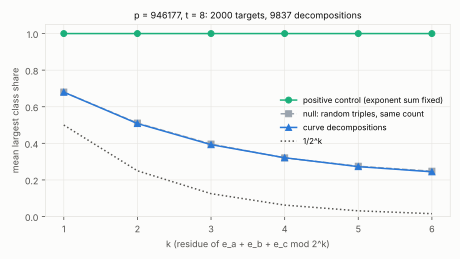

# Exponent falsifiers for prime-field index calculus: C4 (exponent-space structure on PKM's tower)

2026-10-13.  First of the exponent experiments the scope note
[`../ic_speed_and_rho_scope_20261013/`](../ic_speed_and_rho_scope_20261013/README.md)
proposed after the ecbench ladders (#1771) showed every enumerating oracle
at the generic floor.  Candidate C4 of the requirements document
([`../pdp_root_finder_requirements_20261012/`](../pdp_root_finder_requirements_20261012/README.md) §8):
a representation-technique (Wagner / Howgrave-Graham–Joux) search on PKM's
Kummer tower, where every base abscissa is `ζ^e`, `ζ` a primitive `2^t`-th
root of unity.  Such a search needs some linear form of the exponents of a
decomposition `R = P_a + P_b + P_c` whose value is predictable from `R`.

## Test

`examples/kummer_exponent_bias.rs`.  Curve `icv1-fp20-tm728-d215a2a1`
(`p = 946177`, the 20-bit curve of the PKM tower ladder), tower `t = 8`
(246 signed base points).  For 2,000 uniform targets every decomposition over
the signed base is enumerated exactly and counted once (9,837 in all, about
five a target).  Statistic, per `k`: the mean over targets of the largest
share of one residue class of `e_a + e_b + e_c mod 2^k`.  No structure gives
the value a random sample of the same size gives (the null column); full
structure gives 1.  The positive control replaces the group law by
multiplication in `F_p^*`, where the exponent sum is fixed by the target.

## Result

Raw: [`raw/c4_exponent_sum_p20_t8.json`](raw/c4_exponent_sum_p20_t8.json).
Report: [`REPORT.pdf`](REPORT.pdf) (source `REPORT.typ`); figure
`figures/c4_class_share.svg` (`figures/plot.py` lays out the raw JSON).



| `k` | uniform `1/2^k` | curve decompositions | null, same sample size | positive control |
|--:|--:|--:|--:|--:|
| 1 | 0.500 | 0.680 | 0.680 | 1.000 |
| 2 | 0.250 | 0.508 | 0.511 | 1.000 |
| 3 | 0.125 | 0.393 | 0.396 | 1.000 |
| 4 | 0.0625 | 0.321 | 0.321 | 1.000 |
| 5 | 0.0313 | 0.273 | 0.275 | 1.000 |
| 6 | 0.0156 | 0.244 | 0.248 | 1.000 |

The curve's decompositions are indistinguishable from random exponent
triples at every `k` (differences under 1 % of the value), while the
detector reads full structure on the positive control.  **The exponent sum
of a decomposition carries no information about the target: C4's simplest
form is falsified on this base**, as the requirements predicted (`S = 0` is
not additive in the exponents).

Scope: one curve, one tower height, one linear form (the plain sum).  A
weighted form `Σ c_i e_i` would need its own test; the elliptic group law
does not commute with the multiplicative structure of `μ_N` for any of
them unless the curve has a homomorphism to `F_p^*` (pairing-friendly or
anomalous curves, excluded here).

## Still open (the scope note's other exponent experiments)

- **C2, sparse-spectrum zero finding on the tower.** Not run yet.
- **Solving-degree census with symmetries.** Not run yet.
- **`k = 4` symmetry reduction on `F_{p⁴}`** (the extension-field route): the
  full-size measurement of the record-and-replay solver on real `S₅`
  systems is running; the symmetric rewrite is not built.

## Reproduction

```sh
cargo build --release --example kummer_exponent_bias
target/release/examples/kummer_exponent_bias --p 946177 --a 304973 --b 530845 --t 8 --targets 2000 --seed 20261013
```
