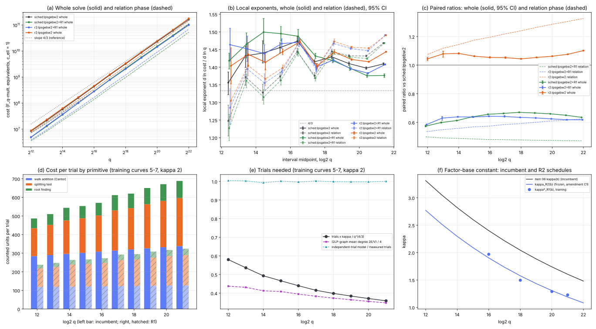

# Round 3, item 01: the relation phase of genus-3 IC after the cubic GHS transfer

2026-10-15. Round rules: [../RULES.md](../RULES.md) (2 single-threaded jobs, 6 GB and 60 minutes per job).
Protocol, frozen before test data, with amendments C0-C2: [PROTOCOL.md](PROTOCOL.md). Prior work:
[round 2 item 06](../../ic_improve_20261015/06-genus3-kappa-bw/README.md) and [round 2 item 01](../../ic_improve_20261015/01-genus3-linalg/README.md).

- Tool: [`examples/ic_improve3_01_genus3_rel.rs`](../../../examples/ic_improve3_01_genus3_rel.rs), a copy of item 06's instrument. `src/` is not touched.
- Analysis: [`examples/ic_improve3_01_analyze.rs`](../../../examples/ic_improve3_01_analyze.rs).
- Figure: [plot.py](plot.py), which plots `summary.json`, `diag.json` and `r2.json` only.
- Records:
  - test: [results/run/](results/run/), with tables [analysis_r2.md](results/run/analysis_r2.md) (12..22, all arms; primary), [analysis.md](results/run/analysis.md) (12..21), [analysis_r1.md](results/run/analysis_r1.md) (incumbent and R1, 12..22) and [analysis_aa.md](results/run/analysis_aa.md);
  - gates: [gate0.md](results/run/gate0.md) and [acct.md](results/run/acct.md);
  - training: [results/train/](results/train/) ([diag.md](results/train/diag.md), [r2rule.md](results/train/r2rule.md), [gatetrain.md](results/train/gatetrain.md)).

## Verdict

**Incumbent:** item 06's cheapest frozen arm at large q, the combination **`sched:lpsgebw2`**:
- kappa(b) = 1.739 x 0.9225^(b-20), with cx(b);
- large primes kept as columns, SGE, then block Wiedemann (2, 1).

**Design:**
- held-out curves 0-2 at q = 2^12..2^22, plus curves 3 and 4 at 2^18..2^21;
- paired on instance, target and walk;
- unit `M_q + ceil(log2 q) I_q + M_ell`;
- 2000 paired bootstrap resamples.

**A/A floors** (`aa:lpsgebw2`, an independent walk, against the incumbent, 12..21):
- exponent Delta +0.0008 [-0.0022, +0.0035], so eps_e = 0.0035;
- per-size ratios 0.983-1.005, so eps_c = 0.017;
- trend difference -0.0003 [-0.0029, +0.0028].

| candidate | exponent, whole, 12..top: slope, Delta [95%] | constant: paired ratio at the top size [95%] | other levels | verdict |
|---|---|---|---|---|
| incumbent `sched:lpsgebw2` | 1.429 [1.428, 1.431] (12..22) | 1 (1.614e11 at 2^22; 6.077e10 at 2^21) | local exponent 21-22: 1.409; trend -0.0003/bit | - |
| **R1**: cheaper relation primitives, same walk | 1.444; **+0.0150 [+0.0143, +0.0156]** (12..22, REGRESSES); 16..22: **-0.0082 [-0.0087, -0.0077]** | **0.635 [0.634, 0.635]** at 2^22 (ADVANCES); 0.650 at 2^21; <= 0.67 at every size | primitive: relation phase **0.471** at 2^22 (ADVANCES); relation-phase exponent Delta -0.0076 [-0.0078, -0.0073] | **TRADES** (exponent REGRESSES, constant and primitive ADVANCE) |
| **R2**: R1 + kappa re-tuned on training (amendment C1) | 1.430; **+0.0008 [-0.0002, +0.0020]** (12..22, MATCHES); 16..22: **-0.0110 [-0.0121, -0.0100]** | **0.617 [0.616, 0.619]** at 2^22 (ADVANCES); 0.618 at 2^21 | LA exponent -0.063, relation +0.022 (phases trade); `c_ell = 9`: exponent Delta **-0.041** [-0.043, -0.038] | **ADVANCES** (constant; exponent MATCHES) |
| decomposition `r2:lpsgebw2` (R2's kappa, incumbent primitives) | +0.0021 [+0.0009, +0.0033] | 1.102 at 2^22 (worse) | - | not a candidate |

**Does the exponent move toward 4/3?** By the protocol rule, yes for both candidates: each paired trend difference has its CI below 0, and each local exponent on the top interval is below the incumbent's. The margins differ:

- **R1** holds 1.376 at both 20-21 and 21-22, against the incumbent's 1.397 and 1.409.
- **R2** is 1.383 against 1.397 at 20-21. At 21-22 it is only 1.408 against 1.409, with overlapping CIs, and its ratio stops falling at 2^22 (0.618 to 0.617).
  - 2^22 is one bit beyond R2's training range (16..21): kappa_R2(22) = 1.08.
  - So R2's flattening is established over 16..21 and not confirmed at 21-22.

| arm | local exponent 19-20 | 20-21 | 21-22 | trend per bit [95%] | paired trend difference [95%] |
|---|---|---|---|---|---|
| incumbent | 1.410 | 1.397 [1.394, 1.401] | **1.409 [1.405, 1.412]** | -0.0003 [-0.0020, +0.0015] (12..22) | - |
| R1 | 1.397 | 1.376 [1.371, 1.381] | **1.376 [1.371, 1.381]** | -0.0109 [-0.0120, -0.0096] | **-0.0106 [-0.0112, -0.0097]** |
| R2 | 1.396 | **1.383 [1.381, 1.385]** | 1.408 [1.406, 1.410] | -0.0085 [-0.0106, -0.0063] | **-0.0082 [-0.0088, -0.0076]** |
| A/A | | 1.388 | | +0.0002 | -0.0003 [-0.0029, +0.0028] |

**What this means.**

- **The relation phase can be made about 2.1x cheaper per trial without changing a single relation.** R1 changes three primitives:
  - Cantor addition with one inversion instead of 6;
  - a Stickelberger discriminant pre-filter on the splitting test;
  - root finding that reuses x^((q-1)/2) mod u.

  On every trial its outputs equal the incumbent's (asserted in every job). The relation phase falls to 0.47-0.50 of the incumbent's at every size, and the whole solve to 0.57-0.67.
- **R1's fitted exponent rises**, which gives TRADES, for the same reason as item 06's schedule. The gain is largest where the relation phase is the larger share, at small q (0.57 at 2^12 against 0.65 at 2^21). Above 2^18 its ratio falls with every bit (0.670, 0.665, 0.659, 0.650, 0.635), and its local exponent is 1.376 against the incumbent's 1.409 at 21-22.
- **R2** re-tunes kappa for the cheaper relations (kappa_R2(21) = 1.19 against 1.60).
  - It restores the incumbent's phase balance: LA share 0.34 at 2^21, against 0.52 for R1.
  - It matches the incumbent's fitted exponent and is the cheapest arm at every size from 2^16 up: 0.618 at 2^21 and 0.617 at 2^22.
  - Its ratio falls with every bit from 2^16 to 2^21 (0.643, 0.641, 0.635, 0.631, 0.624, 0.618) and is flat at 2^22.
  - The lower kappa pays only together with R1. With the incumbent primitives the same kappa costs 1.04-1.08 times the incumbent (`r2:lpsgebw2`).
- **The excess over 4/3 is not set by the relation phase.** The step-1 diagnosis below shows the trial count grows *slower* than q^{4/3} at fixed kappa (q^{1.258}, local 1.285 at 20-21). The 1.43-1.47 local exponent of the incumbent's relation phase is the kappa schedule (about +0.10) plus the per-trial log factor (+0.046).
  - The schedule lowers kappa because the linear algebra grows faster than q^{4/3}.
  - At the frozen optimum kappa the whole-solve exponent is about 4/3 + (2/3)(per-trial log growth) + (1/3)(LA excess). R1 lowers the first term only from 0.046 to 0.041, because it removes constant work as well as log-dependent work. That is why R2 *matches* rather than advances the fitted exponent.
  - The local exponents of both candidates fall by about 0.01 per bit (trend difference -0.0106), but they are 1.376-1.383 at the top, not 4/3.

**2^22 is now measured.**
- The widened instrument (`u128` group order, wide duplicate key, `u128` exponent in F_{q^3} square roots, ell < 2^62 above 2^21) built all three test instances at 2^22: N ≈ 7.38e19 ≈ 2^66, cofactors 40, 32 and 48, all instance checks true.
- All 12 solves there (`sched` and `r2`, each with its accounted R1 arm) have the verified logarithm. Each job took 23-28 minutes with a peak RSS of about 2.15 GB.
- **2^23 was not attempted.** At the measured growth (x2.7 time, x2 memory per bit, incumbent and shadow R1 together), a 2^23 job projects to about 63 minutes, over the 60-minute cap, and about 4.3 GB of peak memory (2.15 GB at 2^22, 1.08 GB at 2^21), under the 6 GB cap. 2^24 is further out still. This is the machine limit, not an instrument limit.



*Panel (a): geometric-mean cost per size (curves 0-2 at 12..17; 0-4 at 18..21) of the whole solve (solid) and the relation phase (dashed), in F_q-multiplication equivalents with `c_ell = 1`; the slope-4/3 line is a reference.*

*Panel (b): local exponents with 95% bootstrap CIs, whole (solid) and relation (dashed).*

*Panel (c): paired ratios against the incumbent, whole (solid, CI) and relation phase (dashed).*

*Panels (d)-(e): step-1 diagnosis on training curves 5-7 at kappa 2, relation phase only, 3 curves per size. (d) is cost per trial by primitive, incumbent (left bar) and R1 (right bar, hatched). (e) is trials x kappa / q^{4/3}, the 2LP-graph mean degree / 4, and independent-trial model / measured trials.*

*Panel (f): kappa schedules, the incumbent's and R2's frozen one, with the training minimisers.*

*Test run [results/run](results/run/), summary [summary_r2.json](results/run/summary_r2.json) over 12..22.*

## Per-size paired ratios against `sched:lpsgebw2`

Ratios are the geometric mean of per-curve ratios with a 95% bootstrap CI. Full tables, with relation and LA costs,
solver sizes and `c_ell = 9`, are in [analysis_r2.md](results/run/analysis_r2.md).

| log2 q | n | incumbent kappa | incumbent cost | LA share | R1 whole | R1 relation | R2 kappa | R2 whole | R2 relation | R2 LA | `r2:lpsgebw2` | A/A |
|---|---|---|---|---|---|---|---|---|---|---|---|---|
| 12 | 3 | 3.314 | 8.481e6 | 0.15 | 0.574 [0.569, 0.580] | 0.499 | 2.772 | 0.584 [0.581, 0.588] | 0.535 | 0.867 | 1.044 | 0.993 |
| 13 | 3 | 3.057 | 2.175e7 | 0.21 | 0.599 [0.595, 0.603] | 0.492 | 2.523 | 0.630 [0.615, 0.641] | 0.549 | 0.932 | 1.079 | 1.005 |
| 14 | 3 | 2.821 | 5.866e7 | 0.24 | 0.613 [0.610, 0.614] | 0.488 | 2.297 | 0.638 [0.636, 0.642] | 0.558 | 0.889 | 1.082 | 0.996 |
| 15 | 3 | 2.602 | 1.588e8 | 0.30 | 0.638 [0.635, 0.640] | 0.484 | 2.091 | 0.638 [0.633, 0.642] | 0.568 | 0.800 | 1.062 | 0.995 |
| 16 | 3 | 2.401 | 4.354e8 | 0.34 | 0.656 [0.654, 0.658] | 0.480 | 1.903 | 0.643 [0.640, 0.645] | 0.574 | 0.777 | 1.054 | 0.983 |
| 17 | 3 | 2.215 | 1.209e9 | 0.35 | 0.662 [0.661, 0.664] | 0.479 | 1.732 | 0.641 [0.637, 0.647] | 0.584 | 0.746 | 1.053 | 0.991 |
| 18 | 5 | 2.043 | 3.224e9 | 0.37 | 0.670 [0.669, 0.671] | 0.477 | 1.576 | 0.635 [0.633, 0.637] | 0.591 | 0.708 | 1.044 | 1.001 |
| 19 | 5 | 1.885 | 8.682e9 | 0.36 | 0.665 [0.665, 0.666] | 0.475 | 1.435 | 0.631 [0.629, 0.632] | 0.601 | 0.684 | 1.054 | 1.001 |
| 20 | 5 | 1.739 | 2.307e10 | 0.35 | 0.659 [0.659, 0.660] | 0.474 | 1.306 | 0.624 [0.622, 0.626] | 0.609 | 0.652 | 1.062 | 1.004 |
| 21 | 5 | 1.604 | 6.077e10 | 0.34 | **0.650 [0.649, 0.650]** | 0.471 | 1.189 | **0.618 [0.617, 0.619]** | 0.616 | 0.623 | 1.076 | 0.998 |
| 22 | 3 | 1.480 | 1.614e11 | 0.31 | **0.635 [0.634, 0.635]** | 0.471 | 1.082 | **0.617 [0.616, 0.619]** | 0.625 | 0.600 | 1.102 | - |

The A/A column covers curves 0-2 only. R1's ratios on the A/A walk (`aa:lpsgebw2+R1` against `aa:lpsgebw2`) agree with R1's to within 0.013 at every size ([analysis_aa.md](results/run/analysis_aa.md)).

**Exponents by phase** (12..21, every solve a point, Delta paired against the incumbent):

| arm | whole | relation | LA | whole, `c_ell = 9` |
|---|---|---|---|---|
| incumbent | 1.431 [1.429, 1.433] | 1.392 [1.390, 1.394] | 1.541 [1.537, 1.545] | 1.504 |
| R1 | +0.0189 [+0.0181, +0.0196] | -0.0080 [-0.0083, -0.0077] | 0 | +0.0150 |
| R2 | +0.0020 [+0.0009, +0.0033] | +0.0218 [+0.0212, +0.0224] | -0.0631 [-0.0672, -0.0589] | -0.0398 [-0.0427, -0.0367] |

Over 16..21: R1 -0.0043 [-0.0050, -0.0037], R2 **-0.0116 [-0.0129, -0.0105]**.

**Log factor on the test records** (q^c against q^a (log q)^beta, OLS, every solve a point; these schedule arms change kappa with q, so beta measures curvature, not a per-trial log factor):

| arm | metric | sizes | q^c | a | beta | RSS two-term / one-term |
|---|---|---|---|---|---|---|
| incumbent | relation | 12-22 | 1.3965 [1.3945, 1.3987] | 1.683 | -3.30 [-3.58, -2.98] | 0.080 |
| incumbent | whole | 12-22 | 1.4296 [1.4278, 1.4313] | 1.387 | +0.49 [+0.27, +0.70] | 0.891 |
| R1 | relation | 12-22 | 1.3888 [1.3871, 1.3908] | 1.699 | -3.57 | 0.073 |
| R1 | whole | 12-22 | 1.4453 [1.4439, 1.4468] | 1.221 | +2.58 | 0.308 |
| R2 | relation | 12-22 | 1.4191 [1.4170, 1.4215] | 1.685 | -3.08 | 0.093 |
| R2 | whole | 12-22 | 1.4301 [1.4281, 1.4321] | 1.269 | +1.86 | 0.210 |

A negative beta on the relation phase means its local exponent *accelerates*: the falling kappa schedule outruns the
falling 2LP-graph mean degree. The whole-solve beta > 0 means it decelerates. The clean log-factor test is the
fixed-kappa fit in the diagnosis.


## Step 1: diagnosis of the relation phase

Training curves 5, 6 and 7 at kappa = 2, relation phase only, with shadow primitives; 3 curves per size at
b = 12..21. Tables: [diag.md](results/train/diag.md). The diagnosis is descriptive and decides no verdict.

**Relation cost = (trials needed) x (cost per trial).** The two factors move in opposite directions.

| quantity (kappa = 2) | q^c fit, 12..21 [95%] | local exponent 20-21 | q^a (log q)^beta fit |
|---|---|---|---|
| trials T | **1.2575 [1.2557, 1.2594]** | 1.285 | a = 1.411, beta = -1.73 [-1.98, -1.43] |
| cost per trial (incumbent) | 0.0540 [0.0539, 0.0541] | 0.037 | a = 0.022, beta = +0.36 |
| cost per trial (R1) | 0.0466 [0.0464, 0.0468] | 0.030 | a = 0.033, beta = +0.15 |
| relation cost (incumbent) | **1.3115 [1.3097, 1.3133]** | 1.322 | a = 1.433, beta = -1.37 [-1.62, -1.07] |
| relation cost (R1) | 1.3041 [1.3022, 1.3061] | 1.315 | a = 1.444, beta = -1.58 |

**Trials needed.**
- The splitting probability is 0.1667 = 1/6 at every size.
- The 2LP, 1LP and full-relation rates given a split match the independent-trial values 3f(1-f)^2, 3f^2(1-f) and f^3 to three digits, with f = #FB / ((q-1)/2).
- An independent-trial model needs **0.993-1.004 times** the trials the 20-adding walk took. The walk is as good as independent sampling, so a "better walk" (more multipliers) has nothing to gain, and none was built.
- T kappa / q^{4/3} falls from 0.580 (2^12) to 0.359 (2^21). The trial count's exponent is **below 4/3** and rising toward it: local exponents run from 1.22 to 1.285.
  - The cause is the 2LP graph. Its mean degree 2E/V, with V = (q-1)/2 large-prime vertices, falls from 1.75 to 1.39.
  - It approaches the giant-component threshold 1 from above, while the cycles needed (#FB, so cycles/#FB goes from 0.93 to 0.99) become a vanishing fraction of V.
  - The excess (2E/V - 1) shrinks like q^{-0.105} per the 12..21 endpoints. The heuristic for cycles in a barely supercritical random graph, where cycles grow like V (c - 1)^3 and the required count is #FB = kappa q^{2/3}, predicts q^{-1/9} = q^{-0.111}.
  - So T = (c/4) q^{4/3} / kappa x (1 + o(1)), with c tending to 1: the trial count tends to q^{4/3} from below.
- The kappa elasticity of T is about -0.84: T kappa / q^{4/3} is 0.358 at kappa 1 and 0.411 at kappa 2.38 (b = 18).

**Cost per trial** (counted units per trial, incumbent → R1, at 2^21):

| primitive | incumbent | R1 | what changed |
|---|---|---|---|
| walk addition (Cantor) | 338 (206 M_q + 6.00 I_q) | **127** (105 M_q + 1.00 I_q) | one inversion per generic addition |
| splitting test | 258 | **163** | discriminant pre-filter rejects type (1,2) for 9 + 4 products and a Legendre exponentiation; `x^((q-1)/2) mod u` on the other half |
| root finding | 92 | **34** | `x^((q-1)/2) mod u` reused: monic(w -+ 1) is the quadratic factor in 3/4 of splits |
| bookkeeping (y-coordinate at each root) | 1 | 1 | unchanged; large-prime bookkeeping is mod-ell row work and is not charged in the unit (0) |
| factor-base and multiplier set-up | < 0.02% of the relation cost | same | |
| **total per trial** | **689** | **325** | rho = R1 / incumbent relation cost 0.4715 |

- Fitted as A + B log2 q, the incumbent is A = 229.4, B = 22.02 and R1 is A = 133.6, B = 9.16.
- The log-dependent part comes from the I_q price (ceil(log2 q) M_q per inversion) and the exponentiations in the splitting test and root finding. It contributes B / ((A + 21 B) ln 2) = **0.046** to the local exponent at 2^21; for R1 it is **0.041**.
- R1 removes most of the log-dependent work but also most of the constant work, so the relative log growth barely changes.
- **The excess over 4/3 is not a log factor of the relation phase.** At fixed kappa the relation phase grows like q^{1.31}, below 4/3: the falling mean degree (about -0.05 to -0.11 in the exponent) more than offsets the per-trial log factor (+0.04 to +0.05). The two-term fit has a *negative* log power (beta = -1.37).
- **Why item 06's relation phase shows 1.43.** The schedule kappa(b) = 1.739 x 0.9225^(b-20) falls by 0.116 in ln kappa per unit ln q, and the trial count follows kappa^{-0.84}. That adds about +0.10 to the trial exponent: 1.285 (trials) + 0.04 (per trial) + 0.10 (schedule) ≈ 1.42.
- The schedule lowers kappa because the linear algebra grows faster than q^{4/3}. Item 06 measured an LA local exponent of 1.53 at kappa = 2, 20-21.
- At the optimum kappa (relation cost about 2 x LA cost), the whole-solve exponent is approximately 4/3 + (2/3) x (per-trial log growth) + (1/3) x (LA excess) + (trial drift). The relation phase alone can therefore move the whole exponent by at most (2/3) x 0.046 ≈ 0.03, and only if its cost per trial became constant in q.

## Step 2: widening the instrument

| change | why | effect on q <= 2^21 |
|---|---|---|
| `N = #E(F_{q^3})` as `u128` (JSON string above 2^64) | q^3 ≈ 2^66 at 2^22 overflowed item 06's `u64` parse | none: gate 0 is 38/38 identical |
| selection also requires ell < 2^62 | the Montgomery bound mod ell; at 2^22 it forces cofactor c >= 17 (c = 40, 32, 48 chosen) | none: every candidate ell there is < 2^62 |
| duplicate-divisor key: 25-bit packing in two words above 2^22 | item 06's key packs 21 bits per coefficient, so 22-bit coefficients would alias | item 06's key is kept below 2^22 |
| `F_{q^3}` square root exponent as `u128` | q^3 - 1 overflowed `u64` above 2^21.33 (random points at 2^22) | same values (exponent < 2^64 there) |

Every 2^22 record carries the instance checks (`ell phi(G) = 0`, `N phi(G) = 0` via `c (ell phi(G))`, 3/3 homomorphism checks).

## Step 3: candidates

**R1** (relation primitives; [PROTOCOL.md](PROTOCOL.md) has the full description).

| primitive | incumbent | R1 |
|---|---|---|
| walk addition | generic Cantor: extended gcd and two reductions with monic normalisations; 206 M_q + 6.0 I_q | adjugate of the multiplication-by-u1 matrix gives s u1 = Res(u1,u2) mod u2; the composed V is kept with denominator r; only the top coefficients of r^2 h - Vt^2 enter the exact division; one joint inversion of r lc(U'); lc of the second quotient is lc(h) (inverse precomputed). **105 M_q + 1.0 I_q** |
| splitting test | x^q mod u by square-and-multiply (12 M_q per squaring) on every trial | Stickelberger: disc(u) a non-square rejects type (1,2) (half of all trials) for 13 products + a Legendre exponentiation; else x^((q-1)/2) mod u and x^q = x w^2 |
| root finding (1/6 of trials) | Cantor-Zassenhaus with a random shift | w = x^((q-1)/2) mod u is reused: when the roots' quadratic characters are mixed (3/4 of splits), monic(w - 1) or monic(w + 1) is the quadratic factor (one remainder test, quadratic formula, third root from the trace); else Cantor-Zassenhaus on a private stream |

- In shadow mode, every trial of every job asserts that R1's outputs equal the incumbent's: the sum (u, v), the splitting decision and the root set. No job aborted. Over the test and training runs this covers about 2.2e9 trials.
- R1 needs no tuning, so it has no training step.

**Considered and not built:**
- **A better walk** (r-adding with more multipliers): the 20-adding walk already needs 0.993-1.004 times the trials of independent sampling, so there is nothing to gain.
- **A large-prime bound**: restricting large primes to a fraction phi of the non-factor-base points scales 2LP edges by phi^2 and vertices by phi. The mean degree falls by phi and the threshold trial count rises by 1/phi, so it cannot cut trials. It could only shrink LA columns, which SGE already removes.
- **3LP**: 3LP relations are 82-91% of the complete splits at 2^18-2^21. Using them changes the graph into a 3-uniform hypergraph whose cycles need a different structure, and the LP-as-columns solver pays for their fill. Not attempted in this budget.
- **Batching inversions across parallel walks**: R1 already leaves 1.0 inversion per addition (1.0 x ceil(log2 q) of its 325 units per trial at 2^21), so batching would save at most about 6%.
- **A cheaper split of square-discriminant cubics** (a Cardano cubic-character test in F_q or F_{q^2} instead of x^((q-1)/2) mod u) could cut the remaining log-dependent part from about 7 to about 3 M_q per bit. Estimated effect at the optimum: about -0.01 in the exponent. Not built.

**R2** (kappa jointly re-tuned; amendment C1):
- rho = R1 / incumbent relation cost was measured on training curves 5-7 (relation only). It is kappa-independent to 0.1%.
- It was applied to item 06's training grid, whose LA costs do not change under R1.
- Quadratic in ln kappa gives kappa\*_R1 = 1.969, 1.495, 1.289 and 1.227 at b = 16, 18, 20, 21.
- **ln kappa_R2(b) = 0.2669 - 0.0941 (b - 20).**

## Controls and gates

- **Gate 0 (widened build)**:
  - 38/38 `sched:lpsgebw2` test records at 2^12..2^21 (curves 0-4) equal item 06's in `k`, cost, relation cost and LA counters ([gate0.md](results/run/gate0.md));
  - 45/45 relation-only training reruns equal item 06's training relation cost and step count ([gatetrain.md](results/train/gatetrain.md)).
- **Shadow equality**: asserted on every trial of every job; 0 aborts.
- **Accounting check**: R1 driving the walk alone (`--relprim fast`, test curve 0 at 2^14 and 2^16) gives exactly the shadow-accounted relation cost (21349610 and 137451051) and the verified `k` ([acct.md](results/run/acct.md)).
- **A/A**: Delta +0.0008 [-0.0022, +0.0035] covers 0; trend difference -0.0003 [-0.0029, +0.0028]; ratios 0.983-1.005. The 3-curve bootstrap undercovers somewhat, as in items 01 and 06: 3 of 10 per-size CIs exclude 1, by at most 1.7%.
- **Correctness**: every logarithm verified (`k phi(G) = phi(T)`) and equal to the planted `k`:
  - incumbent and R1, 41 + 41 (12..22);
  - R2 and `r2:lpsgebw2`, 41 + 41 (12..22);
  - A/A, 30 + 30;
  - accounting, 2.

  0 failures.
- **Reformatting check**: the jobs before about 19:52 ran a binary built before `rustfmt`. The binary rebuilt from the final source ran the last `r2` 2^22 job and reproduced the recorded 2^16 curve-0 `sched` and 2^17 curve-1 `r2` records exactly ([results/repro/](results/repro/)).
  - A first repro attempt of the `r2` row used a hand-typed kappa of 1.7322 instead of the recorded 1.7319. It differed, as it must, and was discarded.
  - Both hashes are in [env.txt](results/run/env.txt).

## Deviations and limits

- **C0**: a job-chaining bug (a `pgrep` pattern matching the waiting shells) delayed the test queue by about 5 minutes; no record is affected.
- **C2**: a slot scheduler replaced the shell queues, and `r2` at 2^22 moved to the end of the queue.
- Both candidates' primary fits are over 12..22. Item 06's schedule and kappa_R2 both extrapolate one bit to 2^22.
- **2^23 and 2^24 were not run**: the projected job time (about 63 minutes at 2^23) exceeds the 60-minute cap. This is where the machine is the limit.
- **The A/A arm covers curves 0-2 at 12..21.** Its floors are applied to the 12..22 fit of R1.
- **The schedules extrapolate below 2^16**, as in item 06: both kappa(b) and kappa_R2(b) were trained at 16..21.
- **Counted unit**: inversions are priced at ceil(log2 q) M_q and Legendre symbols at their square-and-multiply count, as the incumbent's degree-2 branch does; constant multiples (4, 27, 18) in the discriminant are charged as products.
  - Large-prime bookkeeping (mod-ell row work) is not charged in this unit, for either arm.
  - Wall times are not part of any claim. R1 driving the walk alone took 1.7 s at 2^16 against 6 s for the shadow job, which runs both.

## Reproduce

```bash
cargo build --release --example ic_improve3_01_genus3_rel --example ic_improve3_01_analyze
cd research/ic_improve3_20261015/01-genus3-relations
A=../../../target/release/examples/ic_improve3_01_analyze
O6=../../ic_improve_20261015/06-genus3-kappa-bw/results
PAR=2 sh run_diag.sh results/train                                    # training, relation only
$A gatetrain results/train $O6/train > results/train/gatetrain.md
$A diag results/train results/train/diag.json > results/train/diag.md
$A r2rule results/train $O6/train results/train/r2.json > results/train/r2rule.md   # -> r2.env
PAR=2 sh run_test.sh results/run sched "12 13 14 15 16 17 18 19 20 21 22" "0 1 2"
PAR=2 sh run_test.sh results/run sched "18 19 20 21" "3 4"
PAR=2 sh run_test.sh results/run r2    "12 13 14 15 16 17 18 19 20 21 22" "0 1 2"
PAR=2 sh run_test.sh results/run r2    "18 19 20 21" "3 4"
PAR=2 sh run_test.sh results/run aa    "12 13 14 15 16 17 18 19 20 21" "0 1 2"
for b in 14 16; do sh job.sh results/run --bits $b --curve 0 --kappa <kappa(b)> --cx 16 --streams sched \
  --las lpsgebw2@16 --relprim fast --out results/run/b${b}_c0_schedfast.jsonl; done
$A gate results/run $O6/run > results/run/gate0.md; $A acct results/run > results/run/acct.md
$A analyze results/run 12 22 16 results/run/summary_r2.json sched:lpsgebw2 sched:lpsgebw2+R1 r2:lpsgebw2+R1 r2:lpsgebw2 > results/run/analysis_r2.md
$A analyze results/run 12 22 16 results/run/summary_r1.json sched:lpsgebw2 sched:lpsgebw2+R1 > results/run/analysis_r1.md
$A analyze results/run 12 21 16 results/run/summary.json sched:lpsgebw2 sched:lpsgebw2+R1 r2:lpsgebw2+R1 r2:lpsgebw2 > results/run/analysis.md
$A analyze results/run 12 21 16 results/run/summary_aa.json sched:lpsgebw2 aa:lpsgebw2 sched:lpsgebw2+R1 aa:lpsgebw2+R1 > results/run/analysis_aa.md
python3 -I plot.py results/run/summary_r2.json results/train/diag.json results/train/r2.json cost_vs_q \
  sched:lpsgebw2 sched:lpsgebw2+R1 r2:lpsgebw2+R1 r2:lpsgebw2
sh make_pdf.sh
```

The scripts as run were `run_diag.sh`, `run_phase1.sh` and `run_slots.sh` with `queue2.txt`. Toolchain, host and binary hashes are in [results/run/env.txt](results/run/env.txt).
