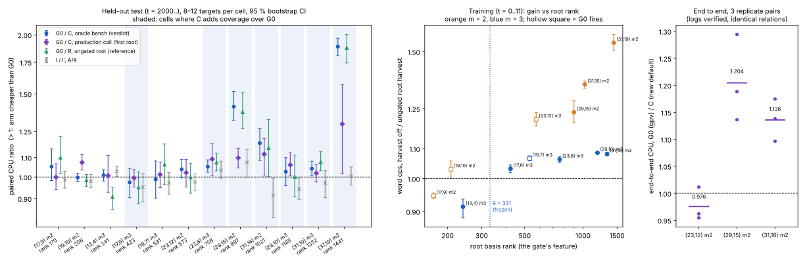

# Item 02: a root-rank gate for the linear-row harvest

This is round 3, item 02 ([`../RULES.md`](../RULES.md)). The protocol is [`PROTOCOL.md`](PROTOCOL.md), frozen before the training, test, production-path and end-to-end data. All numbers are **measured**, and every ratio comes from the Rust tool `examples/ic_improve3_02_fit.rs`.

- **Incumbent G0.** Round 2 item 05's default: root-only harvest, gated on gpv < 0.9607 (generators per occurring variable).
- **Candidate C.** The frozen gate is **gpv < 0.9607 OR root basis rank ≥ 331**: `root,gpv=0.9607,rank=331`.
- **Ratios** are `cost(G0)/cost(C)`, so a value above 1 means C is cheaper. Each is a geometric mean over targets with a 95 % bootstrap CI (10,000 resamples, seed 1).

## Verdict

**C ADVANCES at the constant level and REGRESSES nowhere. It is now the engine's default.**

- **The bar is met.**
  - No cell regresses against G0, in the oracle bench or in the production call.
  - (29,15) m2 advances **1.41× [1.32, 1.52]** in CPU and 1.29× in word operations.
  - Root sets are identical on every target and every arm: 0 failures in 248 test, 144 training and 142 identity rows.
- **Default and opt-outs.**
  - `KIC_LINEAR_HARVEST=0` still restores the pre-harvest engine counter for counter: 60 of 60 against item 03's committed counters.
  - The new `KIC_LINEAR_HARVEST=gpv` restores G0 counter for counter: 38 of 38 against the explicit spec, and 22 of 22 against item 05's committed default counters.
- **End to end at m = 2** (the default against `gpv`, logarithms verified in all 27 runs, identical relations, trials and disposition hashes):

  | size | G0 / C, CPU per pair (3 pairs, descriptive) |
  |---|---|
  | (29,15) | **1.204** |
  | (31,16) | **1.136** |
  | (23,12) | 0.976, the identical code path: noise |

  The gain carries through to end to end at the sizes where the new gate adds coverage.

| where | cells | G0/C, oracle bench (CPU) |
|---|--:|---|
| C adds coverage (rank ≥ 331, gpv ≥ 0.961) | 7 | **ADVANCES** at 5: 1.04–1.89×. MATCHES at (17,6) m3 and (29,10) m3, both with word operations +3.5 % and +8.1 % (CI excludes 1) |
| C = G0 (the same code path, identical word operations) | 5 | MATCHES |

## 1. What predicts gain and loss (training, t = 0..11; `runs/train_diag.jsonl`)

Below, I is harvest off and R is the ungated root harvest. "Root share" is the root reduction's word operations divided by the whole solve's word operations with the harvest off. That is the price of the one extra root rebuild the harvest causes, relative to the tree.

| cell | root rank | occ | gpv | rows harvested | root share | I/R CPU | I/R word ops | splits I/R | rank per call I/R |
|---|--:|--:|--:|--:|--:|---|---|--:|--:|
| (17,9) m2 | 169 | 18 | 0.944 | 1 | 0.306 | 1.011 [0.957, 1.066] | **0.946** | 1.53 | 0.93 |
| (19,10) m2 | 208 | 20 | 0.950 | 2 | 0.268 | 1.353 [1.217, 1.513] | 1.030 | 1.05 | 1.44 |
| **(13,4) m3** | 240 | 25 | **1.040** | 1 | **0.237** | 0.942 [0.882, 1.000] | **0.914 [0.882, 0.936]** | 1.00 | 1.07 |
| (17,6) m3 | 422 | 35 | 0.971 | 1 | 0.117 | 1.050 | 1.032 | 1.00 | 1.09 |
| (19,7) m3 | 531 | 40 | 0.950 | 1 | 0.073 | 1.022 | 1.067 | 1.00 | 1.09 |
| (23,12) m2 | 573 | 24 | 0.958 | 2 | 0.188 | 1.156 | 1.208 | 1.84 | 0.97 |
| (23,8) m3 | 757 | 47 | 0.979 | 1 | 0.045 | 1.028 | 1.063 | 1.00 | 1.08 |
| (29,15) m2 | 898 | 30 | 0.967 | 1 | 0.066 | 1.193 | 1.236 | 1.04 | 1.19 |
| (31,16) m2 | 1021 | 32 | 0.969 | 2 | 0.044 | 1.096 | 1.351 | 1.33 | 1.03 |
| (29,10) m3 | 1188 | 59 | 0.983 | 1 | 0.012 | 1.084 | 1.086 | 1.00 | 1.06 |
| (31,10) m3 | 1332 | 61 | **1.016** | 1 | 0.014 | 1.087 | 1.081 | 1.00 | 1.06 |
| (37,19) m2 | 1442 | 38 | 0.974 | 1 | 0.011 | **1.980 [1.861, 2.112]** | 1.543 | 1.01 | 1.32 |

**Diagnosis.**

- **The harvest costs one extra root rebuild,** about the root share of the solve. It saves in one of two ways:
  - **At m = 2,** it removes a variable the splitter would branch on (splits fall up to 1.84×), or it shrinks every node's matrix (rank per call falls up to 1.44×).
  - **At m = 3,** the splits never change. Every node's rank falls by 6–9 %.
- **Why (13,4) loses.** Its tree is tiny: 18 splits, 3 ms, root share 24 %. At m = 3 the only saving is the 7 % per-node rank cut, and that is smaller than the rebuild. Word operations fall to 0.914.
  - **Its gpv > 1 is a coincidence.** (31,10) also has gens > occ (gpv 1.016), and there R gains 1.08–1.09×.
  - **The incumbent's gpv gate only works by accident.** gpv ≈ (N − 1)/N rises with size, so "gpv < θ" fires on the *small* m = 2 systems and misses (29,15) (gpv 0.967) and (37,19).
- **Root rank is the right kind of feature.**
  - The root share falls monotonically as root rank grows: 0.24 at rank 240, 0.12 at 422, 0.05 at 757, 0.01 at 1442. Rank is therefore a size measure that the solver knows at the moment it decides.
  - Every cell above rank 331 gains in word operations, with CI excluding 1. Every non-G0 cell below it, which is only (13,4), loses.
- **Features that do not predict.**
  - **Harvested rows** (1–2 everywhere, no spread).
  - **m and n/ℓ.** n/ℓ ≈ 2 at m = 2 and ≈ 3 at m = 3, so it carries the same information as m. m alone fails: (13,4) m3 loses while every other m3 cell gains.
  - **occ (= n_vars).** It tied with rank on the training set: the same firing set and the same score, 1.1084. It mixes m = 2 and m = 3 scales: (29,15) m2 has occ 30, below (17,6) m3's 35. Rank orders the cells by the cost that actually matters.
- **The training rule** (`runs/train_fit.jsonl`) scanned both features.
  - Fire-everywhere (rank 224 or lower, or occ 24 or lower) was **inadmissible**: (13,4) word operations 0.914 [0.88, 0.94].
  - The best admissible candidates were **rank ≥ 331** and occ ≥ 27, both with a pooled score of 1.1084. The tie went to rank.

## 2. Held-out test (t = 2000..; `runs/test_*.jsonl`, `runs/fit_test.jsonl`; 0 of 248 rows failed)

| cell | root rank | C adds? | **G0/C CPU, bench** | verdict | G0/C word ops | G0/C CPU, production call | A/A I/I′ (bench) | I/R ref. |
|---|--:|:-:|---|---|---|---|---|---|
| (17,9) m2 | 170 | — (G0 fires) | 1.052 [0.983, 1.147] | MATCHES | 1 (identical) | 0.999 [0.940, 1.067] | 0.986 | 1.013 |
| (19,10) m2 | 208 | — (G0 fires) | 0.997 [0.977, 1.018] | MATCHES | 1 | 1.073 [1.034, 1.118] (same path: noise) | 0.980 | 1.263 |
| (13,4) m3 | 241 | no (neither fires) | 1.009 [0.981, 1.036] | MATCHES | 1 | 1.007 [0.928, 1.111] | 1.028 [1.003, 1.054] | 0.948 [0.918, 0.981] |
| (17,6) m3 | 423 | **yes** | 0.974 [0.904, 1.043] | MATCHES | 1.035 [1.026, 1.043] | 0.995 [0.952, 1.037] | 0.951 | 0.963 |
| (19,7) m3 | 531 | — (G0 fires) | 0.989 [0.901, 1.081] | MATCHES | 1 | 1.012 | 0.972 | 1.046 |
| (23,12) m2 | 573 | — (G0 fires) | 1.038 [0.995, 1.089] | MATCHES | 1 | 1.021 | 0.975 | 1.106 |
| (23,8) m3 | 758 | **yes** | **1.052 [1.023, 1.087]** | ADVANCES | 1.064 [1.059, 1.070] | **1.091 [1.007, 1.179]** | 1.033 | 1.091 |
| (29,15) m2 | 897 | **yes** | **1.410 [1.318, 1.518]** | ADVANCES | 1.294 [1.231, 1.352] | **1.098 [1.045, 1.151]** | 1.074 | **1.468 [1.346, 1.627]** |
| (31,16) m2 | 1021 | **yes** | **1.180 [1.083, 1.266]** | ADVANCES | 1.335 [1.316, 1.354] | **1.118 [1.004, 1.206]** | 0.915 [0.819, 0.994] | 1.062 |
| (29,10) m3 | 1188 | **yes** | 1.026 [0.958, 1.099] | MATCHES | 1.081 [1.077, 1.084] | **1.061 [1.005, 1.125]** | 0.943 [0.897, 0.995] | 1.005 |
| (31,10) m3 | 1332 | **yes** | **1.041 [1.006, 1.079]** | ADVANCES | 1.085 [1.075, 1.094] | 1.019 [0.976, 1.063] | 0.970 | 1.046 |
| (37,19) m2 | 1441 | **yes** | **1.889 [1.808, 1.969]** | ADVANCES | 1.559 [1.514, 1.599] | **1.295 [1.017, 1.571]** | 1.004 | 1.835 |

**Checks.**

- **Firing check.** C harvested exactly where the frozen rule predicts, on 124 of 124 bench rows (`--fires c:rank=331`).
- **Same code path.** Where G0 fires, C's word operations equal G0's exactly. Arms c and g are counter-identical on 120 of 248 rows: every G0-firing cell and (13,4).
- **Production path** (`groebner_decompose`, node budget 4096, stop at the first root that lifts):
  - all 124 decompositions agree across arms (`same_decomposition`) and verify in the group;
  - 54 found, 4 exhausted, the same in every arm.
- **Positive control.** I/R at (29,15) bench = 1.468 [1.35, 1.63]. Item 05 measured 1.283 [1.21, 1.37]; the instrument sees it again.

**Noise.**

- The other item shared the machine. Five A/A CIs exclude 1: bench (13,4), (29,10) and (31,16); production (17,6) and (23,12). Their sizes are 0.915–1.038.
- (13,4) I/G0 = 1.044 [1.003, 1.101] on an *identical* code path, which is a CPU false positive of that size.
- **What survives the noise.**
  - Effects at or below about 9 % against an A/A outside 1 are not counted.
  - The (31,16) advance, 1.18×, exceeds that cell's A/A, 0.915, and its word operations gain 1.34×.
  - The (31,10) advance, 1.04×, is small, but its A/A covers 1 and its word operations agree (1.085).
  - **(17,6) m3 is the honest weak spot.** C adds coverage there and word operations gain 3.5 %, but CPU MATCHES at 0.974 [0.90, 1.04]. It is not a regression at the CI level, so it does not fail the bar.

## 3. End to end, and why the bench and end to end differed in item 05

`runs/e2e.jsonl` and `runs/e2e_fit.jsonl`. The entry point is `koblitz_index_calculus_dlp_with_factor_base` with `DecompositionStrategy::Groebner`, the standard-subspace base and m = 2. Each size has 3 rounds, arms rotated, one process per arm.

| size | log verified | relations / trials | dispositions | reductions 0 → gpv → C | harvests gpv / C | gpv/C CPU per pair | gm | 0/gpv gm |
|---|---|---|---|---|---|---|---|---|
| (23,12) | 9 / 9 | 787 / 1245 | `4bcdd7a91e6f980b`, identical | 174,176 → 129,864 → 129,864 | 1249 / 1249 | 0.962, 1.012, 0.954 | 0.976 | 1.000 |
| (29,15) | 9 / 9 | 106 / 155 | `bc1315e26ba7dbf1`, identical | 80,050 → 80,050 → 77,920 | 0 / 155 | 1.294, 1.136, 1.188 | **1.204** | 1.014 |
| (31,16) | 9 / 9 | 935 / 1449 | `b5f0f365ccc734b8`, identical | 1,569,132 → 1,569,132 → 1,361,654 | 0 / 1449 | 1.096, 1.138, 1.175 | **1.136** | 1.017 |

(31,16) is an addition to the protocol's two sizes, because each run took about 10 s at (29,15).

**The gap.** At (23,12), G0 (unchanged by this item) gives 1.11× in the bench but 1.000× end to end. Prod mode measures why.

- **The production call stops at the first root that lifts.** At m = 2 about 60 % of trials find one, so most solves stop early.
- **The rebuild cost is not amortised.** The harvest's extra root rebuild is paid in full, but most of the tree it would shrink is never visited.
- **Measured, G0 against off in prod mode:**

  | cell | word ops I/G0 | CPU I/G0 |
  |---|---|---|
  | (17,9) | **0.765 [0.686, 0.856]** | 0.873 [0.783, 0.974] |
  | (19,10) | **0.807 [0.727, 0.900]** | 0.940 [0.81, 1.09] |
  | (23,12) | 0.953 [0.846, 1.068] | 0.928 [0.823, 1.036] |

- **At the cells the new gate adds,** the root share is small (≤ 7 %). The rebuild is amortised even in early-stopping solves, so the production call keeps most of the gain: 1.06–1.30×. End to end it delivers 1.20× and 1.14×.
- **Follow-up, not done here.** In production, G0's own firing at small m = 2 (rank < 331) costs word operations, but its CPU MATCHES. A gate trained on the production call might drop G0's gpv clause. That needs its own protocol, because it changes cells where this item was required to keep the incumbent's path.

## 4. The change (`src/cryptanalysis/koblitz_groebner.rs`, gate only)

- **Two new `LinearHarvest` fields.** `or_occ_at_least` and `or_rank_at_least` hold size gates that are OR-ed with the gpv gate. `u32::MAX` means never, so every existing configuration is unchanged.
- **`linear_harvest_size_gate`.** At the root harvest point, it checks the largest rank in the node's `InheritedBases`, or the occurring-variable count.
- **The default is now `root,gpv=0.9607,rank=331`.** `LINEAR_HARVEST_GPV` is item 05's gate.
- **`parse_linear_harvest`** accepts `gpv`, `rank=`, `occ=`.
- **Doc comments** are updated.
- **Unit test `linear_harvest_keeps_every_root`.** It now also covers `LINEAR_HARVEST_GPV` and the size gates alone (`root,gpv=0,rank=1`, `root,gpv=0,occ=1`) against brute force, and asserts the new parse identities.

| `KIC_LINEAR_HARVEST` | meaning |
|---|---|
| unset, `1` | **default**: root, gpv < 0.961 OR root rank ≥ 331 |
| `gpv` | item 05's gate (the previous default), counter-identical |
| `0` | off, the pre-harvest engine, counter-identical |
| `every`, `root`, `k=`, `free=`, `gpv=x`, `rank=r`, `occ=o` | modifiers, as before plus the two size gates |

**Identity** (`runs/identity_*.jsonl`, `runs/identity_fit.txt`):

- `0`: arms e (env) and i (override off) match item 03's committed incumbent counters on **60 of 60**, and i = e on 60 of 60.
- `gpv`: e = the explicit `root,gpv=0.9607` on **38 of 38**. e also matches item 05's committed default arm on **22 of 22**.
- Unset: d = the explicit frozen spec on **44 of 44**.
- **Negative control.** The new default against item 05's committed default is identical on 18 of 22. The 4 that differ are (29,15), where the new gate fires.

**Unit tests.** `cargo test --release --lib -- --test-threads=1 koblitz_groebner inherited koblitz_index_calculus` gives **248 passed, 0 failed, 8 ignored** in each of three runs: default, `KIC_LINEAR_HARVEST=0` and `=gpv` (`runs/unit_tests_{default,optout,gpv}.log`).

**Lint.** `rustfmt --edition 2021` and `cargo +1.98 clippy --lib --example ic_improve3_02_harvest_gate --example ic_improve3_02_fit -- -D warnings` are clean.

## Deviations from the protocol

- **An extra end-to-end size, (31,16).** It was added because (29,15) took only about 10 s per run.
- **The training tie.** rank and occ tied, both on the same firing set. The frozen tie-break ("larger θ, then rank") chose rank.
- **The fit tool was extended after the test** with `--e2e` and missing-field handling: the prod rows carry no r arm. No ratio definition changed.
- **The unit tests were built without the address-space cap.** Under `prlimit --as=6e9`, `rustc` ran out of memory compiling the test crate (LLVM OOM). The test binary itself ran under the cap.
- **Load.** The other round-3 item shared the 4 cores, and five A/A CIs exclude 1 (§2). Peak RSS was not recorded. Every compute job ran under `nice prlimit --as=6e9`, single-threaded, and well under 60 minutes; the longest was the end-to-end batch, about 30 minutes in total.

## Reproduce

```sh
cd /home/user/crypto
cargo build --release --example ic_improve3_02_harvest_gate --example ic_improve3_02_fit --example ic_improve2_05_e2e
D=research/ic_improve3_20261015/02-harvest-gate; F=target/release/examples/ic_improve3_02_fit
$D/run_train.sh
$F --file $D/runs/train_a.jsonl --file $D/runs/train_b.jsonl --train > $D/runs/train_fit.jsonl
$D/run_test.sh
T="--file $D/runs/test_a.jsonl --file $D/runs/test_b.jsonl"
( $F $T --ratio G0/C:g_cpu/c_cpu --ratio W_G0/C:g_word_ops/c_word_ops --ratio AA:i_cpu/i2_cpu --ratio I/G0:i_cpu/g_cpu \
     --ratio I/C:i_cpu/c_cpu --ratio I/R:i_cpu/r_cpu --ratio G0/R:g_cpu/r_cpu --ratio W_I/R:i_word_ops/r_word_ops \
     --ratio W_I/C:i_word_ops/c_word_ops --ratio W_I/G0:i_word_ops/g_word_ops --ratio S_G0/C:g_splits/c_splits
  $F $T --medians gpv,occ,rank,root_word_ops,i_cpu,g_cpu,c_cpu,i_splits,c_splits,r_splits,c_harvests,r_harvested_rows,i_reductions,c_reductions,i_rank_per_call,c_rank_per_call,i_word_ops,c_word_ops
  $F $T --fires c:rank=331 --same c=g --same c=r ) > $D/runs/fit_test.jsonl
( $F --file $D/runs/train_a.jsonl --file $D/runs/train_b.jsonl --ratio I/R:i_cpu/r_cpu --ratio W_I/R:i_word_ops/r_word_ops \
     --ratio AA:i_cpu/i2_cpu --ratio S_I/R:i_splits/r_splits --ratio K_I/R:i_rank_per_call/r_rank_per_call --ratio RootShare:root_word_ops/i_word_ops
  $F --file $D/runs/train_a.jsonl --file $D/runs/train_b.jsonl --medians gpv,occ,rank,root_word_ops,i_word_ops,i_splits,r_splits,r_harvested_rows,i_cpu ) > $D/runs/train_diag.jsonl
$D/run_identity.sh      # then split by arm and fit as in runs/identity_fit.txt:
O=research/ic_improve_20261015/03-fallrow-gate/runs; P5=research/ic_improve_20261015/05-linear-harvest/runs
$F --file $D/runs/identity_off.jsonl --ref $O/test_pipe3.jsonl --ref $O/test_pipe2_barrel_small.jsonl --ref-arm i --arm i --arm e --same i=e
$F --file $D/runs/identity_gpv.jsonl --same g=e --ref $P5/identity_default.jsonl --ref-arm d --arm e
$F --file $D/runs/identity_default.jsonl --same c=d --ref $P5/identity_default.jsonl --ref-arm d --arm d
$D/run_e2e.sh && $F --file $D/runs/e2e.jsonl --e2e gpv/unset --e2e 0/unset --e2e 0/gpv > $D/runs/e2e_fit.jsonl
for v in unset 0 gpv; do ... cargo test --release --lib -- --test-threads=1 koblitz_groebner inherited koblitz_index_calculus; done
python3 -I $D/plot.py && bash $D/make_pdf.sh
```

The pilot (`run_pilot.sh`, `runs/pilot_*.jsonl`, t = 900..903) predates the protocol and is used in no verdict.



*Figure.*

- **Left:** the held-out test per cell, sorted by root rank. G0/C in the bench (the verdict) and in the production call, the ungated reference G0/R, and the A/A null. Shaded cells are where C adds coverage.
- **Middle:** training. The word-operation gain of the ungated root harvest is plotted against root rank, with the frozen θ = 331.
- **Right:** end-to-end CPU, G0/C, for 3 replicate pairs per size.
- **Data:** `runs/fit_test.jsonl`, `runs/train_diag.jsonl`, `runs/e2e_fit.jsonl`.
