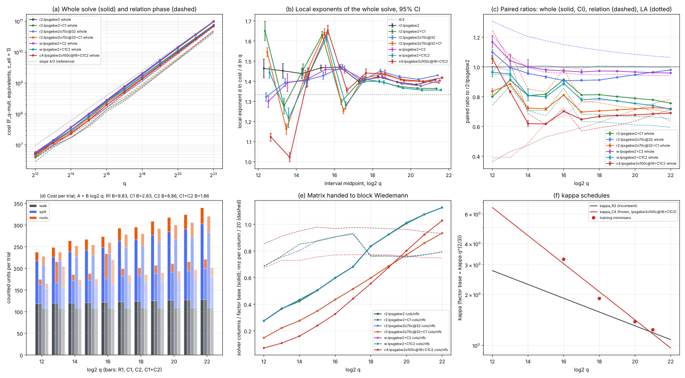

# Round 4, item 01: the genus-3 relation phase, second pass

2026-10-16. Round rules: [../RULES.md](../RULES.md) (at most 3 single-threaded jobs, 4.5 GB and 60 minutes per job).
Protocol, frozen before test data, with amendments D1-D2: [PROTOCOL.md](PROTOCOL.md). Predecessor:
[round 3 item 01](../../ic_improve3_20261015/01-genus3-relations/README.md).

- Tool: [`examples/ic_improve4_01_genus3_rel.rs`](../../../examples/ic_improve4_01_genus3_rel.rs), a copy of round 3's
  instrument. `src/` is not touched.
- Analysis: [`examples/ic_improve4_01_analyze.rs`](../../../examples/ic_improve4_01_analyze.rs).
- Figure: [plot.py](plot.py), which plots `summary_all.json`, `pertrial_w.json` and `tune.json` only.
- Records:
  - test: [results/run/](results/run/), with tables [analysis.md](results/run/analysis.md) (incumbent, C1, C3,
    C1+C3, C4; primary), [analysis_c2.md](results/run/analysis_c2.md) and
    [analysis_c2pair.md](results/run/analysis_c2pair.md) (C2), [analysis_aa.md](results/run/analysis_aa.md) (A/A and
    the W-walk control), [analysis_c4dec.md](results/run/analysis_c4dec.md) (C4 decomposition),
    [pertrial_r2.md](results/run/pertrial_r2.md) and [pertrial_w.md](results/run/pertrial_w.md) (cost per trial);
  - gate: [gate0.md](results/run/gate0.md); reproduction: [results/repro/](results/repro/);
  - training: [results/train/](results/train/) ([wtune.md](results/train/wtune.md), [tune.md](results/train/tune.md)).

## Verdict

**Incumbent:** round 3's **R2**, `r2:lpsgebw2`: round 3's R1 relation primitives (one-inversion Cantor addition,
Stickelberger pre-filter, root finding reusing `x^((q-1)/2) mod u`) with kappa_R2(b) = 1.306 x 0.9102^(b-20), on
`lpsgebw2` (large primes as columns, SGE, block Wiedemann (2, 1)).

**Design:** held-out curves 0-2 at q = 2^12..2^22 and curves 3-4 at 2^18..2^21; paired on instance and target (and on
the walk for C1 and C3); unit `M_q + ceil(log2 q) I_q + M_ell`; 2000 paired bootstrap resamples.

**Floors.** A/A (`aa:lpsgebw2`, an independent single walk, 12..21): exponent Delta -0.0012 [-0.0037, +0.0014], so
eps_e = 0.0037; ratios 0.994-1.023 (1.023 at 2^12, <= 0.006 from 2^13 up), so eps_c = 0.023.

| candidate | exponent, whole: Delta [95%], 12..22 and 16..22 | constant: paired ratio at 2^22 [95%] | other levels | verdict |
|---|---|---|---|---|
| incumbent `r2:lpsgebw2` | slope 1.430 [1.428, 1.432] (12..22), 1.408 (16..22) | 1 (9.967e10) | local exponent 21-22: 1.408 | - |
| **C1**: field-level splitting test (same relations) | **-0.0152 [-0.0154, -0.0149]**; 16..22 **-0.0341 [-0.0343, -0.0339]** | **0.756 [0.755, 0.756]**; 0.779 at 2^21 | primitive: splitting test + root finding per trial **0.438** at 2^22 (211.6 to 92.7 units); per-trial log slope **B 9.75 to 2.71** per bit; local 21-22 **1.364**; trend difference **-0.0094 [-0.0097, -0.0092]** | **ADVANCES** (exponent, constant, primitive); moves toward 4/3 |
| **C2**: batched walks, W = 32 | -0.0187 [-0.0221, -0.0154]\*; 16..22 -0.0032 [-0.0054, -0.0011] (inside eps_e) | **0.959 [0.959, 0.959]** against the incumbent; **0.960** against its own unbatched twin (exactly paired) | primitive: walk addition per trial **0.848** (128.0 to 108.6 units at 2^22); B 9.83 to 8.86 | **ADVANCES** (constant, primitive); exponent MATCHES |
| **C3**: oversample 70%, clique removal, SGE cx 32 (`lpsgebw2o70c@32`, same walk) | -0.0089 [-0.0102, -0.0073]; 16..22 **+0.0203 [+0.0194, +0.0211]** | **0.979 [0.979, 0.980]**; 0.908 at 2^16, 1.099 at 2^12 | LA 0.782 and relation 1.064 at 2^22; solver columns 26277 vs 31695; local 21-22 1.429; trend difference +0.0156 | **TRADES** (constant ADVANCES; phases opposite; gain shrinks with q) |
| C1 + C3 (same walk) | -0.0219 [-0.0233, -0.0203]; 16..22 -0.0106 [-0.0115, -0.0097] | 0.719 [0.719, 0.720] | local 21-22 1.392; trend difference +0.0071 | ADVANCES (constant, exponent) |
| C1 + C2 (W = 32, kappa_R2) | -0.0380\*; 16..22 **-0.0410 [-0.0432, -0.0388]** | **0.715 [0.715, 0.715]** | local 21-22 **1.356**; trend difference +0.0046\* | ADVANCES (constant; exponent over 16..22) |
| **C4**: C1 + C2 + C3 (`lpsgebw2o100c@16`), kappa re-tuned | -0.0312 [-0.0331, -0.0290]\*; 16..22 **+0.0045 [+0.0035, +0.0055]** | **0.690 [0.689, 0.690]**; 0.685 at 2^21 | LA 0.632, relation 0.714 at 2^22; local 21-22 1.418; trend difference +0.0362; 1.056 at 2^12 | **TRADES** (constant ADVANCES, exponent over 16..22 REGRESSES) |

\* The W-walk arms (C2, C1+C2, C4) carry the start-up cost of 31 extra walks (62 scalar multiplications), charged in
full. It makes the W-walk control `w:lpsgebw2` (R1, unbatched) cost 1.199x the incumbent at 2^12 and 1.071x at 2^13,
fading to 0.999x at 2^21-2^22. That alone gives the control an exponent Delta of -0.0169 over 12..22 but -0.0004
over 16..22 ([analysis_c2.md](results/run/analysis_c2.md)). So for W-walk arms the 12..22 exponent mostly measures
this fixed overhead, not a gain; their exponent verdicts above use 16..22 (deviation 3 below).

**What this means.**

- **C1 is the round's clear result.** Splitting a square-discriminant cubic needs only the cubic character of the
  Cardano resolvent ratio y = z2/z1, and y + 1/y = 2 + 27 disc / P'^3 lies in F_q. A Lucas ladder (2 products per bit,
  one inversion) replaces R1's `x^((q-1)/2) mod u` (12-15 products per bit), and the same ladder with exponent
  3^{-1} mod n/3 gives a cube root for root finding. Relations are identical: decisions and root sets were asserted
  equal on every trial of every job.
  - Cost per trial at 2^22: 339.6 to 220.7 units (0.650). The log-dependent slope falls from 9.75 to 2.71 units per
    bit, so the per-trial log factor's share of the local exponent drops from 0.043 to 0.018 at 2^21.
  - This is the lever round 3's diagnosis named, and it moves the exponent: Delta -0.015 over 12..22 and -0.034 over
    16..22, ratio falling every bit from 2^17 (0.812, 0.813, 0.801, 0.789, 0.779, 0.756), local exponent 1.364 at both
    20-21 and 21-22 against the incumbent's 1.383 and 1.408.
  - At q = 8209 (2^13) and 65537 (2^16), 9 divides n = q - (-3|q), there is no one-exponent cube root, and root
    finding falls back to R1's route; the ratio there is 0.911 and 0.915.
- **C2 is a constant.** Batching the one inversion per Cantor addition over 32 lockstep walks saves about
  ceil(log2 q) - 3 units per trial: 0.96x whole, 0.94x relation at 2^20-2^22. W = 32 walks need the same number of
  trials as one walk (the control's ratio is 0.998-1.007 from 2^15 up).
- **C3 is a constant that shrinks with q.** Oversampling plus clique removal makes the matrix smaller (columns 0.83x
  at 2^22) and LA cheaper (0.78x), for 6.4% more relation work. The LA ratio rises with q (0.56 at 2^16 to 0.78 at
  2^22) and so does the whole ratio (0.908 to 0.979; below 2^14 the fixed cx = 32 and oversampling cost more than they save, 1.099 at 2^12): the 2LP graph near its threshold gives cheap extra cycles, but
  each extra relation saves less LA at large q. It raises the LA exponent (+0.08 over 16..22) and moves away from 4/3.
- **C4 is the cheapest arm at 2^22 (0.690x) but its frozen kappa schedule regresses the exponent.** The training rule
  gave ln kappa_C4(b) = 0.3478 - 0.1916 (b - 20), twice as steep as kappa_R2, partly because kappa\*(16) sat at the
  top of the grid (clamped). A falling kappa raises the exponent, as in rounds 2 and 3: C4's ratio rises from 0.617
  (2^15) to 0.690 (2^22). C1 + C2 at the incumbent's kappa (0.715x at 2^22, local exponent 1.356) has the better
  exponent; C1 + C3 is 0.719x.
- **Distance remaining to 4/3:** fitted over 16..22, C1 + C2 1.368 (0.035 above 4/3) and C1 1.374 (0.041), against
  the incumbent's 1.409 (0.075). Local 21-22: C1 + C2 1.356 (0.023), C1 1.364 (0.031), incumbent 1.408 (0.075). The
  matched-rho gap is not measured in this item (no rho arm, as in round 3).



*(a) geometric-mean cost per size (curves 0-2; 0-4 at 18..21 for the `r2` and `c4` arms; W-walk arms curves 0-2),
whole (solid) and relation phase (dashed); slope-4/3 reference. (b) local exponents with 95% CIs. (c) paired ratios
against the incumbent: whole (CI), relation (dashed), LA (dotted). (d) counted cost per trial by primitive (walk,
splitting test, root finding), bars R1, C1, C2, C1+C2 from the `w` stream. (e) solver columns per factor-base
element (solid) and nnz per column / 20 (dashed). (f) kappa_R2 and the frozen kappa_C4 with the training
minimisers. Plotted from [summary_all.json](results/run/summary_all.json) (all arms on common curves).*

## Per-size paired ratios (whole solve) against `r2:lpsgebw2`

From [analysis.md](results/run/analysis.md) and [analysis_c2.md](results/run/analysis_c2.md) (95% CIs there).

| log2 q | incumbent cost | C1 | C3 | C1+C3 | C4 (kappa_C4) | C2 | C1+C2 | W-walk control | A/A |
|---|---|---|---|---|---|---|---|---|---|
| 12 | 4.956e6 | 0.800 | 1.099 | 0.836 | 1.056 | 1.168 | 0.964 | 1.199 | 1.023 |
| 13 | 1.369e7 | 0.911 | 0.996 | 0.884 | 0.833 | 1.042 | 0.952 | 1.071 | 0.995 |
| 14 | 3.744e7 | 0.807 | 0.956 | 0.724 | 0.619 | 1.000 | 0.808 | 1.029 | 0.995 |
| 15 | 1.012e8 | 0.817 | 0.933 | 0.718 | 0.617 | 0.980 | 0.799 | 1.009 | 1.005 |
| 16 | 2.797e8 | 0.915 | 0.908 | 0.811 | 0.702 | 0.974 | 0.889 | 1.003 | 0.994 |
| 17 | 7.754e8 | 0.812 | 0.910 | 0.697 | 0.648 | 0.966 | 0.779 | 0.995 | 0.995 |
| 18 | 2.046e9 | 0.813 | 0.911 | 0.704 | 0.666 | 0.973 | 0.786 | 1.003 | 1.004 |
| 19 | 5.476e9 | 0.801 | 0.930 | 0.711 | 0.673 | 0.971 | 0.771 | 1.004 | 1.004 |
| 20 | 1.441e10 | 0.789 | 0.947 | 0.718 | 0.676 | 0.966 | 0.755 | 1.000 | 1.002 |
| 21 | 3.757e10 | 0.779 | 0.965 | 0.727 | 0.685 | 0.962 | 0.741 | 0.999 | 0.997 |
| 22 | 9.967e10 | **0.756** | **0.979** | **0.719** | **0.690** | **0.959** | **0.715** | 0.999 | - |

The C2, C1+C2 and control columns use curves 0-2
at every size; the others use curves 0-4 at 18..21.

**Exponents by phase** (12..22, Delta against the incumbent; incumbent relation 1.419, LA 1.458):

| arm | relation | LA | whole, `c_ell = 9` (12..22 / 16..22) |
|---|---|---|---|
| C1 | -0.0299 [-0.0302, -0.0297] | 0 | -0.0024 / -0.0103 |
| C3 | -0.0278 | +0.1031 | +0.0507 / +0.0683 |
| C1+C3 | -0.0576 | +0.1031 | +0.0548 / +0.0590 |
| C4 | -0.0622 (16..22: +0.0231) | +0.0858 (16..22: -0.0209) | +0.0373 / -0.0148 |

C3 and C4 raise the LA exponent over 12..22 because their LA saving is largest at small q.

## Candidates

**C1 (instrument: `split_c1`, `roots_c1`).** For u = x^3 + a x^2 + b x + c over F_q (every instance field is a prime
field, q > 3):

| step | R1 (incumbent) | C1 |
|---|---|---|
| discriminant, Legendre symbol (all trials) | 13 products + square-and-multiply | same |
| square discriminant (half the trials) | `x^((q-1)/2) mod u`, `x^q = x w^2`: 12-15 products per bit | P' = 3b - a^2, t = 2 + 27 disc / P'^3 (5 products, 1 inversion), Lucas ladder V_{n/3}(t) = 2 with n = q - (-3|q): 2 products per bit |
| root finding (1/6 of trials) | monic(w -+ 1) as quadratic factor, else Cantor-Zassenhaus | V_e(t) with e = 3^{-1} mod n/3 gives gamma + 1/gamma for a cube root gamma of y; t1 = +-sqrt(-P'(V_e + 2))/3 (square root counted product by product), sign by evaluating u, then the quotient quadratic (incumbent's formula and charge) |

Why it works: a squarefree cubic with square discriminant is split or irreducible; with Cardano's resolvent roots
z1, z2 (z1 z2 = -P^3/27, a cube) it splits iff z1 is a cube in F_q(sqrt(-3)), iff y = z2/z1 is a cube in the cyclic
group of order n (F_q^\* if q = 1 mod 3, the norm-1 torus of F_{q^2} if q = 2 mod 3), iff y^{n/3} = 1, iff
V_{n/3}(y + 1/y) = 2. The suggested shared exponent for the Legendre symbol and sqrt(disc) is not needed: the test
uses no sqrt(disc). Fallbacks: 9 | n (b = 13, 16) and P' = 0 use R1's root finding, charged.

**C2 (`cadd_fast_pre`, `cadd_batch`, `cadd_fast_fin`).** R1's addition split at its single inversion; 32 lockstep
walks invert r q4 jointly (3(W-1) products + 1 inversion); each inverse is checked. Training (T-W, b = 18):
batched / unbatched relation cost 0.953 (W = 8), 0.948 (32), 0.947 (128); rule gave W = 32.

**C3 (`clique_filter`, oversampling thresholds).** Training at kappa_R2 (b = 16, 18, 20, 21): ratio to the incumbent
LA arm 0.945 (`o35c@16`), 0.937 (`o70c@16`), 0.940 (`o100c@16`), **0.933 (`o70c@32`, chosen)**.

**C4.** Training picked `lpsgebw2o100c@16` with C1 and C2 and kappa\*(b) = 3.235 (clamped), 1.895, 1.382, 1.237 at
16, 18, 20, 21: kappa_C4 = 6.56, 3.05, 1.42, 1.17, 0.97 at 12, 16, 20, 21, 22, against kappa_R2 = 2.77, 1.90, 1.31,
1.19, 1.08. The decomposition ([analysis_c4dec.md](results/run/analysis_c4dec.md)) gives C4's R1, C1 and C2
variants on the same walk.

**Considered and dropped:** none of C1-C4 was dropped. A Jacobi-symbol Legendre test (priced like an inversion)
would cut a further ~0.5 log2 q units per trial, but that changes the price of an operation rather than the
algorithm, so it was not used.

## Controls and gates

- **Gate 0:** 41/41 `r2:lpsgebw2` test records (curves 0-4, 12..22) equal round 3's `r2:lpsgebw2+R1` in k, cost,
  relation cost, LA counters and steps ([gate0.md](results/run/gate0.md)).
- **Shadow equality (C1):** asserted on every trial of every job (145 test, 60 training); 0 aborts.
- **Batched inverses (C2):** `r q4 z = 1` asserted on every batched addition; 0 aborts.
- **A/A:** Delta -0.0012 [-0.0037, +0.0014] covers 0.
- **Correctness:** every logarithm verified (`k phi(G) = phi(T)`) and equal to the planted k: `r2` 41 records x 4
  arms, `c4` 41 x 4, `w` 33 x 4, `aa` 30 x 2; 0 failures ([analysis.md](results/run/analysis.md) header).
- **Reproduction:** the rebuilt binary reproduced two earlier records exactly ([results/repro/](results/repro/)).

## Deviations and limits

1. **Container restart** during training (about 00:20): the three b = 21, kappa x 1.7 jobs were killed and rerun;
   nine finished b = 21 records were kept. The binary was rebuilt from the final source (doc comments and `rustfmt`
   only) and reproduced earlier records exactly; hashes in [env.txt](results/run/env.txt). Amendment D2.
2. **Scheduler bug** (23:40-00:03): the slot counter also matched the `timeout` wrapper, so only 2 jobs ran; no record
   affected.
3. **Exponent lens for W-walk arms:** the protocol's primary exponent is 12..top. For C2, C1+C2 and C4 that range
   is dominated by the charged start-up of 31 extra walks (control Delta -0.017 over 12..22, -0.0004 over 16..22),
   so their exponent verdicts use 16..22. This was decided after seeing the control, and is stated as such. By the
   12..22 rule alone, C2 and C4 would read ADVANCES on the exponent.
4. **C3's verdict** uses the protocol's TRADES clause (phases in opposite directions); by the 12..22 rule alone its
   exponent would read ADVANCES, while over 16..22 it REGRESSES.
5. **kappa_C4 extrapolates** below 16 and above 21, and kappa\*(16) was clamped at the grid edge.
6. **Machine limit at 2^23.** 2^22 jobs took 14-17 minutes but peaked at 3.66-3.86 GB resident, close to the
   4.5 GB address-space cap. At the measured doubling per bit, 2^23 needs about 7.5 GB, so it was not run. Memory,
   not time, is the limit.
7. Wall times are descriptive only; claims use counted operations. Large-prime bookkeeping and the filter are not
   charged (as the incumbent's), host L0.

## Reproduce

```bash
cargo build --release --example ic_improve4_01_genus3_rel --example ic_improve4_01_analyze
cd research/ic_improve4_20261015/01-genus3-relations
A=../../../target/release/examples/ic_improve4_01_analyze
SLOTS=3 sh run_slots.sh queue_tw.txt              # T-W (relation only, b = 18)
$A wtune results/train > results/train/wtune.md
SLOTS=3 sh run_slots.sh queue_train.txt           # T-C3/C4 grid
$A tune results/train results/train/tune.json > results/train/tune.md   # -> d2.env
sh make_test_queue.sh > queue_test.txt && SLOTS=3 sh run_slots.sh queue_test.txt
R=results/run
$A gate $R ../../ic_improve3_20261015/01-genus3-relations/results/run > $R/gate0.md
$A analyze $R 12 22 16 $R/summary.json r2:lpsgebw2 r2:lpsgebw2+C1 r2:lpsgebw2o70c@32 r2:lpsgebw2o70c@32+C1 c4:lpsgebw2o100c@16+C1C2 > $R/analysis.md
$A analyze $R 12 21 16 $R/summary_aa.json r2:lpsgebw2 aa:lpsgebw2 w:lpsgebw2 > $R/analysis_aa.md
$A analyze $R 12 22 16 $R/summary_c2.json r2:lpsgebw2 w:lpsgebw2 w:lpsgebw2+C2 w:lpsgebw2+C1C2 > $R/analysis_c2.md
$A analyze $R 12 22 16 $R/summary_c2pair.json w:lpsgebw2 w:lpsgebw2+C2 > $R/analysis_c2pair.md
$A analyze $R 12 21 16 $R/summary_c4dec.json r2:lpsgebw2 c4:lpsgebw2o100c@16 c4:lpsgebw2o100c@16+C1 c4:lpsgebw2o100c@16+C2 c4:lpsgebw2o100c@16+C1C2 > $R/analysis_c4dec.md
$A pertrial $R r2:lpsgebw2 $R/pertrial_r2.json > $R/pertrial_r2.md
$A pertrial $R w:lpsgebw2 $R/pertrial_w.json > $R/pertrial_w.md
$A analyze $R 12 22 16 $R/summary_all.json r2:lpsgebw2 r2:lpsgebw2+C1 r2:lpsgebw2o70c@32 r2:lpsgebw2o70c@32+C1 w:lpsgebw2+C2 w:lpsgebw2+C1C2 c4:lpsgebw2o100c@16+C1C2 > $R/analysis_all.md
python3 -I plot.py $R/summary_all.json $R/pertrial_w.json results/train/tune.json cost_vs_q r2:lpsgebw2 r2:lpsgebw2+C1 r2:lpsgebw2o70c@32 r2:lpsgebw2o70c@32+C1 w:lpsgebw2+C2 w:lpsgebw2+C1C2 c4:lpsgebw2o100c@16+C1C2
sh make_pdf.sh
```

The smoke and probe records in [results/smoke/](results/smoke/) are in no fit.
