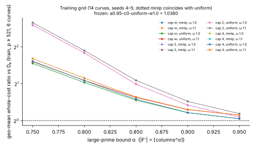
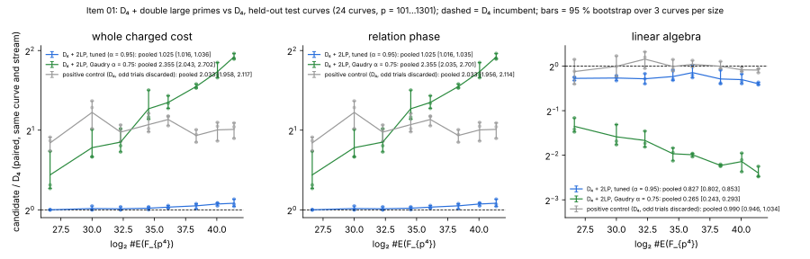
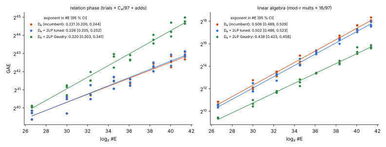

# Item 01: D₄ symmetrisation stacked with double large primes, k = 4 IC on E(F_{p⁴})

IC improvement round (`../RULES.md`), item 01, 2026-10-14. The protocol,
[`PROTOCOL.md`](PROTOCOL.md), was frozen before any data was collected. Prior
work: [`../../ic_next10_20261014/01-fp4-ladder/`](../../ic_next10_20261014/01-fp4-ladder/README.md).

- **Incumbent:** the D₄ Y-line arm (`d4`).
- **Candidate:** D₄ + double large primes (2LP), tuned on held-apart training
  curves and then frozen (`d4-2lp`).
- **Also reported:** the untuned stacked arm at Gaudry's |F|^{3/4} rule
  (`d4-2lp-gaudry`).
- **Rho** appears only as a reference column.

## Verdict

**REGRESSES at the whole-cost level, at both the constant and the exponent
level.** The tuned 2LP still loses at the relation phase. Its only gain is
in linear algebra.

| comparison (test: 24 held-out curves, p = 101…1301) | phase | constant: pooled paired ratio [95 % CI] | verdict | exponent: Δ slope of log₂ ratio per log₂ #E [95 % CI] | verdict |
|:--|:--|--:|:--|--:|:--|
| **tuned D₄ + 2LP / D₄** | **whole** | **1.025 [1.016, 1.037]** | **REGRESSES** | **+0.0055 [+0.0036, +0.0078]** | **REGRESSES** |
| | relation | 1.025 [1.016, 1.035] | REGRESSES | +0.0055 [+0.0033, +0.0079] | REGRESSES |
| | linear algebra | 0.827 [0.802, 0.853] | ADVANCES | −0.0047 [−0.0113, +0.0035] | MATCHES |
| Gaudry-α D₄ + 2LP / D₄ | whole | 2.355 [2.043, 2.702] | REGRESSES | +0.0995 [+0.0853, +0.1117] | REGRESSES |
| | relation | 2.355 [2.035, 2.701] | REGRESSES | +0.0995 [+0.0857, +0.1117] | REGRESSES |
| | linear algebra | 0.265 [0.243, 0.293] | ADVANCES | −0.0683 [−0.0821, −0.0549] | ADVANCES |

By phase, both stacked arms **TRADE**: linear algebra advances while the
relation phase regresses. The relation phase is the whole cost at every
measured size: the D₄ LA share is under 10⁻⁷. So the whole-cost verdict
follows the relation phase.

**Fitted handover.** This is an extrapolation, not a measurement. Each arm's
relation and LA phases are carried on their own fitted power laws.

- Tuned D₄ + 2LP overtakes D₄ only at **#E ≈ 2^128.9**, once LA is about
  half of D₄'s cost.
- The Gaudry-α arm overtakes it at #E ≈ 2^184.3.
- The model also crosses at 2^28.4 and 2^22.5. Both lie at or below the
  smallest measured size, where the measured tuned ratio is exactly 1.000,
  so they are fit artefacts.
- The trend line of the paired whole ratio crosses 1 at 2^28.4 and rises
  from there.
- Modelled tuned ratio: 1.045 at 2^40, 1.146 at 2^64, 1.035 at 2^128 and
  0.40 at 2^256.
- The 2^128.9 crossover rests on two things: the measured LA constant
  (0.83), and an LA exponent difference the data do not resolve (MATCHES).
  Treat it as indicative only.

**Correctness and controls**, all passed:

- **Correctness.** Every logarithm of every arm verified, [d]G = Q and equal
  to the planted d: 120 of 120 on test and 868 of 868 on training.
- **Null A/A** (`d4-2lp-null`, the 2LP path with s = all columns): identical
  to `d4` in trials, full relations, LA counts and output on 24 of 24 test
  curves and 14 of 14 training curves.
- **Positive control** (`d4-half`, which discards every odd trial): ratio
  2.033 [1.958, 2.117]. That is REGRESSES at the constant level, inside the
  pre-registered window [1.6, 2.5].
- **Reproduction.** `d4` trial counts equal item 1's committed
  `ladder.jsonl` on 21 of 21 shared curves.

## Tuning (training split: seeds 4, 5 × 7 sizes = 14 curves)

The grid has 60 configurations, all run on one shared trial stream per
curve:

- large-prime bound α ∈ {0.75, …, 0.95}, where |F'| = ⌈columns^α⌉;
- merge cap (the cycle-finding cut-off) ∈ {∞, 2, 4};
- relation choice ∈ {uniform, minlp};
- relations before the first LA attempt, ω ∈ {1.0, 1.1}.

The objective, fixed in advance, is the geometric-mean whole ratio against
D₄ on the six training curves with p ≥ 521. Full ranking:
[`raw/frozen.json`](raw/frozen.json).

- **Frozen:** α = 0.95, merge cap ∞ (uncapped), uniform, ω = 1.0. Training
  score **1.0360**. `minlp` tied it exactly, and the rule kept the first in
  grid order.
- **Shape of the grid.** The score falls monotonically as α rises. A merge
  cap of 2 always hurts, a cap of 4 equals uncapped, and ω = 1.1 always
  hurts.
- **Best below 1:** none. No configuration in the grid scores below 1. The
  smallest large-prime fraction tried (α = 0.95, about 25 % of columns
  large) is the best, so the tuning drives 2LP back toward the incumbent.
- The Gaudry rule (α = 0.75) scored 2.93.



## Why a tuned 2LP still loses at the relation phase (measured accounting)

At p = 1033 and 1301 the counts are:

| arm | relations used | full relations | pivots | columns in use |
|:--|:--|:--|:--|:--|
| D₄ | ≈ columns + 1 | — | — | all |
| tuned 2LP | ≈ columns + 1 | ≈ s + 1 | ≈ columns − s | s |
| Gaudry α | about 0.9 × columns | — | — | — |

For example, p = 1033 seed 1: D₄ used 263; tuned used 263 = 200 full + 63
pivots; Gaudry used 241 = 67 + 174.

1. **The large primes are the leftover base columns, not an open-ended prime
   set.** Nearly every large prime that appears costs one pivot relation.
   So 2LP cannot cut the number of relations needed below about |F|. It
   only moves unknowns from the matrix into the pivot store, which is where
   the 17 % LA saving comes from.
2. **Decompositions with three or four large primes are inadmissible.** A
   decomposed trial whose decompositions all have ≥ 3 large primes is paid
   for (C₄) and wasted. That costs the tuned arm 0–10 % more trials, rising
   with p because the large-prime set grows with p. It costs the Gaudry arm
   1.4–3.8×.

## Results by size (test split, 3 curves per size)

The tuned and Gaudry columns are paired ratios against D₄ (geometric mean,
95 % bootstrap over the curves at that size).

| p | log₂ #E | columns | D₄ trials (mean) | tuned whole / D₄ | tuned LA / D₄ | Gaudry whole / D₄ | Gaudry LA / D₄ | D₄ S / rho-neg (ref.) |
|--:|--:|--:|--:|--:|--:|--:|--:|--:|
| 101 | 26.6 | 23–24 | 3,315 | 1.000 [1.000, 1.000] | 0.83 | 1.36 [1.20, 1.66] | 0.39 | 1.35·10⁸ |
| 181 | 30.0 | 37–50 | 5,178 | 1.011 [1.000, 1.034] | 0.83 | 1.72 [1.59, 2.01] | 0.33 | 7.28·10⁷ |
| 269 | 32.3 | 58–69 | 7,577 | 1.009 [1.000, 1.027] | 0.82 | 1.80 [1.66, 2.03] | 0.32 | 5.78·10⁷ |
| 397 | 34.5 | 89–107 | 11,294 | 1.014 [1.000, 1.027] | 0.85 | 2.41 [2.20, 2.84] | 0.26 | 3.82·10⁷ |
| 521 | 36.1 | 131–134 | 10,997 | 1.024 [1.012, 1.039] | 0.90 | 2.55 [2.42, 2.70] | 0.25 | 2.18·10⁷ |
| 769 | 38.3 | 181–202 | 19,825 | 1.035 [1.008, 1.055] | 0.82 | 2.92 [2.89, 2.99] | 0.21 | 2.03·10⁷ |
| 1033 | 40.1 | 248–282 | 24,831 | 1.052 [1.034, 1.062] | 0.81 | 3.33 [3.16, 3.60] | 0.23 | 1.36·10⁷ |
| 1301 | 41.4 | 311–349 | 31,024 | 1.059 [1.030, 1.098] | 0.76 | 3.78 [3.71, 3.90] | 0.19 | 1.16·10⁷ |

Level by level, tuned against D₄:

- **Whole cost.** MATCHES at p = 101–397, where the CI touches 1.000.
  REGRESSES at every size from 521 up.
- **LA.** ADVANCES at every size.

The rho-negation reference comes from item 1's 16 walks per curve. At
p = 1301 it comes from 4 walks per curve run here.



### Fitted exponents in #E

OLS of log₂(cost) on log₂ #E over 24 test curves, with 95 % bootstrap over
curves.

| arm | relation phase | linear algebra | whole |
|:--|:--|:--|:--|
| D₄ (incumbent) | 0.221 [0.200, 0.244] | 0.506 [0.489, 0.529] | 0.221 [0.198, 0.244] |
| D₄ + 2LP tuned | 0.226 [0.205, 0.252] | 0.502 [0.486, 0.523] | 0.226 [0.205, 0.251] |
| D₄ + 2LP Gaudry α | 0.320 [0.303, 0.341] | 0.438 [0.423, 0.458] | 0.320 [0.303, 0.339] |

Item 1's x-line DLP measured a relation exponent of 0.333 and an LA
exponent of 0.420. The Gaudry-α stack on the Y-line reproduces that shape:
0.320 and 0.438.



## ecbench (in-harness reproduction, 4 sizes)

The arm is registered as `ic.k4_gaudry` with `base = yline-d4-lp`,
`large_primes = 2` and `lp_exponent = 0.95`. Merge cap ∞, uniform choice
and ω = 1 are the harness's existing behaviour, so the frozen configuration
is expressible exactly.

- **Session.** `ECBS1hb2883a84d770`, spec
  [`ecbench/spec-d4-2lp.json`](ecbench/spec-d4-2lp.json). 4 curves
  (p = 101, 181, 269, 397, seed 1) × 3 targets × 3 arms = 36 runs, 36
  verified.
- **Audit.** `ecbench verify --replay 12`: "audit OK: 36 records, 36
  verified, 12 replays reproduced, 0 problems". Receipt
  `ecbench/session-20261014-d4-2lp.audit.json`, SHA-256
  `5380c98c6ae0ff001cce51cdc192afcb86c7fccec57f9c98c31fcd72ce9621fb`.
- **Isolation.** L0, with `--allow-busy --cpus none`. These are operation
  counts only; no wall-time claim is made.

`ecbench compare` (paired cluster bootstrap, 12 workloads). The harness
labels both rows "diagnostic only (unpriced work)": the oracle is uncharged.

| B / A | ratio | 95 % interval | per curve (p = 101, 181, 269, 397) |
|:--|--:|:--|:--|
| ic-k4-d4-2lp / ic-k4-d4 | 1.0108 | [1.001, 1.026] | 1.000, 1.020, 1.014, 1.024 |
| ic-k4-d4-2lp-gaudry / ic-k4-d4 | 1.584 | [1.423, 1.807] | 1.31, 1.62, 1.84, 2.33 |

These agree with the ladder at the same sizes: tuned 1.000–1.014, Gaudry
1.36–2.41. Full tables: [`ecbench/compare.txt`](ecbench/compare.txt).

## Deviations from the protocol

1. **Tie in the frozen configuration.** `uniform` and `minlp` tied exactly
   at the optimum, because with α = 0.95 the two pick rules chose identical
   relations on every training curve. The protocol named no tie-break; the
   argmin kept the first in grid order (uniform).
2. **Handover output.** The phase-model handover first reported only the
   first crossing. After seeing the test output it was changed to list every
   crossing: the first lay below the measured range and was uninformative.
   No number in the model changed.
3. **No practical-equivalence margin.** The protocol set none. At
   p = 101–397 the tuned arm is within 1.5 % of D₄, and the verdicts are
   stated as measured.
4. **Rho reference at p = 1301.** It uses 4 walks per curve instead of 16.
   It is a reference only.
5. **Machine.** Not the limit. The p = 1301 curves took about 9 minutes and
   1.4 GB each, inside the 3 GB and 60-minute caps. p ≈ 1601 would need
   about 2.7 GB for the oracle's triple table, too close to the cap, so it
   was not tried. The whole item took about 80 minutes of single-core time
   on a shared 4-core host, with load 4–7.

## Reproduce

```sh
cargo build --release --example ic_improve_01_d4_2lp --bin ecbench
./run_train.sh       # 14 training curves, 60 configs + d4 + null
B=../../../target/release/examples/ic_improve_01_d4_2lp
$B tune --in raw/train.jsonl --out raw/frozen.json
./run_test.sh        # 24 held-out curves: d4, d4-2lp, d4-2lp-gaudry, null, positive control
$B analyze --in raw/test.jsonl --prior ../../ic_next10_20261014/01-fp4-ladder/raw/ladder.jsonl --out raw/summary.json
python3 -I plot.py
# from the repository root
target/release/ecbench run --wait --allow-busy --cpus none --spec research/ic_improve_20261014/01-d4-2lp/ecbench/spec-d4-2lp.json --out research/ic_improve_20261014/01-d4-2lp/ecbench/session-20261014-d4-2lp
target/release/ecbench verify --dir research/ic_improve_20261014/01-d4-2lp/ecbench/session-20261014-d4-2lp --replay 12 --out research/ic_improve_20261014/01-d4-2lp/ecbench/session-20261014-d4-2lp.audit.json
target/release/ecbench compare --dir research/ic_improve_20261014/01-d4-2lp/ecbench/session-20261014-d4-2lp --a ic-k4-d4 --b ic-k4-d4-2lp
```

Every job ran single-threaded under `nice`, `prlimit --as=3000000000` and
`timeout 3600`. Host: Claude Code cloud container, 4 vCPU, 15 GiB, shared by
four items. Conductor's control plane was unreachable (`conductor check`
refused the connection), so there is no task card.

## Files

- New: `examples/ic_improve_01_d4_2lp.rs`, with the `train`, `tune`, `test`
  and `analyze` subcommands. The oracle, Y-line base and trial stream are
  copied from item 1.
- Edited, additively: `src/cryptanalysis/ecbench/methods.rs`.
  - It adds the `base` value `yline-d4-lp` to `ic.k4_gaudry`, which allows
    large primes on the Y-line.
  - The existing refusal now tests the literal `yline-d4`. Behaviour and
    method hashes of existing specs are unchanged: no parameter was added.
- Data:
  - `raw/train.jsonl` (14 rows) and `raw/frozen.json`;
  - `raw/test.jsonl` (24 rows), `raw/summary.json` and
    `raw/analyze.stdout`;
  - `ecbench/`.
- Figures: `figures/{paired_ratio,phases,training_grid}.{svg,png}`.
- Report: `REPORT.pdf`, built from this README.
