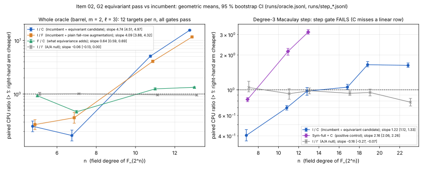

# Item 02: the G2 equivariant pass as a Koblitz decomposition oracle

Round [`research/ic_improve_20261014/`](../RULES.md), item 02. The protocol, including amendment A1, is [`PROTOCOL.md`](PROTOCOL.md). It was written before the main data.

All numbers below are **measured**: per-target thread CPU seconds on the same targets, arms interleaved in one process. Ratios are geometric means with 95 % bootstrap CIs (10,000 resamples). The fit tool is `examples/ic_improve_02_fit.rs`.

## Verdict

**Oracle level: TRADES, at the constant level, with an improvement factor that grows steeply in `n`. All 48 targets pass the correctness gate.**

- The candidate oracle **regresses** at `n = 5, 7` (I/C = 0.25×, 0.17×).
- It **advances** at `n = 11` (5.1× [4.85, 5.34]) and `n = 13` (15.5× [15.1, 15.9]).
- The OLS slope of `ln(I/C)` on `ln n` is **4.74 [4.51, 4.97]** over 4 sizes, `n = 5–13`. That is the slope of a ratio, not a cost exponent.
- Under the protocol's rule, a split across sizes is TRADES. Read in terms of `n`, there is a crossover between `n = 7` and `n = 11`, and from there the candidate wins with a widening margin.

**Most of the win is not equivariance.** The attribution arm F (amendment A1) appends the root's ordinary, non-equivariant degree-3 degree-fall rows to the generators. It gets I/F = 4.1× at `n = 11` and 11.6× at `n = 13`.

- What the equivariant pass adds over F is **F/C = 1.25× [1.20, 1.31] at `n = 11` and 1.34× [1.30, 1.37] at `n = 13`**.
- It is 0.93× at `n = 5` and 0.47× at `n = 7`.
- C and F walk the identical splitting tree on every target. The mechanism is that the solver gets the root's degree-2 consequences as generators, which collapses the tree: median splits fall from 17,765 to 33 at `n = 13`.

**Step level, the degree-3 Macaulay pass alone: the gate FAILS on all 37 targets.**

- The equivariant pass on the symmetric (cubic) system, after gauge fixing, gives a **strict subspace** of what the incumbent's degree-3 step gives on the gauge-fixed (quadratic) system.
- On every target, `n = 7–23`, it yields **one linear consequence fewer**: 4 instead of 5 at `n ≥ 11`.
- So it is not a drop-in substitute for the step. Its cost ratio is still reported, for information only:
  - I/C = 0.40× at `n = 7`, rising to 1.65× at `n = 19` and 1.63× at `n = 23`;
  - slope 1.22 [1.12, 1.33].

**The production pipeline is unaffected.** It never hands a `σ`-symmetric system to `reduce_system`, so the candidate applies at zero of its nodes.

## 1. The incumbent, identified in the code

- **Where the pipeline decomposes.** It decomposes in `koblitz_index_calculus::groebner_decompose_with_geometry`. That function:
  - builds the **target-fixed** system with `polynomial_reuse::build_decomposition_system_reusing`;
  - calls `koblitz_groebner::solve_boolean_system_filtered` with `SolverEngine::default()` = `InheritedF4 { max_degree: 3 }` and `split_rule_default()`.
- **What each node does.** Every node of the solver runs one degree-3 Macaulay step, through `reduce_system` or the inherited bases. It consumes only `1` or forced and linear rows, then splits.
- **No symmetric system ever reaches it.** The target is a constant, and squaring sends `x_R` to `x_R²`, so no system the pipeline builds is Frobenius-symmetric.
- **Where symmetry does exist.** It exists only in the G2 *barrel* formulation, where the target has its own one-hot selector `s₀`. Fixing the gauge `s₀ = e₀` turns it back into a target-fixed system.
- **The incumbent here** is therefore the pipeline's public solver, with the pipeline's default options, on the gauge-fixed barrel system.

## 2. Arms (all same targets, same process, interleaved)

| arm | what runs | charged |
|---|---|---|
| **I** | `solve_boolean_system(gauge-fixed barrel, SolverEngine::default(), split_rule_default())` | system build + solve |
| **C** | equivariant degree-3 pass on the symmetric barrel system (orbits, trivial block via the crate's `gf2_elim::rref_counted`, character blocks over `F_{2^d}`, inverse transform of the degree-fall rows), then specialisation `s₀ = e₀` and RREF; the reduced rows are appended to the gauge-fixed generators; same solver | build + full pass incl. assembly + solve |
| **F** (A1) | the incumbent's own degree-3 Macaulay step on the gauge-fixed system (crate kernel); its degree-fall rows are appended; same solver | build + step + solve |
| **I′** | I again (A/A) | as I |
| **I_step / C_step** | the degree-3 step alone: gauge-fixed Macaulay with `gf2_elim`, against the equivariant pass plus specialisation | assembly included |
| **Sym-full** | `gf2_elim` RREF of the full symmetric Macaulay matrix (positive control, `n ≤ 13`) | assembly included |

- **Setup.** Curve `y² + xy = x³ + 1` over `F_{2^n}`, `m = 2`, `ℓ = 3`, window `span(1, z, z²)`.
- **Targets.** `x_R` is drawn from `StdRng::seed_from_u64(20261014 ^ (n·1000 + t))`.
- **Oracle gate.** On every target, the root sets of I, I′, C and F are equal to each other and to a brute-force enumeration of `(k₁, c₁, k₂, c₂)` with `S₃ = 0`. No arm exhausted its budget.

## 3. Oracle level (12 targets per n; 0 gate failures out of 48)

| n | targets that decompose | I median CPU s | C median s (pass part) | F median s | median splits I / C / F | **I/C** [95 % CI] | I/F | F/C | A/A I/I′ |
|--:|--:|--:|--:|--:|---|---|---|---|---|
| 5 | 8/12 | 0.0072 | 0.0212 (0.0087) | 0.0202 | 131 / 81 / 81 | **0.250** [0.198, 0.313] | 0.269 [0.216, 0.332] | 0.929 [0.891, 0.967] | 1.004 [0.950, 1.077] |
| 7 | 7/12 | 0.0085 | 0.0383 (0.0311) | 0.0172 | 47.5 / 35 / 35 | **0.168** [0.133, 0.212] | 0.361 [0.285, 0.454] | 0.466 [0.441, 0.492] | 1.013 [0.990, 1.037] |
| 11 | 5/12 | 1.755 | 0.339 (0.109) | 0.423 | 4,427 / 29 / 29 | **5.10** [4.85, 5.34] | 4.08 [3.86, 4.32] | 1.25 [1.20, 1.31] | 0.963 [0.929, 0.994] |
| 13 | 3/12 | 10.95 | 0.696 (0.204) | 0.921 | 17,765 / 33 / 33 | **15.53** [15.14, 15.87] | 11.64 [11.35, 11.96] | 1.34 [1.30, 1.37] | 0.957 [0.923, 0.984] |

- **Scaling.** The slopes of the log ratio on `ln n` are:
  - I/C: 4.74 [4.51, 4.97];
  - I/F: 4.09 [3.88, 4.32];
  - F/C: 0.64 [0.59, 0.69];
  - A/A: −0.06 [−0.13, 0.00].
- **Secondary counted unit.** The solver's own word XORs (`f4_word_ops_thread`; the candidate's pass is not in it) give I/C = 0.17×, 0.97×, 3.49× and 10.7× at `n = 5, 7, 11, 13`.
- **The pass cost.** At `n = 13` the equivariant pass is 0.20 s of C's 0.70 s. The rest is the solve on the augmented system.

## 4. Step level (degree-3 Macaulay pass alone)

| n | d | targets | gauge-fixed matrix (rows × cols) | symmetric row orbits | gauge fall / linear rows | C spec rank / linear rows | I_step CPU s | C_step CPU s | **I/C** [CI] | Sym-full ÷ C (pos. ctl) | A/A |
|--:|--:|--:|---|--:|---|---|--:|--:|---|---|---|
| 7 | 3 | 8 | 3,397 × 6,028 | 889 | 403 / 11–12 | 373 / 10 | 0.012 | 0.031 | 0.403 [0.361, 0.452] | 0.824 [0.788, 0.857] | 1.05 [0.96, 1.18] |
| 11 | 10 | 8 | 9,845 × 19,536 | 1,631 | 580 / 5 | 524 / 4 | 0.091 | 0.129 | 0.698 [0.667, 0.731] | 2.15 [1.99, 2.28] | 0.93 [0.83, 1.02] |
| 13 | 12 | 8 | 14,929 × 30,650 | 2,092 | 760 / 5 | 694 / 4 | 0.227 | 0.231 | 0.973 [0.897, 1.046] | 3.15 [3.03, 3.30] | 0.98 [0.92, 1.04] |
| 17 | 8 | 6 | 29,777 × 64,078 | 3,194 | 1,192 / 5 | 1,106 / 4 | 0.970 | 0.927 | 1.053 [1.009, 1.115] | — | 0.93 [0.89, 0.98] |
| 19 | 18 | 4 | 39,925 × 87,384 | 3,835 | 1,444 / 5 | 1,348 / 4 | 1.663 | 1.032 | 1.646 [1.578, 1.753] | — | 0.95 [0.89, 1.01] |
| 23 | 11 | 3 | 66,629 × 149,660 | 5,297 | 2,020 / 5 | 1,904 / 4 | 4.968 | 3.126 | 1.625 [1.563, 1.704] | — | 0.78 [0.72, 0.84] |

- **Gate.** Neither side refutes on any target, so the refutation bits agree.
- **Linear consequences.** The linear-consequence space differs on every target: C has one row fewer. So the step gate fails 37/37.
- **Containment.** Containment `span(C) ⊆ span(I_step)` holds on all 24 targets checked (`n ≤ 13`).
- **Cause, recorded in the protocol before data.**
  - The gauge-fixed system is quadratic, because `x₁x₂x_R` has a constant `x_R`. The symmetric system is cubic, because `X_R` is linear in `s₀`.
  - At Macaulay degree 3 the gauge-fixed step contains `S₃|_gauge × variable`, and the symmetric step cannot.
  - The scope note's 4–6× "smaller per dimension" comparison (`RESEARCH_G2_EQUIVARIANT_F4_SCOPE.md` §3) set the two systems side by side at equal degree. It therefore compared steps that carry different information.
- **Positive control.** The instrument does see the known win of the pass over full reduction of the *symmetric* matrix: 2.15× at `n = 11` and 3.15× at `n = 13`.
  - At `n = 7` it does not: 0.82×. The prior item also found no win at `n = 7` once assembly was charged ("3× / 0×").
  - The prior's 44–73× came against a naive kernel. Against the crate's `gf2_elim` it is 2–3×.
- **Step A/A.** At `n = 17` and `n = 23` the CI excludes 1: the second incumbent run was 7 % and 22 % slower. So step-level cost ratios carry an order or contention bias of up to about 20 % at the largest sizes, and the 1.6× at `n = 19–23` is near that size. The machine ran at load 5–6 on 4 cores; see Deviations.



*Figure: left, the whole oracle (I/C, I/F, F/C, A/A); right, the degree-3 step (I/C, positive control, A/A). Geometric means with 95 % bootstrap CIs. Data: `runs/fit_oracle.jsonl` and `runs/fit_step.jsonl`, computed from `runs/oracle.jsonl` and `runs/step_{small,large}.jsonl`.*

## 5. Hook point, and a lead probe

**Hook point: end-to-end relation collection was not run.**

- The pipeline's systems are target-fixed and never `σ`-symmetric. The candidate therefore applies at no node, and a run with each oracle would execute identical code.
- For the same reason, no `src/` file was changed: a `reduce_system` hook would be dead code on every pipeline system.

**Lead probe, not preregistered, labelled exploratory.** Does the mechanism that carries the win, arm F, transfer to the pipeline's own systems?

- Setup: `build_decomposition_system`, `m = 3` cubic chain, `V = span(1, …, z^{ℓ−1})`, 6 targets per size, the same solver. All gates pass. `examples/ic_improve_02_fall_rows_pipeline.rs`, `runs/lead_fall_rows_pipeline.jsonl`.
- **It does not transfer.** F *regresses* there:

  | `(n, ℓ)` | I/F [95 % CI] |
  |---|---|
  | (13, 4) | 0.59× [0.53, 0.67] |
  | (17, 6) | 0.29× [0.25, 0.33] |
  | (19, 7) | 0.34× [0.31, 0.38] |

- Splits do drop, from 824 to 135 at `n = 17`, but the larger generator set costs more per node.
- So the tree collapse is a property of the barrel system's quadratic gauge-fixed form. It is not a general fix for the pipeline oracle.

## Deviations from the protocol

- **Amendment A1 (arm F)** was added after a one-target pilot at `n = 11` (`runs/pilot.jsonl`) and before the main data.
- **Timing pilot.** `runs/step17_probe.jsonl` is a one-target timing pilot at `n = 17`. It repeats target 0 of the main run and is not used in any fit.
- **The oracle stops at `n = 13`.** The pipeline solver's 64-bit monomials hold the gauge-fixed system's `4n + 6` unknowns only up to `n = 14`, and `n = 9` and `15` lack equal-size character orbits.
  - So the oracle's 4 sizes are `n = 5, 7, 11, 13`, and the oracle at `n = 17–31` is **not measured**.
  - **Where the machine is the limit:** the step at `n = 29, 31` was not run. The gauge-fixed degree-3 matrix would be about 111k × 300k, about 4 GB dense, which is at the 4 GB cap.
- **Targets per size.** The step ran 8/8/8/6/4/3 targets, as planned. The positive control and the containment check ran at `n ≤ 13` only.
- **Load.** The machine ran at load 5–6 on 4 cores, because four items shared it.
  - Thread CPU time removes scheduling, but not cache or memory-bandwidth contention.
  - The A/A arms show a first-run-cheaper bias of 4 % (oracle, `n = 11, 13`, CI excluding 1) and up to 22 % (step, `n = 23`).
  - Every oracle-level effect at `n ≥ 11` is far larger than that bias. The step-level ratios at `n ≥ 17` are not.
- **Units.** The primary unit is CPU time. Field-operation counts are recorded for each arm in the raw rows (`*_word_ops`, `c_gf_muls`), but `F₂` word XORs and `F_{2^d}` table products are not commensurable.
- **Memory.** Peak RSS was not recorded. Every job ran under `prlimit --as=4e9` without hitting the cap.

## Reproduce

```sh
cd /home/user/crypto
cargo build --release --example ic_improve_02_equivariant_oracle --example ic_improve_02_fit --example ic_improve_02_fall_rows_pipeline
B=target/release/examples/ic_improve_02_equivariant_oracle; D=research/ic_improve_20261014/02-equivariant-oracle
export RAYON_NUM_THREADS=1 OMP_NUM_THREADS=1; P="nice prlimit --as=4000000000 --"
for n in 5 7 11 13; do $P $B --mode oracle --n $n --targets 12; done > $D/runs/oracle.jsonl
$P $B --mode step --n 7,11,13 --targets 8 --check --posctl > $D/runs/step_small.jsonl
($P $B --mode step --n 17 --targets 6; $P $B --mode step --n 19 --targets 4; $P $B --mode step --n 23 --targets 3) > $D/runs/step_large.jsonl
for c in "13 3 4" "17 3 6" "19 3 7"; do set -- $c; $P target/release/examples/ic_improve_02_fall_rows_pipeline --n $1 --m $2 --ell $3 --targets 6; done > $D/runs/lead_fall_rows_pipeline.jsonl
F=target/release/examples/ic_improve_02_fit
$F --file $D/runs/oracle.jsonl --ratio I/C:i_cpu/c_cpu --ratio I/F:i_cpu/f_cpu --ratio F/C:f_cpu/c_cpu --ratio AA:i_cpu/i2_cpu --ratio I/C_wordops_solver:i_word_ops/c_word_ops > $D/runs/fit_oracle.jsonl
$F --file $D/runs/step_small.jsonl --file $D/runs/step_large.jsonl --ratio I/C:i_cpu/c_cpu --ratio AA:i_cpu/i2_cpu --ratio POS:pos_cpu/c_cpu > $D/runs/fit_step.jsonl
$F --file $D/runs/lead_fall_rows_pipeline.jsonl --ratio I/F:i_cpu/f_cpu --ratio AA:i_cpu/i2_cpu > $D/runs/fit_lead.jsonl
python3 -I $D/plot.py && bash $D/make_pdf.sh
```

The sha256 of the three binaries used for the main runs is in `runs/binaries.sha256`.
