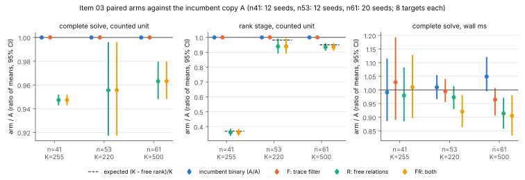
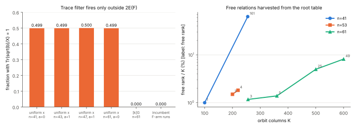

# Item 03: trace-zero pre-filter and free relations on the compact-orbit IC

> **Annotation (2026-10-16, claim audit; the frozen record below is
> unchanged).** The 0.957× was measured at the repository's untuned K
> (255 / 220 / 500), not at each arm's tuned K. At `n = 41`, `K = 255` is far
> above the tuned `K* = 100`, which is why the root table held 161 free
> relations and the gain looks largest there. Round 2 re-ran it with K tuned
> per arm on held-out seeds
> ([`../../ic_improve_20261015/02-freerel-production/README.md`](../../ic_improve_20261015/02-freerel-production/README.md)):
> at matched tuned K the `n = 41` and `n = 53` ratios are **0.972 [0.940,
> 1.003] and 0.984 [0.963, 1.008], not significant** (MATCHES), and the
> `n = 41` wall ratio is 1.008 [0.956, 1.057]. Only `n = 61` (0.962, where
> both arms tune to `K = 500`) is a clean same-K effect. Round 2's pooled
> tuned-vs-tuned 0.960× [0.946, 0.976] is partly where the incumbent's tuned
> K landed. Quote round 2, per size, not this 0.957×.

**Verdict.**

- **R (free relations): ADVANCES, at constant level.** The complete Koblitz DLP solve costs 0.957× the incumbent in the counted unit, 95% CI [0.944, 0.970], pooled over 44 paired replicates at three sizes.
  - The CI excludes 1 at every size: n = 41: 0.947 [0.943, 0.952]; n = 53: 0.956 [0.917, 0.996]; n = 61: 0.963 [0.948, 0.980].
  - Wall clock agrees: 0.948× [0.908, 0.989] pooled.
- **Primitive level.** The cost of one rank-stage relation is unchanged. The rank stage needs `K − free_rank` relations instead of `K`, and the measured rank-stage ratio matches `(K − free_rank)/K` at every size.
- **F (trace pre-filter): REGRESSES by 3.4·10⁻⁵ in the counted unit** (1.0000343 [1.0000255, 1.0000439]). On wall clock it MATCHES (0.990 [0.941, 1.042]).
  - The filter is **provably vacuous** on any index calculus that decomposes points of odd order. It rejected 0 of 29,624 attempts. All it adds is one inversion per attempt.
  - Item 08's "≈50% refuted" came from its target law: uniformly drawn curve abscissae, half of which lie outside `2E(F)`.
- **FR**: the same as R. Counted 0.957 [0.944, 0.970]; wall 0.938 [0.887, 0.989].

Protocol: [`PROTOCOL.md`](PROTOCOL.md), frozen before data. Amendment 1 was also made before any arm data; see Deviations. Rho is not involved in any verdict.



*Figure 1. Each arm divided by `A`, the incumbent's code path with both switches off. The value is the ratio of means over seeds, with a 95% paired bootstrap interval (10,000 resamples). The blue A/A arm is the unmodified incumbent binary. Its counted cost equals `A`'s exactly on all 44 replicates, so its wall-clock spread is the host noise. The dashed lines show the predicted `(K − free_rank)/K`.*

## The incumbent and the arms

The incumbent is the compact-orbit / pair-table pipeline `examples/koblitz_orbit_dlp_fast_online.rs`, run as `construct:<n>:0:<K>` with the default environment. This is the configuration of the retained-setup n = 61 row (`K = 500`) and of item 09's IC arm. Each K is the one the repository already uses at that size: n = 41 K = 255, n = 53 K = 220, n = 61 K = 500. All curves have `a = 0`.

The new example `examples/ic_improve_03_tracezero_freerel.rs` is that file's `u64` path copied verbatim, with two switches added:

- `IC03_TRACE_FILTER=1` (lever **F**). Before every decomposition attempt, compute `Tr(sqrt(b)/X)`. If it is 1, reject the attempt without calling the oracle.
- `IC03_FREE_RELATIONS=1` (lever **R**).
  - Every `insert_if_absent` collision in the root table that is not the inserting state's swap mate is recorded.
  - Each recorded collision is verified as a signed four-point identity `±P1 ± P2 ± P3 ± P4 = O`. The rotation is the exact Frobenius shift given by the two stored canonical shifts.
  - Every non-zero log row is kept as a homogeneous relation.
  - The guided rank stage then fills only the columns that the free rows leave without a pivot.

## Results

### Lever R: free relations (counted unit = S3 root solves; candidate / A)

| n | K | seeds | free rank (of K) | rank stage, measured | rank stage, predicted `(K−F)/K` | **complete solve, counted** | complete solve, wall | harvest cost |
|--:|--:|--:|--:|---|--:|---|---|---|
| 41 | 255 | 12 | 161 (63%) | 0.361 [0.338, 0.385] | 0.369 | **0.947 [0.943, 0.952]** | 0.979 [0.885, 1.083] | 51,172 additions, 54 ms |
| 53 | 220 | 12 | 4 (1.8%) | 0.939 [0.892, 0.992] | 0.982 | **0.956 [0.917, 0.996]** | 0.973 [0.929, 1.014] | 37,186 additions, 13 ms |
| 61 | 500 | 20 | 25 (5.0%) | 0.935 [0.910, 0.962] | 0.950 | **0.963 [0.948, 0.980]** | 0.914 [0.858, 0.971] | 85,198 additions, 26 ms |
| pooled | | 44 | | | | **0.957 [0.944, 0.970]** | 0.948 [0.908, 0.989] | |

- **Where the saving comes from.** The rank stage is the only phase that changes. Index, target and linear-algebra counts are identical to A's (index ratio 1.0000 exactly).
- **Why the whole-solve gain is smaller than the rank-stage gain.** The whole-solve gain is the rank-stage gain weighted by the rank stage's share of the solve, which is:
  - n = 41: 11% (`A`'s counted means are index 2.67M, rank 0.33M, target 2.0k);
  - n = 53: 78% (9.4M of 12.0M);
  - n = 61: 60% (22.8M of 38.0M).
- **The harvest is effectively free.** It costs 0.2–2% of one rank-stage relation. There are no extra S3 solves: the collisions are detected during the insertion the incumbent already does.
- **n = 41, K = 255 is extreme.** Here `K⁴n³/r` is large (r ≈ 2³⁹), and the root table already holds 161 independent relations. They remove 64% of the rank stage. That stage is small at this K, though, so the solve improves by 5.3%.

### Lever F: trace pre-filter

**Derivation.**

1. On `y² + xy = x³ + ax² + b`, take any root `X` of `S3(x1, x2, X) = 0`. Solve for `p = x1·x2`: the equation `p² + Xp + (s²X² + b)` with `s = x1 + x2` is solvable over `F` exactly when
   `Tr(x1) + Tr(x2) = Tr(sqrt(b)/X)`.
2. The curve equation divided by `x²` gives `Tr(sqrt(b)/x_P) = Tr(x_P) + Tr(a) =: χ(P)`. This `χ` is the homomorphism `E(F) → E(F)/2E(F) ≅ Z/2`.
3. So the item-08 rule (base inside `ker Tr`, `Tr(1/X) = 1` ⇒ not decomposable) is the statement that a sum of points in one coset of `2E` lies in the predicted coset. It generalises to **every m**: if every base point has `χ = c`, an m-term sum has `χ = m·c`.
4. **It never fires on an index-calculus target.** Rank-stage points `[a]G − R_j` and published targets all have odd order. They lie in `2E(F)`, so `χ = 0` always.
5. **No other linear filter exists on the prime-order subgroup.** Any homomorphism from a group of odd prime order to an elementary abelian 2-group is trivial. A linear filter on `x` would also have to be Frobenius-compatible on an orbit base, and the only such functional is `Tr` (`Tr(cx²) = Tr(cx)` for all `x` forces `c ∈ F2`).

**Checks** (`examples/ic_improve_03_trace_theory.rs`, file `data/trace_theory.jsonl`):

| check | result |
|---|---|
| identity, n = 41, 10⁶ pairs, `b = 1` and random `b` | 0 violations in 997,948 + 999,840 roots |
| positive control: uniform curve abscissae (item 08's law), 10⁶ each | fires on 0.4989 (n41 a0), 0.4991 (n43 a1), 0.5001 (n47 a1), 0.4989 (n61 a0) |
| subgroup points `[k]G`, `[k]G − R` (2·10⁴ each, n = 41, 43, 47, 61) | fires 0 times |
| exhaustive group census (n = 11 a1, n = 13 a0, n = 17 a1) | exactly half of all points have `χ = 1`; **0** subgroup points do |
| exhaustive m = 1..4 sums over subspace bases (n = 11, 13, 17; k = 5, 6; 3 bases per kind) | inside `ker Tr`: every sum has `χ = m·c` (48/48 m-rows). The span of `{sqrt(b)/X}` is `n − 1` exactly when the rule applies and `n` otherwise, so trace is the only linear condition. Inside another hyperplane, or a random subspace: both cosets are reached and the span is full. No filter. |
| incumbent hypothesis | every base representative has `Tr(x) = Tr(a) = 0` (all 176 runs of the new example). The base already lies in the trace-zero set, so switching bases costs nothing and was not run. |
| in the pipeline (F and FR arms, 88 runs) | 0 rejections out of 29,624 checks (rank-stage and online attempts) |

For `a = 1` (`Tr(a) = 1`), a base inside `ker Tr` lies entirely outside `2E`. Its odd-m sums can then never equal a subgroup target. That is the only regime where the rule says something about subgroup targets, and what it says is "this base is useless at odd m". It does not give a filter.



*Figure 2. Left: how often the filter fires under each target law (recorded fractions). Right: free rank divided by K, from the harvest-only positive-control runs (`data/census_n*_K*.json`), with the free rank as the label.*

### Controls

- **A/A.** The incumbent binary and `A` agree exactly on rank attempts, rank root calls, index candidates and target root calls, in all 44 replicates. Each size has one base-log hash across all its arms and seeds (`distinct_logs_hashes = 1`).
  - Wall-clock A/A ratios: n = 41 0.991 [0.886, 1.115]; n = 53 1.010 [0.966, 1.055]; n = 61 1.049 [0.995, 1.121].
  - The n = 61 A/A rank stage on its own reads 1.098 [1.002, 1.256]. The wall clock on this shared host is therefore not trustworthy at the 5% level. This is why the verdict uses the counted unit (Amendment 1).
- **Positive control, R.** The harvest reproduces item 09's census rank exactly: n = 41 K = 100 → 1, n = 53 K = 200 → 3, n = 61 K = 256 → 3, K = 360 → 5, K = 600 → 49. All verifications succeeded (`harvest_failed = 0` everywhere).
- **Positive control, F.** The filter fires on 50% of uniformly drawn abscissae (table above).
- **Correctness gate.** In every arm and replicate, all 8 targets were recovered, checked with `[d]G = Q` in-process, and equal to item 09's held-back scalar. `correctness_failures = []` in `results.json`.

## Deviations from the protocol

1. **Amendment 1, made before any arm data.** Two smoke runs led to three changes; all are recorded in `PROTOCOL.md`.
   - **(a) R uses the natural column rule instead of the frozen prefix rule.** In the prefix-rule smoke run at n = 41, 114 of the 208 stage rows were wasted: the incumbent's column choice ignores the free pivots. Under the prefix rule the rank stage needed 208/255 attempts; under the natural rule it needed 94/255 = `K − 161`.
   - **(b) The verdict uses the counted unit instead of wall ms.** Two identical n = 61 index builds took 16.6 s and 12.0 s.
   - **(c) 12 seeds per size instead of 10.**
2. **Extra n = 61 seeds.** Seeds 13–20 were added at n = 61 (20 seeds there) because the pairing is statistical there and the expected effect is about 3%. They ran with the same frozen binaries.
3. **A harvest-only mode for the census control.** `IC03_HARVEST_ONLY=1` was added after the arm binaries were frozen. The census runs used a separate frozen binary (`data/census_binary.sha256`). Its harvest code is the same, plus a counter for item 09's state definition, which gave identical ranks.
4. **Counted unit for the candidates' extra work.** The filter's inversion and the harvest's point additions are charged at one S3 root solve each. This over-charges both levers, since an addition is cheaper than a root solve. Item F's 3.4·10⁻⁵ "regression" is exactly this charge: `K + 1` checks against about 10⁷ root solves.
5. **No ecbench.** The incumbent is a standalone example and is not registered as an ecbench method. Registering it would mean far more than the "minimal registration" this task permits. The counted unit is therefore the incumbent's own native counter (S3 root calls), as in items 08 and 09. No `src/` file was touched.
6. **Host.** The host was shared with three other items (load average 5–9 on 4 cores) and every job ran under `nice`. Peak RSS was 1.45 GB at n = 61 K = 500 and 2.69 GB for the K = 600 census, under the 3 GB cap. The machine limit sits at K ≈ 620 for n = 61. The census suggests that larger K raises the free fraction (49/600 = 8%), but K beyond that does not fit the 3 GB cap on this host.

## Reproduce

```sh
cargo build --release --example ic_improve_03_tracezero_freerel --example koblitz_orbit_dlp_fast_online \
  --example ic_improve_03_trace_theory --example ic_improve_03_analyze
D=research/ic_improve_20261014/03-tracezero-freerel
mkdir -p /tmp/ic03bin && cp target/release/examples/{ic_improve_03_tracezero_freerel,koblitz_orbit_dlp_fast_online} /tmp/ic03bin/
export IC03_BIN=/tmp/ic03bin   # data/binaries.sha256 lists the frozen hashes
$D/scripts/run_arms.sh 41 255 1 12; $D/scripts/run_arms.sh 53 220 1 12; $D/scripts/run_arms.sh 61 500 1 20
# census positive control (harvest only)
IC03_FREE_RELATIONS=1 IC03_HARVEST_ONLY=1 target/release/examples/ic_improve_03_tracezero_freerel \
  construct:61:0:600 <(echo '[1,1]') 1 /dev/null > $D/data/census_n61_K600.json
target/release/examples/ic_improve_03_trace_theory $D/data/trace_theory.jsonl
target/release/examples/ic_improve_03_analyze $D/data research/ic_next10_20261014/09-equal-advice/data \
  $D/results.json $D/data/rows.csv
python3 -I $D/scripts/plots.py $D
```

## Files

- `examples/ic_improve_03_tracezero_freerel.rs`: the incumbent's `u64` path with the F and R switches and the harvest-only mode.
- `examples/ic_improve_03_trace_theory.rs`: the identity, the controls, and the exhaustive m = 1..4 checks.
- `examples/ic_improve_03_analyze.rs`: the correctness gate and the paired bootstrap, written to `results.json` and `data/rows.csv`.
- `PROTOCOL.md`, `README.md`, `README.pdf`, `results.json`, `fig_paired.{svg,png}`, `fig_trace_free.{svg,png}`, `scripts/{run_arms.sh,plots.py}`.
- `data/`:
  - per run: `n<n>_K<K>_s<seed>_<arm>.{jsonl,summary.json,stderr}`, 220 runs;
  - `census_*.json`, `trace_theory.jsonl`, `targets_n*.txt`, `rows.csv`, `jobs.log`, and the binary hashes.
