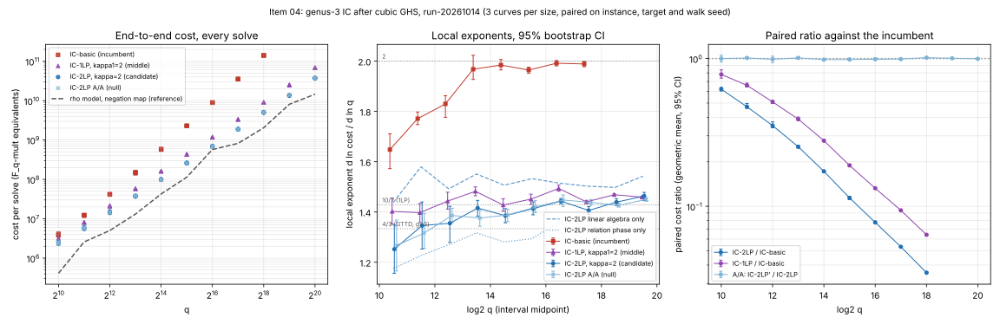

# Item 04: genus-3 double-large-prime IC after the cubic GHS transfer, to q = 2^20

2026-10-14. Round rules: [../RULES.md](../RULES.md). Protocol, frozen before data, with
amendment A1 (after tuning, before any test data): [PROTOCOL.md](PROTOCOL.md).
Prior work: [item 7 of ic_next10](../../ic_next10_20261014/07-cubic-ghs-genus3/README.md).
Tool: [`examples/ic_improve_04_genus3_2lp.rs`](../../../examples/ic_improve_04_genus3_2lp.rs)
(Rust port of `ghs3.py`). Analysis: [`examples/ic_improve_04_analyze.rs`](../../../examples/ic_improve_04_analyze.rs).
Figures: [plot.py](plot.py), which only plots `summary.json`.
Records: [results/run-20261014/](results/run-20261014/) (run `run-20261014`).

## Verdict

**IC-2LP ADVANCES over the incumbent IC-basic, at the exponent level and at the constant level.**

- Common range q = 2^10 to 2^18 (9 sizes, 3 curves per size, paired on instance, target and walk seed):
  - IC-2LP: **q^1.385** [1.379, 1.391].
  - IC-basic: **q^1.910** [1.904, 1.913].
  - Paired exponent difference: **-0.525 [-0.529, -0.521]**.
  - The paired cost ratio IC-2LP/IC-basic has its CI below 1 at every size. It falls from 0.620 [0.604, 0.638] at 2^10 to **0.036 [0.035, 0.036] at 2^18**.
- The middle arm, tuned single-large-prime IC (IC-1LP, kappa1 = 2), also advances over IC-basic:
  - q^1.446 [1.442, 1.449] over the common range, difference -0.463 [-0.470, -0.458].
  - IC-2LP is better than IC-1LP over 2^10 to 2^20:
    - exponent difference (1LP - 2LP) +0.052 [0.048, 0.057];
    - ratio 2LP/1LP 0.794 at 2^10 and 0.544 [0.537, 0.548] at 2^20.
- **The IC-2LP exponent does not settle at 4/3 in this range. It keeps rising, under the protocol's rule.**
  - Local exponents rise from 1.25 (2^10 to 2^11) to **1.46 [1.45, 1.48] (2^19 to 2^20)**.
  - Their trend is +0.018 per bit [0.011, 0.025], so the CI excludes 0.
  - The fit over 2^14 to 2^20 is 1.425 [1.422, 1.428], above 4/3.
- The cause is the linear algebra.
  - The linear algebra alone scales as **q^1.519** [1.512, 1.525], with a flat trend (+0.002 per bit [-0.009, 0.013]).
  - The relation phase alone scales as q^1.295 [1.291, 1.299].
  - The share of the linear algebra grows from 27% to 65%, so the total exponent drifts towards the exponent of the linear algebra.
  - The linear algebra exceeds `ncols^2 = q^{4/3}` because the row weight after large-prime elimination grows from 7.3 to 25.3 nonzeros per column (about q^0.18 over this range).
  - With this linear algebra (Lanczos on the normal equations, no merging or structured elimination) and a frozen factor-base fraction, the measured trend points at an exponent near 1.5, not 4/3.
  - Whether this is a log factor that a rebalanced factor base would absorb is not tested here.
- Item 7's comparison was made over 2^8 to 2^13. That comparison did not cover the same range for both arms: IC-2LP had sizes up to 2^15. This run puts both arms on 2^10 to 2^18, and the 1.30 and 1.65 of item 7 become 1.385 and 1.910. IC-basic's exponent in item 7 was low because its linear algebra had not yet dominated: its local exponents rise from 1.65 to 1.99, with theory at 2.
- Controls:
  - **A/A** (IC-2LP on an independent walk stream): the exponent difference is 0.0002 [-0.0034, 0.0041], which covers 0 (pass).
  - **Gate 0 (the port reproduces item 7):** 42 of 42 solves are identical, covering instance, `k`, steps, all five counters and cost ([xcheck.md](results/xcheck/xcheck.md)).
  - **Positive control:** item 7's separation of IC-2LP from IC-basic at 2^8 to 2^13 is reproduced bit for bit by gate 0.
- Correctness: every solve recovered the planted `k`, checked as `k phi(G) = phi(T)`.
  - IC-basic 27/27, IC-1LP 33/33, IC-2LP 33/33, A/A 33/33, rho 60/60.
  - All 33 instances pass the transfer checks: `phi(G) != 0`, `ell phi(G) = 0`, `N phi(G) = 0` and 3 of 3 homomorphism checks.
  - At q <= 2^11, PARI `hyperellcharpoly` equals `#E0(K)` on 6/6.
- Rho (reference only, not part of the verdict) uses a negation map and 64 random multipliers.
  - IC-2LP costs 1.2 to 2.9 times the rho model `sqrt(pi ell / 4)` at 2^16 to 2^20, and 2.58 times at 2^20.
  - Measured rho is cheaper than IC-2LP at 2^19 and 2^20 on these instances.
  - With IC-2LP's local exponent at 1.46 against rho's 1.5, no crossover is in sight against a negation-map rho.



*Left: cost of every solve in `F_q`-multiplication equivalents (3 curves per size), with the rho model (negation map) as a dashed reference. Middle: local exponents between consecutive sizes, 95% bootstrap CI over curves. IC-2LP's linear-algebra and relation-phase components are shown dashed and dotted. Right: paired cost ratios against IC-basic per size, with the A/A null. Run `run-20261014`.*

## Per-size results

Geometric means over curves. Costs are in `F_q`-multiplication equivalents, with `c_ell = 1`. CIs are 95% percentile bootstrap intervals over curves (2000 resamples).

| log2 q | IC-basic | IC-1LP | IC-2LP | A/A | 2LP/basic [95%] | 1LP/basic [95%] | 2LP/1LP [95%] | A/A ratio [95%] | 2LP LA share | 2LP row weight | rho measured (ref) | rho model, neg (ref) | correct (basic, 1LP, 2LP, A/A, rho) |
|---|---|---|---|---|---|---|---|---|---|---|---|---|---|
| 10 | 3.92e+06 | 3.06e+06 | 2.43e+06 | 2.43e+06 | 0.620 [0.604, 0.638] | 0.781 [0.738, 0.838] | 0.794 [0.762, 0.837] | 0.999 [0.948, 1.052] | 0.27 | 7.3 | 8.65e+05 | 4.11e+05 | 3/3, 3/3, 3/3, 3/3, 6/6 |
| 11 | 1.22e+07 | 8.05e+06 | 5.76e+06 | 5.82e+06 | 0.472 [0.460, 0.496] | 0.659 [0.642, 0.683] | 0.716 [0.674, 0.759] | 1.009 [1.000, 1.029] | 0.31 | 8.4 | 2.95e+06 | 2.58e+06 | 3/3, 3/3, 3/3, 3/3, 6/6 |
| 12 | 4.16e+07 | 2.12e+07 | 1.46e+07 | 1.45e+07 | 0.352 [0.340, 0.373] | 0.509 [0.498, 0.521] | 0.691 [0.675, 0.716] | 0.989 [0.941, 1.038] | 0.37 | 9.4 | 7.4e+06 | 5.03e+06 | 3/3, 3/3, 3/3, 3/3, 6/6 |
| 13 | 1.48e+08 | 5.76e+07 | 3.75e+07 | 3.79e+07 | 0.253 [0.248, 0.257] | 0.389 [0.381, 0.402] | 0.650 [0.640, 0.666] | 1.011 [0.997, 1.030] | 0.40 | 10.3 | 1.99e+07 | 1.31e+07 | 3/3, 3/3, 3/3, 3/3, 6/6 |
| 14 | 5.79e+08 | 1.61e+08 | 9.99e+07 | 9.82e+07 | 0.173 [0.169, 0.174] | 0.278 [0.274, 0.282] | 0.621 [0.609, 0.636] | 0.983 [0.975, 0.989] | 0.44 | 12.1 | 8.32e+07 | 4.25e+07 | 3/3, 3/3, 3/3, 3/3, 6/6 |
| 15 | 2.28e+09 | 4.32e+08 | 2.6e+08 | 2.57e+08 | 0.114 [0.111, 0.117] | 0.189 [0.186, 0.193] | 0.603 [0.597, 0.606] | 0.985 [0.973, 1.006] | 0.48 | 13.4 | 1.71e+08 | 1.14e+08 | 3/3, 3/3, 3/3, 3/3, 6/6 |
| 16 | 8.91e+09 | 1.18e+09 | 6.93e+08 | 6.86e+08 | 0.078 [0.077, 0.078] | 0.132 [0.132, 0.133] | 0.587 [0.585, 0.590] | 0.989 [0.977, 1.014] | 0.52 | 15.2 | 7.14e+08 | 5.73e+08 | 3/3, 3/3, 3/3, 3/3, 6/6 |
| 17 | 3.55e+10 | 3.33e+09 | 1.89e+09 | 1.87e+09 | 0.053 [0.053, 0.053] | 0.094 [0.093, 0.094] | 0.567 [0.561, 0.571] | 0.992 [0.979, 0.999] | 0.55 | 17.0 | 1.18e+09 | 8.21e+08 | 3/3, 3/3, 3/3, 3/3, 6/6 |
| 18 | 1.41e+11 | 9.02e+09 | 5e+09 | 5.07e+09 | 0.036 [0.035, 0.036] | 0.064 [0.063, 0.065] | 0.554 [0.547, 0.557] | 1.015 [1.001, 1.030] | 0.59 | 19.2 | 4.56e+09 | 2.05e+09 | 3/3, 3/3, 3/3, 3/3, 6/6 |
| 19 | - | 2.5e+10 | 1.36e+10 | 1.36e+10 | - | - | 0.542 [0.539, 0.545] | 1.005 [1.001, 1.011] | 0.61 | 21.6 | 1.55e+10 | 8.09e+09 | -, 3/3, 3/3, 3/3, 3/3 |
| 20 | - | 6.87e+10 | 3.74e+10 | 3.72e+10 | - | - | 0.544 [0.537, 0.548] | 0.996 [0.992, 1.002] | 0.65 | 25.3 | 2.01e+10 | 1.46e+10 | -, 3/3, 3/3, 3/3, 3/3 |

Column notes:
- "Row weight" means nonzeros per column of the matrix that IC-2LP's Lanczos solved.
- "Rho measured" is the mean over targets: 2 per curve up to 2^18, 1 per curve at 2^19 and 2^20.
- "Rho model" is the measured cost per step times `sqrt(pi ell / 4)`.
- Measured rho steps are 0.86 to 1.89 times `sqrt(ell)` (mean per size); the ideal is 0.886.

## Exponents

Least squares of `ln cost` on `ln q`. Every solve is a point. The CI is a paired bootstrap over curves within each size.

| arm | common range 2^10 to 2^18 | difference vs IC-basic | 2^10 to 2^20 | 2^14 to 2^20 | `c_ell = 9`, 2^10 to 2^18 |
|---|---|---|---|---|---|
| IC-basic (incumbent) | 1.910 [1.904, 1.913] | - | - | 1.982 [1.977, 1.986] (2^14 to 2^18) | 1.975 [1.968, 1.980] |
| IC-1LP, kappa1 = 2 | 1.446 [1.442, 1.449] | -0.463 [-0.470, -0.458] | 1.451 [1.448, 1.453] | 1.459 [1.457, 1.462] | - |
| **IC-2LP, kappa = 2** | **1.385 [1.379, 1.391]** | **-0.525 [-0.529, -0.521]** | 1.398 [1.394, 1.402] | **1.425 [1.422, 1.428]** | 1.488 [1.481, 1.497] (difference -0.486 [-0.495, -0.478]) |
| A/A (IC-2LP, other walk stream) | 1.384 [1.379, 1.391] | -0.525 [-0.529, -0.521] | 1.398 [1.394, 1.403] (difference vs IC-2LP +0.0002 [-0.0034, 0.0041]) | 1.431 [1.428, 1.433] | - |
| IC-2LP linear algebra only | - | - | 1.519 [1.512, 1.525] | 1.514 | - |
| IC-2LP relation phase only | - | - | 1.295 [1.291, 1.299] | 1.318 | - |

## Local exponents

The local exponent of an interval is `d ln cost / d ln q` between consecutive sizes, from geometric means, with a bootstrap CI.

| interval | IC-basic | IC-1LP | IC-2LP | A/A | IC-2LP LA only | IC-2LP relation phase only |
|---|---|---|---|---|---|---|
| 10-11 | 1.648 [1.572, 1.711] | 1.402 [1.352, 1.455] | 1.252 [1.156, 1.348] | 1.267 [1.165, 1.368] | 1.438 [1.302, 1.575] | 1.175 [1.090, 1.257] |
| 11-12 | 1.771 [1.748, 1.798] | 1.397 [1.358, 1.434] | 1.346 [1.253, 1.439] | 1.317 [1.255, 1.394] | 1.580 [1.426, 1.733] | 1.227 [1.155, 1.299] |
| 12-13 | 1.830 [1.777, 1.863] | 1.443 [1.412, 1.479] | 1.355 [1.279, 1.422] | 1.386 [1.358, 1.415] | 1.492 [1.368, 1.604] | 1.270 [1.212, 1.317] |
| 13-14 | 1.968 [1.927, 2.023] | 1.482 [1.465, 1.500] | 1.416 [1.383, 1.446] | 1.376 [1.344, 1.408] | 1.551 [1.499, 1.607] | 1.317 [1.291, 1.343] |
| 14-15 | 1.984 [1.965, 2.006] | 1.428 [1.403, 1.452] | 1.385 [1.357, 1.413] | 1.388 [1.362, 1.411] | 1.507 [1.443, 1.568] | 1.281 [1.266, 1.299] |
| 15-16 | 1.965 [1.952, 1.976] | 1.451 [1.430, 1.471] | 1.413 [1.389, 1.440] | 1.419 [1.398, 1.446] | 1.533 [1.472, 1.597] | 1.294 [1.288, 1.301] |
| 16-17 | 1.992 [1.981, 2.003] | 1.494 [1.483, 1.507] | 1.443 [1.433, 1.454] | 1.448 [1.422, 1.468] | 1.514 [1.501, 1.528] | 1.361 [1.352, 1.370] |
| 17-18 | 1.989 [1.978, 2.000] | 1.440 [1.434, 1.446] | 1.406 [1.391, 1.421] | 1.438 [1.427, 1.450] | 1.503 [1.482, 1.523] | 1.279 [1.269, 1.290] |
| 18-19 | - | 1.469 [1.465, 1.473] | 1.439 [1.426, 1.453] | 1.426 [1.420, 1.435] | 1.498 [1.477, 1.520] | 1.351 [1.344, 1.358] |
| 19-20 | - | 1.459 [1.457, 1.461] | 1.464 [1.446, 1.478] | 1.451 [1.443, 1.456] | 1.543 [1.516, 1.566] | 1.330 [1.327, 1.334] |

Trend of the local exponents (OLS slope per bit, bootstrap CI):

| arm | slope per bit | 95% CI |
|---|---|---|
| IC-basic | +0.047 | [0.041, 0.053] |
| IC-1LP | +0.006 | [0.003, 0.010] |
| IC-2LP | +0.018 | [0.011, 0.025] |
| A/A | +0.018 | [0.011, 0.024] |
| IC-2LP linear algebra only | +0.002 | [-0.009, 0.013] |
| IC-2LP relation phase only | +0.015 | [0.009, 0.021] |

## What was built

- **Port.** Everything in `ghs3.py`, operation for operation and counter for counter:
  - the instance generator and the transfer, computed over `K`;
  - Cantor arithmetic over `F_q` and over `K`;
  - the smoothness test;
  - Cantor-Zassenhaus root finding;
  - the large-prime graph, with spanning-tree elimination and DFS propagation in the same order;
  - singleton filtering;
  - Lanczos on the normal equations mod `ell`.

  CPython's MT19937, `randrange` and `sample` are reproduced bit for bit, so one seed gives the same instance and walk in both languages. The Rust port is about 250 times faster in wall time (IC-2LP at 2^15: 2.5 s, against 622 s in Python).
- **Not reused:** `src/prime_hyperelliptic` and `hyperelliptic_index_calculus`. They use BigUint with checked, uncounted arithmetic and cannot reproduce item 7's counted unit.
- **Lanczos internals:** Montgomery products and a single reduction per row or column. The counted `M_ell` are unchanged; gate 0 was re-run after this change and after the rho change.
- **IC-1LP:** the same code. Two-large-prime relations are dropped, and the factor base has `ceil(kappa1 q^{5/7})` primes (Theriault's g = 3 balance, `q^{10/7}`).
- **Rho (reference):**
  - same `K` arithmetic and counters;
  - 64 random multipliers;
  - canonical `+-y` (negation map);
  - distinguished points;
  - fruitless cycles of length <= 64 detected with a saved point every 64 steps, and escaped by doubling the smallest point of the cycle.

## Deviations and limits

- **IC-basic stops at 2^18.** Each 2^18 job took 40 min of wall time (about 20 min CPU) on the shared machine (load 6 on 4 cores). Its linear algebra scales as q^1.99, so a 2^19 job would take about 4 times as long and exceed the 60-minute cap. This is where the machine is the limit. The common range is therefore 2^10 to 2^18. IC-2LP, IC-1LP, A/A and rho run to 2^20.
- **IC-2LP-tuned is not run separately.** Tuning chose kappa2 = 2, item 7's value, so that arm is identical to IC-2LP (amendment A1).
  - The grid {0.5, 1, 2, 4} was tuned at 2^14. Because the share of linear algebra rises with `q`, a smaller kappa is probably better at 2^18 to 2^20.
  - Re-tuning per size is not done. This is the main open question for "4/3 or not".
- **The A/A per-size ratio CIs exclude 1 at 3 of 11 sizes**, by at most 1.7%: 0.983 at 2^14, 1.015 at 2^18 and 1.005 at 2^19.
  - The protocol asked for coverage.
  - A percentile bootstrap over 3 curves has only 10 distinct resamples and undercovers.
  - Read per-size constant-level CIs with a noise floor of about +-2%. Every candidate effect here (ratios 0.04 to 0.79) is far outside that floor.
  - The exponent-level A/A passes.
- **The cross-arm fairness of the linear algebra is unchanged from item 7.** Both IC arms use the same unstructured Lanczos. Structured Gaussian elimination would help IC-basic's very sparse matrix more than IC-2LP's heavier one, so the constant-level gap is specific to this linear algebra. The exponent gap of 0.5 (q^2 against at most q^1.52 for the linear algebra) is not.
- `M_ell` counts as one `F_q` multiplication. `ell` has at most 58 bits, which is one word. The sensitivity run with `c_ell = 9` is in the exponent table.
- Wall times are from a shared, loaded host and are not part of any claim. Each job is recorded with its wall time.

## Reproduce

```bash
cargo build --release --example ic_improve_04_genus3_2lp --example ic_improve_04_analyze
cd research/ic_improve_20261014/04-genus3-2lp
B=../../../target/release/examples
# gate 0: the port against item 7's records (python mode)
for b in 8 9 10 11 12 13 14 15; do for c in 0 1 2; do A=ic2lp; [ $b -le 13 ] && A=ic2lp,basic
  $B/ic_improve_04_genus3_2lp --bits $b --curve $c --mode python --arms $A --out results/xcheck/ic_b${b}_c${c}.jsonl; done; done
$B/ic_improve_04_analyze xcheck ../../ic_next10_20261014/07-cubic-ghs-genus3/results/run-20261014 results/xcheck
# tuning (training curves 5-7), then the recorded run
PAR=2 sh run_tune.sh results/tune && $B/ic_improve_04_analyze tune results/tune
PAR=3 sh run_all.sh results/run-20261014
$B/ic_improve_04_analyze analyze results/run-20261014 10 18 14 results/run-20261014/summary.json
python3 -I plot.py results/run-20261014
```

Hashes, toolchain and host: [results/run-20261014/env.txt](results/run-20261014/env.txt).
