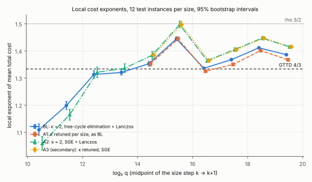
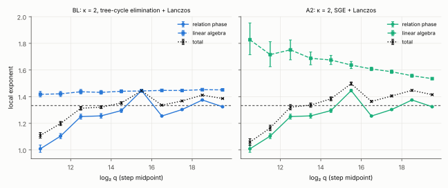
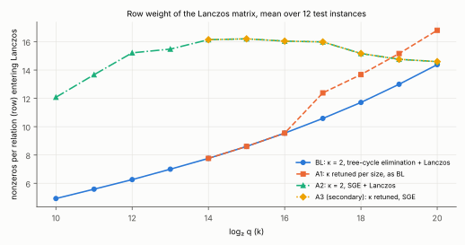
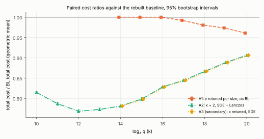
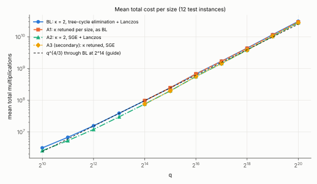
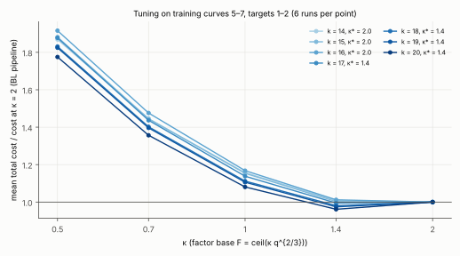

# 04b: is genus-3 IC-2LP's departure from q^{4/3} an artifact of the factor base or the linear algebra?

2026-10-15. Conductor T-1. Results report. Measured counts only; no security claim.

| | |
|---|---|
| Protocol, frozen before data | [PROTOCOL.md](PROTOCOL.md), commit `9752513ea`, sha256 `633e69bb…` |
| κ choice, frozen before test runs | [tuning/kappa_choice.json](tuning/kappa_choice.json), commit `288e74293` |
| Recorded run | `run-20261015T0200Z`: [environment](results/env-run-20261015T0200Z.txt), [run report](reports/run-20261015T0200Z/run-report.pdf) |
| Analysis output | [analysis.json](analysis.json), [tables.md](tables.md) |
| PDF of this report | [REPORT.pdf](REPORT.pdf) |
| Tool | [`examples/ic_improve_04b_genus3_2lp.rs`](../../../examples/ic_improve_04b_genus3_2lp.rs) |
| Analysis | [`examples/ic_improve_04b_analyze.rs`](../../../examples/ic_improve_04b_analyze.rs) |
| Figures | [`figures/plots.py`](figures/plots.py), which only draws `analysis.json` |

> **This study pairs against a rebuilt baseline, not the original.** The study
> it follows up (`04-genus3-2lp`, its protocol, `RULES.md`, and the two
> `ic_improve_04_*` examples) is not in this repository
> ([problem record](../../../problems/ic-improve-04-genus3-2lp-study-missing.md)).
> At the requester's choice, the IC-2LP baseline was rebuilt here.
>
> Every arm shares instances, seeds and counted unit **with the rebuilt
> baseline**. Nothing here is paired with the original's records. The
> request's figures are compared with the rebuild only qualitatively (§5).

## Answer

**On this rebuild, the departure from 4/3 is not an artifact of either choice.**

**The baseline departs from 4/3.** Its cost fits q^1.383 over 2^14–2^20 (99%
interval [1.382, 1.384]). The local exponents trend upward at +0.003 per
log₂ q (99% [0.002, 0.004]).

**Only the linear algebra causes it.**

- The relation phase fits q^1.332. That is 4/3, as GTTD predict.
- The linear algebra fits q^1.447.
- The row weight of the Lanczos matrix grows from 7.8 at 2^14 to 14.4 at 2^20.

**Retuning the factor base (A1) reduces the exponent but does not remove the
departure.**

- The frozen rule's verdict is "reduces the exponent".
- E = 1.373, 99% interval [1.372, 1.374]. That is 0.010 below the baseline,
  and still 0.039 above 4/3.
- Tuning moved κ from 2 to 1.4 at 2^17–2^20. The paired saving grows from
  0.8% at 2^17 to 3.9% at 2^20.

**Structured Gaussian elimination before Lanczos (A2) is cheaper at every size
but raises the exponent.**

- The frozen rule's verdict is "raises the exponent".
- E = 1.419, 99% interval [1.417, 1.421].
- A2 caps row weight at about 15–16. But the baseline's own weight reaches
  14.4 by 2^20, so the saving shrinks: from 22% at 2^14 to 9% at 2^20.

## 1. Unit, instances, arms

**Unit.** Multiplications in F_q plus multiplications mod ℓ, over the whole
method:
- the relation phase: setup, walk and decomposition;
- the linear algebra: elimination and Lanczos;
- the final verification.

S = total / √ℓ. Additions are not counted.

**Instances.**
- Hyperelliptic GHS cubic covers of type m = 3, r = 5, as in T-2463. Each is
  y² = f(x) of degree 7 over F_q, with q the largest prime below 2^k, k = 10–20.
- #Jac(C)(F_q) = hℓ with h ∈ {4, 8}.
- 7 curves per size, seed 20261016. Test curves are 1–4, with targets 1–3:
  12 instances per size. Training curves are 5–7.

**Arms.**
- **BL:** κ = 2, F = ceil(2 q^{2/3}). Elimination over a BFS spanning tree
  from vertex 0, then Lanczos on the normal equations.
- **A1:** κ tuned per size from {0.5, 0.7, 1, 1.4, 2} on the training curves,
  with BL's linear algebra.
- **A2:** κ = 2 and BL's own relation records. Then singleton removal, excess
  pruning, and Markowitz merges while the Lanczos cost estimate falls, then
  Lanczos.
- **A3** (secondary): κ tuned on A2's pipeline. The tuning chose κ = 2 at
  every size, so A3 is A2.
- **Rho** on Jac(C), at k = 10–14.

**Verification.** Every one of the 360 logarithms (180 solves × 2
linear-algebra routes) was checked by [log]P = Q and equals the planted value.

## 2. Results

### Mean total cost and S

12 test instances per size. Full tables with intervals are in [tables.md](tables.md).

| k | BL total | A1 (κ*) | A2 total | S_BL | S_A1 | S_A2 | S_rho, measured (n = 4) | BL/rho raw, renormalised |
|---|---|---|---|---|---|---|---|---|
| 10 | 3.142e6 | — | 2.559e6 | 192.6 | — | 156.9 | 550.0 | 0.35, 0.58 |
| 11 | 6.765e6 | — | 5.323e6 | 207.8 | — | 163.5 | 739.1 | 0.28, 0.63 |
| 12 | 1.560e7 | — | 1.199e7 | 119.1 | — | 91.5 | 439.7 | 0.27, 0.35 |
| 13 | 3.878e7 | — | 2.997e7 | 148.0 | — | 114.3 | 582.6 | 0.25, 0.42 |
| 14 | 9.686e7 | 9.686e7 (2) | 7.566e7 | 92.4 | 92.4 | 72.2 | 571.4 | 0.16, 0.25 |
| 15 | 2.472e8 | 2.472e8 (2) | 1.974e8 | 83.4 | 83.4 | 66.6 | — | — |
| 16 | 6.731e8 | 6.731e8 (2) | 5.575e8 | 80.3 | 80.3 | 66.5 | — | — |
| 17 | 1.700e9 | 1.687e9 (1.4) | 1.436e9 | 101.3 | 100.5 | 85.6 | — | — |
| 18 | 4.387e9 | 4.301e9 (1.4) | 3.801e9 | 92.4 | 90.6 | 80.1 | — | — |
| 19 | 1.167e10 | 1.136e10 (1.4) | 1.036e10 | 86.9 | 84.6 | 77.2 | — | — |
| 20 | 3.049e10 | 2.930e10 (1.4) | 2.763e10 | 56.8 | 54.6 | 51.5 | — | — |

Notes:
- **S is not smooth in k.** ℓ = N/h varies from curve to curve and h ∈ {4, 8},
  so √ℓ moves.
- **Rho is a single r-adding walk with Brent cycle detection** per instance.
  - It took 0.30–4.0 steps per √ℓ. The means are 1.6–2.8, against an ideal of 1.25.
  - "Renormalised" rescales rho's measured mean to the ideal √(π/2), following
    the scoreboard's genus panel.
  - Rho runs on Jac(C) in the same unit. It is not rho on E0(F_{q³}).

### Fit over 2^14–2^20 and trend

Point estimate, then the 95% interval, then the 99% interval:

| arm | phase | E | E − 4/3 | E − E_BL | trend of local exponents per log₂ q |
|---|---|---|---|---|---|
| BL | total | **1.383** [1.382, 1.384] [1.382, 1.384] | **+0.049** | — | +0.003 [0.002, 0.004] [0.002, 0.004] |
| BL | relation | 1.332 [1.331, 1.334] | −0.001 | — | −0.001 [−0.002, 0.001] |
| BL | linear algebra | 1.447 [1.445, 1.448] | +0.113 | — | +0.002 [0.001, 0.004] |
| A1 | total | **1.373** [1.372, 1.374] [1.372, 1.374] | +0.039 | **−0.010** [−0.010, −0.010] | −0.001 [−0.002, 0.000] [−0.002, 0.000] |
| A2 | total | **1.419** [1.418, 1.420] [1.417, 1.421] | +0.086 | **+0.036** [+0.036, +0.037] [+0.035, +0.037] | +0.001 [−0.000, 0.003] [−0.001, 0.003] |
| A2 | linear algebra | 1.599 [1.596, 1.602] | +0.266 | +0.152 | −0.027 [−0.031, −0.024] |

### Local exponents of total cost

Point estimate; intervals are in [tables.md](tables.md).

| step | 10→11 | 11→12 | 12→13 | 13→14 | 14→15 | 15→16 | 16→17 | 17→18 | 18→19 | 19→20 |
|---|---|---|---|---|---|---|---|---|---|---|
| BL | 1.109 | 1.199 | 1.313 | 1.321 | 1.353 | 1.444 | 1.336 | 1.368 | 1.411 | 1.386 |
| A1 | — | — | — | — | 1.353 | 1.444 | 1.325 | 1.350 | 1.401 | 1.367 |
| A2 | 1.059 | 1.165 | 1.321 | 1.336 | 1.384 | 1.497 | 1.364 | 1.405 | 1.447 | 1.415 |

### Paired cost ratios against BL

Geometric mean over the 12 instances, with the 99% interval:

| k | 14 | 15 | 16 | 17 | 18 | 19 | 20 |
|---|---|---|---|---|---|---|---|
| A1/BL | 1 (same run) | 1 | 1 | 0.992 [0.990, 0.994] | 0.980 [0.978, 0.982] | 0.974 [0.972, 0.975] | **0.961** [0.959, 0.963] |
| A2/BL | 0.781 [0.779, 0.784] | 0.798 | 0.828 | 0.844 | 0.867 | 0.888 | **0.906** [0.905, 0.907] |
| A2/BL, linear algebra only | 0.429 | 0.505 | 0.578 | 0.646 | 0.712 | 0.766 | 0.812 |

A2/BL also falls below 1 at k = 10–13: 0.815, 0.787, 0.768, 0.773.













### Matrix entering Lanczos

Mean over instances:

| k | 10 | 12 | 14 | 16 | 17 | 18 | 19 | 20 |
|---|---|---|---|---|---|---|---|---|
| BL rows | 213 | 522 | 1301 | 3261 | 5171 | 8202 | 13014 | 20653 |
| BL nnz/row | 4.92 | 6.26 | 7.76 | 9.55 | 10.58 | 11.71 | 13.00 | 14.38 |
| A2 rows | 71 | 206 | 645 | 2021 | 3528 | 6241 | 10816 | 18491 |
| A2 nnz/row | 12.08 | 15.21 | 16.14 | 16.04 | 15.99 | 15.17 | 14.76 | 14.60 |
| A1 nnz/row (κ = 1.4 from 17) | — | — | 7.76 | 9.55 | 12.39 | 13.68 | 15.16 | 16.81 |

## 3. Decision under the frozen rule (PROTOCOL §7)

| test | outcome |
|---|---|
| D0: the baseline departs | **yes**: the 99% interval of E_BL, [1.382, 1.384], lies above 4/3, and the 99% interval of T_BL, [0.0016, 0.0042], lies above 0 |
| A1 | **reduces the exponent**: E − E_BL has 99% interval [−0.010, −0.010]; E's interval [1.372, 1.374] excludes 4/3, so the departure is not removed |
| A2 | **raises the exponent**: E − E_BL has 99% interval [+0.035, +0.037] |
| A3 (secondary) | the same run as A2 (κ** = 2 at every size) |
| Answer | the departure is **not** an artifact of either choice |
| Power | the half-width of the 95% interval of E_BL is 0.0009, well below the 0.03 required |

**Controls.**

- **Pairing.** A2's relation phase is BL's own record on all 132 instances.
- **A/A.** E_BL fitted on target 1 alone minus E_BL on targets 2–3 is
  +0.002, with 95% interval [0.001, 0.004]. That excludes 0 by a margin 25
  times smaller than the departure (+0.049).
  - Interpretation: the bootstrap intervals understate between-target
    variation at about the 0.002 level, because there are only 4 curves per
    size. This does not affect any verdict, since every verdict's margin is at
    least 0.010.
- **Accounting.** On all 360 linear-algebra runs, `lanczos_mults` equals its
  closed form exactly.
- **Mechanism.** The baseline's row weight grows at every size; A2's stays
  between 14.6 and 16.2 from 2^14 on.

**Integrity.**

- 180 test solves, 210 tuning solves and 20 rho runs; no failed logarithm and
  no job failure.
- Peak memory 119 MB. The longest job took 490 s, against the 3 GB and 3600 s limits.
- One operator error is recorded in
  [results/orchestration_errors.jsonl](results/orchestration_errors.jsonl): an
  empty job list was launched once. It is not a test job.

## 4. Interpretation

Labelled as interpretation, not measurement.

**Why the linear algebra departs.**

- Lanczos costs about F · (2·nnz + 7·rows). That is about F²·(2w + 7) for a
  matrix of F rows with row weight w.
- With F ∝ q^{2/3} and w ∝ q^δ, the linear algebra grows like q^{4/3+δ}.
- The measured weight gives δ = ln(14.38/7.76)/ln 64 ≈ 0.15 over 2^14–2^20.
  The measured linear-algebra exponent is 1.447. The constant 7-per-row term
  dilutes the effect of the growing weight.
- The weight grows because each tree-cycle relation is a cycle in the
  large-prime graph closed through the BFS tree, and the tree gets deeper as
  the graph grows.

**Why retuning helps only a little.**

- Take the 2LP relation cost as ∝ q²/F (heuristic) and the linear algebra as
  ∝ F²·w(q). Balancing them gives F ∝ q^{2/3} w^{−1/3} and a total of
  q^{4/3} w^{1/3}.
- So even continuous retuning would leave an exponent of about 4/3 + δ/3 ≈ 1.38.
- The measured A1 is 1.373. The grid moves κ in one step, at 2^17, so A1 is
  close to what retuning can do under this model.
- This model is not tested beyond the grid.

**Why A2 raises the exponent.**

- A2 removes most of the structure at small q: half the rows at 2^14. At
  2^20 it removes only 10%.
- Its Markowitz merges stop when the Lanczos estimate stops falling. That
  happens at about the weight the baseline matrix already reaches by 2^20.
- So A2 is a constant-factor saving that shrinks with q. Extrapolating the
  ratio trend (+0.02 per size) puts it at parity a few sizes past 2^20; this
  extrapolation was not measured.
- The tested design is one SGE variant. More aggressive merging with a
  block-Lanczos or Wiedemann solver, or an elimination order that bounds cycle
  length, was not tested.

**The bump at 15→16.**

- The relation phase's decomposition cost per trial jumps from 300 to 378
  multiplications between 2^15 and 2^16. Walk cost per trial stays flat.
- Unverified explanation: Tonelli–Shanks in the quadratic root step costs more
  at q₁₆ = 65521, where q − 1 = 2⁴·4095, than at its neighbours, whose
  2-adic part is 2² or 2¹.
- It is a constant step in the counted unit, not a trend.

**Classification (AGENTS.md §3).**

- **A1:** engineering. S fell 0.8–3.9% from 2^17, and the exponent fell 0.010
  but stays above 4/3.
- **A2:** engineering. S fell 9–22%, and the exponent rose.
- Neither is an advance. The reference rho is measured only up to 2^14.

## 5. Against the request's description of the original

This comparison is qualitative and not paired.

| quantity | original, as stated in the request | rebuild |
|---|---|---|
| local exponents, 2^10 → 2^20 | 1.25 → 1.46 | 1.11 → 1.39, peak 1.44 at 15→16 |
| linear algebra | q^1.52 | q^1.447 (fit 14–20) |
| relation phase | q^1.30 | q^1.332 |
| row weight | 7 → 25 | 4.9 → 14.4 (2^10 → 2^20) |
| factor base | ceil(2 q^{2/3}), tuned at 2^14 | the same; tuning here also picks κ = 2 at 2^14 |

The direction is the same: the excess comes from the linear algebra's row
weight, and the relation phase sits near 4/3. The magnitudes differ. Whether
04b's verdicts carry over to the original is open; see the problem record.

## 6. Limits

- **Õ hides log factors.** The decomposition test costs about log q per trial,
  so even the relation phase carries a log. Its fit of 1.332 already includes it.
- **Grid edges.** The tuning grid is the request's. The optimum is at the edge
  κ = 2 for the A2 pipeline at every size, and for BL at 2^14–2^16. Larger κ
  was not tested.
- **The transfer is not executed per target.** T-2463 verified that
  Jac(C)[ℓ] = φ(E0(F_{q³})[ℓ]), so instances drawn in Jac(C)[ℓ] are
  transferred instances. Curve construction and the group order are not counted.
- **Rho.** It is measured only at k ≤ 14, with 4 single walks per size, and on
  Jac(C) rather than E0.
- **Host.** One shared 4-vCPU container with no isolation. Wall time is a
  practicality note only.
- **Lean.** There is no new theorem; this study is measurement only, so there
  is no Lean obligation.

## 7. Reproduce

```sh
cargo build --release --example ic_improve_04b_genus3_2lp --example ic_improve_04b_analyze
B=target/release/examples/ic_improve_04b_genus3_2lp
cd research/ic_improve_20261014/04b-genus3-2lp-rebalance
BIN=../../../$B ./run_jobs.sh jobs/curves.txt results/curves   # then jobs/tuning.txt, jobs/test_all.txt, jobs/rho.txt
../../../target/release/examples/ic_improve_04b_analyze tune --dir results/tuning --out tuning/kappa_choice.json
../../../target/release/examples/ic_improve_04b_analyze report --dir results/test --rho results/rho --choice tuning/kappa_choice.json --out analysis.json --md tables.md
python figures/plots.py analysis.json tuning/kappa_choice.json figures   # needs matplotlib
```

Every record is deterministic given the seed: the counts reproduce exactly,
and wall times do not.

**The source changed after the run; the counts did not.** The recorded runs
used the tool as committed at `9752513ea` (sha256 `595e3efa…`; see
`results/env-run-20261015T0200Z.txt`). Afterwards both examples were passed
through `rustfmt` and given six behaviour-preserving clippy fixes, for CI's
lint job:

- a slice parameter;
- `is_multiple_of`;
- `div_ceil(2)` for `(x + 1)/2`;
- a method rename;
- one collapsed `if`.

To show nothing moved, these were re-run with the formatted source and match
their records exactly, apart from wall time and memory:

- curve generation at k = 12;
- six solves: `te_k10_kap2_c1_t1`, `te_k14_kap2_c3_t2`, `te_k17_kap1.4_c2_t1`,
  `te_k18_kap2_c4_t3`, `tu_k16_kap0.5_c5_t1` and `tu_k19_kap0.7_c6_t2`;
- `rho_k11_c2_t1`.

`analysis.json`, `tables.md` and `tuning/kappa_choice.json` regenerate byte
for byte.
