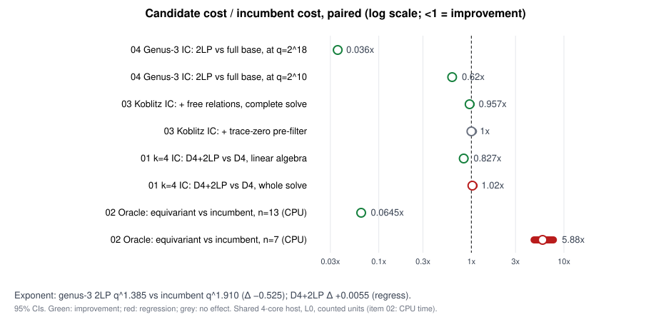

# IC improvement round: results (2026-10-14)

This round ran four follow-ups to [`../ic_next10_20261014/README.md`](../ic_next10_20261014/README.md), under [`RULES.md`](RULES.md):

- Each candidate is measured against the incumbent IC component it replaces.
- Every comparison is paired: same curves, targets and seeds, and the same counted unit on both arms.
- Every logarithm is verified.
- Rho is a reference column only; no verdict depends on it.

| # | Candidate vs incumbent | Verdict | Level | Key numbers |
|---|---|---|---|---|
| [04](04-genus3-2lp/README.md) | Genus-3 IC after cubic GHS: double large primes vs full factor base | **ADVANCES** | exponent and constant | <ul><li>q^1.385 [1.379, 1.391] vs q^1.910 [1.904, 1.913] on a common range 2^10–2^18: Δ −0.525.</li><li>Paired ratio 0.620 at 2^10, falling to 0.036 at 2^18.</li><li>A tuned single-large-prime arm sits between them at q^1.446.</li><li>Rust port, 2^10–2^20, 3 curves per size. It reproduces the Python tool on 42/42 solves.</li></ul> |
| [03](03-tracezero-freerel/README.md) | Compact-orbit Koblitz IC plus free relations harvested from the root table | **ADVANCES** | constant | <ul><li>Complete solve 0.957× [0.944, 0.970] counted, 0.948× wall.</li><li>Rank stage 0.36× at n=41 and 0.94× at n=53 and n=61.</li><li>44 paired replicates, A/A exact.</li></ul> |
| [03](03-tracezero-freerel/README.md) | Same pipeline plus the trace-zero pre-filter | MATCHES / REGRESSES | primitive | <ul><li>1.00003×.</li><li>Odd-order IC targets lie in 2E, so the filter never fires: 0 rejections in 29,624 checks.</li><li>Item 08's 50% came from drawing targets from all curve abscissae.</li></ul> |
| [01](01-d4-2lp/README.md) | k=4 IC on E(F_{p⁴}): D₄ plus double large primes (tuned, frozen) vs D₄ | **TRADES**: whole cost REGRESSES | constant and exponent | <ul><li>Whole 1.025× [1.016, 1.037], Δ exponent +0.0055.</li><li>Linear algebra 0.827× [0.802, 0.853] (ADVANCES), but it is a negligible share of D₄'s cost.</li><li>Untuned Gaudry-α 2.36×.</li><li>24 held-out curves, p = 101–1301; ecbench 1.011×.</li></ul> |
| [02](02-equivariant-oracle/README.md) | Koblitz decomposition oracle: G2 equivariant pass vs `solve_boolean_system` (InheritedF4 deg 3) | **TRADES** | constant | <ul><li>0.25× and 0.17× at n=5 and 7; 5.1× and 15.5× at n=11 and 13. 0/48 gate failures.</li><li>Most of the gain comes from appending degree-fall rows, not from equivariance: equivariance itself adds 1.25–1.34×.</li><li>The step-level gate fails (one linear consequence short).</li><li>Not applicable to production pipeline systems, where fall-row augmentation regresses 0.29–0.59×.</li></ul> |

## Corrections to the earlier campaign

1. **Item 7's exponent comparison was not like for like.** Its "1.30 vs 1.65" compared arms over different size ranges. On a common range, the gain is larger: 1.385 vs 1.910, Δ −0.525. The candidate's exponent keeps rising: its local exponent reaches 1.46 at 2^20. The cause is the linear algebra, which scales as q^1.52 because row weight grows after large-prime elimination. So the exponent does not settle at the theoretical 4/3 with this linear algebra and κ = 2.
2. **Item 6's 44–73× equivariant speedup was measured against a naive elimination kernel.** Against the crate's `gf2_elim` it is 2–3× at n = 11–13.
3. **Item 8's trace-zero "50% refutation" does not apply to IC targets,** which have odd order.

## Where to push next (improvement targets)

- **Genus-3 linear algebra.** It is now the bottleneck: 65% of cost at 2^20, scaling as q^1.52. Two options:
  - a structured-Gaussian-elimination prefilter, or block Wiedemann on the sparse matrix, instead of Lanczos on the normal equations;
  - re-tuning κ at large q.

  Either should pull the exponent toward 4/3.
- **Free relations in the Koblitz pipeline.** Pick K so the harvested rank is a large fraction, as at n = 41 (63%), and land the change behind a flag in the production example.
- **Fall-row augmentation (item 02, arm F).** It gave 11.6× on barrel systems but regresses on pipeline systems. A cheap per-system predictor of when it helps would be needed before it is worth wiring in.

## Caveats

- **Host:** shared, 4 cores, load average up to about 25, isolation level L0. Operation counts are the measured unit.
- **Small samples:** 3 curves per size in item 04. Its A/A check shows a ±2% noise floor on per-size ratio intervals.
- **Python:** used for figures only.
- **Conductor:** the control plane was unreachable.
