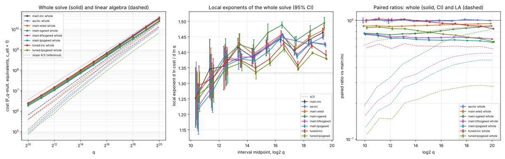

# Round 2, item 01: the linear algebra of genus-3 IC-2LP after the cubic GHS transfer

2026-10-15. Round rules: [../RULES.md](../RULES.md). Protocol, frozen before data, with amendments
A1-A5: [PROTOCOL.md](PROTOCOL.md). Prior work: [item 04](../../ic_improve_20261014/04-genus3-2lp/README.md).
Tool: [`examples/ic_improve2_01_genus3_linalg.rs`](../../../examples/ic_improve2_01_genus3_linalg.rs)
(a copy of `examples/ic_improve_04_genus3_2lp.rs`; `src/` is not touched). Analysis:
[`examples/ic_improve2_01_analyze.rs`](../../../examples/ic_improve2_01_analyze.rs). Figure:
[plot.py](plot.py), which only plots `summary.json`. Records: [results/run/](results/run/);
full tables: [results/run/analysis.md](results/run/analysis.md).

## Verdict

The incumbent is item 04's IC-2LP: kappa = 2, large primes removed by DFS spanning-tree substitution,
then Lanczos on the normal equations (`main:inc`). The candidate frozen by tuning is **`lpsgewd`**:
the large primes are kept as matrix columns, structured Gaussian elimination (SGE) merges them away,
and scalar Wiedemann solves the square remainder. Fits are over q = 2^10..2^20, 3 curves per size,
paired on instance, target and walk.

| level | result | verdict |
|---|---|---|
| exponent, whole solve | q^1.380 [1.376, 1.384] against q^1.398 [1.394, 1.402]; Delta **-0.018 [-0.020, -0.016]** | **ADVANCES** (small) |
| constant, whole solve | paired ratio at 2^20 **0.653 [0.647, 0.660]**; below 1 at every size (0.76 at 2^10) | **ADVANCES** |
| primitive (linear algebra alone) | LA ratio at 2^20 **0.463 [0.456, 0.470]**; LA exponent 1.702 against 1.519, Delta **+0.184 [+0.179, +0.189]** | **TRADES**: cheaper at every size, but by less as q grows |
| sensitivity, `c_ell = 9` | ratio at 2^20 0.494 [0.486, 0.501]; whole exponent 1.563 against 1.491, Delta +0.071 [+0.068, +0.075] | TRADES (constant ADVANCES, exponent REGRESSES) |

**Does the whole exponent move toward 4/3?** Yes, but only a little.

- It passes the protocol's rule:
  - Delta over 10..20 has its CI below 0.
  - The 14..20 slope falls from 1.425 [1.422, 1.428] to **1.415 [1.413, 1.417]**, with a paired difference of -0.011 [-0.013, -0.008].
  - That difference is just outside the A/A noise floor over 14..20, which is about 0.008 (see Controls).
- The local exponent at 19-20 falls from 1.464 [1.446, 1.478] to 1.423 [1.417, 1.429].
- It does **not** settle at 4/3. The trend of the local exponents is still +0.020 per bit [+0.017, +0.025], against +0.018 [+0.014, +0.022] for the incumbent.

**Why the linear algebra stays near q^1.5.**

- `lpsgewd` holds the solver's row weight flat at about 15 nonzeros per column. The incumbent's weight climbs from 7.3 to 25.3.
- But SGE removes a shrinking share of the columns. The solver keeps 32% of the incumbent's column count at 2^10 and 91% at 2^20.
- So the weight growth is traded for column growth. At 19-20 both arms' linear algebra has the same local exponent, 1.543.
- The LA ratio flattens at 0.45-0.46 over 2^18 to 2^20 and creeps up to 0.479 [0.470, 0.488] at 2^21.
- The linear-algebra exponent over 10..20 is higher only because SGE's advantage is largest at small q.

**Exploratory (amendment A3): kappa re-tuned to 1.41.** This value came from the training-curve optimum for the incumbent's own linear algebra.

- With the new linear algebra (`tuned:lpsgewd`):
  - **the whole exponent is 1.357 [1.354, 1.360]**, Delta -0.041 [-0.043, -0.039];
  - the 14..20 slope is **1.375 [1.373, 1.378]**, against 1.425;
  - the local exponent at 19-20 is **1.379 [1.376, 1.381]**;
  - the trend is +0.011 per bit [+0.008, +0.013];
  - at `c_ell = 9` the exponent is 1.493, Delta +0.002 [-0.002, +0.005], so it matches.
- Its paired ratio falls monotonically, from 0.87 at 2^10 to 0.659 [0.653, 0.667] at 2^20.
- It is not cheaper than `main:lpsgewd` at any size up to 2^20; the two tie at 2^20.
- At 2^21 it is cheaper (see the 2^21 extension).
- kappa re-tuned alone, with the incumbent's linear algebra (`tuned:inc`):
  - exponent 1.373, Delta -0.025 [-0.028, -0.022];
  - ratio 0.850 [0.840, 0.855] at 2^20;
  - this is the cheapest change to make, and it moves the exponent more than the new linear algebra at kappa = 2 does.
- These are exploratory arms. The protocol's frozen rule (the kappa that minimises `lpsgewd` at b = 20 on training curves) chose kappa = 2.

**The other linear-algebra arms** (whole cost; paired against `main:inc`):

| arm | rows / SGE / solver | whole exponent Delta [95%] | ratio at the top size [95%] | LA ratio at the top size | verdict (exponent; constant) |
|---|---|---|---|---|---|
| `wied` | incumbent / no / Wiedemann | +0.008 [+0.007, +0.009] | 0.939 [0.938, 0.941] (2^20) | 0.906 | REGRESSES; ADVANCES (TRADES) |
| `sgewd` | incumbent / yes / Wiedemann | +0.024 [+0.023, +0.025] | 0.896 [0.896, 0.897] (2^20) | 0.839 | REGRESSES; ADVANCES (TRADES) |
| `sgelz` | incumbent / yes / Lanczos | +0.027 [+0.026, +0.028] (10-18) | 0.904 [0.903, 0.907] (2^18) | 0.837 | REGRESSES; ADVANCES (TRADES) |
| `bfslz` | BFS basis / no / Lanczos | **-0.029 [-0.031, -0.026]** (10-18) | 0.835 [0.830, 0.842] (2^18) | 0.719 | ADVANCES; ADVANCES |
| `bfswd` | BFS basis / no / Wiedemann | -0.024 [-0.026, -0.022] (10-18) | 0.767 [0.762, 0.772] (2^18) | 0.602 | ADVANCES; ADVANCES |
| `bfssgelz` | BFS basis / yes / Lanczos | -0.002 [-0.004, 0.000] (10-18) | 0.760 [0.755, 0.763] (2^18) | 0.590 | MATCHES; ADVANCES |
| `bfssgewd` | BFS basis / yes / Wiedemann | -0.010 [-0.012, -0.009] | 0.694 [0.689, 0.701] (2^20) | 0.527 | ADVANCES; ADVANCES |
| `lpsgelz` | LP columns / yes / Lanczos | -0.009 [-0.011, -0.007] | 0.700 [0.692, 0.707] (2^20) | 0.535 | ADVANCES; ADVANCES |
| **`lpsgewd`** | LP columns / yes / Wiedemann | **-0.018 [-0.020, -0.016]** | **0.653 [0.647, 0.660]** (2^20) | 0.463 | ADVANCES; ADVANCES |

- Only one arm lowers the linear-algebra exponent itself: **`bfslz`**.
  - It re-bases the cycle space on a breadth-first spanning tree, so the cycles are shorter.
  - Its LA exponent is 1.475 [1.470, 1.480] over 10..18, Delta -0.045 [-0.053, -0.036].
  - Its row weight at 2^18 is 12.8 against 19.2.
  - The incumbent's DFS substitution makes long cycle rows, and that is the source of the q^0.18 weight growth item 04 measured.
- SGE then buys a large constant at small q that shrinks with q, and that raises every SGE arm's fitted LA exponent.
- Wiedemann alone is only a constant gain, about 6-10% of the linear algebra:
  - Lanczos never formed `A^T A` explicitly;
  - both solvers use about `2 n nnz` products;
  - Wiedemann saves the vector updates and the excess rows.

**Correctness.**

- Every logarithm of every arm at b = 10..20 was verified (`k phi(G) = phi(T)`) and equals the planted `k`: 14 arms, 438 solves, 0 failures.
- At b = 21 the gate caught a bug in the candidate. On curve 0, where ell = 2^61, the `lpsgewd` arms failed all 8 checks: the Berlekamp-Massey accumulator overflowed (amendment A5). It was fixed and rerun; the failed records are kept.

**Controls.**

- **Gate 0**: `main:inc` reproduces item 04's IC-2LP records exactly on 33/33 solves (k, cost and linear-algebra counters).
- **A/A** (`aa:inc`, the incumbent on an independent walk stream):
  - the exponent difference over 10..20 is +0.000 [-0.004, +0.004], which passes;
  - over 14..20 it is +0.005 [+0.003, +0.008]: the 3-curve bootstrap undercovers, so read differences of up to about 0.008 over 14..20 as noise;
  - per-size ratios lie within +-1.7% of 1 (the same data as item 04's A/A).
- **A/A of the candidate** (`aa:lpsgewd` against `main:inc`): Delta -0.020 [-0.024, -0.016] and ratio 0.655 at 2^20, which agrees with `main:lpsgewd`.

**Rho reference** (item 04's records on the same instances; not part of any verdict):

- At 2^20, measured negation-map rho costs 2.01e10 and the model costs 1.46e10.
- The best arm here costs 2.44e10, which is 1.21 times measured rho. At the 19-20 local exponents (1.38-1.42 against rho's 1.5), the crossover with measured rho would be near 2^22 to 2^23. That is an extrapolation, not a measurement.



*Left: geometric-mean cost per size (3 curves) of the whole solve (solid) and of the linear algebra (dashed), in `F_q`-multiplication equivalents with `c_ell = 1`, with a slope-4/3 reference line. Middle: local exponents of the whole solve between consecutive sizes, with 95% bootstrap CIs. Right: paired ratios against `main:inc` per size, whole (solid, CI) and linear algebra (dashed). Run `results/run`, b = 10..20.*

## Per-size numbers (main arms)

Geometric means over curves 0-2; ratios are paired against `main:inc`, with 95% percentile bootstrap CIs over curves (2000 resamples).

| log2 q | `inc` cost | `inc` LA share | `inc` solver cols, nnz/col | `lpsgewd` cost | ratio whole | ratio LA | `lpsgewd` solver cols, nnz/col | `tuned:lpsgewd` ratio | `tuned:inc` ratio | A/A ratio |
|---|---|---|---|---|---|---|---|---|---|---|
| 10 | 2.43e6 | 0.27 | 175, 7.3 | 1.85e6 | 0.760 [0.750, 0.769] | 0.126 | 56, 10.4 | 0.869 | 0.999 | 0.999 [0.948, 1.052] |
| 11 | 5.76e6 | 0.31 | 275, 8.4 | 4.28e6 | 0.743 [0.726, 0.759] | 0.174 | 107, 11.6 | 0.878 | 1.028 | 1.009 [1.000, 1.029] |
| 12 | 1.46e7 | 0.37 | 456, 9.4 | 1.03e7 | 0.706 [0.697, 0.717] | 0.198 | 195, 12.3 | 0.850 | 1.007 | 0.989 [0.941, 1.038] |
| 13 | 3.75e7 | 0.40 | 740, 10.3 | 2.65e7 | 0.708 [0.704, 0.713] | 0.274 | 373, 13.4 | 0.847 | 1.022 | 1.011 [0.997, 1.030] |
| 14 | 9.99e7 | 0.44 | 1190, 12.1 | 6.89e7 | 0.690 [0.683, 0.700] | 0.298 | 656, 14.1 | 0.819 | 0.993 | 0.983 [0.975, 0.989] |
| 15 | 2.60e8 | 0.48 | 1924, 13.4 | 1.78e8 | 0.683 [0.671, 0.693] | 0.342 | 1169, 14.5 | 0.791 | 0.969 | 0.985 [0.973, 1.006] |
| 16 | 6.93e8 | 0.52 | 3114, 15.2 | 4.71e8 | 0.679 [0.676, 0.681] | 0.386 | 2082, 15.0 | 0.766 | 0.945 | 0.989 [0.977, 1.014] |
| 17 | 1.89e9 | 0.55 | 5022, 17.0 | 1.29e9 | 0.684 [0.681, 0.688] | 0.424 | 3671, 15.2 | 0.749 | 0.935 | 0.992 [0.979, 0.999] |
| 18 | 5.00e9 | 0.59 | 8029, 19.2 | 3.37e9 | 0.675 [0.670, 0.678] | 0.446 | 6322, 15.3 | 0.719 | 0.904 | 1.015 [1.001, 1.030] |
| 19 | 1.36e10 | 0.61 | 12835, 21.6 | 9.10e9 | 0.672 [0.667, 0.675] | 0.463 | 10843, 15.3 | 0.699 | 0.893 | 1.005 [1.001, 1.011] |
| 20 | 3.74e10 | 0.65 | 20462, 25.3 | 2.44e10 | 0.653 [0.647, 0.660] | 0.463 | 18601, 15.1 | 0.659 | 0.850 | 0.996 [0.992, 1.002] |

## Exponents (b = 10..20; every solve is a point; paired bootstrap over curves)

| arm | whole 10-20 | Delta vs inc | whole 14-20 | Delta vs inc | LA 10-20 | Delta vs inc | LA 14-20 | whole `c_ell = 9` | Delta vs inc | relation phase |
|---|---|---|---|---|---|---|---|---|---|---|
| `main:inc` (incumbent) | 1.398 [1.394, 1.402] | - | 1.425 [1.422, 1.428] | - | 1.519 [1.512, 1.525] | - | 1.514 | 1.491 [1.485, 1.497] | - | 1.295 |
| `aa:inc` (A/A) | 1.398 [1.394, 1.403] | +0.000 [-0.004, +0.004] | 1.431 | +0.005 [+0.003, +0.008] | 1.521 | +0.003 [-0.004, +0.010] | 1.523 | 1.494 | +0.002 [-0.004, +0.008] | 1.294 |
| **`main:lpsgewd`** | **1.380 [1.376, 1.384]** | **-0.018 [-0.020, -0.016]** | **1.415 [1.413, 1.417]** | -0.011 [-0.013, -0.008] | 1.702 [1.697, 1.707] | +0.184 [+0.179, +0.189] | 1.621 | 1.563 | +0.071 [+0.068, +0.075] | 1.295 |
| `aa:lpsgewd` | 1.378 [1.375, 1.382] | -0.020 [-0.024, -0.016] | 1.418 | -0.007 [-0.010, -0.005] | 1.694 | +0.176 | 1.624 | 1.559 | +0.068 | 1.294 |
| `main:bfssgewd` | 1.388 [1.384, 1.391] | -0.010 [-0.012, -0.009] | 1.421 | -0.004 [-0.007, -0.002] | 1.689 | +0.171 | 1.612 | 1.568 | +0.077 | 1.295 |
| `main:lpsgelz` | 1.389 [1.385, 1.393] | -0.009 [-0.011, -0.007] | 1.424 | -0.002 [-0.004, +0.001] | 1.700 | +0.181 | 1.619 | 1.573 | +0.082 | 1.295 |
| `main:wied` | 1.406 [1.402, 1.410] | +0.008 [+0.007, +0.009] | 1.435 | +0.010 [+0.010, +0.011] | 1.573 | +0.054 | 1.551 | 1.530 | +0.038 | 1.295 |
| `main:sgewd` | 1.422 [1.418, 1.426] | +0.024 [+0.023, +0.025] | 1.462 | +0.037 | 1.722 | +0.203 | 1.644 | 1.615 | +0.123 | 1.295 |
| `tuned:inc` (kappa 1.41) | 1.373 [1.370, 1.376] | -0.025 [-0.028, -0.022] | 1.391 | -0.035 [-0.037, -0.033] | 1.515 | -0.004 [-0.010, +0.003] | 1.504 | 1.470 | -0.021 [-0.026, -0.016] | 1.315 |
| `tuned:lpsgewd` (kappa 1.41) | **1.357 [1.354, 1.360]** | **-0.041 [-0.043, -0.039]** | **1.375 [1.373, 1.378]** | -0.050 [-0.052, -0.047] | 1.648 | +0.129 | 1.575 | 1.493 | +0.002 [-0.002, +0.005] | 1.315 |

The arms run to 2^18 only (`bfslz`, `bfswd`, `sgelz`, `bfssgelz`; their Deltas are over 10..18 against `inc` over 10..18) are in [analysis.md](results/run/analysis.md).

Local exponents of the whole solve (selected; all arms in analysis.md):

| interval | `inc` | `lpsgewd` | `bfssgewd` | `tuned:inc` | `tuned:lpsgewd` |
|---|---|---|---|---|---|
| 14-15 | 1.385 [1.357, 1.413] | 1.372 [1.357, 1.392] | 1.385 | 1.349 | 1.335 |
| 15-16 | 1.413 [1.389, 1.440] | 1.405 [1.397, 1.413] | 1.421 | 1.378 | 1.366 |
| 16-17 | 1.443 [1.433, 1.454] | 1.453 [1.450, 1.457] | 1.457 | 1.428 | 1.411 |
| 17-18 | 1.406 [1.391, 1.420] | 1.387 [1.379, 1.395] | 1.391 | 1.357 | 1.347 |
| 18-19 | 1.439 [1.426, 1.454] | 1.432 [1.423, 1.441] | 1.432 | 1.422 [1.413, 1.430] | 1.398 [1.395, 1.402] |
| 19-20 | 1.464 [1.446, 1.478] | 1.423 [1.417, 1.429] | 1.427 | 1.391 [1.378, 1.406] | 1.379 [1.376, 1.381] |
| trend per bit | +0.018 [+0.014, +0.022] | +0.020 [+0.017, +0.025] | +0.020 [+0.017, +0.023] | +0.010 [+0.008, +0.013] | +0.011 [+0.008, +0.013] |

Linear-algebra local exponents at 19-20: `inc` 1.543 [1.515, 1.566], `lpsgewd` 1.543 [1.533, 1.553], `tuned:lpsgewd` 1.504 [1.499, 1.510].
Trend of the LA local exponents: `inc` +0.002 [-0.005, +0.007]; `lpsgewd` -0.041 [-0.047, -0.037], falling from SGE's large small-q advantage toward about 1.54.

## Extension to 2^21 (amendments A4, A5; not in the primary fits)

The extension covers 3 curves for each of `main:inc`, `main:lpsgewd`, `tuned:inc` and `tuned:lpsgewd`; all 36/36 solves over 10..21 are verified. Tables: [analysis_b21.md](results/run/analysis_b21.md).

| arm | cost at 2^21 | ratio vs `main:inc` [95%] | LA ratio | solver cols, nnz/col | local exponent 20-21, whole | local exponent 20-21, LA | slope 14..21 | Delta 14..21 vs inc |
|---|---|---|---|---|---|---|---|---|
| `main:inc` | 1.003e11 | - | - | 32616, 28.0 | 1.425 [1.404, 1.447] | 1.477 [1.444, 1.512] | 1.428 [1.425, 1.430] | - |
| `main:lpsgewd` | 6.54e10 | 0.652 [0.643, 0.659] | 0.479 [0.470, 0.488] | 31466, 15.2 | 1.421 [1.418, 1.424] | 1.528 [1.519, 1.533] | 1.416 [1.415, 1.418] | -0.012 [-0.014, -0.009] |
| `tuned:inc` | 8.47e10 | 0.844 [0.835, 0.857] | 0.588 | 23061, 33.6 | 1.415 [1.399, 1.429] | 1.515 | 1.393 [1.392, 1.395] | -0.034 [-0.036, -0.032] |
| `tuned:lpsgewd` | **6.40e10** | **0.638 [0.631, 0.645]** | 0.281 | 24021, 15.3 | **1.379 [1.378, 1.381]** | 1.496 | **1.377 [1.375, 1.378]** | -0.051 [-0.053, -0.049] |

- At 2^21, kappa 1.41 with `lpsgewd` is the cheapest arm. It overtakes `main:lpsgewd`, as the local exponents at 19-20 predicted.
- The incumbent's local exponent at 20-21 (1.425) is lower than at 19-20 (1.464). With 3 curves its CI is wide, so the incumbent's rise is not monotone point by point.
- `main:lpsgewd`'s LA ratio keeps creeping up, from 0.463 to 0.479.

## Tuning (training curves 5-7, never in the fits)

- **Stage 1** ([results/tune1/tune1.md](results/tune1/tune1.md); 10 arms x cx in {0, 2, 8}, b = 14, 16, 18, kappa = 2):
  - at b = 18 the geometric-mean whole cost is lowest for `lpsgewd`, cx 8: 3.371e9, against 4.995e9 for `inc`;
  - next come `lpsgelz` (3.571e9) and `bfssgewd` (3.574e9);
  - cx = 8, the edge of the grid, was frozen.
- **Stage 2** ([results/tune2/tune2.md](results/tune2/tune2.md); b = 20):
  - `lpsgewd`: kappa 1: 2.831e10; 1.41: 2.469e10; **2: 2.446e10**; 2.83: 2.791e10. So kappa* = 2.
  - `inc`: kappa 1: 3.269e10; **1.41: 3.204e10**; 2: 3.695e10; 2.83: 4.961e10.
  - All 3 curves were complete for every kappa before the analysis.

## What was built

- **Shared collection.** One walk serves every arm. At each of the incumbent's check points, every arm still running solves its own system.
  - The counters of that solve go to the arm.
  - An arm's cost is the transfer and relation-phase counters up to the check where it succeeded, plus all of its own linear-algebra counters.
  - So arms differ only in the linear algebra, and an arm's cost does not depend on which other arms share the walk.
  - Gate 0 checks that this rewiring leaves the incumbent's records unchanged.
- **BFS cycle basis.**
  - The consumed large-prime relations are logged.
  - At a check, a breadth-first spanning tree of the large-prime graph from the "1" vertex gives one row per non-tree edge.
  - The rows have the same count and span as the incumbent's DFS substitution rows.
- **Large primes as columns.** Every consumed relation becomes a row with its large primes as extra columns.
- **SGE**, with ideas ported from `koblitz_sparse_la.rs`:
  - singleton cascade;
  - Markowitz-order merging: a column is eliminated while its fill is below the average column weight + cx;
  - removal of the heaviest excess rows with a singleton cascade;
  - the `k` column is never eliminated, so no back-substitution is needed.
  - A debug check (`CHECK_SGE=1`) confirms that every reduced row is satisfied by the full Lanczos solution.
- **Wiedemann** on the square remainder, computing only the `k` coordinate:
  - Berlekamp-Massey on `s_j = (A^j b)[k]` with early termination;
  - `k = -(1/g_0) sum g_i s_{i-1}`;
  - so there is no second Krylov pass.
- **Counting.**
  - Every product mod ell is counted, in the incumbent's unit (one `M_ell` per stored nonzero per matrix-vector product, as Lanczos is charged).
  - Products by +-1 in SGE are additions and are not charged, as in the incumbent's own substitution, which is uncharged.
  - In practice SGE costs only tens of `M_ell`, because almost all its pivots and multipliers are +-1.
  - Inversions mod ell are not priced, as in item 04. `lpsgewd` makes fewer of them than `inc` (18.8k against 40.9k at 2^20).

## Deviations and limits

- **Host load.** The host ran at load 8-14 on 4 cores, shared by three items (amendment A2).
  - The first b = 20 jobs, with all ten arms in one collection, would have passed the 60-minute cap, so they were stopped.
  - At b >= 19 the arms were split over two collections per curve. This leaves every arm's cost unchanged, and gate 0 confirms it for `inc`.
  - The four arms dominated in tuning (`sgelz`, `bfslz`, `bfswd`, `bfssgelz`) were not run at b >= 19.
  - As a result, `bfslz`, the only arm that lowered the LA exponent, has data only to 2^18.
- **Stage-2 grid changed** (amendment A1): kappa 0.5 and b = 16 were dropped and 2.83 was added. The b = 18 part was stopped.
- **The `tuned` stream (kappa 1.41) is exploratory** (amendment A3). It was not chosen by the frozen rule.
- **b = 21 is an extension** (A4) for `inc` and `lpsgewd` in both streams. It hit the BM overflow bug on curve 0, which was fixed and rerun (A5).
- **The A/A per-size CIs exclude 1 at 3 of 11 sizes**, by at most 1.7%, as in item 04.
  - A 3-curve percentile bootstrap undercovers.
  - All candidate effects at the constant level (0.65-0.94) are far outside this floor.
- **cx = 8 is the edge of its grid.** A larger cx may be slightly better.
- **The large-prime bound is not tuned.** As in item 04, every non-factor-base prime is a large prime.
- **The relation phase is unchanged.** Its exponent is 1.295 at kappa = 2 and 1.315 at kappa = 1.41.
  - It is now the larger share at every size for `lpsgewd` (54% at 2^20).
  - The remaining distance to 4/3 is therefore partly in the walk.
- Wall times come from a loaded shared host and are not part of any claim.

## Reproduce

```bash
cargo build --release --example ic_improve2_01_genus3_linalg --example ic_improve2_01_analyze
cd research/ic_improve_20261015/01-genus3-linalg
A=../../../target/release/examples/ic_improve2_01_analyze
PAR=3 sh run_tune1.sh results/tune1 && $A tune1 results/tune1      # stage 1
PAR=2 sh run_tune2.sh results/tune2 && $A tune2 results/tune2      # stage 2
PAR=3 sh run_all.sh results/run                                    # main + A/A, b = 10..20
KAPPA=1.41 PAR=2 sh run_tuned.sh results/run                       # exploratory kappa 1.41
sh run_b21.sh results/run; for c in 0 1 2; do sh job.sh results/run - --bits 21 --curve $c --cx 8 \
  --kappa 1.41 --streams tuned --las inc,lpsgewd --out results/run/b21_c${c}_tuned.jsonl; done
$A gate results/run ../../ic_improve_20261014/04-genus3-2lp/results/run-20261014
$A analyze results/run 10 20 14 results/run/summary.json > results/run/analysis.md
$A analyze results/run 10 21 14 results/run/summary_b21.json > results/run/analysis_b21.md
python3 -I plot.py results/run main:inc aa:inc main:wied main:sgewd main:bfssgewd main:lpsgewd tuned:inc tuned:lpsgewd
```

Toolchain, host and binary hashes: [results/run/env.txt](results/run/env.txt).
