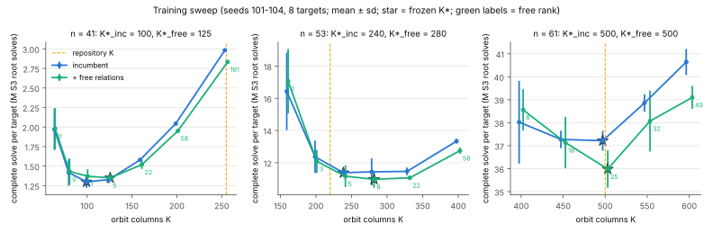
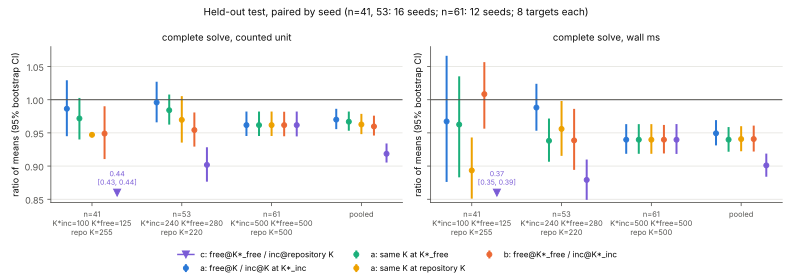

# Item 02: free relations in the production compact-orbit IC, with K tuned per arm

## Verdict

**ADVANCES, at constant level.** The primary comparison is (b): each arm at its own tuned K, measured on held-out seeds.

- **Pooled:** free relations cost **0.960× [0.946, 0.976]** of the tuned incumbent in the counted unit (S3 root solves per complete solve per target). Wall clock agrees: 0.941× [0.922, 0.961].
- **Per size:** the CI excludes 1 at every size.

  | n | K*_inc | K*_free | (b) counted | (b) wall |
  |--:|--:|--:|---|---|
  | 41 | 100 | 125 | **0.949 [0.911, 0.990]** | 1.008 [0.956, 1.057] |
  | 53 | 240 | 280 | **0.954 [0.929, 0.981]** | 0.939 [0.894, 0.986] |
  | 61 | 500 | 500 | **0.962 [0.945, 0.982]** | 0.940 [0.919, 0.962] |

- **Read this before quoting the n = 41 and n = 53 figures.** Part of (b) there comes from where the incumbent's tuned K landed. On the test seeds, the incumbent at the candidate's K was cheaper than at its own training-chosen K:
  - n = 41: 1.344M at K = 125 against 1.377M at K = 100;
  - n = 53: 10.95M at K = 280 against 11.30M at K = 240.

  At those K the paired same-K ratios are 0.972 [0.940, 1.003] and 0.984 [0.963, 1.008]. Both are MATCHES. At n = 61 the two arms tune to the same K, so the 0.962 there is a pure same-K effect.
- **Same K, comparison (a).** The candidate's point estimate is below 1 at every K tested. Its CI is never above 1. Pooled over sizes, the same-K comparison ADVANCES at every choice of K:

  | K used at each size | pooled counted ratio |
  |---|---|
  | K*_inc | 0.970 [0.956, 0.986] |
  | K*_free | 0.967 [0.953, 0.982] |
  | repository K (255 / 220 / 500) | 0.963 [0.948, 0.979] |

- **Primitive level.** The cost of one rank-stage relation does not change. The rank stage needs `K − free_rank` relations instead of `K`, and the index and target stages are identical.
- **Default changed.** The coordinator's condition was that (b) reads ADVANCES. It does, so `examples/koblitz_orbit_dlp_fast_online.rs` now runs free relations **by default** on the `u64` path (n ≤ 63).
  - **`KIC_FREE_RELATIONS=0` restores the previous pipeline exactly.** This was re-checked against the committed incumbent binary: 24 of 24 runs byte-identical after deleting timing fields only.
  - **K is not changed.** It is a command-line argument (`construct:<n>:<a>:<K>`), and the file has no per-size default to change. Recommended values are below.

Protocol: [`PROTOCOL.md`](PROTOCOL.md), frozen before any data. Rho is not used.



*Figure 1. Training sweep on seeds 101–104, 8 targets each. Each point is the mean counted cost per complete solve per target, with ±1 sd error bars. Stars mark the frozen K\* for each arm. The green labels give the free rank. The dashed line is the K the repository uses today. Source: `data/frozen_K.json`.*



*Figure 2. Held-out paired ratios, with seeds 1–16 at n = 41 and 53 and seeds 1–12 at n = 61. Each value is a ratio of means with a 95% percentile bootstrap interval from 10,000 resamples of seeds. (a) compares the arms at the same K, (b) compares tuned against tuned, and (c) compares the tuned candidate with the incumbent at the repository's K. The n = 41 (c) value, 0.44, is off the scale and is printed. Source: `results.json`.*

## What changed in the production file

`examples/koblitz_orbit_dlp_fast_online.rs` (no `src/` file touched):

- **`RootTable::insert_if_absent`** now returns the value already stored under the key. The table it builds is unchanged; a unit test checks this.
- **`build_index(.., harvest)`** records every key collision between pair states that are not swap mates. Swap-mate collisions are only counted.
- **`harvest_free_relations`** works through each recorded collision:
  1. It rebuilds the four abscissae, using the Frobenius shift between the two stored canonical shifts.
  2. It searches the signed lifts for `P1 + P2 + P3 + P4 = O` by point additions.
  3. It keeps each non-zero row as a homogeneous row (right-hand side 0) in the rank echelon.
- **The guided rank stage is unchanged.** It still decomposes `[a]G − R_j` for the first column without a pivot. It now starts from the harvested echelon, so it fills only the columns the free rows leave open.
- **Output.** The summary line gains a `free_relations` object: collisions, verified, trivial, failed, harvest additions, free rank, harvest ms, and a `logs_hash`. When the harvest runs, `cold_phase_ms` gains `free_relation_harvest`. With `KIC_FREE_RELATIONS=0`, neither field appears.
- **Wide path (n > 63).** There is no harvest, so the default has no effect there. An explicit `KIC_FREE_RELATIONS=1` is refused.
- **Tests.** `cargo test --release --example koblitz_orbit_dlp_fast_online` passes all 4 tests. The new one, `free_relation_harvest_leaves_the_index_unchanged_and_verifies` (n = 41, K = 125), checks three things: the harvest leaves the table unchanged, every collision verifies, and the free rank is 5.

## Results

### Held-out test (counted unit, mean per complete solve per target; M = 10⁶ S3 root solves)

| n | arm @ K | index | rank stage | target | harvest adds | **total** | rank attempts | free rank | wall ms |
|--:|---|--:|--:|--:|--:|--:|--:|--:|--:|
| 41 | inc @ 100 (K*_inc) | 0.410 | 0.955 | 0.011 | – | **1.377** | 100 | – | 1423 |
| 41 | inc @ 125 | 0.641 | 0.700 | 0.003 | – | **1.344** | 125 | – | 1491 |
| 41 | free @ 125 (K*_free) | 0.641 | 0.641 | 0.003 | 21,222 | **1.306** | 120 | 5 | 1435 |
| 41 | inc @ 255 (repo) | 2.666 | 0.327 | 0.002 | – | **2.995** | 255 | – | 3892 |
| 41 | free @ 255 | 2.666 | 0.118 | 0.002 | 51,172 | **2.837** | 94 | 161 | 3478 |
| 53 | inc @ 240 (K*_inc) | 3.053 | 8.218 | 0.025 | – | **11.296** | 240 | – | 15053 |
| 53 | inc @ 280 | 4.155 | 6.768 | 0.030 | – | **10.953** | 280 | – | 15064 |
| 53 | free @ 280 (K*_free) | 4.155 | 6.547 | 0.030 | 47,448 | **10.779** | 272 | 8 | 14131 |
| 53 | inc @ 220 (repo) | 2.565 | 9.366 | 0.022 | – | **11.953** | 220 | – | 16073 |
| 53 | free @ 220 | 2.565 | 8.966 | 0.022 | 37,186 | **11.590** | 216 | 4 | 15366 |
| 61 | inc @ 500 (K* = repo) | 15.250 | 22.837 | 0.038 | – | **38.125** | 500 | – | 62677 |
| 61 | free @ 500 | 15.250 | 21.293 | 0.038 | 85,198 | **36.667** | 475 | 25 | 58899 |

### Paired ratios (candidate / base, held-out seeds)

| comparison | n = 41 | n = 53 | n = 61 | pooled |
|---|---|---|---|---|
| (b) free@K\*_free / inc@K\*_inc | **0.949 [0.911, 0.990]** | **0.954 [0.929, 0.981]** | **0.962 [0.945, 0.982]** | **0.960 [0.946, 0.976]** |
| (b) wall | 1.008 [0.956, 1.057] | 0.939 [0.894, 0.986] | 0.940 [0.919, 0.962] | 0.941 [0.922, 0.961] |
| (a) same K = K\*_inc | 0.986 [0.945, 1.029] | 0.996 [0.966, 1.027] | 0.962 [0.945, 0.982] | 0.970 [0.956, 0.986] |
| (a) same K = K\*_free | 0.972 [0.940, 1.003] | 0.984 [0.963, 1.008] | 0.962 [0.945, 0.982] | 0.967 [0.953, 0.982] |
| (a) same K = repo K | 0.947 [0.944, 0.951] | 0.970 [0.935, 1.005] | 0.962 [0.945, 0.982] | 0.963 [0.948, 0.979] |
| (c) free@K\*_free / inc@repo K | 0.436 [0.427, 0.445] | 0.902 [0.877, 0.928] | 0.962 [0.945, 0.982] | 0.919 [0.905, 0.934] |
| incumbent retuned only: inc@K\*_inc / inc@repo K | 0.460 [0.442, 0.477] | 0.945 [0.916, 0.975] | 1.000 | – |

**Verdicts on the counted unit**, using the rule in `results.json`:

- **(b):** ADVANCES at every size and pooled.
- **(a), per size:** MATCHES at n = 41 for K\*_inc and K\*_free, and at n = 53 for every K. ADVANCES at n = 41 for K = 255 and at n = 61. ADVANCES pooled for all three K choices.
- **Wall clock:** no wall CI lies on the opposite side of 1 from its counted verdict.

Observations from these numbers:

- **The incumbent is badly over-sized at n = 41.** Retuning K alone gives 0.46× (K = 100 against the configured 255). That gain is larger than anything free relations give, and it needs no new code.
- **Free relations move the optimum K upward**, because free rank grows roughly as K⁴. Training puts the optimum at n = 41 from 100 to 125 and at n = 53 from 240 to 280. At n = 61 it stays at 500: the 550 and 600 points cost more index work than the free rows save.
- **At the tuned optimum the free fraction is small**: 5/125, 8/280 and 25/500. The saving is 2–4% of the complete solve, the same order as the prior item's same-K result.
- **Recommended K for the default-on pipeline.** These come from training seeds only, with the large training spread visible in Figure 1:

  | n | recommended K | repository K today |
  |--:|--:|--:|
  | 41 | 125 | 255 |
  | 53 | 280 | 220 |
  | 61 | 500 | 500 |

  This file takes K from its caller and has no per-size default, so this change sets none. Changing the K that callers and the retained-setup rows use is the caller's decision.

### Controls and correctness

- **A/A, default unchanged (stage 1).** This compares the opt-in build with the flag unset (frozen candidate binary) against the incumbent binary built from committed blob `ca551bb`, on 24 runs:
  - seed 101 at every training (n, K);
  - seeds 1 and 2 at each repository K.

  The summary line, all 8 target records and the full rank trace are byte-identical after deleting `*_ms`, `*_ns`, `peak_rss_bytes` and `online_hw_counts`: **24/24 identical** (`data/aa.json`).
- **A/A after the default flip.** The final binary with `KIC_FREE_RELATIONS=0`, against the same incumbent binary, on the same 24 (n, K, seed) points: **24/24 identical** (`data/aa_optout.json`).
- **The default equals the measured candidate.** The final binary with no environment, against the frozen candidate with `KIC_FREE_RELATIONS=1`, on seed 1 at all 7 test (n, K):
  - **7/7 identical** (`data/default_vs_frozen_free.json`): summary including the `free_relations` object, target records and rank trace;
  - the data were collected with the frozen candidate binary, so they apply to the new default.
- **Correctness gate:**
  - All 360 arm runs (144 training, 216 test) recovered all 8 targets, verified `[d]G = Q` in process, and matched item 09's held-back scalars.
  - Every candidate run had `free_relations.failed = 0` and reached rank K.
  - Every candidate run's `logs_hash` equals the blake3 hash of the base logs in the incumbent's rank trace at the same (n, K).
  - `correctness_failures = []`.
- **Positive control.** At the repository K the candidate reproduces the prior item's free ranks, 161 / 4 / 25, and its rank-stage attempts `K − free_rank` (94 / 216 / 475).

### Optional extension: 2-torsion translation census (measured)

This is a separate research example, `examples/ic_improve2_02_torsion_census.rs`. It copies the prior item's research copy and adds one census. Every root-table key X (one representative per Frobenius/τ orbit, since `sqrt(b) = 1 ∈ F2` commutes with Frobenius) is mapped to `sqrt(b)/X`, the abscissa of `Q + T2`, and looked up in the same table. A hit would be a relation `±P1 ± P2 ± P3 ± P4 = T2` over the base.

| n, K | keys looked up | τ-orbit collisions (harvest) | verified / free rank | T2 matches | T2 relations | control `x(Q+T2) = sqrt(b)/x(Q)` |
|---|--:|--:|--:|--:|--:|--:|
| 41, 255 | 2,664,777 | 2,496 | 966 / 161 | **0** | 0 | 10,000 / 10,000 |
| 53, 220 | 2,564,528 | 1,344 | 24 / 4 | **0** | 0 | 10,000 / 10,000 |
| 61, 500 | 15,248,425 | 3,150 | 150 / 25 | **0** | 0 | 10,000 / 10,000 |

- **The 2-torsion map gives no relations.** All table abscissae are of points of odd order, so a sum equal to T2 cannot occur. The census measured exactly 0.
- **No further τ-action to exploit.** The table is already keyed on canonical rotations, so every τ-orbit (Frobenius) collision is the harvest above. Negation fixes x.
- **More free relations per table entry needs a larger table, that is, a larger K.** Figure 1 shows where that stops paying.

## Deviations from the protocol

1. **Default flipped mid-item, at the coordinator's request.** It was conditional on (b) reading ADVANCES and was made after the test analysis. All arm data were taken with the frozen opt-in binaries. The flip was then checked by the two extra identity checks above.
2. **Unit test edited after the candidate binary was frozen.** The `#[cfg(test)]` module of the production file was updated (the new `harvest` argument, plus one new test) after the candidate binary was frozen. Non-test code was unchanged until the default flip, and the flip is covered by the 7/7 identity check.
3. **The pooled ratio is weighted by cost.** It is a ratio of summed per-size means, as frozen, so it is dominated by n = 61, which costs about 3× n = 53 and 28× n = 41.
4. **Host.** The host was shared with the other round-2 items, with load average 3–10 on 4 cores. Every job ran under `nice` with one thread, at most 2 of this item's jobs at once, and a 3 GiB address-space cap.
   - Peak RSS was 2.69 GB at n = 61, K = 600, just under the cap. This is why the n = 61 grid stops at 600; K ≈ 620 is the wall.
   - Wall-clock ratios are noisier than counted ones. For example, inc@255 at n = 41 took 1.87 s on average in training and 3.89 s in test.

## Reproduce

```sh
# incumbent binary from the committed file (blob ca551bb), before any edit:
# build at commit 45946b054 and keep the binary as $IC2_02_BIN/incumbent
cargo build --release --example koblitz_orbit_dlp_fast_online --example ic_improve2_02_analyze \
  --example ic_improve2_02_torsion_census
D=research/ic_improve_20261015/02-freerel-production
export IC2_02_BIN=<dir with incumbent, candidate, final>  IC2_02_TRACES=<scratch dir>
xargs -P 2 -L 1 $D/scripts/run_job.sh < $D/data/jobs_aa1.txt     # A/A n41, n53
xargs -P 2 -L 1 $D/scripts/run_job.sh < $D/data/jobs_train.txt   # n61 A/A + training
A=target/release/examples/ic_improve2_02_analyze; S=research/ic_next10_20261014/09-equal-advice/data
$A aa $D/data/runs $IC2_02_TRACES $D/data/aa.json
$A train $D/data/runs $S $D/data/aa.json $D/data/frozen_K.json
xargs -P 2 -L 1 $D/scripts/run_job.sh < $D/data/jobs_test.txt
$A test $D/data/runs $S $D/data/aa.json $D/data/frozen_K.json $D/results.json $D/data/rows.csv
IC2_02_RUNS=$D/data/runs_aa_optout xargs -P 2 -L 1 $D/scripts/run_job.sh < $D/data/jobs_optout.txt
IC2_02_RUNS=$D/data/runs_default   xargs -P 2 -L 1 $D/scripts/run_job.sh < $D/data/jobs_default.txt
IC03_FREE_RELATIONS=1 IC03_HARVEST_ONLY=1 target/release/examples/ic_improve2_02_torsion_census \
  construct:61:0:500 $D/data/targets_n61.txt 1 /dev/null > $D/data/census/torsion_n61_K500.json
python3 -I $D/scripts/plots.py $D
```

## Files

- **Production file.** `examples/koblitz_orbit_dlp_fast_online.rs`: the free-relation harvest, on by default; `KIC_FREE_RELATIONS=0` opts out.
- **New examples:**
  - `examples/ic_improve2_02_analyze.rs`: A/A identity, training selection, held-out paired bootstrap.
  - `examples/ic_improve2_02_torsion_census.rs`: the 2-torsion census.
- **Report and figures:** `PROTOCOL.md`, `README.md`, `README.pdf`, `results.json`, `fig_sweep.{svg,png}`, `fig_paired.{svg,png}`.
- **Scripts:** `scripts/run_job.sh`, `scripts/plots.py`.
- **Data (`data/`):**
  - runs: `runs/` (training and test), `runs_aa_optout/`, `runs_default/`;
  - analysis outputs: `aa.json`, `aa_optout.json`, `default_vs_frozen_free.json`, `frozen_K.json`, `rows.csv`;
  - census: `census/torsion_*.json`;
  - job lists `jobs_*.txt`, `jobs.log`, `binaries.sha256`, `targets_n*.txt`;
  - rank traces are not kept (scratch only); their hashes are in `aa*.json`.
