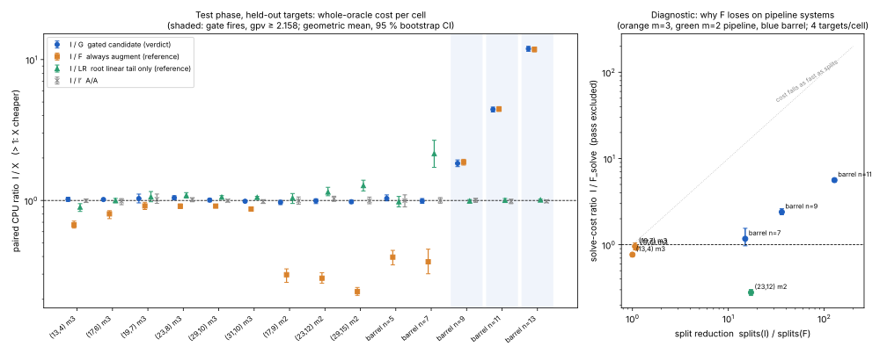

# Item 03: a gated fall-row augmentation for the Koblitz decomposition oracle

This is round 2, item 03 ([`../RULES.md`](../RULES.md)). The protocol is [`PROTOCOL.md`](PROTOCOL.md), frozen before the training, test and end-to-end data. All numbers are **measured**.

- Every number is per-target thread CPU, with all arms run in one process and interleaved per target.
- Ratios are `cost(I)/cost(X)`, geometric means with 95 % bootstrap CIs (10,000 resamples).
- The fit tool is `examples/ic_improve2_03_fit.rs`.

## Verdict

**ADVANCES at the constant level under the protocol's rule. On pipeline systems the gate never fires, so in production it is a no-op.**

- **The bar is met.**
  - No test cell regresses.
  - Every cell where the gate fires advances:

    | barrel n | I/G [95 % CI] |
    |---|---|
    | 9 | 1.83× [1.74, 1.94] |
    | 11 | 4.42× [4.25, 4.60] |
    | 13 | 11.9× [11.5, 12.4] |

  - All 146 test targets and all 56 training targets pass the root-set gate. The barrel root sets also equal brute force.
- **On the pipeline's own systems, fall-row augmentation does not become a net win.**
  - At every pipeline cell, m = 3 and m = 2, `(13,4)` to `(31,10)`, always augmenting (F) **regresses**: I/F = 0.23–0.91.
  - The trained gate learns this. It never fires on a pipeline system (gpv 0.94–1.04, threshold 2.158), so G is the incumbent there and the cells MATCH.
  - That holds end to end as well: same dispositions, same reductions (16,563 and 21,543), same logarithm.
- **Wired in**, opt-in: `KIC_FALLROW_GATE=1`, default off. It fires only on overdetermined systems like the G2 barrel system, which the production pipeline does not build today.
- **A side finding, not the candidate.** It is exploratory, because the frozen training rule rejected it on one cell. LR appends the multi-variable linear rows of the incumbent's own root basis, which the solver computes and throws away.
  - It **advanced at 5 held-out pipeline cells**: 1.05× to 1.28×.
  - But it **regressed at (13,4)**: 0.90× [0.84, 0.95].
  - See §4.

## 1. Why F regresses on pipeline systems (diagnostic arms, `runs/fit_diag.jsonl`)

Medians are over 4 targets per cell. "Solve" excludes the Macaulay pass.

| cell | gpv | falls (deg 1) | pass ÷ I | splits I → F | rank/node I → F | I/F_solve | I/F |
|---|--:|--:|--:|---|---|---|---|
| pipe (13,4) m3 | 1.04 | 46 (1) | 0.28 | 18 → 18 | 79 → 68 | 0.77 [0.73, 0.80] | 0.64 [0.60, 0.66] |
| pipe (17,6) m3 | 0.97 | 62 (1) | 0.10 | 68 → 62 | 133 → 129 | 0.92 [0.88, 0.96] | 0.84 [0.80, 0.89] |
| pipe (19,7) m3 | 0.95 | 70 (1) | 0.05 | 149 → 140 | 161 → 153 | 0.96 [0.87, 1.05] | 0.91 [0.83, 1.00] |
| pipe (23,12) m2 | 0.96 | 89 (2) | 0.12 | 121 → 7 | 236 → 576 | 0.28 [0.26, 0.30] | 0.27 [0.25, 0.29] |
| barrel n=7 | 1.91 | 403 (12) | 2.9 | 15 → 1 | 249 → 175 | 1.17 [0.97, 1.55] | 0.25 [0.21, 0.32] |
| barrel n=9 | 2.40 | 424 (5) | 0.11 | 1,139 → 30 | 204 → 861 | 2.40 [2.23, 2.62] | 1.90 [1.74, 2.10] |
| barrel n=11 | 2.90 | 580 (5) | 0.05 | 4,591 → 36 | 332 → 1,443 | 5.62 [5.35, 5.86] | 4.36 [4.21, 4.51] |

**The answer: it depends on the shape of the system. Pass cost alone is not the cause.**

- **m = 3 pipeline: rows that do not help.**
  - In the pipeline's interleaved chain order, under `HighestFree`, the incumbent's tree is already narrow. The 46–70 degree-2 falls cut splits by 0–9 %, so the solve is 0.77–0.96× of I.
  - The pass then adds 28 % of I at (13,4), 10 % at (17,6) and 5 % at (19,7). At the smallest cell, the pass is the larger share of the loss.
- **m = 2 pipeline: the rows help the tree, but each node costs more.**
  - The falls collapse the tree 17×.
  - But each degree-2 fall enters every node's degree-3 basis multiplied by every variable in its support. The rank per node goes up 2.4×, and so does the work per specialisation, so the solve costs 3.6× more.
- **Barrel (quadratic, about 2.4–2.9 generators per variable): the collapse beats the growth.**
  - The incumbent's basis already holds the products `x·f`, and the falls give degree-4 information.
  - The tree collapses 36–128×, against a 4× rank growth.
  - At n = 7 the tree is already tiny (15 splits), so the pass (2.9× of I) dominates.
- **Item 02's 0.29–0.59×** came from a different layout: `build_decomposition_system` in its own order, not interleaved. There the incumbent is 3–6× slower and F still loses: 0.53, 0.23 and 0.34 at (13,4), (17,6) and (19,7) (`runs/fit_plain.jsonl`).
  - In the production (interleaved) order, F loses less (0.64 to 0.91), because there is less tree left for it to cut.

**Variants tried** (`diag` mode, I/X; all failed to beat I on any m = 3 pipeline cell except where noted):

| variant | (13,4) m3 | (17,6) m3 | (19,7) m3 | (23,12) m2 | barrel n=11 |
|---|---|---|---|---|---|
| FQ: degree-2 falls only | 0.50 | 0.59 | 0.79 | 0.23 | 3.73 |
| FL: degree-≤1 falls only | 0.79 | 0.92 | 1.05 [1.02, 1.10] | 1.13 [1.12, 1.14] | 1.03 |
| LR: the root basis's own linear tail | 0.89 | 1.02 | 1.05 | 1.12 [1.07, 1.18] | 1.00 |
| FLR: the linear tail of the basis of generators plus falls | 0.57 | 0.86 | 0.99 | 0.71 | 0.97 |
| D2: split 2 variables by hand, then the leaves' own falls | 0.45 | 0.58 | 0.79 | 0.42 | 2.99 |
| D4: the same with 4 variables | 0.03 | 0.39 | 0.50 | 0.20 | 1.29 |

- **Only the linear part transfers to the pipeline.** One or two linear consequences at the root let the solver's linear elimination remove a variable. At m = 2 that halves the splits.
- **Every variant that adds degree-2 rows loses on pipeline systems.**
- **Deferring the pass (D2, D4) loses everywhere except barrel n = 11.** The leaves' systems are partly specialised, so their degree-3 matrices carry more products.

## 2. The gate (training, `runs/gate_train_fit.jsonl`, frozen in `runs/gate.json`)

- **Feature.** `gpv` = non-zero generators per occurring variable. It is computed by counting, in about 2–4 µs.
- **Feature rejected.** The expansion ratio of the degree-3 Macaulay matrix was the first idea. In pilots it ranked the families backwards (pipeline 9–25, barrel 7), so it was dropped before the protocol was frozen.
- **The training rule (§5)** chose:
  - **θ = 2.1583**, the midpoint between barrel n = 7 (1.91) and n = 9 (2.40);
  - **π₀ = I**. LR was rejected: it regressed on training cell (13,4), at 0.92× [0.88, 0.95], even though its pooled geometric mean was 1.18.
- **Only one admissible threshold beat +∞.**

## 3. Test (held-out targets, `runs/fit_test.jsonl`; 0 of 146 gate failures)

| cell | targets | gate fires | I median s | **I/G** [95 % CI] | verdict | I/F (ref.) | I/LR (ref.) | A/A I/I′ |
|---|--:|--:|--:|---|---|---|---|---|
| pipe (13,4) m3 | 12 | 0 | 0.0031 | 1.018 [0.985, 1.055] | MATCHES | 0.671 | 0.897 [0.836, 0.949] | 0.995 |
| pipe (17,6) m3 | 12 | 0 | 0.0250 | 1.016 [1.004, 1.029] | ADVANCES* | 0.803 | 0.999 | 0.990 |
| pipe (19,7) m3 † | 12 | 0 | 0.0878 | 1.032 [0.962, 1.110] | MATCHES | 0.915 | 1.061 | 1.020 |
| pipe (23,8) m3 † | 12 | 0 | 0.244 | 1.044 [1.010, 1.081] | ADVANCES* | 0.910 | 1.087 [1.040, 1.136] | 1.013 |
| pipe (29,10) m3 † | 8 | 0 | 2.06 | 1.006 [0.978, 1.032] | MATCHES | 0.912 | 1.056 [1.024, 1.083] | 0.997 |
| pipe (31,10) m3 † | 8 | 0 | 2.12 | 0.987 [0.970, 1.003] | MATCHES | 0.870 | 1.051 [1.033, 1.069] | 0.984 |
| pipe (17,9) m2 | 12 | 0 | 0.0031 | 0.970 [0.935, 1.001] | MATCHES | 0.297 | 1.042 | 0.995 |
| pipe (23,12) m2 † | 12 | 0 | 0.0170 | 0.993 [0.950, 1.028] | MATCHES | 0.281 | 1.148 [1.080, 1.240] | 1.028 |
| pipe (29,15) m2 † | 8 | 0 | 0.126 | 0.979 [0.951, 1.004] | MATCHES | 0.226 | 1.277 [1.169, 1.392] | 0.996 |
| barrel n=5 | 12 | 0 | 0.0081 | 1.033 [0.993, 1.095] | MATCHES | 0.396 | 0.979 | 0.997 |
| barrel n=7 | 12 | 0 | 0.0044 | 0.992 [0.954, 1.032] | MATCHES | 0.367 | 2.151 [1.717, 2.674] | 1.001 |
| barrel n=9 | 12 | 12 | 0.255 | **1.833 [1.738, 1.939]** | ADVANCES | 1.871 | 0.991 | 1.005 |
| barrel n=11 † | 8 | 8 | 1.71 | **4.424 [4.245, 4.603]** | ADVANCES | 4.454 (pos. ctl) | 1.002 | 0.988 |
| barrel n=13 † | 6 | 6 | 10.6 | **11.94 [11.45, 12.42]** | ADVANCES | 11.83 | 1.008 | 0.987 |

† Held-out size, never seen in training.

\* Where the gate does not fire, G runs **the same code as I** plus 2–4 µs of counting: the identical tree and word operations. So the "ADVANCES" at (17,6) and (23,8), at +1.6 % and +4.4 %, is the instrument's order bias between the first and second arm, not an effect. Every A/A CI covers 1, and these two are read as MATCHES.

- **Controls.**
  - A/A covers 1 at all 14 cells.
  - The positive control, I/F at barrel n = 11, is 4.45× [4.29, 4.64]. Item 02 measured 4.1×, so the instrument sees the known effect.
- **Level.** Constant: a paired ratio per cell.

## 4. Wiring and end-to-end (`runs/e2e.jsonl`)

**The code change**, both edits minimal:

- `koblitz_groebner.rs` gains `FALL_ROW_GATE_THETA`, `fall_row_gate_enabled()` (reads `KIC_FALLROW_GATE`, once per process) and `fall_row_gate_augment(system, n_vars)`.
- `groebner_decompose_with_geometry` makes one call to them, on the solver's equations, before both the F6-IC path and the plain path.
- The default is unchanged. `cargo build --release --lib` passes.

**The library hook equals the harness's G** on 14 targets (`runs/libcheck.jsonl`): the same firing decision, an identical augmented system, and the same roots. These include fires at barrel n = 9 and 11, and non-fires on pipe and m = 2.

**End-to-end, paired.**

- **Setup.**
  - `koblitz_index_calculus_dlp_with_factor_base` with `DecompositionStrategy::Groebner` and the standard-subspace base. The rest are the defaults (`node_budget = 4096`).
  - m = 3 at (17,6) and (19,7), 3 replicate pairs each, in alternating order, one process per arm.
- **Result.**

  | cell | log verified | relations / trials | dispositions (hash) | reductions | I/G CPU per pair | geomean |
  |---|---|---|---|---|---|---|
  | (17,6) | both arms, all runs | 33 / 127 | `18e09264ac04e592`, identical | 16,563, identical | 1.073, 1.027, 1.024 | 1.041 |
  | (19,7) | both arms, all runs | 64 / 111 | `c479892ef87a8c80`, identical | 21,543, identical | 0.988, 0.938, 0.974 | 0.966 |

  The per-pair ratios are derived as the division of the `cpu_s` fields. The same code ran in both arms, so the ±5 % spread is process-to-process noise. **MATCHES**, as expected: the gate never fires on these systems.

**Where the gain is for the pipeline (exploratory, labelled as such).** LR beat I at 5 held-out pipeline cells: 1.05–1.28×, largest at m = 2, where `KoblitzIcOptions` defaults to m = 2.

- **It loses at the smallest cell, (13,4)**, because rebuilding the basis after elimination costs more than a 3 ms solve saves.
- **Why the engine misses it.** The solver already computes these rows in `linear_tail` at every node and keeps only `1` and `v + c`.
- **Suggested next item** (not done here): harvest them in-engine, at every node, gated on the incumbent's root cost or on `n_vars`, and test it under its own protocol.

## Deviations from the protocol

- **The fit tool gained a `--medians` option** after the protocol was frozen. It is descriptive only.
- **`libcheck` mode** was added after wiring, as a correctness check of the hook. It was not in the protocol.
- **End-to-end cells.** §7a asked for one pipeline cell; two were run, (17,6) and (19,7).
- **Load.** Other items shared the 4 cores; the load average was 5–7. Thread CPU removes scheduling but not cache contention. A/A stays within ±3 % at every cell, so effects of 1.6–4 % are within the order bias, as noted above.
- **Peak RSS** was not recorded. Every job ran under `prlimit --as=3e9` without hitting the cap.

## Reproduce

```sh
cd /home/user/crypto
cargo build --release --example ic_improve2_03_fallrow_gate --example ic_improve2_03_fit --example ic_improve2_03_e2e
D=research/ic_improve_20261015/03-fallrow-gate; F=target/release/examples/ic_improve2_03_fit
$D/run_train.sh
$F --file $D/runs/train_pipe3.jsonl --file $D/runs/train_pipe2.jsonl --file $D/runs/train_barrel.jsonl --train \
   --ratio I/F:i_cpu/f_cpu --ratio I/LR:i_cpu/lr_cpu --ratio AA:i_cpu/i2_cpu > $D/runs/gate_train_fit.jsonl
$D/run_test.sh      # reads runs/gate.json
$F --file $D/runs/test_pipe3.jsonl --file $D/runs/test_pipe2_barrel_small.jsonl --file $D/runs/test_barrel_large.jsonl \
   --ratio I/G:i_cpu/g_cpu --ratio I/F:i_cpu/f_cpu --ratio I/LR:i_cpu/lr_cpu --ratio AA:i_cpu/i2_cpu > $D/runs/fit_test.jsonl
$D/run_diag.sh      # diagnostic fits: see below
$D/run_e2e.sh
python3 -I $D/plot.py && bash $D/make_pdf.sh
```

The diagnostic fits are:

```sh
$F --file $D/runs/diag_pipe.jsonl --file $D/runs/diag_barrel.jsonl --ratio I/F:i_cpu/f_cpu --ratio I/Fsolve:i_cpu/f_solve_cpu \
   --ratio I/LR:i_cpu/lr_cpu --ratio I/FLR:i_cpu/flr_cpu --ratio I/FL:i_cpu/fl_cpu --ratio I/FQ:i_cpu/fq_cpu \
   --ratio I/D2:i_cpu/d2_cpu --ratio I/D4:i_cpu/d4_cpu --ratio Isplits/Fsplits:i_splits/f_splits \
   --ratio Iwords/Fwords:i_word_ops/f_word_ops --ratio AA:i_cpu/i2_cpu \
   --medians falls,falls_deg1,lr_rows,pass_cpu,i_cpu,f_cpu,i_splits,f_splits,i_calls,f_calls,i_rank_per_call,f_rank_per_call,i_cols_per_call,f_cols_per_call,gens_per_var > $D/runs/fit_diag.jsonl
$F --file $D/runs/diag_plain_layout.jsonl --ratio I/F:i_cpu/f_cpu --ratio I/LR:i_cpu/lr_cpu --ratio AA:i_cpu/i2_cpu \
   --medians i_cpu,f_cpu,i_splits,f_splits,falls,pass_cpu > $D/runs/fit_plain.jsonl
```

The pilots (`runs/pilot_*.jsonl`) predate the protocol and are not used in any verdict. Binary hashes for the training and test runs are in `runs/binaries.sha256`.



*Figure.*

- **Left:** the test phase, I/G (verdict), I/F, I/LR and A/A per cell. Geometric means with 95 % bootstrap CIs. The shaded cells are where the gate fires. Data: `runs/fit_test.jsonl`.
- **Right:** the diagnostic. Split reduction against solve-cost ratio for F, with the pass excluded. Pipeline systems sit at or below 1, however far their splits fall. Data: `runs/fit_diag.jsonl`.
