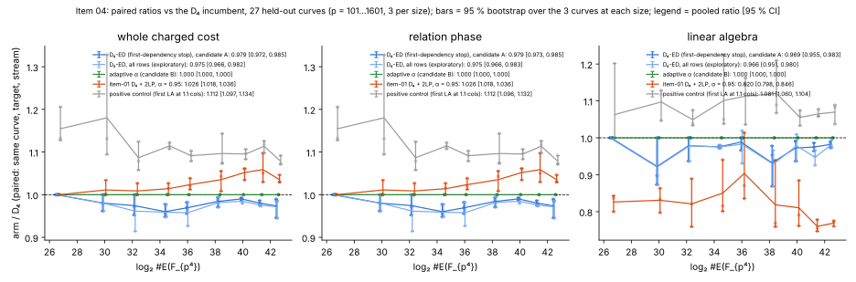
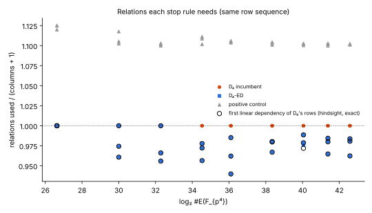
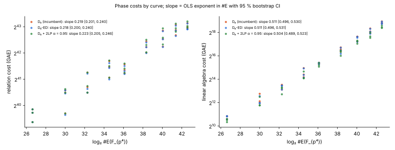

# Item 04: fixing the D₄ + double-large-prime regression, k = 4 IC on E(F_{p⁴})

IC improvement round 2 (`../RULES.md`), item 04, 2026-10-15. The protocol,
[`PROTOCOL.md`](PROTOCOL.md), was frozen before any data was collected.
Prior work: [`../../ic_improve_20261014/01-d4-2lp/`](../../ic_improve_20261014/01-d4-2lp/README.md).
That item found tuned D₄+2LP / D₄ = 1.025 [1.016, 1.037] on the whole cost,
which REGRESSES.

- **Incumbent:** `d4`, the D₄ Y-line arm. Its first LA attempt comes at
  columns + 1 relations.
- **Candidates:**
  - `d4-ed`: D₄ with the first-dependency stop (from paths 1 and 2);
  - `d4-adapt`: an adaptive α chosen by a cost model (path 3).
- **Reported:** item 01's `d4-2lp` (α = 0.95) and `d4-ed-all`
  (exploratory).
- **Controls:** a null A/A arm and a positive control.
- **Rho** is a reference column only.

## Verdict

**The regression is fixed by removing the large primes, not by better large
primes.** In the D₄ Y-line setting, large primes buy nothing in the
relation phase. What the 2LP graph was really doing is finding a linear
dependency before columns + 1 relations. If filtering runs after every
relation, the full D₄ base gets that saving with no rejected trials.

| comparison (test: 27 held-out curves, p = 101…1601) | phase | constant: pooled paired ratio [95 % CI] | verdict | exponent: Δ slope of log₂ ratio per log₂ #E [95 % CI] | verdict |
|:--|:--|--:|:--|--:|:--|
| **`d4-ed` / `d4`** (candidate A) | **whole** | **0.9792 [0.9725, 0.9855]** | **ADVANCES** | **−0.0008 [−0.0024, +0.0015]** | **MATCHES** |
| | relation | 0.9792 [0.9727, 0.9850] | ADVANCES | −0.0008 [−0.0025, +0.0015] | MATCHES |
| | linear algebra | 0.9693 [0.9552, 0.9827] | ADVANCES | +0.0000 [−0.0036, +0.0052] | MATCHES |
| **`d4-adapt` / `d4`** (candidate B) | whole, relation, LA | 1.0000 [1.0000, 1.0000] | MATCHES | 0 | MATCHES |
| `d4-ed-all` / `d4` (exploratory) | whole | 0.9746 [0.9659, 0.9822] | ADVANCES | −0.0010 [−0.0028, +0.0018] | MATCHES |
| `d4-2lp` / `d4` (item 01's arm, re-measured) | whole | 1.0264 [1.0179, 1.0362] | REGRESSES | +0.0047 [+0.0031, +0.0067] | REGRESSES |
| | linear algebra | 0.8201 [0.7979, 0.8456] | ADVANCES | −0.0067 [−0.0129, −0.0008] | ADVANCES |
| `d4-late110` / `d4` (positive control) | whole | 1.1119 [1.0970, 1.1338] | REGRESSES | −0.0057 [−0.0106, −0.0013] | (see note) |
| `d4-2lp-null` / `d4` (null A/A) | all | 1 exactly on 27/27 | MATCHES | 0 | MATCHES |

- **Candidate A (`d4-ed`)** **ADVANCES at the constant level** by 2.1 %
  [1.5 %, 2.8 %] on the whole cost. Relation and LA phases both advance, so
  there is no trade.
  - The exponent MATCHES: the saving is a constant fraction of the
    relations.
  - Per size it is MATCHES at p = 101–269, where the 3-curve CIs touch 1,
    and ADVANCES at every size from p = 397 to 1601.
  - It never regresses on any curve: per-curve ratio 0.946–1.000.
- **Candidate B (`d4-adapt`)** is **MATCHES at every measured size**, by
  construction.
  - The frozen model keeps plain D₄ everywhere in the measured range
    (log₂ #E = 26.6 to 42.6). It is identical to `d4` on 27 of 27 curves.
  - The frozen rule would first leave plain D₄ at **#E ≈ 2^116.5**
    (α = 0.90, modelled ratio 0.943). This is an extrapolation, not a
    measurement. Item 01 put its handover at 2^128.9.
- **Item 01's arm** reproduces its regression on the 3 new p = 1601 curves:
  1.035 [1.029, 1.046].

Note on the positive control's exponent: `d4-late110` is a known +10 %
relation regression. Its ratio is larger at small p, where
⌈1.1·(columns + 1)⌉ rounds up a larger fraction. That gives the negative
slope. Its pre-registered test is the constant level: point 1.112, inside
[1.04, 1.16], and the CI excludes 1. It **passes**.

**Correctness and controls** (all passed):

- **Logarithms.** Every logarithm of every arm on every test curve was
  verified ([d]G = Q and equal to the planted d): 27 × 7 = 189 of 189. On
  training, all 14 × 6 = 84 were verified. Every decomposition was re-added
  in the group.
- **Null A/A.** `d4-2lp-null` is identical to `d4` (trials, full relations,
  LA multiplications, output) on 27 of 27 test curves and 14 of 14 training
  curves.
- **Reproduction.**
  - `d4` trial counts equal item 01's on all 24 shared test curves and all
    14 training curves.
  - α = 0.95 equals item 01's on all 14 training curves.
  - So the new 48-bit bucketed oracle is output-identical to item 01's.
- **ecbench.** The new base `yline-d4-ed` reproduces the direction in the
  harness (see below). Item 01's committed session still audits clean
  against the edited code: 36 records, 6 replays reproduced, 0 problems.



## Why 2LP cannot fix the relation phase here, and what can

### Path 1: large primes, inside or outside the base

**(a) Inside the decomposition base B (Thériault; Gaudry–Thomé–Thériault–Diem).**
In GTTD the large primes are exactly B∖F, the base points left out of a
small factor base F with |F| ≪ |B|. Item 01's `d4-2lp-gaudry` arm
(|F| = |B|³ᐟ⁴) is that construction, and it measured 2.36× D₄.
Item 01's α = 0.95 arm is the same construction with a larger F. Neither
is a "fake" large-prime scheme.

Here is why no choice of F can help the relation phase. Each row is

    Σ_j ±(log P_j) − b·d = a.

Every full relation that large-prime elimination (graph cycles, merges)
produces is a linear combination of the rows collected so far. So whenever
an LP scheme determines d at time m, the collected base rows already have a
combination that is zero on every base column and has Σc·b ≠ 0. That is a
linear dependency, and full LA would find d from the same rows.

Hence the trials needed by any LP scheme on a shared stream are at least
those of the **first-dependency stop (FD)** on the same rows. LP schemes
also lose the rows they reject (≥ 3 large primes).

- **Measured.** On every test curve, `d4-ed` and `d4-ed-all` used no more
  trials than `d4-2lp`. There are 0 violations in 27 curves; `d4-2lp` used
  1.000–1.098× D₄'s trials.
- **D₄ orbits.** The orbits {±P, ±(P + T)} are already the columns. Each
  large-prime "vertex" is an orbit, which halves the vertex set but leaves
  the argument unchanged.

**What the incumbent leaves on the table.** D₄ first tries LA at columns + 1
relations. The exact first dependency of D₄'s own row sequence, computed in
hindsight by incremental elimination mod r, comes at **0.977 × (columns + 1)
relations on average** (test, 27 curves). That is close to the random
4-uniform (XORSAT-type) dependency threshold of about 0.977 rows per column.
Columns hit fewer than twice are peeled, which is why the threshold sits
below 1. This 2.3 % is the most any stop rule can gain on D₄'s row stream.
The square-core stop in `d4-ed` reaches it: it used FD relations on 26 of 27
curves and FD + 1 on one, a mean gap of 0.037 relations.



**(b) Large primes outside B** (one summand from a set Λ ⊋ B, the
"much larger outside set"). Let π be the probability that a trial decomposes
over B. At p = 1301, π ≈ 1/77.

- Decompositions R = P₁ + P₂ + P₃ + L, with P_i ∈ B and L in a line-sized
  slice of Λ, occur about 4π per C₄-type solve: 4!/3! orderings. Covering
  Λ takes |Λ|/|B| such slices per target.
- A partial relation is useful only after its L collides. N partials give
  about N²/(2|Λ|) cycles, so about ncols cycles need
  N ≈ √(2|Λ|·ncols) partials.
- **Trials versus D₄:** √(2|Λ|·ncols)/(4π) against ncols/π, a ratio of
  √(|Λ|/(8·ncols)).
  - For a 2-dimensional Λ (|Λ| ≈ p²/2, ncols ≈ p/4) this is √(p/4): 18× at
    p = 1301. It worsens as p^{1/2}, i.e. +1/8 in the exponent in #E.
  - For Λ a second line (|Λ| ≈ |B|), the trial count could halve. But
    "3 + 1" is then just a larger base with a different decomposition shape.
    The summands are no longer interchangeable, so the S₄ symmetrisation of
    the D₄ solver drops to S₃. That multiplies the solution degree by ≥ 4,
    and C₄ rises by at least that much.
  - Net: ≥ 2× D₄ even if C₄ grew only 4×.
- This is a derivation, not a measurement: C₄ for the 3 + 1 shape was not
  measured here.

### Path 2: stop paying for rejected trials

**It cannot be done before the solve.** The large-prime count of a
decomposition depends on which roots y₁…y₄ the D₄ solve returns. Those
come out of the Gröbner basis / FGLM step of the symmetrised system, which
is the C₄ cost itself.

- **Resultant-degree filter.** The degree of the eliminant is fixed by the
  system's shape, not by R, so it carries no information about where the
  roots lie.
- **Partial solve.** Requiring two summands in F adds Π_{f∈F}(y − y_f),
  of degree |F|, and breaks S₄ to S₂ × S₂. That is more expensive, not
  cheaper.

The cheap fix is to stop rejecting. `d4-ed` admits every decomposition and
finds the dependency with full sparse LA. In the hypergraph sense, every
column is a "large prime" and the cycle is the linear dependency.

### Path 3: adaptive arm

Fitted on training. Per configuration, the OLS of log₂ relation and log₂ LA
GAE on log₂ #E:

- plain D₄: relation slope 0.187, LA slope 0.535;
- α = 0.90: relation slope 0.200, LA slope 0.532.

The rule keeps plain D₄ until #E ≈ 2^116.5, so at every measured size it is
the incumbent (ratio exactly 1). It also flips at 2^20–2^21.5, below the
smallest training size (2^26.3). That is a fit artefact and is not used.

The recommended component is the composition: `d4-ed` as the plain arm,
switching to 2LP only past the modelled handover. In the measured range it
is `d4-ed`.

## Results by size (test split, 3 curves per size)

Paired whole-cost ratios against `d4`: geometric mean, with a 95 %
bootstrap over the 3 curves at that size. With 3 curves the per-size CI is
coarse; a CI of [1, 1] means all three curves tied.

| p | log₂ #E | columns | D₄ trials (mean) | FD / (cols + 1) | `d4-ed` / D₄ | `d4-ed-all` / D₄ | `d4-adapt` / D₄ | `d4-2lp` / D₄ | positive control | D₄ S / rho-neg S (ref.) |
|--:|--:|--:|--:|--:|--:|--:|--:|--:|--:|--:|
| 101 | 26.6 | 23–24 | 3,315 | 1.000 | 1.000 [1.000, 1.000] MATCHES | 1.000 [1.000, 1.000] | 1.000 | 1.000 [1.000, 1.000]¹ | 1.155 [1.128, 1.206] | 1.35·10⁸ |
| 181 | 30.0 | 37–50 | 5,178 | 0.978 | 0.980 [0.961, 1.000] MATCHES | 0.980 [0.961, 1.000] | 1.000 | 1.011 [1.000, 1.034] MATCHES | 1.180 [1.095, 1.328] | 7.25·10⁷ |
| 269 | 32.3 | 58–69 | 7,577 | 0.974 | 0.975 [0.952, 1.000] MATCHES | 0.961 [0.914, 1.000] | 1.000 | 1.009 [1.000, 1.027] MATCHES | 1.087 [1.058, 1.124] | 5.69·10⁷ |
| 397 | 34.5 | 89–107 | 11,294 | 0.969 | 0.960 [0.948, 0.978] ADVANCES | 0.959 [0.948, 0.978] | 1.000 | 1.014 [1.000, 1.027] MATCHES | 1.114 [1.107, 1.122] | 3.80·10⁷ |
| 521 | 36.1 | 131–134 | 10,997 | 0.962 | 0.969 [0.955, 0.982] ADVANCES | 0.958 [0.927, 0.982] | 1.000 | 1.024 [1.012, 1.039] REGRESSES | 1.091 [1.079, 1.103] | 2.18·10⁷ |
| 769 | 38.3 | 181–202 | 19,825 | 0.976 | 0.984 [0.971, 0.994] ADVANCES | 0.982 [0.971, 0.994] | 1.000 | 1.035 [1.008, 1.055] REGRESSES | 1.097 [1.073, 1.143] | 1.98·10⁷ |
| 1033 | 40.1 | 248–282 | 24,831 | 0.980 | 0.990 [0.986, 0.993] ADVANCES | 0.985 [0.979, 0.990] | 1.000 | 1.052 [1.034, 1.062] REGRESSES | 1.095 [1.083, 1.107] | 1.33·10⁷ |
| 1301 | 41.4 | 311–349 | 31,024 | 0.976 | 0.980 [0.975, 0.986] ADVANCES | 0.975 [0.973, 0.978] | 1.000 | 1.059 [1.030, 1.098] REGRESSES | 1.114 [1.098, 1.126] | 1.14·10⁷ |
| 1601 | 42.6 | 413–429 | 34,065 | 0.976 | 0.974 [0.946, 0.990] ADVANCES | 0.972 [0.945, 0.986] | 1.000 | 1.035 [1.029, 1.046] REGRESSES | 1.078 [1.072, 1.092] | 6.31·10⁶ |

¹ At p = 101, `d4-2lp` uses the same trials as D₄ and a smaller LA, so the
ratio is 1 − 4·10⁻¹⁰. The rule formally calls that ADVANCES. It is an LA
saving of 10⁻⁹ of the cost.

**Accounting.**

- **Mean relations used / (columns + 1):**

  | arm | relations / (columns + 1) |
  |:--|--:|
  | `d4` | 1.000 |
  | `d4-ed` | 0.977 |
  | `d4-ed-all` | 0.977 |
  | `d4-2lp` (full only; pivots extra) | 0.795 |
  | positive control | 1.106 |

- **`d4-ed-all`'s extra gain** comes from 25 of 5,203 decomposed trials
  that carried two distinct rows. The trial ratio against D₄ ranges
  0.914–1.000, against 0.946–1.000 for `d4-ed`.
- **Every arm solved at its first LA attempt** on every test curve. `d4-ed`
  runs one Wiedemann solve on a slightly smaller core, hence its LA ratio
  of 0.969.
- **Filtering bookkeeping.** `d4-ed` calls the square-core filter after
  every relation: up to 4.0·10⁶ index operations per curve, uncharged in
  every arm (PROTOCOL). Charged at 1 F_p mult per index operation, they
  would be at most 5·10⁻⁹ of the whole cost. The whole ratio with them
  charged is 0.9792 [0.9727, 0.9853], unchanged and still ADVANCES.
- **LA share.** LA is at most 6·10⁻⁸ of D₄'s whole cost at these sizes.

### Fitted exponents in #E

OLS of log₂(cost) on log₂ #E over the 27 test curves, with a 95 % bootstrap
over curves.

| arm | relation | linear algebra | whole |
|:--|:--|:--|:--|
| `d4` (incumbent) | 0.2186 [0.2012, 0.2396] | 0.5107 [0.4956, 0.5304] | 0.2186 [0.2024, 0.2406] |
| `d4-ed` | 0.2178 [0.2001, 0.2402] | 0.5108 [0.4963, 0.5309] | 0.2178 [0.2001, 0.2395] |
| `d4-ed-all` | 0.2176 [0.2001, 0.2397] | 0.5099 [0.4946, 0.5301] | 0.2176 [0.2001, 0.2404] |
| `d4-2lp` | 0.2233 [0.2049, 0.2457] | 0.5041 [0.4888, 0.5226] | 0.2233 [0.2061, 0.2445] |
| `d4-adapt` | = `d4` | = `d4` | = `d4` |



## ecbench (in-harness reproduction, 4 sizes)

- **Registration.** Additive edits register the candidate as
  `ic.k4_gaudry` with `base = yline-d4-ed`:
  - `K4Params.eager_la` in `fp4.rs`: filter after every relation, retry at
    the next relation;
  - the new base value in `methods.rs`.
- **Hashes.** No parameter was added, so existing specs' method hashes are
  unchanged.
- **Session.** `ECBS1h08cd110d706f`, spec
  [`ecbench/spec-d4-ed.json`](ecbench/spec-d4-ed.json): p = 101, 181, 269,
  397 (seed 1) × 3 targets × 2 arms = 24 runs, 24 verified.
- **Audit.** "audit OK: 24 records, 24 verified, 8 replays reproduced, 0
  problems". Receipt `ecbench/session-20261015-d4-ed.audit.json`, SHA-256
  `49a4ad811469475dbc60198b1de4d093665afbfb30b8d0af665ab9e32a61199f`.
- **Result.** `ecbench compare` gives ic-k4-d4-ed / ic-k4-d4 =
  **0.9904 [0.977, 0.998]** (cluster bootstrap, 12 workloads).
  - Per curve: 1.000, 0.984, 0.985, 0.980.
  - The harness labels it "diagnostic only (unpriced work)", because the
    oracle is uncharged.
  - L0 isolation, so these are operation counts only; no wall-time claim is
    made.
- Full table: [`ecbench/compare.txt`](ecbench/compare.txt).

## Deviations from the protocol

1. **Fit output.** The fit's report of where the rule leaves plain D₄
   first printed only the first flip, at 2^20.0. That is below the training
   range and a fit artefact. It was changed before any test data to list
   every flip; the rule and the model are unchanged.
2. **Exact ties.** The verdict function gained a 10⁻¹² tolerance, so that
   ratios identical to 1 (`d4-adapt`, the null) are called MATCHES as the
   protocol states. Without it, floating-point rounding of exp₂(mean log₂)
   called them ADVANCES. This was applied after the test data, and no other
   verdict changed.
3. **Oracle bucket size.** The first bucket capacity overflowed on a smoke
   run: D₄ repeats x-values, so bucket counts are clumped. It was enlarged
   before any recorded run. The overflow is asserted, never silent.
4. **Positive control at small p.** The ⌈1.1·(cols + 1)⌉ rounding makes it
   larger than 1.10 at small p: 1.155 and 1.180 at p = 101 and 181.
   The pooled point, 1.112, is inside the registered window.
5. **Machine.** Not the limit for the item.
   - p = 1601 took 11–12 min and 1.95 GB per curve; the oracle build was
     6–7 min of that.
   - The host's load average was 8–13 on 4 cores, shared with three other
     items.
   - p ≈ 2000 would need about 2.9 GB of triple table even at 48 bits
     (m ≈ 1000 base points), plus the pair table. So 1601 is the largest
     size that fits the 3 GB cap with this oracle.
   - Training took 6 min of wall time and test 40 min (two lanes).

## Reproduce

```sh
cargo build --release --example ic_improve2_04_d4_2lp_fix --bin ecbench
cd research/ic_improve_20261015/04-d4-2lp-fix
./run_train.sh       # 14 training curves: d4, d4-ed, d4-ed-all, null, positive control, α = 0.95
B=../../../target/release/examples/ic_improve2_04_d4_2lp_fix
$B fit --train raw/train.jsonl --prior-train ../../ic_improve_20261014/01-d4-2lp/raw/train.jsonl --out raw/frozen.json
./run_test.sh        # 27 held-out curves
$B analyze --in raw/test.jsonl --prior ../../ic_improve_20261014/01-d4-2lp/raw/test.jsonl \
  --prior-summary ../../ic_improve_20261014/01-d4-2lp/raw/summary.json --out raw/summary.json
python3 -I plot.py
# from the repository root
D=research/ic_improve_20261015/04-d4-2lp-fix/ecbench
target/release/ecbench run --wait --allow-busy --cpus none --spec $D/spec-d4-ed.json --out $D/session-20261015-d4-ed
target/release/ecbench verify --dir $D/session-20261015-d4-ed --replay 8 --out $D/session-20261015-d4-ed.audit.json
target/release/ecbench compare --dir $D/session-20261015-d4-ed --a ic-k4-d4 --b ic-k4-d4-ed
```

Every job ran single-threaded under `nice`, `prlimit --as=3000000000` and
`timeout 3600`. Conductor's control plane was unreachable (`conductor check`
refused the connection), so there is no task card.

## Files

- **New code:** `examples/ic_improve2_04_d4_2lp_fix.rs`, with the `train`,
  `fit`, `test` and `analyze` subcommands.
- **Edited, additively:**
  - `src/cryptanalysis/ecbench/fp4.rs`: the field `K4Params.eager_la`;
  - `src/cryptanalysis/ecbench/methods.rs`: the base `yline-d4-ed`.
- **Data:**
  - `raw/train.jsonl` (14 rows), `raw/frozen.json` and `raw/fit.stdout`;
  - `raw/test.jsonl` (27 rows), `raw/summary.json` and
    `raw/analyze.stdout`;
  - `ecbench/`.
- **Figures:** `figures/{paired_ratio,relations,phases}.{svg,png}`.
- **Report:** `REPORT.pdf`, built from this README.
