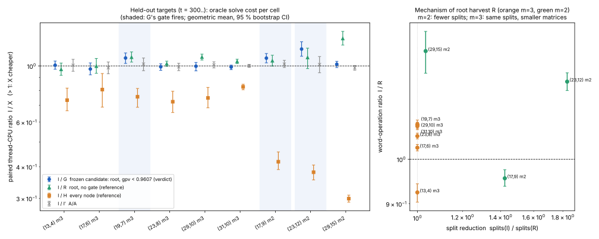

# Item 05: in-engine harvest of the solver's discarded linear rows

This is round 2, item 05 ([`../RULES.md`](../RULES.md)). The protocol is [`PROTOCOL.md`](PROTOCOL.md), frozen before the training, test and end-to-end data. All numbers are **measured**.

- **Primary metric:** per-solve thread CPU. All arms run in one process on the same system, and the arm order rotates per target.
- **Ratios** are `cost(I)/cost(X)`, as geometric means with 95 % bootstrap CIs (10,000 resamples of targets). The fit tool is `examples/ic_improve2_05_fit.rs`.

## Verdict

**The frozen candidate G ADVANCES at the constant level and REGRESSES nowhere. It wins under the bar, so it is now the engine's default. `KIC_LINEAR_HARVEST=0` opts out and restores the previous engine counter for counter.**

- **What G is.** At the root only, in solves with fewer than 0.9607 non-zero generators per occurring variable (gpv), it appends the root basis's multi-variable linear rows to the system. The existing linear elimination then substitutes them away.
- **Held-out test**, 96 targets on 9 pipeline cells:

  | where | cells | I/G |
  |---|--:|---|
  | where G fires | 3 | **ADVANCES**, 1.07–1.17× |
  | elsewhere | 6 | MATCHES, the same code path |

  No cell regresses at the CI level.
- **Correctness.** Root sets are identical for every arm on every target: 0 failures in 96 test, 32 training and 142 identity rows. A new unit test, `linear_harvest_keeps_every_root`, checks every configuration against brute force.
- **End-to-end at m = 2, (19,10) and (23,12).**
  - Logarithms are verified in all 12 runs, with identical relations, trials and disposition hashes.
  - Solver reductions fall 15 % and 25 %.
  - CPU per pair is 1.065× at (19,10) and **0.992× at (23,12)**. End to end at (23,12) the gain does not appear (see §4).
- **Every-node harvest (H), the variant the task asked for, REGRESSES everywhere**: 0.30–0.83×. Rebuilding a node's bases after each substitution costs more than the rows save.
- **The frozen gate is a weak feature**, which is the honest caveat:
  - In the pipeline, gpv ≈ (N − 1)/N, so the gate acts as a proxy for size.
  - It leaves out (29,15) m2, where the ungated root harvest R gains **1.28× [1.21, 1.37]**.
  - It also leaves out the large m = 3 cells, where R gains 1.04–1.08×.
  - R is the obvious next candidate, but it was inadmissible under the frozen training rule: (13,4) regressed 0.91× [0.85, 0.97] in training.

## 1. Where the rows are dropped

- `ReducedBasis::linear_tail` (`src/cryptanalysis/inherited_f4.rs`) computes, at every node, the intersection of the basis row space with the span of `{1, x_i}`.
- `ReducedBasis::decisive_rows` keeps only `1`, `v` and `v + 1`, and `reduce_inherited` (`koblitz_groebner.rs`) hands only those to `solve_rec`. Every linear row with two or more variables is discarded.

**The change** is additive, in `src/cryptanalysis/koblitz_groebner.rs` only:

- **Configuration.** `LinearHarvest { max_vars, root_only, min_free, gpv_below_milli }`, with `parse_linear_harvest`, `linear_harvest()` (reads `KIC_LINEAR_HARVEST` once, with a thread override `set_linear_harvest`) and the thread counters `linear_harvest_counts_thread`/`linear_harvest_counts_reset`.
- **`reduce_inherited`.** With a harvest set, it reads `linear_tail` and splits it with `split_linear_tail`: the decisive rows go back in the same order, and the multi-variable rows go to a buffer. The word cost is the same as `decisive_rows`, because that function calls `linear_tail` itself.
- **`solve_rec`.** When a reduction forces nothing (the solver would split next), the gate passes (root, free count, gpv on the original equations) and rows were harvested, they are appended to the node system and the loop continues.
  - `eliminate_linear_generators` substitutes them, records the definitions and rebuilds the node's bases.
  - Every root is still verified against the original equations.
- **The hook comment** documents the default and the opt-out.

| `KIC_LINEAR_HARVEST` | meaning |
|---|---|
| unset | **default**: `LINEAR_HARVEST_DEFAULT` = root, gpv < 0.961 (stored as 961‰ from θ = 0.9607) |
| `0` | **opt-out**: the engine before this item, with identical counters |
| `1` | the same as the default |
| `every` | every node, every row (H) |
| `root`, `k=2`, `free=N`, `gpv=x`, comma-joined | modifiers of `every` |

## 2. Training (t = 0..7; `runs/train_fit.jsonl`)

| cell | gpv | I/R [95 % CI] | word ops I/R | A/A |
|---|--:|---|---|---|
| (13,4) m3 | 1.040 | **0.907 [0.852, 0.969]** | 0.900 | 0.966 [0.924, 0.997] |
| (17,6) m3 | 0.971 | 0.975 [0.914, 1.018] | 1.025 | 0.982 |
| (17,9) m2 | 0.944 | 0.918 [0.780, 1.055] | 0.942 | 0.980 |
| (19,10) m2 | 0.950 | **1.254 [1.202, 1.306]** | 1.009 | 0.995 |

**The rule chose θ = 0.9607.**

- θ = +∞ (no gate) was inadmissible because (13,4) regressed.
- Of the admissible values, θ = 0.9607 had the largest pooled geometric mean, 1.036. The other two were θ = 1.0057 (1.029) and θ = 0.9472 (0.979).
- At θ = 0.9607 the gate fires on (17,9) m2 and (19,10) m2.

## 3. Test (held-out t = 300..; `runs/fit_test.jsonl`; 0 of 96 rows failed the root-set gate)

| cell | n | I median s | G fires | **I/G** [95 % CI] | verdict | I/R (ref.) | I/H (ref.) | A/A I/I′ | word ops I/G |
|---|--:|--:|:-:|---|---|---|---|---|---|
| (13,4) m3 | 12 | 0.0032 | no | 1.006 [0.970, 1.045] | MATCHES | 0.969 [0.918, 1.026] | 0.733 | 1.006 [0.953, 1.062] | 1 (identical) |
| (17,6) m3 | 12 | 0.0254 | no | 0.973 [0.923, 1.028] | MATCHES | 0.998 | 0.806 | 0.983 [0.932, 1.037] | 1 |
| (19,7) m3 | 12 | 0.0889 | yes | **1.075 [1.023, 1.125]** | ADVANCES | 1.083 [1.036, 1.135] | 0.755 | 1.018 [0.958, 1.075] | 1.086 [1.075, 1.097] |
| (23,8) m3 | 12 | 0.247 | no | 0.992 [0.961, 1.019] | MATCHES | 1.020 [0.996, 1.044] | 0.722 | 0.991 | 1 |
| (29,10) m3 | 8 | 2.18 | no | 0.997 [0.956, 1.032] | MATCHES | **1.084 [1.056, 1.113]** | 0.747 | 1.009 | 1 |
| (31,10) m3 | 8 | 2.17 | no | 0.990 [0.967, 1.007] | MATCHES | **1.042 [1.022, 1.063]** | 0.827 | 1.002 | 1 |
| (17,9) m2 | 12 | 0.0029 | yes | **1.073 [1.028, 1.119]** | ADVANCES | 1.048 [0.999, 1.102] | 0.419 | 1.017 [0.986, 1.052] | **0.956 [0.938, 0.976]** |
| (23,12) m2 | 12 | 0.0183 | yes | **1.166 [1.092, 1.246]** | ADVANCES | 1.080 [0.976, 1.175] | 0.380 | 1.013 [0.940, 1.089] | 1.201 [1.176, 1.226] |
| (29,15) m2 | 8 | 0.130 | no | 1.016 [0.985, 1.043] | MATCHES | **1.283 [1.209, 1.369]** | 0.299 | 0.983 [0.962, 1.004] | 1 |

**Reading the table.**

- Where G does not fire, it runs the incumbent's code path and its word operations are **identical**. The MATCHES there is the instrument's noise, and every A/A CI covers 1.
- **(17,9) m2 trades.** CPU advances (1.07×), but the counted word unit regresses (0.956×).
  - The tree shrinks: 22.5 → 15.5 splits and 61 → 39 reductions.
  - The per-node overhead it saves is not counted in word operations, while the extra root rebuild is.
  - At the protocol's primary metric it ADVANCES. In the counted unit it is a TRADE.
- **u, exploratory, gpv < 1.0 (not frozen):** it REGRESSES at (31,10), 0.950 [0.910, 0.988]. Its gpv is 1.016, so the gate is not supposed to fire there. The regression is noise or order bias in the 8-target cell, and it is a warning against reading single CIs too finely.

**Mechanism, root harvest R** (medians in `runs/fit_test.jsonl`; figure, right):

- **m = 2.** The 1–2 harvested rows let the elimination remove a variable the splitter would otherwise branch on. Splits fall 1.42× at (17,9) and 1.83× at (23,12).
- **m = 3.** The splits are unchanged. The rank per node falls by about 6–8 % (for example 356 → 334 at (29,10)), so every node's Macaulay work is smaller. The word operations fall 1.03–1.09×.
- **(13,4).** The tree is too small (18 splits, 3 ms) to repay the second root build: word operations are 0.925×.
- **Every node, H.** Rebuilds at 10–650 nodes (median harvests per solve). Each rebuild replaces a cheap specialisation with a from-scratch Macaulay basis, so H loses 0.30–0.83×.
  - Restricting it to ≤ 2- or ≤ 3-variable rows (pilot `runs/pilot1.jsonl`) does not rescue it.

## 4. Default identity and end-to-end

**Opt-out identity** (`runs/identity.jsonl`, `runs/identity_fit.txt`).

- **Setup.**
  - `KIC_LINEAR_HARVEST=0` in the environment.
  - Arm e reads it; arm i is a thread override off.
  - 60 targets: item 03's test targets at (13,4), (17,6) and (19,7) m3, and (17,9) and (23,12) m2.
- **Result.** Both arms match **item 03's committed incumbent counters** (splits, reductions, eliminations, word operations, calls, specialisation word operations and root count) on **60 of 60** targets.
- **Negative control.** The default arm d against the same reference is identical on only 4 of 22. Those 4 are (29,15), where the gate does not fire.
- **The default equals the frozen spec.** The arm with the variable unset equals `root,gpv=0.9607` on 22 of 22.
- **Before the default change** (`runs/identity_optin.jsonl`), the same check was also 60 of 60.

**End-to-end** (`runs/e2e.jsonl`, default on).

- **Setup.**
  - `koblitz_index_calculus_dlp_with_factor_base`, `DecompositionStrategy::Groebner`, m = 2, the standard-subspace base.
  - 3 replicate pairs, in alternating order, one process per arm.
- **Result.** Per-pair ratios are the division of the `cpu_s` fields. Thread CPU equals process CPU here, so the runs are single-threaded.

| cell | log verified | relations / trials | dispositions | reductions I → G | harvests | I/G CPU per pair | geomean |
|---|---|---|---|---|---|---|---|
| (19,10) | 12 / 12 runs | 29 / 51 | `9ee028f6bd6c998e`, identical | 2,365 → 2,015 | 51 | 1.101, 1.034, 1.061 | 1.065 |
| (23,12) | 12 / 12 runs | 787 / 1,245 | `4bcdd7a91e6f980b`, identical | 174,176 → 129,864 | 1,249 | 0.960, 1.015, 1.001 | 0.992 |

- **The run before the default change** (`runs/e2e_optin.jsonl`, the same configuration selected by the variable) gave 1.066 and 0.981.
- **Why (23,12) shows no gain end to end, although the oracle bench gives 1.17×.**
  - The production path solves with the F6-IC node oracle and stops at the first accepted root. That makes its solves about 10 ms on average, against 18 ms for the full root-set solve the bench measures.
  - The 25 % fewer reductions are paid for by the second root build.
  - This was not decomposed further. Three pairs cannot resolve a few percent, so it is **MATCHES** end to end.

## 5. Unit tests (default on and opt-out)

- **Command:** `cargo test --release --lib -- --test-threads=1 koblitz_groebner inherited koblitz_index_calculus`.
  - Default on (variable unset): **248 passed, 0 failed, 8 ignored** (`runs/unit_tests_default.log`).
  - `KIC_LINEAR_HARVEST=0`: **248 passed, 0 failed, 8 ignored** (`runs/unit_tests_optout.log`).
- **New test:** `linear_harvest_keeps_every_root`. It covers 60 random underdetermined systems against brute force, under the configurations off, default, every, root and k=2.

## Deviations from the protocol

- **The training rule was followed exactly, but the protocol's choice of feature was weak.**
  - gpv has almost no spread on pipeline systems (0.944–1.040), so θ falls between the m = 2 cells by size.
  - The gate therefore leaves out the largest available gain, R at (29,15) m2 and at large m = 3.
  - Not fixed after the fact. A follow-up with a better gate (for example on `n_vars` or the root tree size) and its own protocol is the obvious next item.
- **The `u` arm** (gpv < 1.0) and the `h`/`r` reference arms were added to the test as references. They are not verdicts.
- **Spelling of `h`.** The recorded test run spelled it `h:1`. Before the default change `1` meant every node; `run_test.sh` now spells it `every`, the same configuration.
- **Process CPU.** `proc_cpu_s` was added to the end-to-end tool after the first (opt-in) run.
- **The default change and the unit tests** were added at the coordinator's request after the test. The rule ("if it wins, make it the default") was fixed before the default was flipped, and the frozen configuration was not changed.
- **Load.** Other items shared the 4 cores; the load average was 5–12. Thread CPU removes scheduling but not cache contention. Every A/A CI covers 1. Peak RSS was not recorded, and every job ran under `prlimit --as=3e9`.

## Reproduce

```sh
cd /home/user/crypto
cargo build --release --lib --example ic_improve2_05_linear_harvest --example ic_improve2_05_fit --example ic_improve2_05_e2e
D=research/ic_improve_20261015/05-linear-harvest; F=target/release/examples/ic_improve2_05_fit
$D/run_train.sh
$F --file $D/runs/train_m3.jsonl --file $D/runs/train_m2.jsonl --train \
   --ratio I/R:i_cpu/r_cpu --ratio W:i_word_ops/r_word_ops --ratio AA:i_cpu/i2_cpu > $D/runs/train_fit.jsonl
$D/run_test.sh
$F --file $D/runs/test_a.jsonl --file $D/runs/test_b.jsonl --file $D/runs/test_c.jsonl \
   --ratio I/G:i_cpu/g_cpu --ratio I/R:i_cpu/r_cpu --ratio I/U:i_cpu/u_cpu --ratio I/H:i_cpu/h_cpu --ratio AA:i_cpu/i2_cpu \
   --ratio W_I/G:i_word_ops/g_word_ops --ratio W_I/R:i_word_ops/r_word_ops --ratio S_I/R:i_splits/r_splits > $D/runs/fit_test.jsonl
$F --file $D/runs/test_a.jsonl --file $D/runs/test_b.jsonl --file $D/runs/test_c.jsonl --medians \
   gpv,n_vars,i_cpu,i_splits,g_splits,r_splits,h_splits,g_harvests,r_harvested_rows,h_harvests,i_reductions,r_reductions,i_rank_per_call,r_rank_per_call,i_word_ops,r_word_ops >> $D/runs/fit_test.jsonl
$D/run_identity.sh
O=research/ic_improve_20261015/03-fallrow-gate/runs
$F --file $D/runs/identity.jsonl --ref $O/test_pipe3.jsonl --ref $O/test_pipe2_barrel_small.jsonl --ref-arm i --arm i --arm e --same i=e
$F --file $D/runs/identity_default.jsonl --same g=d
$D/run_e2e.sh
RAYON_NUM_THREADS=1 cargo test --release --lib -- --test-threads=1 koblitz_groebner inherited koblitz_index_calculus
python3 -I $D/plot.py && bash $D/make_pdf.sh
```

The pilots (`runs/pilot1.jsonl`, `runs/pilot2.jsonl`, targets t = 200..) predate the protocol and are used in no verdict.



*Figure.*

- **Left:** the held-out test, per cell. I/G (verdict), I/R (root, ungated), I/H (every node) and A/A, as geometric means with 95 % bootstrap CIs. The shaded cells are where G's gate fires.
- **Right:** the mechanism of root harvest R. Split reduction is plotted against the word-operation ratio. At m = 2 the gain comes from fewer splits; at m = 3, from smaller per-node matrices with the same splits.
- **Data:** `runs/fit_test.jsonl`.
