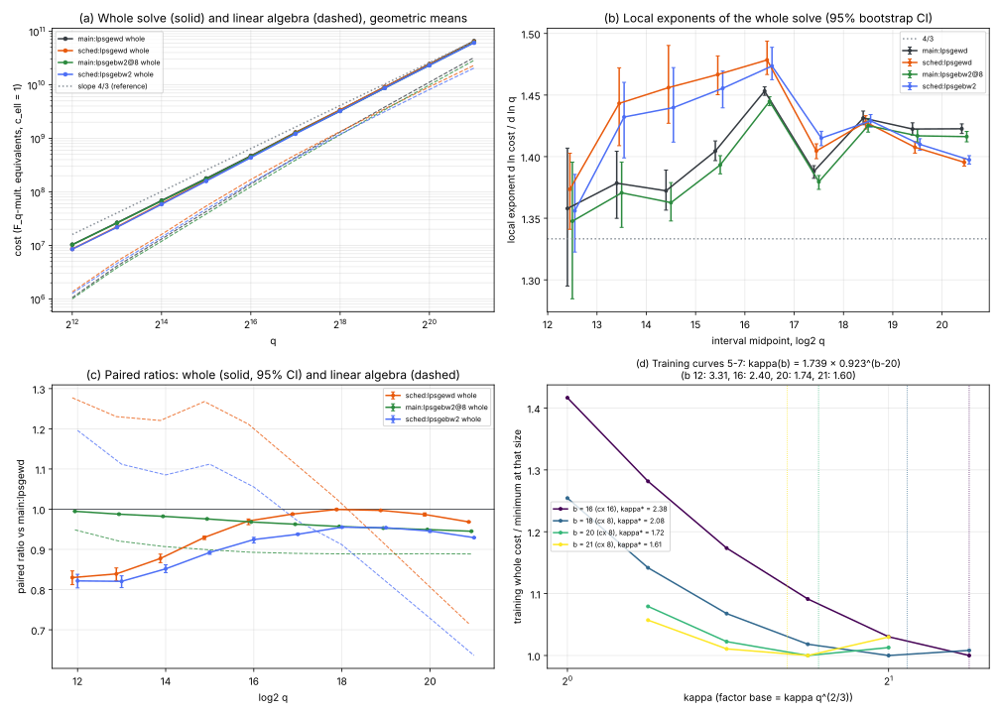

# Round 2, item 06: a kappa schedule and block Wiedemann for genus-3 IC after the cubic GHS transfer

2026-10-15. Round rules: [../RULES.md](../RULES.md) (this item ran alone: 3 single-threaded jobs, 8 GB, 60 min each).
Protocol, frozen before data, with amendments B0-B2: [PROTOCOL.md](PROTOCOL.md). Prior work:
[item 01](../01-genus3-linalg/README.md).

- Tool: [`examples/ic_improve2_06_genus3_kappa_bw.rs`](../../../examples/ic_improve2_06_genus3_kappa_bw.rs), a copy of item 01's
  instrument with block Wiedemann and per-arm cx added. `src/` is not touched.
- Analysis: [`examples/ic_improve2_06_analyze.rs`](../../../examples/ic_improve2_06_analyze.rs).
- Figure: [plot.py](plot.py), which only plots `summary.json` and `train.json`.
- Records: [results/run/](results/run/) (test) and [results/train/](results/train/) (training).
- Tables: [analysis.md](results/run/analysis.md), [analysis_aa.md](results/run/analysis_aa.md),
  [train.md](results/train/train.md) and [gate0.md](results/run/gate0.md).

## Verdict

The incumbent is item 01's **`lpsgewd` at kappa = 2, cx = 8** (`main:lpsgewd`). It keeps large primes as columns,
runs structured Gaussian elimination (SGE), then scalar Wiedemann.

The design:
- held-out test curves 0-2 at q = 2^12..2^21, plus curves 3 and 4 at 2^18..2^21 (5 curves at the top four sizes);
- paired on instance, target and walk;
- the counted unit `M_q + ceil(log2 q) I_q + M_ell`;
- 2000 paired bootstrap resamples.

**2^21 is the top size.** The instrument cannot build a 2^22 instance: #E(F_{q^3}) ~ 2^66 overflows its `u64`
(amendment B2). This is an instrument limit, not a time limit.

The A/A noise floors (`aa:lpsgewd` against `main:lpsgewd`, 3 curves):
- exponent: Delta -0.0004 [-0.0028, +0.0021] over 12..21, so eps_e = 0.0028;
- over 16..21 the A/A Delta is +0.0037 [+0.0020, +0.0056]. The 3-curve bootstrap undercovers there, as in item 01;
- per-size ratios lie within 0.986..1.009, so eps_c = 0.014.

| candidate | exponent, whole 12..21: slope, Delta [95%] | constant: paired ratio at 2^21 [95%] | other levels | verdict |
|---|---|---|---|---|
| incumbent `main:lpsgewd` | 1.408 [1.405, 1.410] | 1 (6.54e10) | local exponent 20-21: 1.423; trend +0.0082/bit | - |
| **(1) kappa schedule** `sched:lpsgewd` | 1.435; **+0.0275 [+0.0258, +0.0293]** (REGRESSES); 16..21: -0.0024 [-0.0037, -0.0009] (MATCHES, inside eps 0.0056) | **0.968 [0.968, 0.969]** (ADVANCES); <= 1 at every size, 0.83 at 2^12 | relation phase +0.097 and LA phase -0.154 (exponent, 16..21); `c_ell = 9`: -0.051 [-0.056, -0.047] (ADVANCES) | **TRADES** (exponent REGRESSES, constant ADVANCES) |
| **(2) block Wiedemann** `main:lpsgebw2@8` | 1.399; **-0.0082 [-0.0083, -0.0081]** (ADVANCES, small) | **0.945 [0.945, 0.945]** (ADVANCES) | primitive, LA ratio **0.889 [0.888, 0.889]** (ADVANCES); trend difference +0.0005 (no flattening) | **ADVANCES** (exponent, constant, primitive) |
| **(3) combination** `sched:lpsgebw2` | 1.431; **+0.0236 [+0.0219, +0.0253]** (REGRESSES); 16..21: +0.0003 [-0.0010, +0.0018] (MATCHES) | **0.929 [0.928, 0.930]** (ADVANCES) | LA ratio 0.636 at 2^21 | **TRADES** (exponent REGRESSES, constant ADVANCES) |

**Does the local-exponent trend flatten toward 4/3?** Yes for the schedule and the combination, no for block
Wiedemann alone.

| arm | local exponent 20-21 | trend per bit, 12..21 | paired trend difference [95%] | flattens (protocol rule) |
|---|---|---|---|---|
| incumbent | 1.423 [1.419, 1.427] | +0.0082 [+0.0057, +0.0124] | - | - |
| (1) schedule | **1.395 [1.392, 1.398]** | **-0.0023 [-0.0043, -0.0002]** | **-0.0105 [-0.0125, -0.0086]** | **yes** |
| (2) block Wiedemann | 1.416 [1.412, 1.420] | +0.0087 | +0.0005 [+0.0005, +0.0006] | no |
| (3) combination | **1.397 [1.394, 1.401]** | +0.0006 [-0.0014, +0.0027] | **-0.0076 [-0.0096, -0.0057]** | **yes** |

**How to read the schedule's "exponent REGRESSES".**
- The frozen schedule is kappa(b) = 1.739 x 0.9225^(b-20):
  - 3.31 at 2^12 and 2.04 at 2^18;
  - 1.60 at 2^21.
- It is cheaper than the incumbent at every size. The paired ratio is U-shaped:
  - 0.83 at 2^12-2^13, where the schedule extrapolates to kappa > 3, below the training range;
  - 1.00 at 2^18, where kappa(18) = 2.04 is nearly the incumbent's kappa;
  - 0.968 at 2^21.
- A least-squares slope over 2^12..2^21 therefore rises, because the large constant gain at small q shrinks toward 2^18.
- The scale question is answered by the local exponents. Above 2^18 the schedule's local exponent falls with every bit (1.428, 1.408, 1.395), while the incumbent's stays at 1.42-1.43.
- The fitted 12..21 exponent is still the protocol's exponent level, so the frozen verdict is TRADES.
- Over 16..21 the schedule matches the incumbent's slope (1.419 against 1.422) and its trend is flat. It sits at about 1.40, not at 4/3: the distance from 4/3 is about 0.06.

**What the schedule does.**
- Smaller kappa at large q moves cost from the linear algebra to the walk:
  - at 2^21 the relation phase costs 1.214 times the incumbent's;
  - the linear algebra costs 0.716 times the incumbent's, on 26.6k solver columns against 31.5k;
  - the LA local exponent at 20-21 is 1.334 against 1.528.
- The relation phase's local exponent rises to 1.43, against 1.33 for the incumbent. At these sizes it is the relation phase, not the linear algebra, that now holds the exponent near 1.4.
- With `c_ell = 9` (dearer LA products) the schedule wins at both levels: its exponent Delta is -0.051.

**Block Wiedemann: does it change the counted cost, or only its parallelism?**
- **The (m, 1) blocking changes the single-threaded counted cost.** This is blocking (m, 1): m free coordinate projections and one right vector.
  - It needs N (1 + 1/m) matrix-vector products instead of 2N: measured 1.501 N against 2.001 N at m = 2.
  - The price is the generator (an order basis of [A(x) | -I_m]). Its share of the LA products rises from 6% to 21%.
  - Net effect on the LA cost: **0.889** at every size from 2^17 to 2^21.
  - Net effect on the whole solve: 0.945 at 2^21, a ratio that keeps falling with q as the LA share grows.
- m = 3 is worse: LA 0.934, whole 0.967. m = 4 is worse again (training). Each extra projection saves N/m(m+1) products but adds about m N^2 generator products. The training rule froze m\* = 2.
- **The symmetric blocking (n = m right vectors), the usual block Wiedemann, changes only parallelism.**
  - Single-threaded it needs n (N/m + N/n) = 2N single-vector products, the same as scalar Wiedemann, and its generator is larger. So its counted cost cannot fall below the scalar arm's.
  - It was not built. This is stated from the operation count, not measured.
- The LA exponent is unchanged above 2^16: Delta -0.0010 [-0.0013, -0.0006]. Block Wiedemann is a constant-level change to the linear algebra.
- The whole-solve exponent gain (-0.008) comes only from the LA share growing with q.
- LA wall times are not part of any claim. At 2^21 the mean LA wall time was 223 s for scalar and 189 s for m = 2 (m = 3: 183 s).

**References** (not part of any verdict):
- Old IC-2LP (item 01's `main:inc`) on curves 0-2 at 2^21: the incumbent here is 0.652 of it and the combination is **0.605** of it.
- At 2^20 the combination costs 2.31e10 (5 curves). Item 01's measured negation-map rho on curves 0-2 costs 2.01e10 there.



*Panel (a): geometric-mean cost per size of the whole solve (solid) and of the linear algebra (dashed), in F_q-multiplication equivalents with `c_ell = 1`; the slope-4/3 line is a reference.*

*Panel (b): local exponents of the whole solve with 95% bootstrap CIs.*

*Panel (c): paired ratios against `main:lpsgewd`, whole (solid, CI) and linear algebra (dashed).*

*Panel (d): training (curves 5-7). Whole cost against kappa at each training size, normalised to its minimum. Dotted lines mark kappa\*(b); the title gives the frozen schedule.*

*Test run [results/run](results/run/): 3 curves at 2^12..2^17 and 5 at 2^18..2^21.*

## Per-size paired ratios against `main:lpsgewd`

All ratios are paired against `main:lpsgewd`: the geometric mean of per-curve ratios, with a 95% bootstrap CI.
The full tables, with solver sizes, mat-vec counts and the product split, are in [analysis.md](results/run/analysis.md).

| log2 q | n | incumbent cost | kappa(b), cx | (1) schedule whole | (1) LA | (2) block m=2 whole | (2) LA | (3) combination whole | A/A |
|---|---|---|---|---|---|---|---|---|---|
| 12 | 3 | 1.03e7 | 3.31, 16 | 0.830 [0.812, 0.847] | 1.28 | 0.995 | 0.949 | 0.822 [0.804, 0.838] | 1.009 |
| 13 | 3 | 2.65e7 | 3.06, 16 | 0.839 [0.823, 0.854] | 1.23 | 0.988 | 0.921 | 0.821 [0.805, 0.834] | 1.005 |
| 14 | 3 | 6.89e7 | 2.82, 16 | 0.878 [0.867, 0.888] | 1.22 | 0.982 | 0.907 | 0.852 [0.842, 0.862] | 0.992 |
| 15 | 3 | 1.78e8 | 2.60, 16 | 0.930 [0.924, 0.933] | 1.27 | 0.976 | 0.899 | 0.892 [0.888, 0.895] | 0.995 |
| 16 | 3 | 4.71e8 | 2.40, 16 | 0.971 [0.961, 0.976] | 1.21 | 0.968 | 0.893 | 0.924 [0.916, 0.930] | 0.986 |
| 17 | 3 | 1.29e9 | 2.21, 16 | 0.988 [0.986, 0.989] | 1.12 | 0.963 | 0.890 | 0.938 [0.936, 0.939] | 0.990 |
| 18 | 5 | 3.37e9 | 2.04, 8 | 0.999 [0.997, 1.001] | 1.03 | 0.957 | 0.889 | 0.955 [0.953, 0.957] | 1.001 |
| 19 | 5 | 9.10e9 | 1.89, 8 | 0.997 [0.996, 0.998] | 0.92 | 0.953 | 0.888 | 0.954 [0.953, 0.955] | 1.002 |
| 20 | 5 | 2.44e10 | 1.74, 8 | 0.987 [0.983, 0.991] | 0.82 | 0.949 | 0.889 | 0.946 [0.942, 0.949] | 1.003 |
| 21 | 5 | 6.54e10 | 1.60, 8 | **0.968 [0.968, 0.969]** | 0.72 | **0.945 [0.945, 0.945]** | 0.889 | **0.929 [0.928, 0.930]** | 0.997 |

The A/A column is over curves 0-2 only ([analysis_aa.md](results/run/analysis_aa.md)).

## Training (curves 5, 6, 7; never in a test fit)

Amendment B1 applied the frozen rules ([train.md](results/train/train.md)). All 60 training jobs returned the verified `k`.

| b | cx(b) | grid-best kappa | quadratic kappa\* |
|---|---|---|---|
| 16 | 16 | 2.38 | 2.38 (clamped at the grid edge) |
| 18 | 8 | 2.00 | 2.08 |
| 20 | 8 | 1.68 | 1.72 |
| 21 | 8 | 1.68 | 1.61 |

- Schedule: ln kappa(b) = 0.5533 - 0.0806 (b - 20).
- m\* = 2. At 2^21 and kappa 2, the LA geometric mean is 2.84e10 for m = 2 against 2.99e10 for m = 3.
- The block solver goes into the combination: whole cost at 2^21 is 6.16e10 for block against 6.51e10 for scalar.
- cx moves little. At 2^16, cx 16 beats cx 8 by 0.2%; from 2^18 up, cx 8 is best. cx 32 is never best.
- On the training curves at 2^21, block Wiedemann at kappa 1.68 is the cheapest training arm: 6.05e10, against 6.51e10 for the incumbent configuration.

## Controls and gates

- **Gate 0**:
  - `main:lpsgewd` reproduces item 01's `main:lpsgewd` records exactly on curves 0-2 at 2^12..2^21: 30/30 identical in `k`, cost and LA counters ([gate0.md](results/run/gate0.md)).
  - The training `lpsgewd@8` records at 2^20 (kappa 1.41 and 2) equal item 01's `tune2` records: 6/6.
- **A/A**: the exponent Delta over 12..21 is -0.0004 [-0.0028, +0.0021], so it covers 0. Per-size ratios lie between 0.986 and 1.009.
- **Correctness**: every logarithm was verified (`k phi(G) = phi(T)`) and equals the planted `k`, with 0 failures:
  - 220 test solves: `main` 3 arms x 38, `sched` 2 x 38, `aa` 30;
  - all training solves.
- **Reformatting check**: after the coordinator's rustfmt and clippy edits, the rebuilt binary reproduced the recorded 2^16 curve-0 `main` and 2^17 curve-1 `sched` records exactly.

## Deviations and limits

- **No 2^22** (amendment B2). The instrument's `u64` group order overflows. The freed budget went to curves 3 and 4 at 2^18..2^21 and to `aa` at 2^21.
- **A/A covers curves 0-2 only.** Its floors (eps_e = 0.0028, eps_c = 0.014) come from 3 curves. The candidates' effects at the constant level (0.93-0.97 at 2^21) lie outside the floor with CIs of width 0.001-0.002.
- **The schedule extrapolates below 2^16.** Its training sizes are 16..21. kappa(12) = 3.31 is outside the training grid, whose top is 2.38, and kappa\*(16) was clamped at that edge.
  - The small-q part of the schedule is therefore untested by training. It drives the exponent-level REGRESSES.
  - A schedule frozen as `max(2, kappa(b))` would by construction equal the incumbent below 2^18 and keep the large-q gains. That was not the frozen rule and is not claimed.
- **The large-prime bound is not tuned.** The instrument treats every prime outside the factor base as a large prime, and only cx co-varied with kappa.
- **Orchestration.** The orchestration shell's 2-hour limit killed two training jobs (2^21, kappa 2, curves 6 and 7). They were rerun unchanged before any rule was applied.
- `main` collections carry both `lpsgebw2@8` and `lpsgebw3@8` (amendment B0). This is booking-neutral.
- The relation phase now holds the exponent. With the schedule its local exponent at 20-21 is 1.43, so further distance to 4/3 must come from the walk, not the solver.

## Reproduce

```bash
cargo build --release --example ic_improve2_06_genus3_kappa_bw --example ic_improve2_06_analyze
cd research/ic_improve_20261015/06-genus3-kappa-bw
A=../../../target/release/examples/ic_improve2_06_analyze
PAR=3 sh run_train.sh results/train "16 18"; PAR=2 sh run_train.sh results/train "20 21"
$A train results/train results/train/train.json > results/train/train.md
$A gatetrain results/train ../01-genus3-linalg/results/tune2
PAR=1 sh run_test.sh results/run main  "12 13 14 15 16 17 18 19 20 21" "0 1 2"
PAR=1 sh run_test.sh results/run main  "18 19 20 21" "3 4"
PAR=1 sh run_test.sh results/run aa    "12 13 14 15 16 17 18 19 20 21" "0 1 2"
PAR=2 sh run_test.sh results/run sched "12 13 14 15 16 17 18 19 20 21" "0 1 2"   # sched.env = amendment B1
PAR=2 sh run_test.sh results/run sched "18 19 20 21" "3 4"
$A gate results/run ../01-genus3-linalg/results/run > results/run/gate0.md
$A analyze results/run 12 21 16 results/run/summary.json main:lpsgewd sched:lpsgewd main:lpsgebw2@8 sched:lpsgebw2 main:lpsgebw3@8 > results/run/analysis.md
$A analyze results/run 12 21 16 results/run/summary_aa.json main:lpsgewd aa:lpsgewd > results/run/analysis_aa.md
python3 -I plot.py results/run results/train/train.json main:lpsgewd sched:lpsgewd main:lpsgebw2@8 sched:lpsgebw2
```

Toolchain, host and binary hashes: [results/run/env.txt](results/run/env.txt). Phase scripts as run: `run_phase1.sh`,
`run_phase1b.sh`, `run_phase2a.sh`, `run_phase2b.sh`.
